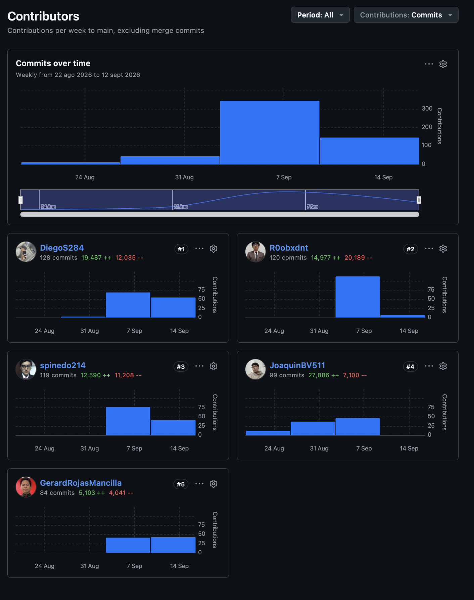
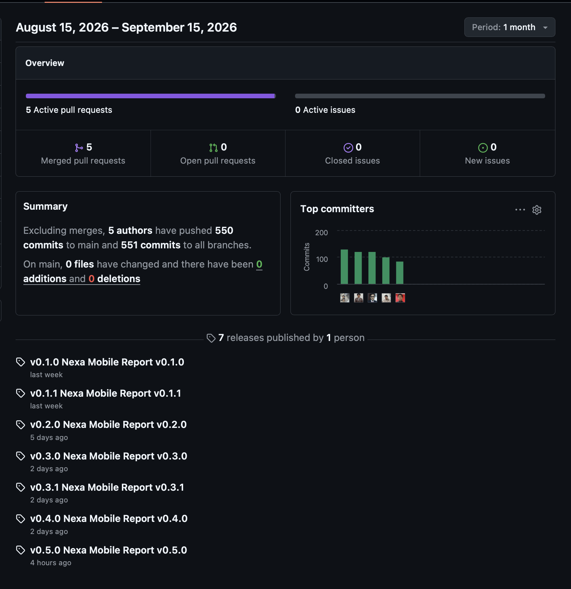
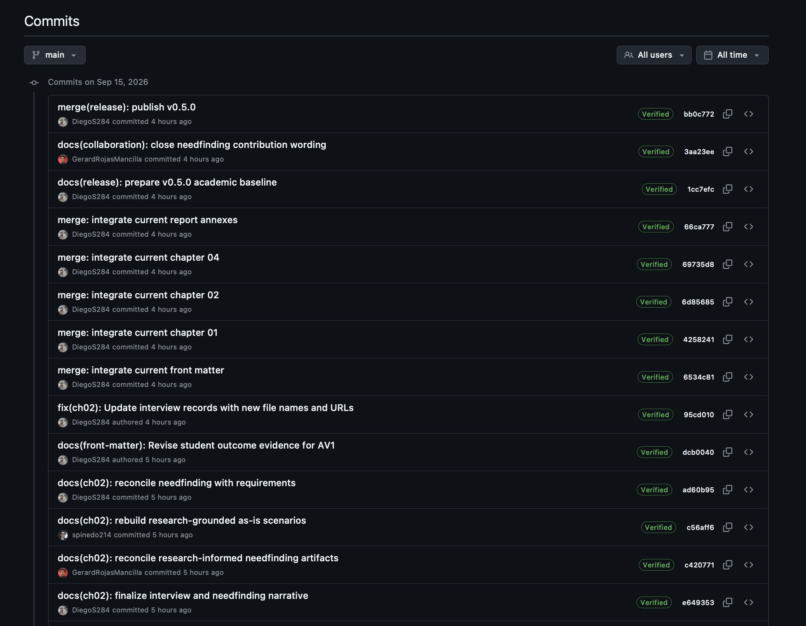
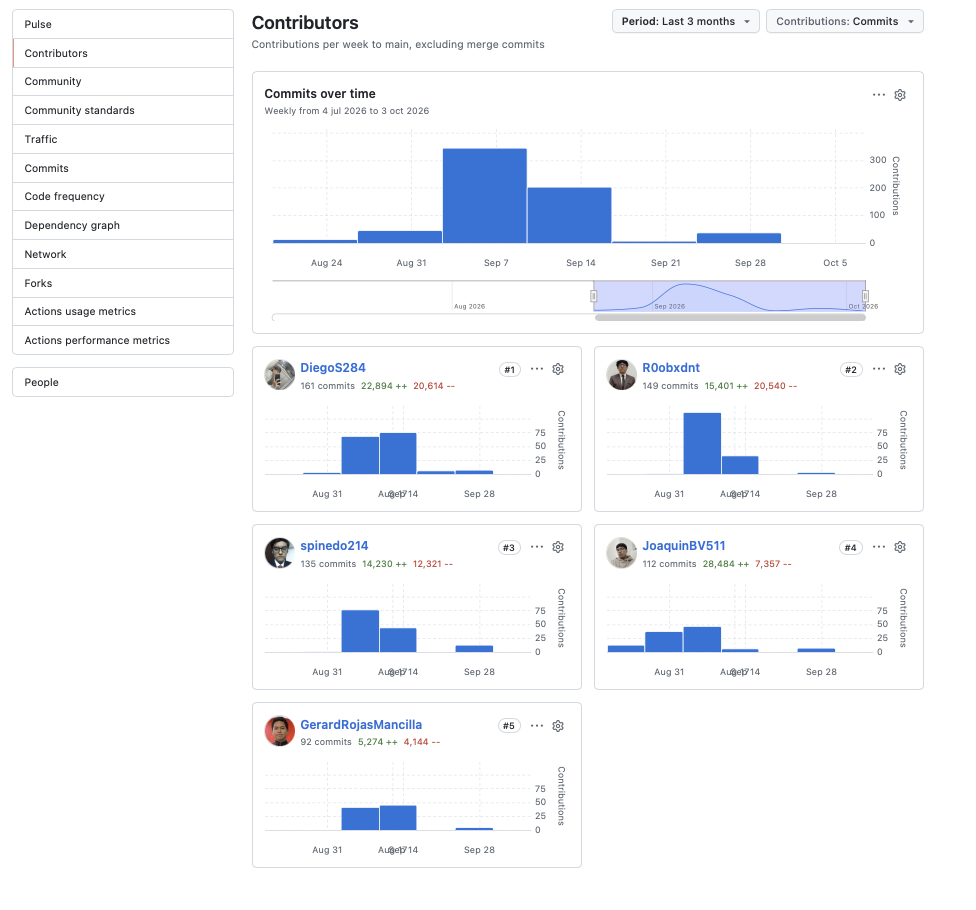
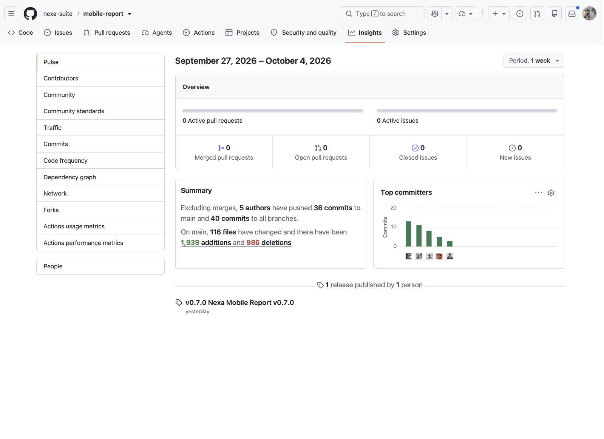
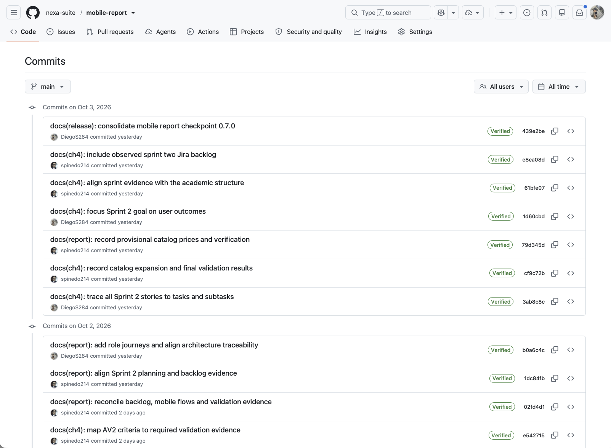

# Project Report Collaboration Insights

Repositorio del informe: [nexa-suite/mobile-report](https://github.com/nexa-suite/mobile-report).

Esta sección presenta la evolución documental del informe entre el primer avance (AV1) y el trabajo parcial 1 (TB1), los aportes representativos de los cinco integrantes y las evidencias de actividad conservadas para cada corte. Las publicaciones del informe y las estadísticas de GitHub cumplen funciones distintas: las primeras permiten identificar cambios documentales; las segundas muestran actividad de cuentas y del repositorio en periodos determinados.

**Evolución entre AV1 y TB1**

La Tabla 1 reúne los hitos de publicación directamente relacionados con ambas entregas. AV1 consolidó la investigación, los requisitos, el diseño de dominio y arquitectura y la planificación académica; TB1 amplió la documentación de diseño UX/UI y las evidencias de ingeniería del Sprint 2.

**Tabla 1**

*Aportes documentales incorporados por versión del informe*

| Entrega y alcance | Versión del informe | Aporte documental distintivo |
| --- | --- | --- |
| AV1 — cierre oficial | [1.0.1](https://github.com/nexa-suite/mobile-report/releases/tag/v1.0.1) | Publicó la revisión final de AV1, con Needfinding, requisitos, Product Backlog, DDD, arquitectura y evidencia académica consolidados. Ajustó la redacción de las Spike Stories sin alterar el alcance del proyecto. |
| TB1 — línea base | [1.1.0](https://github.com/nexa-suite/mobile-report/releases/tag/v1.1.0) | Estableció el punto de partida de TB1 y conservó el estado del informe anterior a la incorporación de las nuevas evidencias visuales y las revisiones de diseño. |
| TB1 — consolidación | [2.0.0](https://github.com/nexa-suite/mobile-report/releases/tag/v2.0.0) | Consolidó Style Guidelines, prototipos y videos, wireframes, mockups, wireflows y User Flows; actualizó la documentación del incremento Operations Mobile v1.0.1 y recuperó la presentación del repositorio. |
| TB1 — revisión documental | [2.0.1](https://github.com/nexa-suite/mobile-report/releases/tag/v2.0.1) | Refinó el registro de versiones, la colaboración y Student Outcome; amplió las guías de estilo y la arquitectura de información, y actualizó la documentación de SCM, servicios, despliegue y responsabilidades del Sprint 2. |

*Nota.* Elaboración propia a partir de las publicaciones oficiales del repositorio Nexa Mobile Report. Se incluyen los hitos vinculados directamente con AV1 y TB1, no el historial exhaustivo de versiones o prereleases. Las versiones de Operations Mobile, API y Website corresponden a repositorios independientes; mencionarlas en este cuadro no implica que el informe sea una release de dichas aplicaciones.

La evolución entre AV1 y TB1 se aprecia en el paso de los artefactos de investigación y planificación a los recursos visuales del capítulo III y a los registros técnicos del capítulo IV. La presencia de documentación de implementación, pruebas o despliegue no equivale, por sí sola, a la aceptación de todos los recorridos de usuario ni al cierre del producto móvil.

La Tabla 2 sintetiza los aportes documentales por integrante y entrega, de acuerdo con la evidencia de colaboración y aprendizaje registrada en el informe.

**Tabla 2**

*Aportes representativos de los integrantes en AV1 y TB1*

| Integrante | AV1 | TB1 |
| --- | --- | --- |
| Pinedo Sanchez, Sebastián Martín | Sistematizó escenarios As-Is, caracterización de segmentos y evidencia de planificación del Sprint 1. | Relacionó criterios de distribución y alcance táctil con los diseños, revisó el backlog observado del Sprint 2 y organizó su trazabilidad documental. |
| Rojas Mancilla, Gerard Gianpier | Vinculó Needfinding con los modelos DDD y C4 en Structurizr y con la trazabilidad del Product Backlog en Jira. | Documentó wireframes de la Landing Page, evidencia de instalación Android y recorridos técnicos registrados durante Sprint 2. |
| Torrejón De Los Santos, Gino Rodrigo | Sistematizó registros de entrevistas, planificación del Product Backlog y verificación técnica documentada del Sprint 1. | Relacionó composiciones de la Landing Page con registros de navegación y contratos de servicio documentados para Sprint 2. |
| Verde Bueno, Joaquín Francisco | Contribuyó a la organización de responsabilidades de Sprint y a la revisión de coherencia de la evidencia visual y del lenguaje público del informe. | Incorporó referencias de tipografía móvil y documentó comprobaciones técnicas de API y publicación Android. |
| Yucra Sandoval, Diego Sebastián | Integró la evidencia de Student Outcome y la trazabilidad de versiones, dominio, arquitectura y datos. | Revisó la integración documental de los capítulos III y IV y del front matter, el registro de versiones y la consistencia de la evidencia de servicios y despliegue. |

*Nota.* Síntesis cualitativa de los aportes expuestos en el informe, especialmente en Student Outcome y las secciones de diseño, SCM y Sprint. No constituye una clasificación por cantidad de commits ni atribuye automáticamente a una persona toda la actividad registrada desde su cuenta de GitHub.

**Evidencia de colaboración en AV1**

Las Figuras 1 a 3 corresponden a capturas del 15 de septiembre de 2026. Documentan la actividad visible antes de la publicación final de AV1, versión 1.0.1, del 17 de septiembre. Los indicadores de Contributors, Pulse e historial de commits tienen alcances diferentes y deben interpretarse dentro de la fecha y el periodo de cada captura.

**Figura 1**

*Participación de las cuentas colaboradoras en Nexa Mobile Report durante el corte de AV1*

*Nota.* Captura de la vista Contributors de GitHub del 15 de septiembre de 2026. La actividad acumulada que muestra esta vista no equivale exclusivamente al trabajo de AV1 ni determina la calidad de los aportes individuales.

**Figura 2**

*Actividad del repositorio Nexa Mobile Report registrada por GitHub Pulse en AV1*

*Nota.* Captura de la vista Pulse de GitHub del 15 de septiembre de 2026. Los indicadores describen la ventana temporal presentada por GitHub y no representan todo el historial de la entrega.

**Figura 3**

*Historial de commits de Nexa Mobile Report en el corte documental de AV1*

*Nota.* Captura del historial del repositorio en GitHub del 15 de septiembre de 2026. Es anterior a la publicación final de AV1 del 17 de septiembre; por tanto, no acredita los cambios incorporados después del momento capturado.

**Evidencia de colaboración en TB1**

Las Figuras 4 y 5 corresponden a capturas de actividad del 4 de octubre de 2026; la Figura 6 registra el historial observado el 3 de octubre. Estas evidencias muestran un corte inicial de TB1, anterior a las publicaciones 1.1.0, 2.0.0 y 2.0.1 de los días 5 y 6 de octubre. Los cambios de esas publicaciones se identifican mediante sus respectivas releases, no mediante capturas tomadas con anterioridad.

**Figura 4**

*Participación de las cuentas colaboradoras en Nexa Mobile Report durante el corte inicial de TB1*

*Nota.* Captura de la vista Contributors de GitHub del 4 de octubre de 2026. Los totales corresponden al intervalo acumulado que muestra la gráfica y no exclusivamente a las actividades de TB1.

**Figura 5**

*Actividad de Nexa Mobile Report registrada por GitHub Pulse durante el corte inicial de TB1*

*Nota.* Captura de la vista Pulse de GitHub del 4 de octubre de 2026, correspondiente a la ventana semanal mostrada para el corte inicial de TB1. No incluye las publicaciones documentales posteriores.

**Figura 6**

*Historial de commits de Nexa Mobile Report registrado el 3 de octubre de 2026*

*Nota.* Captura del historial del repositorio en GitHub del 3 de octubre de 2026. Corresponde a un checkpoint documental anterior a la línea base y a la consolidación oficial de TB1.

En conjunto, las capturas permiten observar participación y actividad registrada, mientras que las releases y los apartados de los capítulos III y IV documentan el contenido incorporado y sus evidencias técnicas. Estas fuentes son complementarias, pero no sustituyen una verificación de implementación, pruebas integradas, aceptación de producto o finalización de los cuatro Sprints.
