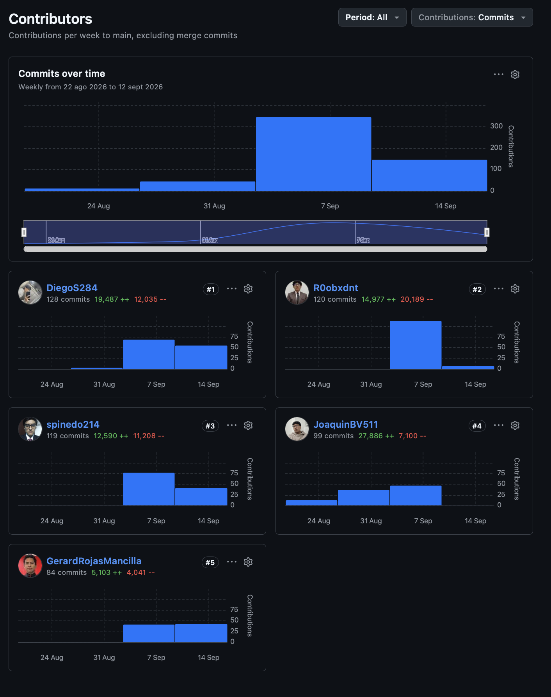
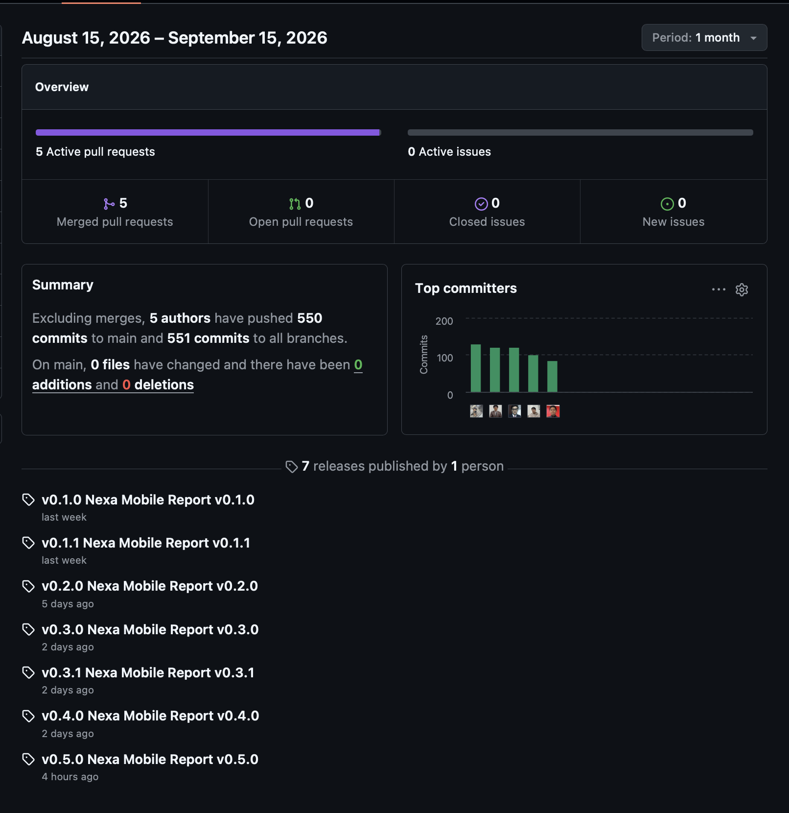
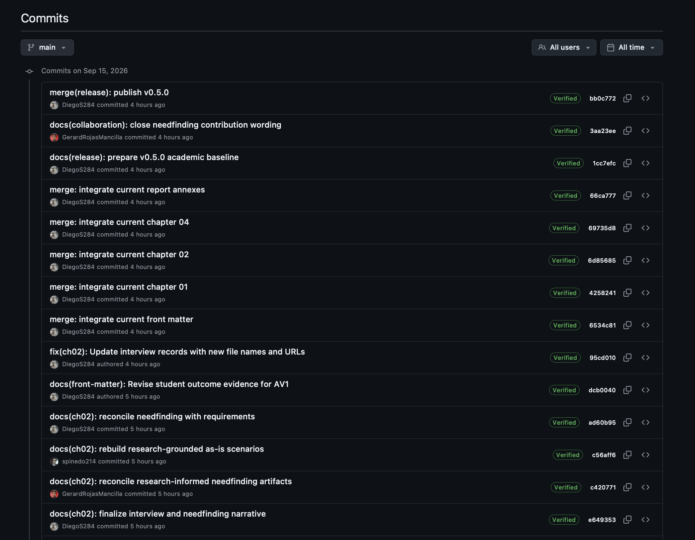
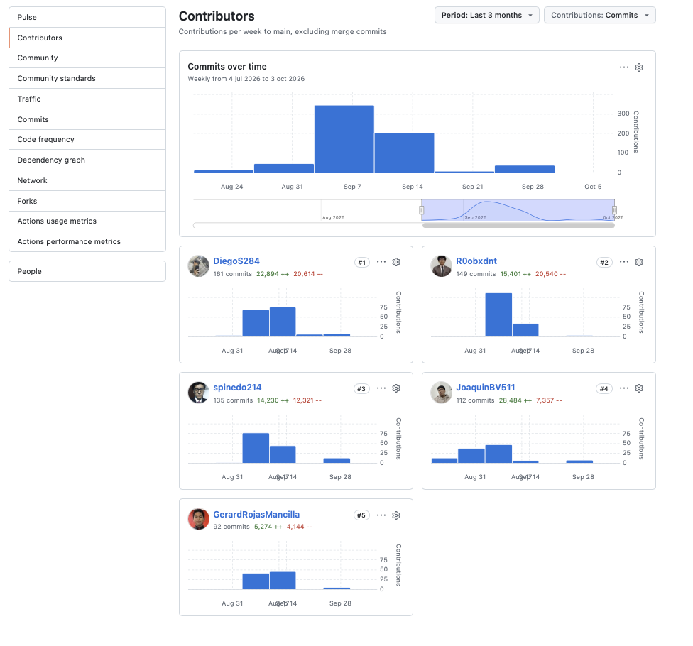
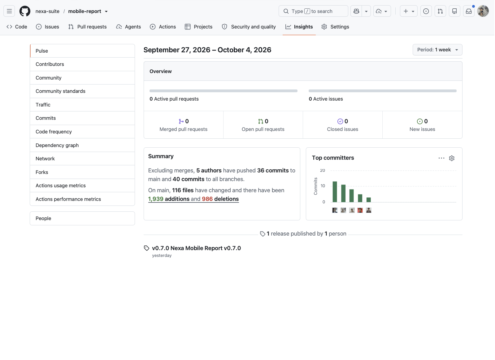
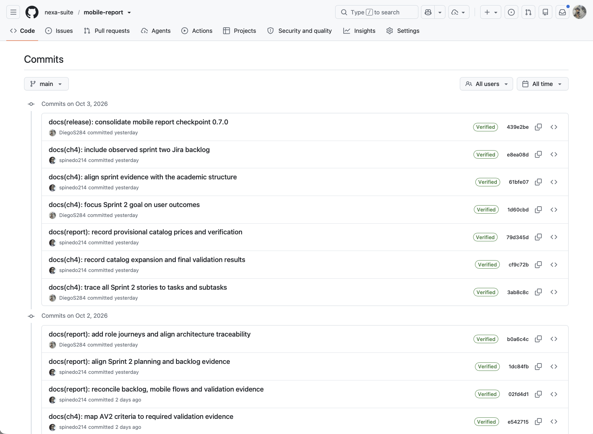

# Project Report Collaboration Insights

Repositorio del informe: nexa-suite/mobile-report.

Aquí se muestran los principales avances del informe desde AV1 hasta AV2, considerando los aportes de los integrantes de nexa-team y las evidencias de colaboración registradas durante cada entrega. Se incluyen las actualizaciones de los capítulos III y IV, el trabajo relacionado con los Sprints y la participación del equipo en la organización, revisión e integración de la documentación.

Las versiones del informe permiten identificar los cambios realizados en cada entrega, mientras que las estadísticas de GitHub ofrecen una referencia de la actividad registrada en el repositorio. Ambas fuentes se utilizan de manera complementaria, ya que el número de commits no refleja necesariamente la cantidad o calidad del trabajo de cada integrante.

## Evolución del informe entre AV1, TB1 y AV2

El informe ha pasado por tres etapas principales. En AV1 se establecieron las bases de investigación, requisitos y arquitectura. Durante TB1 se amplió el diseño de la solución y la documentación de implementación. Finalmente, para AV2 se desarrolló con mayor detalle el capítulo III, se revisó el capítulo IV y se incorporaron los avances del Sprint 3.

**Tabla**

*Principales actualizaciones documentales del Nexa Mobile Report*

| Entrega | Versión | Principales avances |
| --- | --- | --- |
| AV1 | 1.0.1 | Se consolidaron Lean UX, Needfinding, requisitos, Product Backlog, Domain-Driven Design, arquitectura de software y la planificación inicial de los Sprints. |
| TB1 | 1.1.0 | Se estableció la base documental para la segunda entrega y la organización de los nuevos avances. |
| TB1 | 2.0.0 | Se incorporaron Style Guidelines, wireframes, mockups, wireflows, prototipos y User Flows. También se actualizó la documentación de implementación y del Sprint 2. |
| TB1 | 2.0.1 | Se realizaron ajustes en el registro de versiones, arquitectura de información, evidencias de colaboración, Student Outcome y documentación técnica de servicios y despliegue. |
| AV2 | 3.0.0 | Se amplió el capítulo III con el desarrollo de sus apartados de diseño UI/UX. Se mejoró el capítulo IV y se completó la documentación del Sprint 3, incluyendo planificación, responsabilidades, backlog y evidencias técnicas. También se actualizaron las contribuciones y los aprendizajes del equipo. |

*Nota.* Elaboración propia a partir de las versiones y de los avances documentados en Nexa Mobile Report. Las versiones mencionadas corresponden al informe académico y deben diferenciarse de las publicaciones independientes de Nexa Mobile, Nexa API y Nexa Website.

En AV2, el equipo se concentró principalmente en completar los apartados de diseño y relacionarlos con el avance de las aplicaciones móviles. Esto permitió presentar de forma más ordenada las decisiones de interfaz, los recorridos de usuario y la documentación técnica que respalda el desarrollo del producto.

## Aportes de los integrantes

Los aportes se organizaron considerando el trabajo documentado en cada entrega y las responsabilidades asociadas con los capítulos y Sprints. La participación se distribuyó entre investigación, diseño, revisión técnica, desarrollo e integración de evidencias.

**Tabla**

*Aportes representativos de los integrantes durante AV1, TB1 y AV2*

| Integrante | AV1 | TB1 | AV2 |
| --- | --- | --- | --- |
| Pinedo Sanchez, Sebastián Martín | Participó en la organización de escenarios As-Is, segmentos objetivo y evidencias de planificación del Sprint 1. | Relacionó criterios de diseño móvil con la organización de pantallas, el seguimiento del backlog y la documentación del Sprint 2. | Revisó los recorridos de reparto y recepción del comprador, además de las evidencias de entrega y funcionalidades móviles del Sprint 3. |
| Rojas Mancilla, Gerard Gianpier | Relacionó los resultados de Needfinding con los modelos DDD, C4 y la trazabilidad del Product Backlog. | Trabajó en la documentación de wireframes de la Landing Page y la revisión de recorridos operativos e instalación Android. | Revisó los User Flows y documentó escenarios de entregas parciales, rechazos y discrepancias correspondientes al Sprint 3. |
| Torrejón De Los Santos, Gino Rodrigo | Participó en la organización de entrevistas, Product Backlog y evidencias técnicas del Sprint 1. | Relacionó diseños de la Landing Page con navegación, servicios y procesos operativos documentados en Sprint 2. | Revisó criterios de navegación, privacidad y compatibilidad de contratos entre las aplicaciones móviles y Nexa API. |
| Verde Bueno, Joaquín Francisco | Contribuyó a la revisión de la documentación, el lenguaje utilizado y la consistencia de las evidencias del proyecto. | Revisó referencias tipográficas, recursos de diseño móvil y comprobaciones técnicas relacionadas con API y Android. | Revisó escenarios de recuperación, notificaciones y ubicación, manteniendo la coherencia entre interfaces y procesos operativos. |
| Yucra Sandoval, Diego Sebastián | Integró evidencias de Student Outcome, versiones, arquitectura y trazabilidad documental. | Revisó la integración de los capítulos III y IV, el front matter y la documentación de servicios y despliegue. | Integró evidencias técnicas del Sprint 3 y revisó la documentación, los cambios de autenticación y la recuperación de acceso biométrico. |

*Nota.* Los aportes se presentan como una síntesis cualitativa de las actividades y responsabilidades documentadas. No constituyen una distribución basada exclusivamente en commits ni implican que cada integrante haya desarrollado de manera individual todas las funcionalidades asociadas con su área.

## Avances realizados para AV2

### Actualización del capítulo III: Solution UI/UX Design

Durante AV2 se completó el desarrollo documental de los apartados del capítulo III. Se revisaron las guías generales de estilo y se organizó la información relacionada con la identidad visual de Nexa, el uso de colores, tipografía, componentes, espaciado y criterios de accesibilidad.

También se amplió la arquitectura de información, considerando los sistemas de organización, etiquetado, búsqueda y navegación. Estas decisiones se adaptaron a las distintas experiencias del producto: el sitio web público, Operations Mobile y Buyer Mobile.

En el diseño de la Landing Page se consolidaron wireframes y mockups que permiten visualizar la distribución del contenido, la jerarquía de las secciones y la adaptación de las páginas a diferentes tamaños de pantalla.

Para las aplicaciones móviles se desarrolló la documentación de wireframes, wireflows, mockups, User Flows y prototipado. Estos recursos ayudan a explicar los recorridos de autenticación, consulta de productos, identificación mediante cámara o búsqueda manual, operaciones de almacén y las actividades previstas para repartidores y compradores.

Uno de los principales avances fue relacionar los diseños con las necesidades identificadas durante Needfinding y con las historias de usuario del proyecto. De esta manera, las pantallas y sus recorridos mantienen una conexión con los requisitos y con las acciones que cada usuario necesita realizar.

### Mejoras del capítulo IV: Product Implementation & Validation

El capítulo IV fue revisado para presentar con mayor claridad la configuración del proyecto, las herramientas utilizadas y las evidencias de los avances técnicos.

Se actualizaron los apartados de Software Configuration Management, manteniendo la documentación de los repositorios, las convenciones de desarrollo y los entornos utilizados por el equipo. Asimismo, se organizaron los registros de implementación para facilitar la identificación de versiones, componentes y resultados técnicos.

La revisión permitió relacionar mejor los artefactos de diseño del capítulo III con las actividades de desarrollo y verificación del capítulo IV. Esto resulta importante porque las decisiones presentadas en wireframes y User Flows deben poder contrastarse con el comportamiento de las aplicaciones y los servicios.

También se reforzó la separación entre evidencias de código, pruebas automatizadas, ejecución y despliegue. Cada una documenta una parte diferente del desarrollo y permite identificar con mayor precisión qué resultados se han comprobado y cuáles todavía requieren validación funcional.

### Incorporación del Sprint 3

Uno de los avances principales de AV2 fue la documentación completa de las secciones correspondientes al Sprint 3.

El Sprint 3 se organizó alrededor de las funcionalidades de entrega y recepción de mercadería. Su alcance incluye la consulta de entregas asignadas, el inicio de intentos de entrega, el registro de resultados y evidencias, las entregas parciales y el seguimiento de pedidos por parte de los compradores.

La planificación contempla 29 elementos del Product Backlog y 129 Story Points, distribuidos entre funcionalidades móviles, tareas técnicas e investigaciones. También se documentó la matriz de líderes y colaboradores, junto con el desglose de actividades y responsabilidades.

Se incorporaron evidencias de desarrollo de Operations Android y Buyer Flutter relacionadas con la navegación, el seguimiento de entregas y la recepción del comprador. Entre los registros de integración destacan los Pull Requests #72, #73 y #74 del repositorio Nexa Mobile, correspondientes a la integración de funcionalidades y a correcciones específicas de acceso.

En cuanto a las verificaciones técnicas, se documentaron ejecuciones satisfactorias de GitHub Actions para las aplicaciones móviles y Nexa API. También se registraron comprobaciones de instalación de las aplicaciones, documentación de servicios mediante Swagger UI y evidencias de infraestructura en Render y Neon.

El Sprint 3 permitió reunir en un mismo apartado la planificación, las responsabilidades, el código integrado y las evidencias de prueba y despliegue. Aunque se documentaron avances importantes, las comprobaciones disponibles todavía no acreditan la aceptación funcional completa de todos los recorridos de entrega y recepción. Esta diferencia se mantiene indicada en el capítulo IV.

## Evidencia de colaboración en AV1

Las siguientes figuras corresponden a capturas realizadas el 15 de septiembre de 2026. Presentan la actividad del repositorio durante el corte previo a la entrega final de AV1.

**Figura**

*Participación de las cuentas colaboradoras en Nexa Mobile Report durante AV1*

*Nota.* Vista Contributors de GitHub correspondiente al 15 de septiembre de 2026. La gráfica presenta contribuciones acumuladas y no exclusivamente las actividades desarrolladas para AV1.

**Figura**

*Actividad del repositorio registrada mediante GitHub Pulse durante AV1*

*Nota.* Captura de GitHub Pulse del 15 de septiembre de 2026. Los indicadores corresponden al periodo seleccionado en la herramienta.

**Figura**

*Historial de commits de Nexa Mobile Report durante AV1*

*Nota.* Historial registrado el 15 de septiembre de 2026, previo a la publicación final de AV1 del 17 de septiembre.

## Evidencia de colaboración en TB1

Las evidencias de TB1 corresponden a las capturas de actividad registradas el 3 y 4 de octubre de 2026. Permiten observar la participación del equipo durante el periodo inicial de esta entrega y complementan las actualizaciones documentales posteriores.

**Figura**

*Participación de los colaboradores de Nexa Mobile Report durante TB1*

*Nota.* Captura de Contributors del 4 de octubre de 2026. Los totales representan la actividad acumulada que muestra GitHub.

**Figura**

*Actividad del repositorio registrada mediante GitHub Pulse durante TB1*

*Nota.* Captura de GitHub Pulse del 4 de octubre de 2026. La información corresponde al intervalo seleccionado y no representa todo el trabajo de TB1.

**Figura**

*Historial de commits de Nexa Mobile Report durante el corte inicial de TB1*

*Nota.* Registro del 3 de octubre de 2026, anterior a las principales actualizaciones documentales publicadas para TB1.

## Evidencia de colaboración en AV2

**Fecha de corte documental: 11 de noviembre de 2026.**

Para AV2 se consideran los avances relacionados con la actualización del capítulo III, la revisión del capítulo IV y la incorporación de la documentación del Sprint 3.

Las siguientes figuras están reservadas para registrar la actividad de Nexa Mobile Report en GitHub durante el corte de AV2. Se utilizarán las vistas Contributors, Pulse e historial de commits, manteniendo el mismo criterio empleado en las entregas anteriores.

**Figura**

*Participación de los integrantes en Nexa Mobile Report durante el corte de AV2*

[Contributors de Nexa Mobile Report](https://github.com/nexa-suite/mobile-report/graphs/contributors).

*Nota.* GitHub muestra la participación acumulada según el período seleccionado.

**Figura**

*Actividad del repositorio Nexa Mobile Report registrada mediante GitHub Pulse durante AV2*

[Pulse de Nexa Mobile Report](https://github.com/nexa-suite/mobile-report/pulse).

*Nota.* GitHub muestra la actividad correspondiente al intervalo elegido.

**Figura**

*Historial de commits de Nexa Mobile Report durante el corte de AV2*

[Historial de commits de Nexa Mobile Report](https://github.com/nexa-suite/mobile-report/commits/main).

*Nota.* El historial permite revisar cada cambio por fecha y autor.

## Reflexión sobre el trabajo colaborativo

A lo largo de las tres entregas, el equipo ha organizado el desarrollo del informe mediante una distribución de responsabilidades por capítulos, actividades y Sprints. Esta forma de trabajo permitió avanzar en distintos apartados del proyecto y posteriormente revisar su consistencia antes de integrarlos.

Durante AV2, uno de los principales retos fue mantener la relación entre los diseños del capítulo III y las evidencias técnicas del capítulo IV. La documentación de las aplicaciones móviles, los servicios y los recorridos de usuario debía utilizar conceptos y estados coherentes para evitar contradicciones entre las secciones.

El trabajo con ramas de GitHub y Pull Requests facilitó la revisión de cambios y la integración de aportes. Asimismo, la organización de las evidencias por Sprint permitió conservar un registro más claro de las actividades realizadas y de los aspectos que todavía necesitan comprobaciones adicionales.

En conjunto, el avance de AV2 permitió mejorar la presentación del informe, completar las secciones de diseño previstas y documentar con mayor detalle el trabajo relacionado con Sprint 3. La experiencia también ayudó al equipo a reconocer la importancia de revisar los cambios antes de integrarlos, mantener una comunicación constante y registrar tanto los resultados obtenidos como las limitaciones identificadas.
