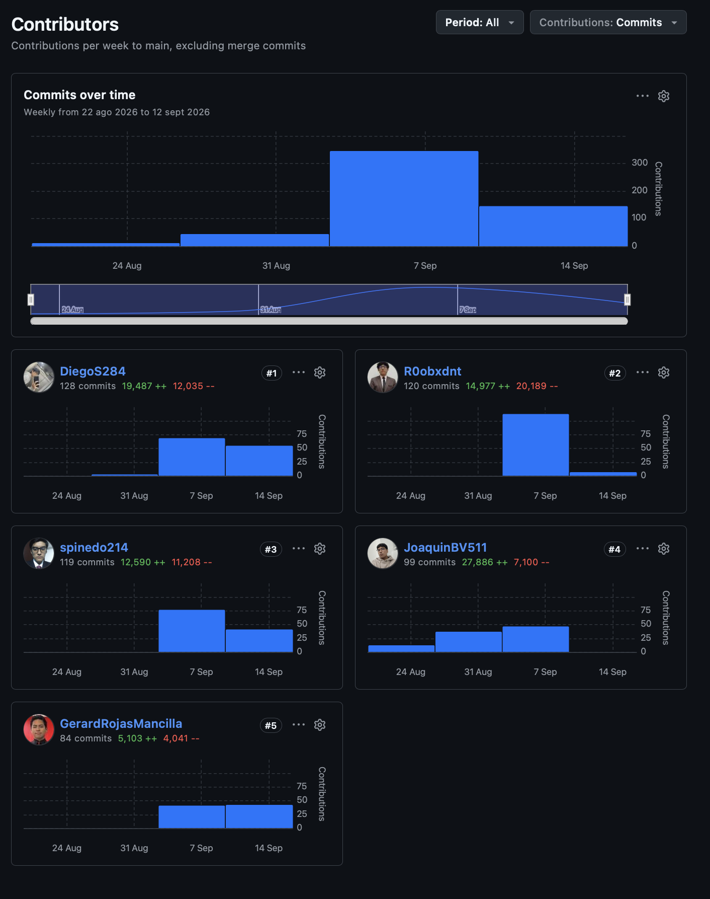
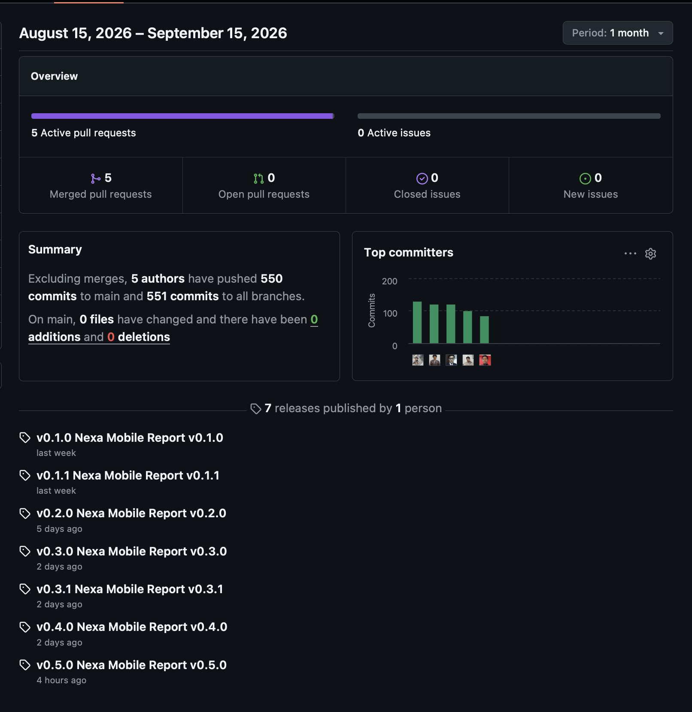
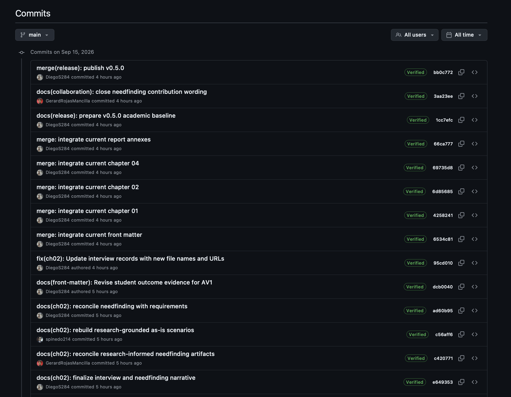
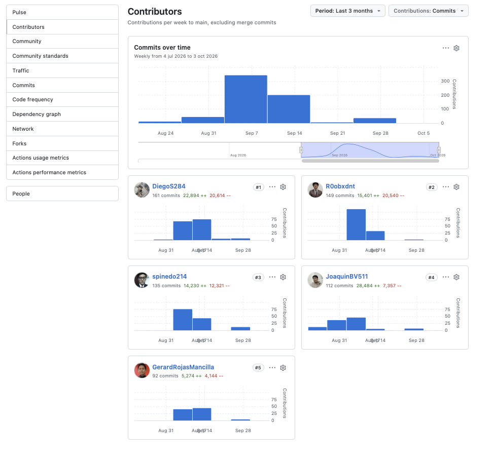
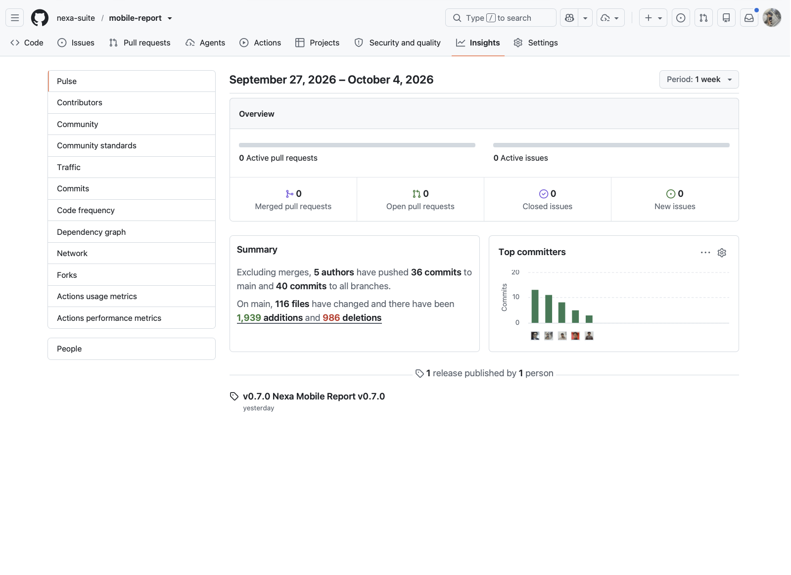
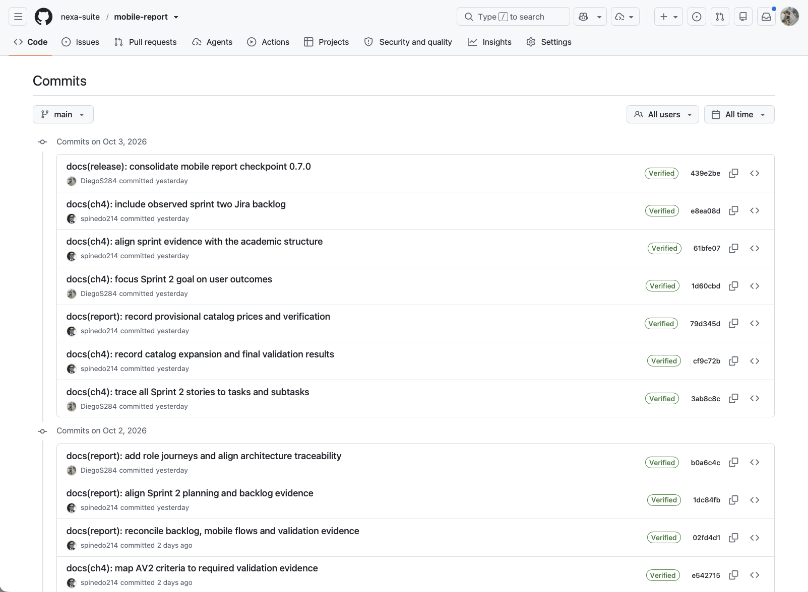
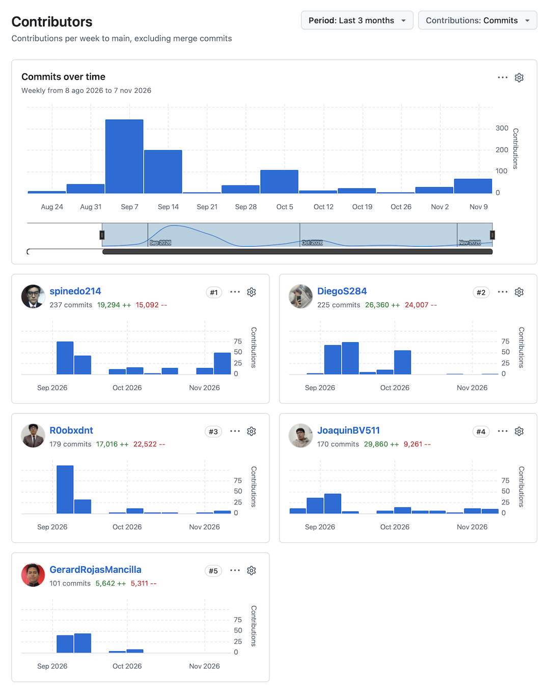
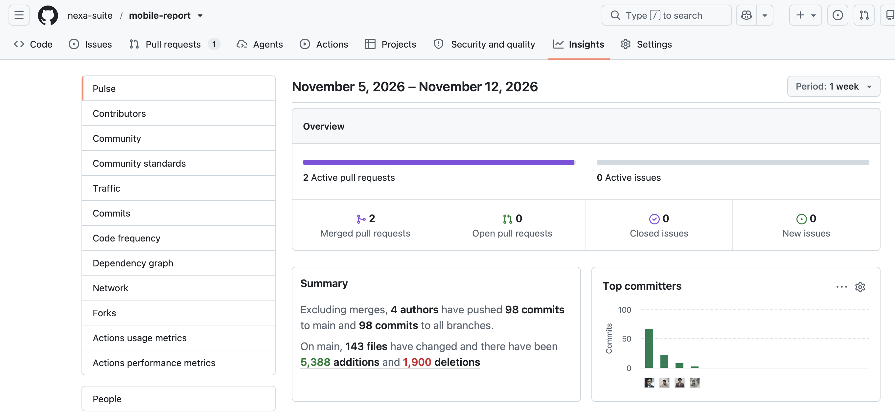
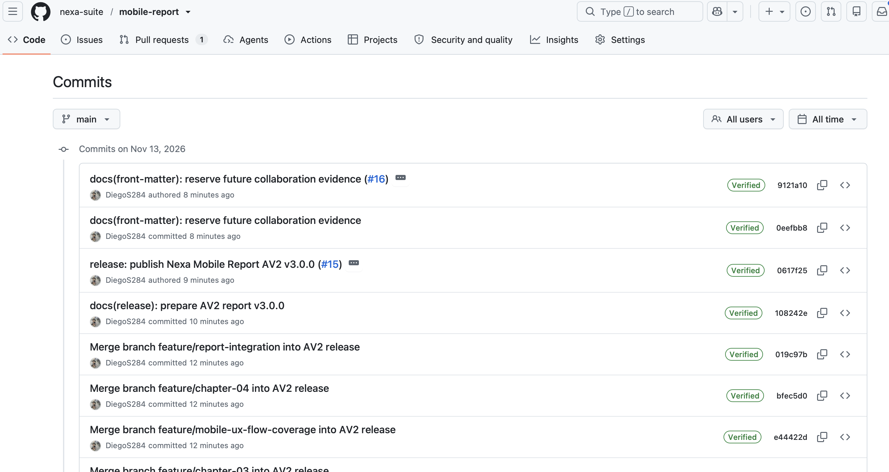

# Project Report Collaboration Insights

Repositorio del informe: nexa-suite/mobile-report.

Aquí se presentan los principales avances del informe desde AV1 hasta TB2, considerando los aportes de los integrantes de nexa-team y las evidencias de colaboración registradas durante cada entrega. Se incluyen las actividades de investigación, diseño, implementación, pruebas, documentación técnica y despliegue, así como la participación del equipo en la elaboración, revisión e integración de los capítulos del informe.

Las versiones del informe permiten identificar los cambios realizados durante el ciclo de vida del proyecto, mientras que las estadísticas y el historial de GitHub proporcionan evidencias de las contribuciones registradas. Ambas fuentes se utilizan de manera complementaria, considerando que el número de commits no representa necesariamente la cantidad, complejidad o calidad del trabajo realizado por cada integrante.

## Evolución del informe entre AV1, TB1, AV2 y TB2

El informe ha evolucionado a través de cuatro entregas académicas. En AV1 se establecieron las bases de investigación, requisitos y arquitectura. Durante TB1 se amplió el diseño de la solución y la documentación de implementación. En AV2 se desarrolló con mayor detalle el capítulo III, se revisó el capítulo IV y se incorporaron los avances del Sprint 3. Finalmente, en TB2 se integró la documentación del Sprint 4, las evidencias de implementación y despliegue de las aplicaciones móviles y los resultados obtenidos durante las comprobaciones finales del proyecto.

**Tabla**

*Principales actualizaciones documentales del Nexa Mobile Report*

| Entrega | Versión | Principales avances |
| --- | --- | --- |
| AV1 | 1.0.1 | Se consolidaron Lean UX, Needfinding, requisitos, Product Backlog, Domain-Driven Design, arquitectura de software y la planificación inicial de los Sprints. |
| TB1 | 1.1.0 | Se estableció la base documental para la segunda entrega y la organización de los nuevos avances. |
| TB1 | 2.0.0 | Se incorporaron Style Guidelines, wireframes, mockups, wireflows, prototipos y User Flows. También se actualizó la documentación de implementación y del Sprint 2. |
| TB1 | 2.0.1 | Se realizaron ajustes en el registro de versiones, arquitectura de información, evidencias de colaboración, Student Outcome y documentación técnica de servicios y despliegue. |
| AV2 | 3.0.0 | Se amplió el capítulo III con el desarrollo de sus apartados de diseño UI/UX. Se mejoró el capítulo IV y se completó la documentación del Sprint 3, incluyendo planificación, responsabilidades, backlog y evidencias técnicas. También se actualizaron las contribuciones y los aprendizajes del equipo. |

*Nota.* Elaboración propia a partir de las versiones y de los avances documentados en Nexa Mobile Report. Las versiones mencionadas corresponden al informe académico y deben diferenciarse de las publicaciones independientes de Nexa Mobile, Nexa API y Nexa Website.

En AV2, el equipo se concentró principalmente en completar los apartados de diseño y relacionarlos con el avance de las aplicaciones móviles. Esto permitió presentar de forma más ordenada las decisiones de interfaz, los recorridos de usuario y la documentación técnica que respalda el desarrollo del producto.

## Aportes de los integrantes

Los aportes se organizaron considerando el trabajo documentado en cada entrega y las responsabilidades asociadas con los capítulos y Sprints. La participación se distribuyó entre investigación, diseño, revisión técnica, desarrollo e integración de evidencias.

**Tabla**

*Aportes representativos de los integrantes durante AV1, TB1 y AV2*

| Integrante | AV1 | TB1 | AV2 |
| --- | --- | --- | --- |
| Pinedo Sanchez, Sebastián Martín | Participó en la organización de escenarios As-Is, segmentos objetivo y evidencias de planificación del Sprint 1. | Relacionó criterios de diseño móvil con la organización de pantallas, el seguimiento del backlog y la documentación del Sprint 2. | Revisó los recorridos de reparto y recepción del comprador, además de las evidencias de entrega y funcionalidades móviles del Sprint 3. |
| Rojas Mancilla, Gerard Gianpier | Relacionó los resultados de Needfinding con los modelos DDD, C4 y la trazabilidad del Product Backlog. | Trabajó en la documentación de wireframes de la Landing Page y la revisión de recorridos operativos e instalación Android. | Revisó los User Flows y documentó escenarios de entregas parciales, rechazos y discrepancias correspondientes al Sprint 3. |
| Torrejón De Los Santos, Gino Rodrigo | Participó en la organización de entrevistas, Product Backlog y evidencias técnicas del Sprint 1. | Relacionó diseños de la Landing Page con navegación, servicios y procesos operativos documentados en Sprint 2. | Revisó criterios de navegación, privacidad y compatibilidad de contratos entre las aplicaciones móviles y Nexa API. |
| Verde Bueno, Joaquín Francisco | Contribuyó a la revisión de la documentación, el lenguaje utilizado y la consistencia de las evidencias del proyecto. | Revisó referencias tipográficas, recursos de diseño móvil y comprobaciones técnicas relacionadas con API y Android. | Revisó escenarios de recuperación, notificaciones y ubicación, manteniendo la coherencia entre interfaces y procesos operativos. |
| Yucra Sandoval, Diego Sebastián | Integró evidencias de Student Outcome, versiones, arquitectura y trazabilidad documental. | Revisó la integración de los capítulos III y IV, el front matter y la documentación de servicios y despliegue. | Integró evidencias técnicas del Sprint 3 y revisó la documentación, los cambios de autenticación y la recuperación de acceso biométrico. |

*Nota.* Los aportes se presentan como una síntesis cualitativa de las actividades y responsabilidades documentadas. No constituyen una distribución basada exclusivamente en commits ni implican que cada integrante haya desarrollado de manera individual todas las funcionalidades asociadas con su área.

## Avances realizados para TB2

### Actualización del capítulo III: Solution UI/UX Design

Durante TB2 se realizaron ajustes en la documentación de diseño de las aplicaciones móviles, incluyendo la revisión de los prototipos, las referencias de Figma, los User Flows y los recursos visuales correspondientes a Buyer Mobile y Operations Mobile.

Estas actualizaciones permitieron mantener una mayor consistencia entre las propuestas de diseño, los recorridos de usuario y las funcionalidades incorporadas durante el desarrollo de las aplicaciones.

### Incorporación del Sprint 4

El Sprint 4 estuvo orientado a ampliar las funcionalidades comerciales y operativas de Nexa Mobile, incluyendo la gestión de cargas de despacho, la recepción de mercadería, el tratamiento de comprobantes de pago, las notificaciones y la continuidad de consulta ante interrupciones de conectividad.

La documentación del sprint incorpora la planificación, la matriz de líderes y colaboradores, el Sprint Backlog y las evidencias asociadas con el desarrollo, las pruebas automatizadas, la ejecución de las aplicaciones y la documentación de los servicios REST.

Asimismo, se registraron los cambios relacionados con las publicaciones Nexa Mobile v3.0.0, v3.0.1 y v3.0.2, diferenciando las funcionalidades incorporadas de los resultados obtenidos durante las comprobaciones técnicas.

### Actualización de las evidencias de despliegue

Como parte de las actividades de TB2, se ampliaron las evidencias relacionadas con la distribución de Buyer Mobile y Operations Android mediante Firebase App Distribution y GitHub Releases.

También se documentaron las comprobaciones de disponibilidad de Nexa API en Render, la consulta de su definición OpenAPI, la persistencia de información en PostgreSQL mediante Neon y la visualización de Nexa Website publicado en GitHub Pages.

Estas evidencias permiten identificar los componentes desplegados, sus versiones y los resultados de las operaciones evaluadas, manteniendo la trazabilidad entre la implementación, los servicios y la infraestructura utilizada.

### Integración de la documentación final

La integración de los avances del informe se realizó mediante Pull Requests, conservando el historial de modificaciones y las contribuciones registradas en las ramas de trabajo.

El [Pull Request #17](https://github.com/nexa-suite/mobile-report/pull/17) integró la documentación del Sprint 4 y las actualizaciones correspondientes a TB2, incluyendo modificaciones en el diseño, la implementación, las evidencias técnicas y la configuración de exportación del informe.

## Evidencia de colaboración en AV1

Las siguientes figuras corresponden a capturas realizadas el 15 de septiembre de 2026. Presentan la actividad del repositorio durante el corte previo a la entrega final de AV1.

**Figura**

*Participación de las cuentas colaboradoras en Nexa Mobile Report durante AV1*

*Nota.* Vista Contributors de GitHub correspondiente al 15 de septiembre de 2026. La gráfica presenta contribuciones acumuladas y no exclusivamente las actividades desarrolladas para AV1.

**Figura**

*Actividad del repositorio registrada mediante GitHub Pulse durante AV1*

*Nota.* Captura de GitHub Pulse del 15 de septiembre de 2026. Los indicadores corresponden al periodo seleccionado en la herramienta.

**Figura**

*Historial de commits de Nexa Mobile Report durante AV1*

*Nota.* Historial registrado el 15 de septiembre de 2026, previo a la publicación final de AV1 del 17 de septiembre.

## Evidencia de colaboración en TB1

Las evidencias de TB1 corresponden a las capturas de actividad registradas el 3 y 4 de octubre de 2026. Permiten observar la participación del equipo durante el periodo inicial de esta entrega y complementan las actualizaciones documentales posteriores.

**Figura**

*Participación de los colaboradores de Nexa Mobile Report durante TB1*

*Nota.* Captura de Contributors del 4 de octubre de 2026. Los totales representan la actividad acumulada que muestra GitHub.

**Figura**

*Actividad del repositorio registrada mediante GitHub Pulse durante TB1*

*Nota.* Captura de GitHub Pulse del 4 de octubre de 2026. La información corresponde al intervalo seleccionado y no representa todo el trabajo de TB1.

**Figura**

*Historial de commits de Nexa Mobile Report durante el corte inicial de TB1*

*Nota.* Registro del 3 de octubre de 2026, anterior a las principales actualizaciones documentales publicadas para TB1.

## Evidencia de colaboración en AV2

**Fecha de corte documental: 11 de noviembre de 2026.**

Para AV2 se consideran los avances relacionados con la actualización del capítulo III, la revisión del capítulo IV y la incorporación de la documentación del Sprint 3.

Las siguientes figuras están reservadas para registrar la actividad de Nexa Mobile Report en GitHub durante el corte de AV2. Se utilizarán las vistas Contributors, Pulse e historial de commits, manteniendo el mismo criterio empleado en las entregas anteriores.

**Figura**

*Participación de los integrantes en Nexa Mobile Report durante el corte de AV2*

*Nota.* Captura de contribuidores hasta 12 de noviembre de 2026, los totales representan la actividad acumulada que muestra GitHub.

**Figura**

*Actividad del repositorio Nexa Mobile Report registrada mediante GitHub Pulse durante AV2*

*Nota.* Captura de GitHub Pulse hasta 12 de noviembre de 2026. La información corresponde al intervalo seleccionado y no representa todo el avance del AV2.

**Figura**

*Historial de commits de Nexa Mobile Report durante el corte de AV2*

*Nota.* Captura de commits realizados hasta 12 de noviembre de 2026.

## Aportes al informe para TB2

Durante TB2, el trabajo del equipo se concentró en completar la documentación del Sprint 4, actualizar las evidencias de implementación de las aplicaciones móviles y preparar los materiales correspondientes a la entrega final.

A diferencia de las entregas anteriores, en esta etapa fue necesario relacionar la información presentada en los capítulos de diseño e implementación con las versiones más recientes de las aplicaciones. Para ello, se revisaron los recursos visuales, la documentación de los servicios y los resultados de las comprobaciones realizadas.

**Tabla**

*Aportes representativos de los integrantes durante TB2.*

| Integrante | Aportes durante TB2 |
| --- | --- |
| Pinedo Sanchez, Sebastián Martín | Desarrolló la documentación de planificación, distribución de responsabilidades, Sprint Backlog y evidencias de desarrollo y pruebas del Sprint 4. |
| Rojas Mancilla, Gerard Gianpier | Contribuyó al desarrollo de Operations Mobile, particularmente en los escenarios de consulta de información de almacén sin conexión y navegación, cuyos avances se presentan en el capítulo IV. |
| Torrejón De Los Santos, Gino Rodrigo | Actualizó la documentación de diseño de las aplicaciones móviles, incluyendo los prototipos, User Flows, recursos visuales y referencias de Figma del capítulo III. |
| Verde Bueno, Joaquín Francisco | Desarrolló las secciones de ejecución, documentación de servicios, despliegue y colaboración del Sprint 4. Incorporó las capturas correspondientes a las aplicaciones móviles, los servicios desplegados y las herramientas utilizadas en el proyecto. |
| Yucra Sandoval, Diego Sebastián | Integró los avances de los capítulos III y IV, actualizó las conclusiones y organizó las referencias técnicas y la configuración de exportación del informe para TB2. |

La distribución del trabajo permitió avanzar de manera paralela en las diferentes secciones del informe, relacionando los recursos de diseño con las evidencias técnicas y los resultados obtenidos durante el desarrollo de Nexa.

## Reflexión sobre el trabajo colaborativo

A lo largo de las cuatro entregas académicas, el equipo organizó el desarrollo del proyecto mediante la distribución de responsabilidades por capítulos, funcionalidades y sprints. Esta forma de trabajo permitió avanzar de manera colaborativa en las actividades de investigación, diseño, implementación y documentación.

Durante las primeras entregas, el trabajo estuvo orientado a comprender el dominio del problema, identificar las necesidades de los segmentos objetivo y establecer los requisitos y la arquitectura de la solución. Posteriormente, las actividades se concentraron en el diseño de las interfaces, la implementación de las aplicaciones móviles y su integración con los servicios de Nexa API.

En TB2, el principal reto consistió en integrar los avances del Sprint 4 y mantener la consistencia entre las funcionalidades desarrolladas, las pruebas técnicas, las evidencias de ejecución y los componentes desplegados. El uso de ramas, Pull Requests y herramientas de integración continua facilitó la organización de las modificaciones y la conservación del historial de contribuciones.

La preparación de las evidencias finales también permitió reconocer la importancia de documentar los resultados obtenidos de manera objetiva, diferenciando las funcionalidades implementadas, las comprobaciones realizadas y las actividades que requieren verificaciones adicionales.

En conjunto, el desarrollo de Nexa permitió fortalecer las competencias técnicas y colaborativas de los integrantes, promoviendo el aprendizaje autónomo, la comunicación efectiva, la revisión de resultados y la aplicación de buenas prácticas de ingeniería de software.
