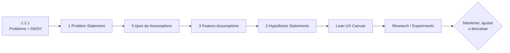

### 1.2.2. Lean UX Process

El **Lean UX Process** se utiliza en Nexa para convertir el entendimiento
preliminar de la problemática en un conjunto explícito de creencias para su
contraste mediante investigación y experimentación. El punto de partida es la
sección 1.2.1, donde se identifica como problema central la posible pérdida de
continuidad confiable de la información cuando un pedido B2B cambia de persona,
lugar o responsabilidad durante la preparación, el despacho, la entrega y la
recepción.

Al formular este baseline, el equipo no conocía con certeza cuáles fricciones
eran más frecuentes, qué magnitud tenían ni qué solución sería más efectiva.
Por ello, las ideas iniciales se expresan como **assumptions** e **hypotheses**,
no como requisitos definitivos ni como resultados ya validados (Gothelf &
Seiden, 2021). El *Needfinding* posterior aporta evidencia sobre la situación
actual; la validación del efecto de las soluciones propuestas permanece aparte.

El alcance de la investigación Mobile comprende tres segmentos objetivo: **Warehouse & Dispatch Operations**, **Driver Delivery Execution** y **B2B Buyers**, caracterizados en la sección 1.3. Esta delimitación permite estudiar las necesidades y fricciones particulares de cada grupo, manteniendo diferenciadas las responsabilidades de Warehouse Operator, Dispatch Coordinator, Driver / Delivery Operator y Customer Buyer.

Los tres segmentos representan el foco priorizado de investigación y no el alcance funcional completo de Nexa Mobile. Otros actores, como Sales Representative, permanecen dentro del producto y de su catálogo funcional aceptado, sin formar parte de los segmentos seleccionados para este proceso inicial de Needfinding.

El proceso se documenta mediante cuatro artefactos relacionados:

- **Lean UX Problem Statements**, donde se formula un único Problem Statement
  para todo el proyecto;
- **Lean UX Assumptions**, donde se hacen explícitas las Business Assumptions,
  Business Outcome Assumptions, User Assumptions, User Outcome and Benefit
  Assumptions y Feature Assumptions;
- **Lean UX Hypothesis Statements**, donde cada Feature Assumption se relaciona
  con un business outcome, users y user outcome/benefit;
- **Lean UX Canvas**, donde se sintetiza el razonamiento mediante Business
  Problem, Business Outcomes, Users, User Outcomes and Benefits, Solutions,
  Hypotheses, Learning y MVPs/Experiments.

Para mantener un alcance de aprendizaje definido, se establecieron **tres Feature Assumptions primarias y tres Hypothesis Statements**, una por cada segmento objetivo. Las posibles capacidades de soporte, como identificación mediante cámara, registro de condición, navegación externa, actualizaciones críticas o recuperación temporal limitada, se consideran dentro de los recorridos correspondientes y no constituyen hipótesis independientes. Su relación se desarrolla en las secciones 1.2.2.2 y 1.2.2.3.
*Relación entre problema, assumptions, hypotheses y aprendizaje*

 *Nota.* Elaboración propia a partir del proceso aplicado en Nexa y del Lean UX Canvas de Gothelf y Seiden (2021).

El contenido de esta sección representa el **baseline de aprendizaje previo a la
investigación primaria**. Posteriormente, la evidencia podrá mantener, ajustar o
descartar assumptions e hypotheses. El cierre del proyecto deberá mostrar esos
cambios de manera explícita en lugar de reescribir retroactivamente las
creencias iniciales como si siempre hubieran estado validadas.

#### 1.2.2.1. Lean UX Problem Statements

Lean UX utiliza el Problem Statement para enmarcar la problemática sin convertir
anticipadamente una idea de solución en un requisito. Para una iniciativa nueva,
el patrón organiza cinco elementos: el estado actual del dominio y sus flujos, la
brecha que las alternativas existentes no resuelven suficientemente, la
estrategia general de la propuesta, el foco inicial y los comportamientos
observables que indicarían progreso.

Nexa formula **un único Problem Statement para todo el proyecto**. Su contenido
se deriva de los antecedentes y del análisis 5W2H de la sección 1.2.1. Las
fricciones y comportamientos descritos a continuación siguen siendo hipótesis de
producto y deberán contrastarse con investigación primaria.

##### Iniciativa nueva

###### The current state of the domain we are working in has focused mainly on...

La coordinación de pedidos B2B en empresas importadoras, distribuidoras y mayoristas comprende actividades comerciales y operativas que requieren la participación de diferentes actores. Durante este recorrido, el pedido atraviesa preparación física, readiness, despacho, ejecución de entrega y recepción por parte de la empresa compradora. Cada transición supone un cambio de contexto o responsabilidad que puede requerir información generada en etapas anteriores.

La evidencia secundaria presentada en la sección 1.2.1 contextualiza este problema dentro de un entorno empresarial heterogéneo. Sin embargo, no permite determinar por sí sola las prácticas de coordinación, las necesidades ni la magnitud de las fricciones experimentadas por los futuros usuarios de Nexa.

La hipótesis central plantea que la dificultad puede manifestarse cuando **la información necesaria para continuar una tarea pierde claridad al cambiar la responsabilidad sobre el pedido**. Esta situación presenta distintas implicancias según el segmento:

- **Warehouse & Dispatch Operations:** posibles dificultades para conservar contexto entre recepción, preparación, readiness y handoff, manteniendo las responsabilidades diferenciadas de Warehouse Operator y Dispatch Coordinator.
- **Driver Delivery Execution:** necesidad de identificar la entrega asignada, ejecutar el Delivery Attempt y conservar resultados, incidencias y evidencias atribuibles.
- **B2B Buyers:** necesidad de comprender la entrega esperada, verificar lo recibido y comunicar discrepancias con información suficiente.

En operaciones sujetas a condiciones de lote, vencimiento, temperatura o conservación, la pérdida de contexto puede tener consecuencias adicionales. Estas condiciones representan una especialización del dominio y no requisitos universales de los clientes de Nexa.

###### What existing products or services fail to address is...

Las organizaciones pueden disponer de sistemas administrativos, ERP, soluciones
de inventario, herramientas logísticas, hojas de cálculo o canales de
comunicación que resuelven partes importantes del recorrido. La oportunidad que
Nexa busca explorar aparece cuando la persona que continúa una tarea **todavía
necesita reinterpretar información, consultar varias fuentes o pedir
aclaraciones para comprender qué ocurrió antes y qué debe hacer ahora**.

La brecha no se define como “falta de software” ni como “falta de
digitalización”. Se define como la posible falta de **continuidad confiable entre
hechos y responsabilidades** a lo largo del pedido. Esta brecha puede
manifestarse mediante aclaraciones repetidas, búsqueda en varios canales,
reingreso de información, evidencia difícil de asociar, errores de preparación o
incertidumbre frente a diferencias entre lo entregado y lo recibido.

Las tres perspectivas deben mantenerse separadas. El handoff registrado por
Warehouse o Dispatch no demuestra por sí solo el resultado posterior de la
entrega; el resultado declarado por Driver / Delivery Operator no equivale a la
recepción o aceptación de Customer Buyer; y la recepción del Buyer no debe
reescribir retroactivamente los hechos registrados por otros participantes.

###### Our product or service will address this gap by...

Nexa explorará una **estrategia de coordinación digital orientada por rol** para
preservar contexto útil y trazable cuando cambia la responsabilidad sobre el
pedido. La propuesta busca que cada participante pueda reconocer la tarea que le
corresponde, comprender los hechos relevantes de las etapas anteriores y
registrar su propio resultado sin apropiarse de la responsabilidad de otro actor.

La estrategia prioriza:

- **Claridad operativa:** proporcionar a cada participante información autorizada y pertinente para reconocer su tarea, comprender su estado e identificar la siguiente acción.
- **Continuidad del pedido:** conservar el contexto necesario entre preparación, readiness, handoff, Delivery Attempt y recepción, evitando reconstrucciones innecesarias.
- **Trazabilidad de responsabilidades:** relacionar hechos, incidencias y evidencias con el pedido y el actor correspondiente, manteniendo diferenciados el resultado del Driver y la recepción del Buyer.
- **Adecuación al contexto de uso:** investigar cuándo una experiencia Mobile facilita el trabajo físico y qué información adicional debe conservarse en operaciones sujetas a lote, vencimiento o condiciones particulares.

El problema y la estrategia de coordinación no dependen de un dispositivo. La
hipótesis Mobile se limita a los momentos en que el trabajo se realiza junto a la
mercadería, durante la entrega o en el punto de recepción; deberá contrastarse
frente a alternativas que también puedan conservar el contexto requerido. El
framework Mobile, los proveedores externos, el detalle del escaneo, las
notificaciones, la navegación y otras decisiones técnicas permanecen fuera de
este Problem Statement y deberán justificarse posteriormente.

###### Our initial focus will be...

El foco inicial comprende los tres segmentos definidos en la sección 1.3: **Warehouse & Dispatch Operations**, **Driver Delivery Execution** y **B2B Buyers**. Su selección responde a los cambios de responsabilidad y a las condiciones de movilidad que pueden afectar la continuidad de información durante la preparación, el despacho, la entrega y la recepción de pedidos B2B.

La agrupación de Warehouse Operator y Dispatch Coordinator permite investigar una transición operativa compartida sin equiparar sus funciones. Del mismo modo, Driver / Delivery Operator y Customer Buyer mantienen responsabilidades independientes sobre los hechos registrados durante la entrega y la recepción.

Sales Representative permanece como actor de Nexa y cuenta con capacidades contempladas en el catálogo funcional Mobile aceptado, aunque no integra los segmentos priorizados para esta investigación. Las necesidades y fricciones atribuidas a los tres grupos seleccionados deberán contrastarse mediante evidencia primaria, sin asumir previamente la eficacia de una solución específica.

###### We’ll know we are successful when we see...

La propuesta mostrará señales favorables cuando, en comparación con una línea base obtenida durante la investigación, se observen cambios en el comportamiento de los participantes y en la continuidad de las tareas priorizadas.

Los criterios iniciales de éxito se plantean por segmento:

- **Warehouse & Dispatch Operations:** reducción del tiempo necesario para reconocer la siguiente acción, del número de fuentes consultadas y de las aclaraciones entre preparación, readiness y handoff. También se observarán la proporción de tareas completadas sin asistencia y la aparición de errores, omisiones o correcciones durante la transición.
- **Driver Delivery Execution:** mayor claridad para reconocer la entrega asignada y registrar cada Delivery Attempt con resultado, incidencia y evidencia atribuibles. Se considerarán el tiempo de identificación, los errores de asociación y la necesidad de aclaraciones posteriores.
- **B2B Buyers:** mayor capacidad para verificar la recepción y comunicar discrepancias con contexto suficiente. Se observarán el tiempo de verificación, las tareas completadas sin asistencia, los errores de interpretación y las consultas adicionales al proveedor.

De manera transversal, se buscará identificar cambios en la reconstrucción manual de información, el retrabajo y la continuidad entre responsabilidades, siempre que estas variables puedan medirse de manera responsable.

Los indicadores representan **criterios preliminares de aprendizaje**, no resultados alcanzados. Antes de evaluar una solución deberán obtenerse las líneas base pertinentes y establecerse objetivos observables y medibles. La construcción de una funcionalidad no constituye, por sí sola, evidencia de mejora ni validación de una hypothesis.

##### Trazabilidad entre 5W2H y el Problem Statement

*Relación entre el análisis 5W2H y el Problem Statement*

| Componente del Problem Statement | 5W2H relacionado | Aplicación en Nexa |
| --- | --- | --- |
| **Estado actual del dominio** | What, Where, When | El pedido cambia de contexto entre preparación, despacho, ruta y recepción. |
| **Personas afectadas** | Who | Warehouse Operator, Dispatch Coordinator, Driver / Delivery Operator y Customer Buyer, agrupados en tres segmentos de investigación. |
| **Brecha** | What, Why, How | El contexto puede fragmentarse o requerir reinterpretación al cambiar la responsabilidad. |
| **Momentos críticos** | Where, When | Preparación, readiness, handoff, Delivery Attempt y recepción/discrepancia. |
| **Manifestaciones** | How | Aclaraciones, múltiples fuentes, retrabajo, evidencia difícil de asociar e incertidumbre. |
| **Magnitud** | How Much | Todavía no cuantificada para los usuarios de Nexa; requiere línea base de investigación. |

*Nota.* Elaboración propia a partir del análisis 5W2H desarrollado en 1.2.1.

##### Alcance y límites del Problem Statement

El Problem Statement determina el problema y la dirección de aprendizaje, pero
no define todavía la solución final. En consecuencia:

- una aplicación Mobile no se considera valiosa únicamente por existir;
- las necesidades atribuidas a los segmentos todavía requieren evidencia
  primaria;
- Warehouse Operator y Dispatch Coordinator conservan responsabilidades
  diferentes aunque compartan un segmento de investigación;
- Driver outcome, Buyer receipt y POD permanecen como hechos distintos;
- la cadena de frío se considera cuando corresponda y no como requisito
  universal;
- las capacidades de Sales se mantienen fuera del núcleo Mobile priorizado;
- cámara, escáner, almacenamiento local, navegación, notificaciones u otros
  mecanismos son capacidades candidatas, no decisiones de esta sección;
- una feature construida no constituye por sí sola evidencia de éxito: el
  criterio relevante es el cambio observable de comportamiento o resultado.

Esta formulación constituye el punto de partida de las Assumptions de la sección
siguiente.
