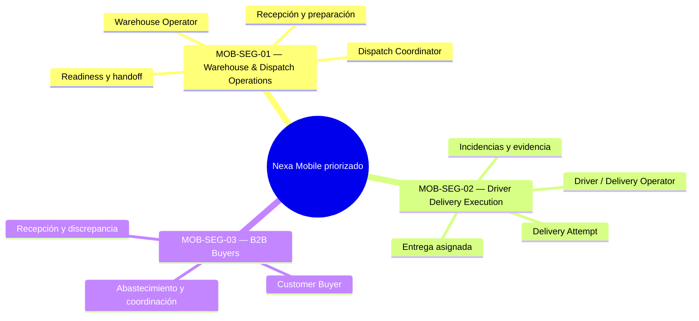

## 1.3. Segmentos objetivo

La segmentación de Nexa Mobile delimita los grupos de usuarios priorizados para la investigación a partir de sus responsabilidades, los momentos del pedido B2B en los que intervienen y las condiciones en las que desarrollan sus actividades. Este criterio responde a la problemática de continuidad de información presentada en la sección 1.2.1 y permite formular preguntas de investigación diferenciadas.

Nexa se orienta a empresas importadoras, distribuidoras y mayoristas B2B. Dentro de este mercado, la investigación Mobile prioriza actividades que requieren consultar, verificar o registrar información durante la preparación, el despacho, la ejecución de entregas y la recepción del comprador, especialmente cuando el trabajo ocurre fuera de una estación de escritorio.

Los tres segmentos objetivo son:

1. **MOB-SEG-01 — Warehouse & Dispatch Operations**, integrado por personas que participan en la recepción, preparación, alistamiento y salida física del pedido.
2. **MOB-SEG-02 — Driver Delivery Execution**, conformado por personas responsables de ejecutar entregas asignadas y registrar los resultados e incidencias de cada Delivery Attempt.
3. **MOB-SEG-03 — B2B Buyers**, integrado por compradores empresariales autorizados que coordinan su abastecimiento, consultan información relevante y verifican recepciones o comunican discrepancias cuando corresponde.

Los identificadores `MOB-SEG-*` permiten mantener la trazabilidad entre la segmentación, las preguntas de investigación y los artefactos posteriores de Needfinding. Representan grupos de investigación y no constituyen roles de autorización, aplicaciones independientes, módulos técnicos ni Bounded Contexts de Nexa.

### Criterio de segmentación

Los segmentos se diferencian por el momento del proceso en el que intervienen,
el contexto físico en el que trabajan y la responsabilidad que asumen frente al
pedido.

*Criterios utilizados para diferenciar los segmentos objetivo*

| Criterio | MOB-SEG-01 — Warehouse & Dispatch Operations | MOB-SEG-02 — Driver Delivery Execution | MOB-SEG-03 — B2B Buyers |
| --- | --- | --- | --- |
| **Momento principal** | Recepción, preparación, alistamiento y salida del pedido | Traslado y ejecución de la entrega | Reabastecimiento, coordinación con proveedor, llegada y recepción cuando aplica |
| **Actores principales** | Warehouse Operator y Dispatch Coordinator | Driver / Delivery Operator | Customer Buyer |
| **Contexto físico** | Zona de recepción, almacén, picking, staging y despacho | Vehículo, ruta y punto de entrega | Empresa compradora, punto de recepción y canales de coordinación comercial |
| **Responsabilidad central** | Preparar la mercadería y transferir su responsabilidad de salida de forma comprensible | Ejecutar la entrega asignada y registrar lo ocurrido durante cada Delivery Attempt | Proteger continuidad de abastecimiento y comunicar recepción o discrepancia cuando corresponde |
| **Información relevante** | Producto, SKU, lote, cantidad, condición, preparación, alistamiento y entrega de responsabilidad | Entrega asignada, destino, intento, resultado, incidencia y evidencia | Disponibilidad, pedido, puntualidad, llegada, excepción y recepción cuando aplica |
| **Pregunta de movilidad** | ¿Qué información debe estar disponible junto a la operación física? | ¿Cómo se conserva claridad durante una jornada en movimiento? | ¿Cuándo aporta valor consultar contexto comercial o de llegada desde el teléfono? |

*Nota.* Los segmentos representan grupos de investigación y necesidades de
producto. No modifican las responsabilidades propias de los actores que
participan en ellos. Elaboración propia.

La agrupación de **Warehouse Operator** y **Dispatch Coordinator** en MOB-SEG-01 responde a su participación consecutiva en la preparación y salida física del pedido, sin fusionar sus responsabilidades. Warehouse Operator se relaciona principalmente con recepción, identificación, inventario y preparación de mercadería; Dispatch Coordinator se concentra en el alistamiento, la coordinación de salida y la transferencia de responsabilidad hacia la entrega.

Del mismo modo, **Driver / Delivery Operator** y **Customer Buyer** mantienen perspectivas independientes sobre los hechos de entrega y recepción. El resultado registrado durante un Delivery Attempt no equivale a la recepción ni a la aceptación declarada por el comprador. Esta separación permite investigar las necesidades de cada participante sin atribuirle responsabilidades correspondientes a otro actor.

### Preguntas iniciales de investigación

*Foco de investigación definido para cada segmento*

| Segmento | Preguntas iniciales | Motivo de priorización |
| --- | --- | --- |
| MOB-SEG-01 | ¿Cómo se conserva contexto entre recepción, preparación, alistamiento y entrega de responsabilidad? ¿Qué información ayuda a verificar producto, lote, cantidad o condición cerca de la tarea física? | El pedido cambia de responsabilidad mientras se manipula mercadería y se prepara su salida. |
| MOB-SEG-02 | ¿Qué contexto necesita Driver para ejecutar una entrega asignada, comunicar una incidencia y distinguir un resultado confirmado de uno incierto? | La entrega ocurre bajo movilidad, interrupciones y restricciones del dispositivo. |
| MOB-SEG-03 | ¿Qué información necesita Customer Buyer para proteger reabastecimiento, coordinar con el proveedor y reconocer una recepción o discrepancia cuando aplica? | La continuidad comercial depende de información de pedido, llegada y excepción que puede requerir consulta fuera de escritorio. |

Estas preguntas orientan el levantamiento de evidencia; no anticipan que una
capacidad Mobile específica resuelva el problema ni convierten supuestos en
resultados.

### Frontera de Sales dentro del alcance Mobile

**Sales Representative** forma parte de los actores de Nexa y participa en el ciclo comercial general del producto. Sin embargo, no fue seleccionado como uno de los tres segmentos priorizados para el Needfinding de Mobile. La investigación se concentra en Warehouse & Dispatch Operations, Driver Delivery Execution y B2B Buyers, cuyas actividades presentan condiciones específicas de trabajo físico, movilidad y cambios de responsabilidad.

Esta delimitación corresponde al **alcance de investigación**, no a una exclusión funcional del producto. El catálogo canónico de Nexa Mobile contempla capacidades comerciales para Sales Representative dentro de la generación Mobile V1 planificada, con estados de ciclo de vida y necesidades de validación independientes. Su incorporación al catálogo no demuestra que dichas funcionalidades hayan sido implementadas, verificadas o aceptadas.

De manera similar, Business Operations Manager conserva sus responsabilidades dentro de Nexa, aunque tampoco constituye un segmento priorizado de esta investigación. Nexa Platform Web mantiene un alcance más amplio para la gestión comercial y operativa del personal interno.

La selección de segmentos permite concentrar el aprendizaje en las transiciones del pedido donde se busca comprender el valor específico de la movilidad, sin redefinir los actores, las responsabilidades ni el alcance funcional aceptado del producto.

### Contexto demográfico y estadístico

La evidencia secundaria se utiliza para contextualizar el entorno en el que se
planteó la investigación. No determina la composición esperada de clientes de
Nexa ni asigna características demográficas específicas a los segmentos.

En 2024, el Instituto Nacional de Estadística e Informática registró
**3 302 973 empresas formales en el Perú**. El **96,4 %** correspondió a
microempresas, el 3,0 % a pequeñas empresas y el 0,6 % a medianas y grandes
empresas. Asimismo, el **43,5 %** desarrolló actividades de comercio y el
**5,8 %** actividades de transporte y almacenamiento. Lima concentró el
**45,7 %** de las empresas registradas (INEI, 2025b).

El acceso digital móvil también aporta contexto. Durante el cuarto trimestre de
2025, el **89,2 % de la población usuaria de Internet de seis años a más accedió
mediante teléfono celular** (INEI, 2026). Durante el segundo trimestre de 2025,
el uso de Internet alcanzó el **93,3 % entre las personas de 25 a 40 años** y el
**81,1 % entre las de 41 a 59 años** (INEI, 2025a).

### Contexto demográfico y estadístico

La evidencia estadística secundaria permite contextualizar el entorno empresarial y digital en el que se planteó la investigación. Los indicadores del Instituto Nacional de Estadística e Informática (INEI) aportan información sobre la estructura empresarial peruana y el acceso a Internet mediante dispositivos móviles. Sin embargo, no representan directamente a los usuarios de Nexa ni permiten atribuirles características demográficas o comportamientos específicos.

*Contexto demográfico y estadístico para la investigación de segmentos*

| Dimensión | Evidencia disponible | Aplicación en la segmentación | Límite de interpretación |
| --- | --- | --- | --- |
| **Estructura empresarial** | En 2024 se registraron 3 302 973 empresas formales en el Perú: 96,4 % microempresas, 3,0 % pequeñas empresas y 0,6 % medianas y grandes empresas (INEI, 2025b). | Justifica considerar organizaciones con diferentes niveles de especialización, recursos y estructuras de trabajo. | No representa la distribución esperada de clientes de Nexa ni demuestra la presencia del problema en todas las empresas. |
| **Actividad económica** | El 43,5 % de las empresas formales perteneció a comercio y reparación de vehículos automotores y motocicletas, mientras que el 5,8 % correspondió a transporte y almacenamiento (INEI, 2025b). | Contextualiza la presencia de actividades económicas relacionadas con comercialización y movimiento de bienes. | No permite determinar cuántas empresas son importadoras, distribuidoras o mayoristas compatibles con Nexa. |
| **Ámbito geográfico** | Lima concentró el 45,7 % de las empresas formales registradas en 2024 (INEI, 2025b). | Sustenta la pertinencia de Lima como entorno para una primera investigación de campo. | No limita el mercado objetivo de Nexa a una única región. |
| **Acceso mediante celular** | Durante el cuarto trimestre de 2025, el 89,2 % de la población usuaria de Internet de seis años a más accedió mediante teléfono celular (INEI, 2026). | Aporta contexto sobre la relevancia del acceso móvil al plantear preguntas relacionadas con tareas realizadas fuera de una estación de escritorio. | No demuestra el uso laboral de aplicaciones móviles ni su utilidad específica para los segmentos investigados. |
| **Uso de Internet por edad** | Durante el segundo trimestre de 2025, el uso de Internet alcanzó el 93,3 % entre personas de 25 a 40 años y el 81,1 % entre personas de 41 a 59 años (INEI, 2025a). | Permite considerar diferencias generales de acceso digital entre grupos de población adulta. | No establece la distribución etaria de Warehouse Operator, Dispatch Coordinator, Driver / Delivery Operator o Customer Buyer. |

*Nota.* Los indicadores corresponden a evidencia secundaria utilizada para contextualizar la investigación. No constituyen resultados obtenidos con participantes de Nexa ni permiten extrapolar frecuencias, necesidades o comportamientos específicos de sus usuarios. Elaboración propia.

### Lectura visual de la segmentación

La figura sintetiza los actores y las actividades centrales asociadas a los tres segmentos priorizados, manteniendo su relación con el recorrido del pedido B2B.

*Segmentos objetivo y focos principales de investigación de Nexa Mobile*

*Nota.* La figura representa una agrupación de investigación basada en responsabilidades y actividades. No establece límites de Bounded Contexts, módulos técnicos ni aplicaciones independientes. Elaboración propia.

Las condiciones de lote, vencimiento, temperatura y conservación se consideran cuando forman parte de una operación concreta, sin constituir requisitos universales. Para Driver / Delivery Operator, la conectividad, la batería, el clima y la seguridad física representan condiciones relevantes de investigación, sin presuponer seguimiento continuo, optimización avanzada de rutas ni una política única de evidencia.

Customer Buyer mantiene una relación comercial autorizada con el Tenant proveedor. Su registro de recepción o discrepancia conserva una perspectiva independiente del resultado declarado por Driver / Delivery Operator.
