#### 2.5.1.1. Candidate Context Discovery

Candidate Context Discovery es una actividad de Domain-Driven Design (DDD) que permite identificar las distintas áreas de responsabilidad de un sistema a partir del análisis de sus procesos y eventos de negocio.

Para Nexa, esta actividad ayudó a reconocer qué decisiones, reglas y actividades debían mantenerse separadas. El objetivo fue evitar que un mismo modelo asumiera responsabilidades diferentes y dificultara la comprensión del funcionamiento del producto.

El proceso comenzó con la identificación de eventos importantes, continuó con el análisis de posibles agrupaciones y permitió establecer los once Bounded Contexts del diseño estratégico. Las figuras siguientes muestran cómo se desarrolló esta exploración, mientras que el modelo final representa los límites aceptados para Nexa.

*Eventos pivote y agrupaciones iniciales.*

*Nota. Elaboración propia.*

Durante la exploración se identificaron eventos relacionados con el registro de empresas, la relación con compradores, la gestión de productos, los pedidos, el inventario, las entregas y los pagos. También se reconocieron actividades de documentación, notificaciones y trazabilidad. Estos eventos permitieron observar qué áreas del negocio toman decisiones propias y cuáles necesitan intercambiar información para completar un proceso.

*Eventos pivote y decisiones de separación.*

| Evento o decisión pivote | Cambio de responsabilidad | Candidato |
| :--- | :--- | :--- |
| TenantActivated y WorkforceMembershipGranted | La solicitud pasa a un alcance autorizado y tenant-scoped. | BC-01 Tenant & Access Governance |
| BuyerRelationshipApproved | Una relación proveedor-comprador se vuelve elegible. | BC-02 Customer & Buyer Relationships |
| AuthoritativePriceResolved | Catálogo entrega una oferta resuelta a la decisión comercial. | BC-03 Catalog & Commercial Policy |
| PurchaseRequestSubmitted y SalesOrderConfirmed | La intención se vuelve compromiso y obligación confirmada. | BC-04 Sales Commitment |
| CommitmentDemandObserved y PhysicalAllocationExecuted | Demanda, protección por Warehouse y selección de lotes mantienen autoridad distinta. | BC-05 Inventory Availability |
| ReadyForDispatch, DeliveryAttempted y ContinuationDeliveryCreated | La obligación entra en ejecución física, entrega y continuidad. | BC-06 Fulfillment & Delivery |
| CreditReservationEstablished y ReceivablePosted | Riesgo y obligación financiera requieren consistencia propia. | BC-07 Credit & Receivables |
| PaymentReported y PaymentConfirmed | Un resultado externo se traduce a lenguaje de pago. | BC-08 Payments |
| BusinessDocumentIssued | Un snapshot autorizado adquiere historia documental. | BC-09 Business Documents |
| NotificationDeliveryFailed | La comunicación conserva intentos y resultado sin mutar la fuente. | BC-10 Notifications |
| BusinessFactTraced | Un hecho significativo se agrega a una línea de tiempo. | BC-11 Business Traceability |

Los eventos identificados ayudaron a reconocer posibles límites del sistema, pero no significan que cada evento deba convertirse en un Bounded Context. La separación se realizó considerando las reglas de negocio, las responsabilidades y la información que cada área necesita controlar.

*Crítica de fronteras y cambios de candidatos.*

*Nota. Elaboración propia.*

El análisis permitió identificar responsabilidades que debían mantenerse separadas. Por ejemplo, **Catalog & Commercial Policy** establece las condiciones comerciales de los productos, mientras que **Sales Commitment** administra las solicitudes y los pedidos confirmados. De manera similar, **Inventory Availability** controla la disponibilidad y la asignación de inventario, mientras que **Fulfillment & Delivery** se encarga de preparar y ejecutar las entregas.

También se mantuvieron separados **Payments** y **Credit & Receivables**, debido a que confirmar un pago no es lo mismo que administrar una deuda o una reserva de crédito. Finalmente, **Notifications** se diferencia de **Business Traceability**, ya que comunicar un evento no equivale a conservar su historial.

Estas decisiones permiten que cada Bounded Context tenga responsabilidades claras y que la información necesaria se comparta mediante relaciones definidas entre ellos.

*Candidatos consolidados a Bounded Context.*

*Nota. Elaboración propia.*

El resultado de esta actividad muestra cómo se relacionan los Bounded Contexts de Nexa para atender los procesos comerciales y operativos. Aunque colaboran entre sí, cada uno conserva sus propias responsabilidades y reglas de negocio.

Esta división no significa que deba existir una aplicación o una base de datos independiente por cada contexto. Los Bounded Contexts representan límites del modelo de negocio, no necesariamente divisiones físicas del sistema.

*Catálogo consolidado de Bounded Contexts.*

| Código | Bounded Context | Alineación estratégica | Capacidad y límite |
| :--- | :--- | :--- | :--- |
| BC-01 | Tenant & Access Governance | Supporting-aligned | Tenant, Workspace, identidad, membership, roles y capacidades. |
| BC-02 | Customer & Buyer Relationships | Supporting-aligned | Customer Account y Buyer Relationship. |
| BC-03 | Catalog & Commercial Policy | Supporting-aligned | Product, SKU, precio, términos y promoción. |
| BC-04 | Sales Commitment | Core-aligned | Draft, Purchase Request, Commercial Commitment y Sales Order. |
| BC-05 | Inventory Availability | Core-aligned | Stock físico, Inventory Reservation, Warehouse Backing, lotes y Physical Allocation. |
| BC-06 | Fulfillment & Delivery | Core-aligned | Fulfillment, dispatch, Delivery, POD y continuidad. |
| BC-07 | Credit & Receivables | Supporting-aligned | Crédito, reservas, receivables y ajustes. |
| BC-08 | Payments | Generic-aligned | Pago, traducción de proveedor y conciliación. |
| BC-09 | Business Documents | Generic-aligned | Numeración, documentos emitidos, revisiones y referencias documentales. |
| BC-10 | Notifications | Generic-aligned | Intención, preferencias, suscripciones, intentos y entrega. |
| BC-11 | Business Traceability | Supporting-aligned | Hechos significativos append-only, evidencia y línea de tiempo. |

La definición de estos once Bounded Contexts permite distinguir conceptos que, aunque están relacionados, cumplen funciones diferentes. Por ejemplo, un compromiso comercial no es lo mismo que una reserva de inventario; un pago confirmado no equivale a una cuenta por cobrar; y el resultado registrado por el conductor es distinto de la recepción declarada por el comprador.

Asimismo, Nexa contempla dos formas de confirmar pedidos según las condiciones comerciales. En el flujo `DIRECT_ORDER`, el pedido puede confirmarse directamente cuando cumple las reglas correspondientes. En `APPROVAL_REQUIRED`, primero se presenta una Purchase Request que debe pasar por el proceso de revisión y aceptación establecido.

Estas diferencias sirven como base para explicar, en las siguientes secciones, cómo se relacionan los contextos y cómo se distribuyen las responsabilidades dentro de Nexa.
