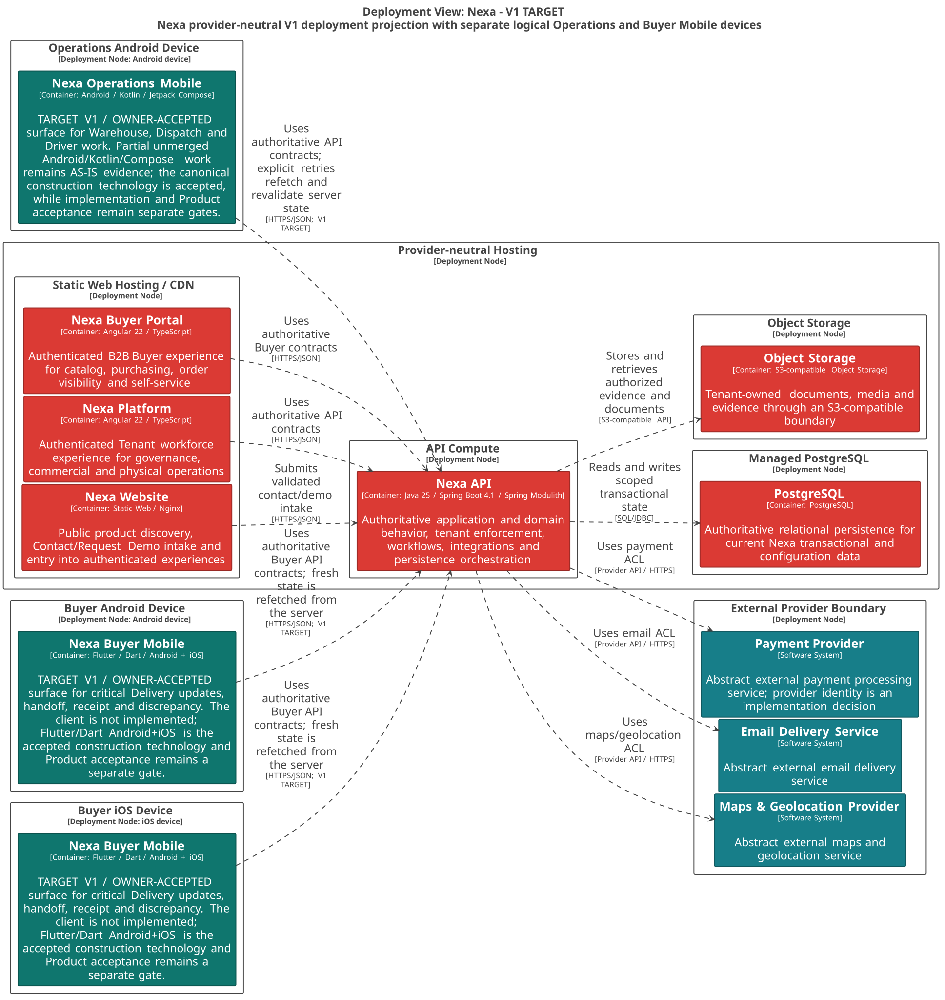

#### 2.5.3.3. Software Architecture Deployment Diagrams

La vista de despliegue muestra dónde se ejecutan las aplicaciones de Nexa y cómo se comunican con los servicios necesarios para su funcionamiento. En ella se representan los dispositivos móviles, las aplicaciones web, el servidor principal y los servicios de almacenamiento.

Esta vista permite comprender qué elementos trabajan en los dispositivos de los usuarios y cuáles se ejecutan en el servidor. También muestra cómo se organiza el almacenamiento de datos, sin confundir la distribución física del sistema con las responsabilidades de sus Bounded Contexts.

##### Topología y límites

**Tabla** 
*Nodos lógicos y responsabilidad de cada límite de ejecución.*

| Nodo | Responsabilidad |
| :--- | :--- |
| Public Edge | Sirve Website, Platform y Buyer Portal mediante HTTPS. |
| Operations Mobile Device | Ejecuta Operations Mobile instalado en dispositivo; usa HTTPS hacia Nexa API y conserva sólo estado local no autoritativo permitido. |
| Buyer Android Device | Ejecuta la misma instancia Container de Buyer Mobile en Android; usa HTTPS y revalida Buyer Relationship en servidor. |
| Buyer iOS Device | Ejecuta la misma instancia Container de Buyer Mobile en iOS; usa HTTPS y revalida Buyer Relationship en servidor. |
| Application Runtime | Ejecuta el Nexa API modular y conserva decisiones autorizadas. |
| Data Services | Almacena los datos y archivos utilizados por Nexa. En el diseño aceptado se contempla una base central para identidad y administración de empresas, junto con bases de negocio independientes por Tenant y un servicio de almacenamiento de archivos con acceso controlado. |
| External Services | Payment, email y mapas se integran mediante contratos explícitos. |

Las aplicaciones móviles se ejecutan directamente en los dispositivos de los usuarios y se comunican de manera segura con Nexa API mediante HTTPS. El servidor comprueba la identidad, los permisos y la empresa a la que pertenece cada operación antes de permitir el acceso a la información.

En el funcionamiento actual, Nexa utiliza PostgreSQL compartido con controles para separar la información de cada Tenant. Como parte del diseño aceptado, se prevé que cada empresa tenga una base de datos de negocio independiente, mientras que la información general de identidad y administración se mantenga en una base central.

La selección de la base de datos correspondiente debe realizarla el servidor a partir de información confiable. Si no puede determinarse correctamente a qué empresa pertenece una operación, el acceso debe rechazarse. De esta manera, se evita que una solicitud utilice por error información de otra empresa.

Esta organización representa una decisión de arquitectura que todavía requiere desarrollo, pruebas y una migración controlada. Asimismo, los archivos y evidencias almacenados deben conservar sus restricciones de acceso y no quedar disponibles públicamente.

**Figura** 
*Vista C4 Deployment: topología lógica de Nexa.*

*Nota. Exportación canónica de arquitectura y dominio de Nexa.*
