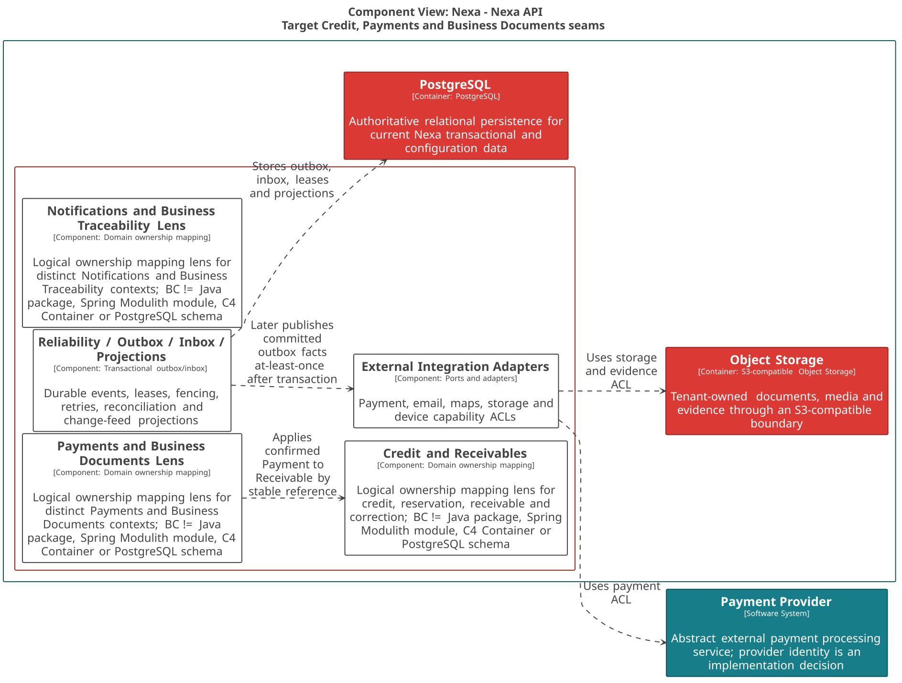
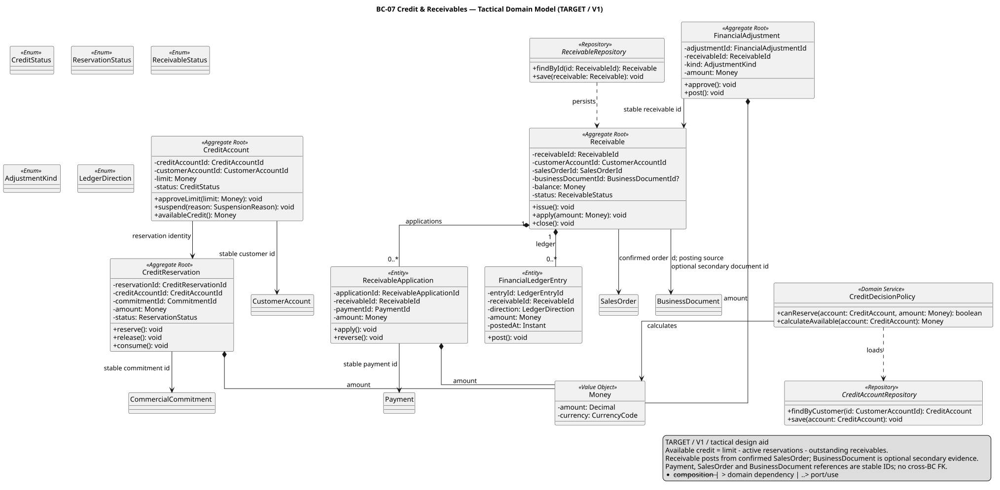
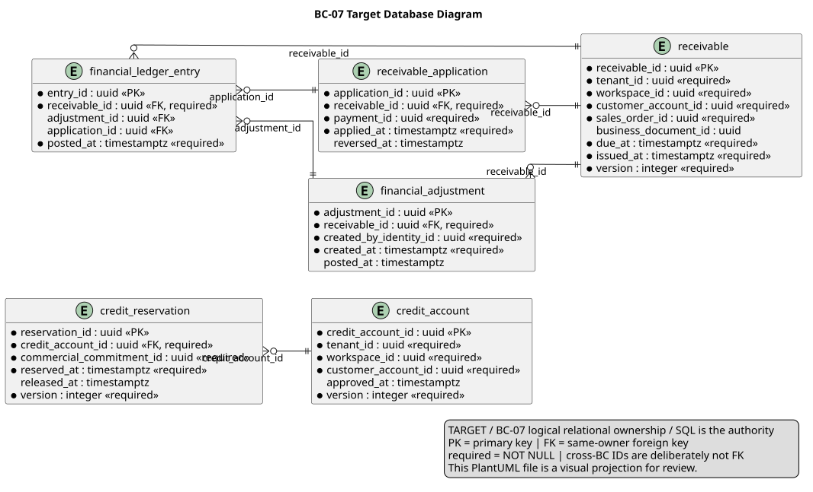

### 2.6.7. Bounded Context: Credit & Receivables

BC-07 conserva exposición crediticia, reservas y obligaciones por cobrar.
Payment es una autoridad distinta: Payment Confirmed no crea por sí mismo un
Receivable ni BC-07 importa un Payment Aggregate.

#### 2.6.7.1. Domain Layer

El dominio protege la disponibilidad de crédito mediante la siguiente relación:

`Available Credit = max(0, Credit Limit - Financed Exposure - Outstanding Receivable Balances - Active Credit Reservations)`.

Los componentes representan usos corrientes diferenciados del crédito. Una obligación no debe contabilizarse dos veces cuando su exposición se transforma, por ejemplo, de financiamiento a una cuenta por cobrar. Las transiciones de reservas, las aplicaciones de pagos y los ajustes financieros deben preservar esta consistencia sin reescribir los hechos originales.

| Clase | Categoría | Propósito | Atributos / inputs clave | Operaciones principales | Relaciones / ownership |
| :--- | :--- | :--- | :--- | :--- | :--- |
| `CreditAccount` | Aggregate Root | Mantener el límite, la política, el estado y la exposición crediticia de un Customer Account. | `CreditAccountId`, `CustomerAccountId`, límite, política, estado y versión. | Configurar límite autorizado; activar o desactivar cuenta; calcular crédito disponible. | Customer Account referenciado mediante ID de BC-02; decisiones de reserva coordinadas dentro de BC-07. |
| `CreditReservation` | Aggregate Root | Proteger crédito de fuente comercial. | `CreditReservationId`, `CreditAccountId`, `CommitmentId`, monto, status. | `reserve`, `release`, `consume`. | Lifecycle independiente; Commitment ID BC-04. |
| `Receivable` | Aggregate Root | Mantener obligación, saldo y vencimiento. | `ReceivableId`, `CustomerAccountId`, `SalesOrderId`, importes, status. | `issue`, `apply`, `close`. | Compone applications y ledger entries. |
| `FinancialAdjustment` | Aggregate Root | Conservar corrección explícita. | `FinancialAdjustmentId`, `ReceivableId`, tipo, monto, razón. | `approve`, `post`. | Referencia Receivable por ID; root independiente. |
| `ReceivableApplication` | Entity | Aplicar Payment confirmado a saldo. | application, `PaymentId`, monto. | `apply`, `reverse`. | Propiedad de Receivable; Payment ID BC-08. |
| `CreditExposurePolicy`, `ReceivableApplicationPolicy` | Domain Policies | Calcular disponibilidad de crédito y proteger la aplicación de pagos. | Límite, exposición financiada, saldos pendientes de Receivables, reservas activas e importes aplicables. | `calculateAvailable`, `canApply`, `canReverse`. | Reglas de dominio sin acceso directo a proveedores ni persistencia. |
| `CreditAccountRepository`, `CreditReservationRepository` | Repository interfaces | Cargar roots de crédito. | IDs y roots. | `byId`, `save`. | Implementaciones PostgreSQL. |
| `ReceivableRepository`, `FinancialAdjustmentRepository` | Repository interfaces | Cargar obligación/ajuste independientes. | IDs y roots. | `byId`, `save`. | No persisten Payment. |

La protección de crédito se establece durante el envío de una Purchase Request cuando corresponde al flujo sujeto a aprobación, o dentro de la misma confirmación lógica del Sales Order cuando se trata de un Direct Order. La transición de una Credit Reservation hacia la obligación correspondiente debe mantener una única exposición económica, evitando liberaciones, reservas o contabilizaciones duplicadas.

En operaciones de crédito o pago neto, el Receivable se reconoce al confirmar el Sales Order. La finalización de Delivery o la emisión de un Business Document no constituyen desencadenantes universales para registrar dicha obligación. La posterior aplicación de pagos utiliza hechos autoritativos de BC-08 mediante contratos explícitos y conserva los controles contra sobreaplicación y procesamiento duplicado.

#### 2.6.7.2. Interface Layer

La interfaz recibe comandos de crédito y obligación con scope/versión; no
confirma callbacks de proveedor ni expone Payment como aggregate local.

| Clase | Categoría | Propósito | Inputs clave | Operaciones principales | Colaboradores |
| :--- | :--- | :--- | :--- | :--- | :--- |
| `CreditController` | REST Controller | Exponer consultas de crédito, configuración restringida de cuentas y operaciones autorizadas de reservas. | Actor, Workforce Membership verificada, Tenant/Workspace, Customer Account, importe, estado solicitado, versión y autorización específica según el comando. | Consultar exposición; solicitar configuración de límite o estado; reservar o liberar crédito según las reglas correspondientes. | Credit handlers y controles de autorización del servidor. |
| `ReceivableController` | REST Controller | Exponer obligación y ajuste autorizado. | actor, SalesOrder/Receivable, versión. | `issue`, `applyPayment`, `postAdjustment`. | Receivable handlers. |

La capa de interfaz expone consultas y comandos financieros bajo autorización del servidor, preservando el alcance de Tenant y Workspace. La configuración del límite y del estado activo de un Credit Account constituye una operación restringida y distinta de la consulta de exposición o de la gestión ordinaria de reservas.

El **Business Operations Manager** constituye el operador principal autorizado para esta configuración, mientras que **Company Owner** dispone de autorización secundaria. Ambos requieren una Workforce Membership activa y verificada en la superficie `PLATFORM`, el contexto vigente de Tenant/Workspace y la capacidad específica `client.credit.configuration.manage`. La capacidad general `client.credit.manage` no concede por sí sola esta autorización; tampoco basta la denominación del rol.

La decisión corresponde al servidor y debe rechazar solicitudes con contexto ambiguo, capacidades insuficientes o estados incompatibles. Estas reglas representan la dirección de construcción aceptada y no acreditan que los comandos estén implementados o validados.

#### 2.6.7.3. Application Layer

Application coordina los comandos financieros, las transiciones autorizadas y los controles de concurrencia e idempotencia. La configuración de Credit Account debe verificar la elegibilidad del actor y comprobar que el nuevo límite no sea inferior al uso corriente del crédito, calculado a partir de la exposición financiada, los saldos pendientes de Receivables y las reservas activas, sin doble contabilización.

La desactivación de la cuenta impide nuevos usos del crédito, pero no elimina obligaciones, reservas o historial financiero existente. Los hechos confirmados de Payment se consumen mediante los contratos de integración correspondientes, sin importar un Payment Aggregate ni ejecutar operaciones directas con el proveedor desde el dominio.

| Clase | Categoría | Propósito | Inputs clave | Operaciones principales | Colaboradores |
| :--- | :--- | :--- | :--- | :--- | :--- |
| `ReserveCreditCommandHandler` | Command Handler | Resolver y persistir reserva de crédito. | commitment, amount, llave idempotente. | `handle`. | Account/reservation repositories. |
| `ReleaseCreditReservationCommandHandler` | Command Handler | Liberar reserva por transición autorizada. | reservation, razón, versión. | `handle`. | `CreditReservationRepository`. |
| `IssueReceivableCommandHandler` | Command Handler | Emitir obligación al confirmar SalesOrder. | SalesOrder fact, customer, importe. | `handle`. | `ReceivableRepository`. |
| `ApplyConfirmedPaymentCommandHandler` | Command Handler | Aplicar Payment fact a saldo. | `PaymentId`, receivable, amount, llave. | `handle`. | Receivable root y policy. |
| `PostFinancialAdjustmentCommandHandler` | Command Handler | Registrar corrección explícita. | receivable, tipo, razón, actor. | `handle`. | `FinancialAdjustmentRepository`. |
| `PaymentConfirmedEventHandler` | Event Handler | Consumir Payment fact deduplicado. | fact publicado, event ID. | `handle`. | Inbox y apply handler. |

#### 2.6.7.4. Infrastructure Layer

Infrastructure implementa persistencia de roots, deduplicación de facts y
publicación durable de consecuencias locales.

| Clase | Categoría | Propósito | Inputs / datos | Operaciones principales | Colaboradores |
| :--- | :--- | :--- | :--- | :--- | :--- |
| `PostgresCreditAccountRepository`, `PostgresCreditReservationRepository` | Repository implementations | Mapear crédito y reservas. | credit records. | `byId`, `save`. | Repositories Domain, PostgreSQL. |
| `PostgresReceivableRepository`, `PostgresFinancialAdjustmentRepository` | Repository implementations | Mapear obligación, applications y ajustes. | receivable records. | `byId`, `save`. | Repositories Domain. |
| `PaymentFactInbox` | Inbox adapter | Deduplicar Payment facts entregados al menos una vez. | event ID, status. | `claim`, `complete`. | `PaymentConfirmedEventHandler`. |
| `CreditReceivablesOutboxPublisher` | Outbox adapter | Guardar facts de receivable/adjustment comprometidos. | fact, correlación. | `enqueue`. | BC-09, BC-10, BC-11. |

#### 2.6.7.5. Bounded Context Software Architecture Component Level Diagrams

La lente C4 TARGET de Credit, Payment & Documents sitúa la exposición y los
contratos con Payment. BC-08 conserva la autoridad de pago; BC-07 no se
convierte en un componente o Container C4.

*Nota. Exportación canónica de arquitectura y dominio de Nexa.*

#### 2.6.7.6. Bounded Context Software Architecture Code Level Diagrams

Los diagramas conservan CreditReservation y FinancialAdjustment como roots
independientes y Payment como ID externo.

##### 2.6.7.6.1. Bounded Context Domain Layer Class Diagrams

El UML presenta repositories de los cuatro roots y políticas puras de exposición
y aplicación.

*Nota. Elaboración propia.*

##### 2.6.7.6.2. Bounded Context Database Design Diagram

El modelo relacional marca importes positivos/no negativos y conserva Payment,
SalesOrder, BusinessDocument y Customer como referencias tipadas externas.

*Nota. Elaboración propia.*
