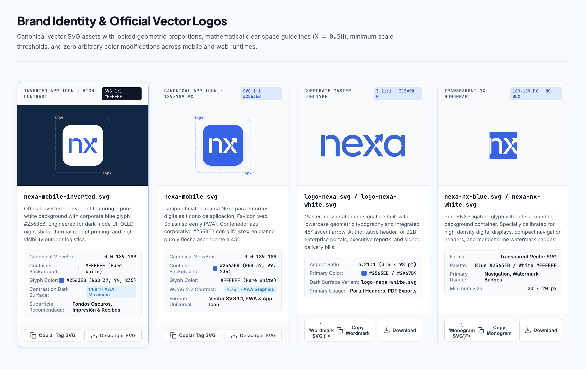
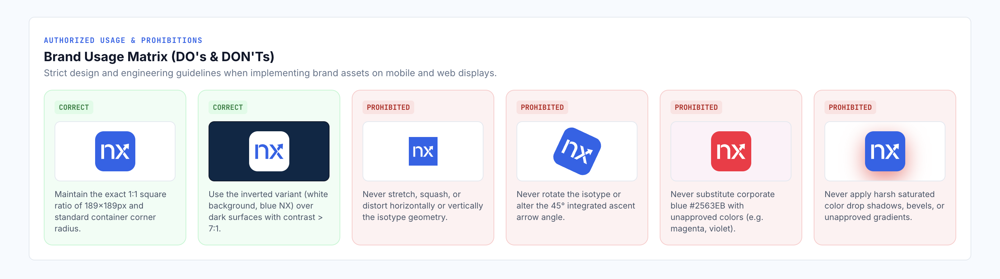
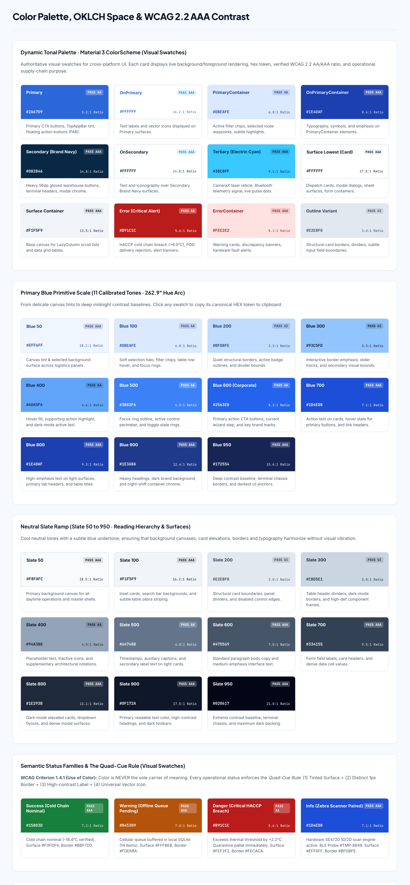
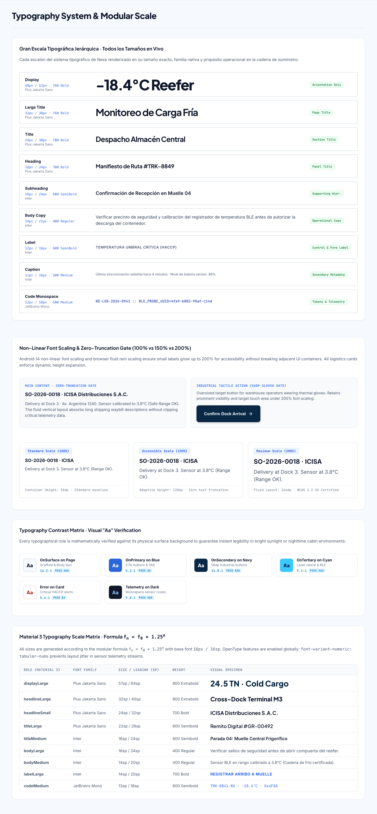
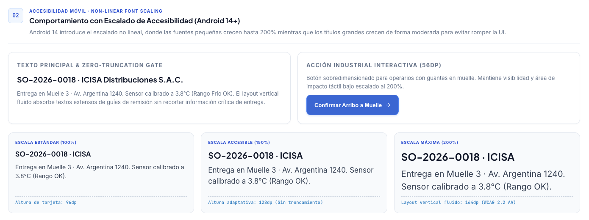
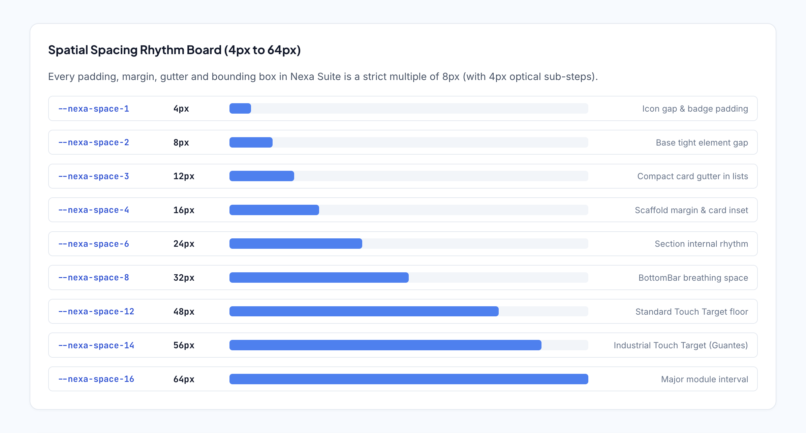
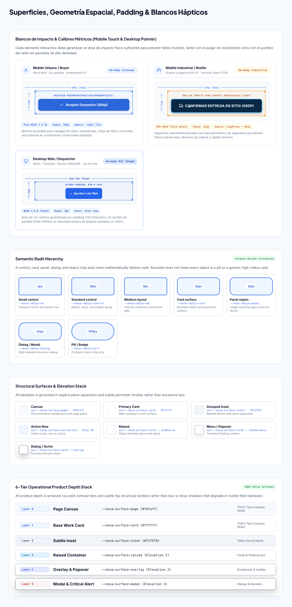
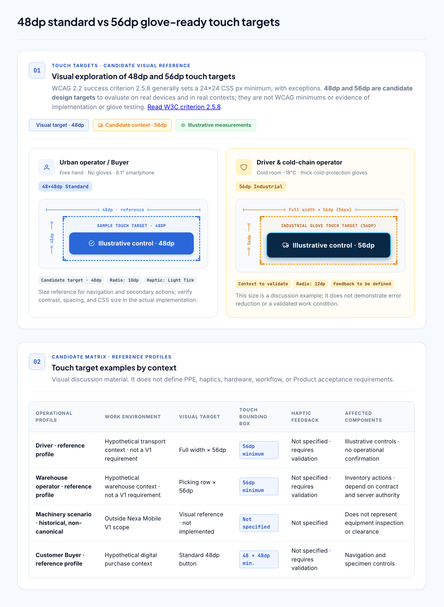
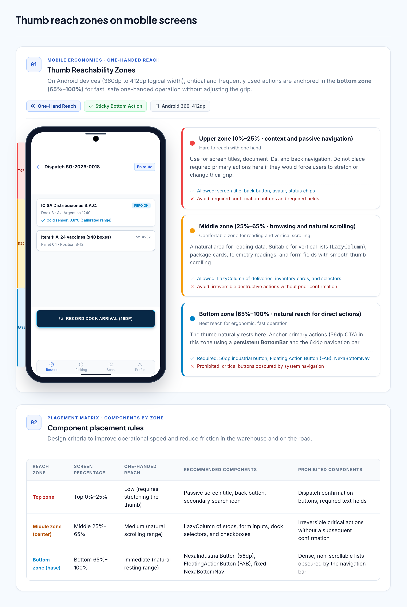
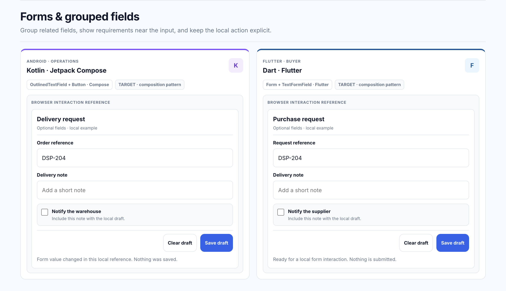

# Capítulo III: Solution UI/UX Design

## 3.1 Product Design

### 3.1.1 Style Guidelines

#### 3.1.1.1 General Style Guidelines

Las guías generales de estilo de Nexa establecen una base visual común para comunicar la identidad del producto y mantener consistencia entre sus experiencias digitales. La referencia principal es el **Master Hub de Nexa Design Lab**, que reúne identidad de marca, fundamentos cromáticos, tipografía, espaciado, superficies, principios de interacción y tono de comunicación. Los recursos vectoriales y los *design tokens* compartidos permiten expresar estas decisiones en distintas tecnologías sin exigir que todas las interfaces tengan la misma organización o densidad.

Para Nexa Mobile, esta base se adapta a dos experiencias con necesidades diferentes: **Nexa Operations Mobile**, orientada a tareas operativas, y **Nexa Buyer Mobile**, orientada a la consulta y gestión de actividades del comprador. Se comparten identidad, semántica visual y criterios de legibilidad, mientras que la disposición de controles y la información destacada se ajustan al objetivo del usuario. Las composiciones de Nexa Design Lab se utilizan como **referencias de diseño**, no como prueba de que cada pantalla, interacción o integración esté implementada en las aplicaciones.

**Principios generales de diseño**

La propuesta visual prioriza la claridad de la tarea sobre la decoración. Los elementos deben comunicar qué información es importante, qué acción está disponible y qué resultado produce una interacción. La Tabla 1 sintetiza los criterios adoptados:

**Tabla** 
*Principios generales de diseño aplicados a Nexa Mobile*

| Principio | Decisión de diseño | Aplicación en Nexa Mobile |
| :--- | :--- | :--- |
| Consistencia de identidad | Reutilizar activos vectoriales, tipografías y roles cromáticos comunes. | Operations y Buyer mantienen una identidad reconocible sin copiar necesariamente el mismo diseño de pantalla. |
| Jerarquía y lectura rápida | Diferenciar títulos, datos principales, información auxiliar y acciones mediante tamaño, peso, espaciado y agrupación. | La persona identifica la tarea actual, los datos relevantes y la acción siguiente. |
| Retroalimentación comprensible | Expresar cambios y resultados mediante texto, iconografía y estados visuales; no depender solo del color. | Los mensajes de carga, confirmación, validación o error explican qué sucede y cómo continuar. |
| Adaptabilidad | Permitir que el contenido cambie de distribución según el espacio disponible y el tamaño del texto. | Una composición compacta puede reorganizar tarjetas o controles sin ocultar información esencial. |
| Ergonomía y accesibilidad | Ofrecer objetivos táctiles adecuados, etiquetas legibles, foco visible y alternativas cuando una interacción no esté disponible. | Las acciones frecuentes se colocan en zonas alcanzables y se evita que los controles compitan por espacio. |

**Nota.** Los criterios organizan las decisiones visuales y de interacción aplicables a las experiencias móviles.

**Branding e identidad visual**

La identidad de Nexa se apoya en sus activos gráficos oficiales. El logotipo horizontal resulta apropiado cuando existe espacio para mostrar la denominación completa; el isotipo móvil permite reconocer la marca en superficies reducidas. Se mantienen las proporciones originales, el área libre alrededor del símbolo y las variantes de contraste definidas para diferentes fondos. No se debe redibujar la marca mediante texto, deformarla ni aplicarle efectos que modifiquen su geometría. Las Figuras 1 a 4 presentan, respectivamente, el logotipo horizontal, las variantes del isotipo, una composición de identidad y ejemplos de aplicación de marca.

**Figura** 
*Logotipo institucional horizontal de Nexa*

**Nota.** Recurso vectorial del sistema de identidad de Nexa.

**Figura** 
*Variantes vectoriales del isotipo de Nexa Mobile*

| Isotipo regular | Isotipo invertido |
| :---: | :---: |
|  |  |

**Nota.** (a) Variante regular. (b) Variante invertida. Ambas se representan mediante recursos vectoriales compartidos.

**Figura** 
*Composición visual de los activos de marca de Nexa*

**Nota.** Composición de referencia de Nexa Design Lab para presentar los activos de marca.

**Figura** 
*Ejemplos de usos adecuados e inadecuados de la identidad visual*

**Nota.** La composición presenta aplicaciones ilustrativas de la identidad de Nexa.

El sistema de identidad distingue, por tanto, **un activo de marca** de **una decisión de composición**: el primero debe conservarse íntegro; la segunda puede ajustarse para garantizar contraste, espacio y lectura en cada superficie. Los SVG incluidos proceden de los recursos compartidos del Design Lab.

**Colors: paleta y significado**

Nexa utiliza una identidad azul y neutral, con superficies predominantemente claras y familias semánticas para comunicar información, advertencias y errores. La asignación se realiza por **roles**, no por la selección aislada de un color. La fuente de valores del sistema de diseño se organiza en tokens primitivos, semánticos y de componente; los tonos de apoyo de un ejemplo visual no deben reemplazar esa jerarquía. La Tabla 2 resume los roles principales y la Figura 5 muestra su referencia visual.

**Tabla** 
*Roles cromáticos de referencia para la identidad visual de Nexa*

| Rol | Referencia cromática | Uso de diseño |
| :--- | :--- | :--- |
| Acción primaria e identidad | Azul Nexa; referencia visual `#2563EB` | Destacar la acción principal y los elementos activos, evitando varias acciones de igual énfasis en un mismo contexto. |
| Texto principal | `#0F172A` | Títulos, valores de lectura prioritaria y contenido principal. |
| Superficie de página | `#F6FAFF` | Plano general de lectura de la composición clara. |
| Superficie de tarjeta | `#FFFFFF` | Contenido, formularios y agrupaciones de información. |
| Superficie interior | `#F1F5F9` | Distinguir bloques relacionados sin depender de sombras intensas. |
| Borde estructural | `#E2E8F0` | Delimitar campos y grupos, complementándolo con otras señales de estado. |
| Confirmación | Verde semántico; superficie `#F0FDF4` | Comunicar un resultado favorable indicando qué acción quedó registrada o confirmada. |
| Atención | Ámbar semántico; superficie `#FFFBEB` | Informar una condición que requiere revisión o una decisión adicional. |
| Error o bloqueo | Rojo semántico; superficie `#FEF2F2` | Describir una condición que impide continuar y, cuando corresponda, ofrecer recuperación. |

**Nota.** Los códigos hexadecimales son referencias visuales; los tokens compartidos conservan la autoridad sobre los valores del sistema.

**Figura** 
*Familias cromáticas semánticas aplicadas con texto e iconografía*

**Nota.** La imagen ilustra roles semánticos de diseño; no certifica el contraste de todas las combinaciones de interfaz.

La dirección de color conserva el carácter funcional de Material Design 3, pero Nexa define sus propios roles de diseño. Los valores de contraste deben comprobarse **para cada combinación efectiva de texto y fondo**. WCAG 2.2 establece, en el criterio 1.4.3, una relación mínima de **4.5:1 para texto normal** y **3:1 para texto grande**, con las excepciones correspondientes. Una muestra cromática o un cálculo aislado no equivale a una certificación de accesibilidad de toda la aplicación.

**Typography: familias y jerarquía**

La identidad tipográfica utiliza **Plus Jakarta Sans** para encabezados de mayor jerarquía, **Inter** para lectura y controles, y **JetBrains Mono** o una alternativa monoespaciada para identificadores y datos técnicos. Estas familias cumplen funciones diferentes: la primera orienta la lectura, la segunda facilita la continuidad del contenido y la tercera diferencia valores que requieren reconocimiento preciso. La Tabla 3 organiza sus usos y la Figura 6 ilustra su jerarquía.

**Tabla** 
*Familias tipográficas y roles de jerarquía visual de Nexa*

| Nivel | Familia de referencia | Criterio de uso |
| :--- | :--- | :--- |
| Display y encabezados | Plus Jakarta Sans | Identificar pantalla, sección o dato destacado sin multiplicar títulos dominantes. |
| Texto de cuerpo | Inter | Presentar instrucciones, descripciones y contenido habitual con interlineado legible. |
| Etiquetas y controles | Inter | Nombrar acciones, campos, filtros y estados de manera breve y consistente. |
| Códigos e identificadores | JetBrains Mono / pila monoespaciada | Mostrar códigos y valores de estructura fija sin confundirlos con texto narrativo. |

**Figura** 
*Jerarquía de roles y familias tipográficas del sistema visual*

**Nota.** Referencia visual de Nexa Design Lab sobre los roles tipográficos.

En Mobile, las dimensiones del texto deben respetar los mecanismos de escalado propios de Android y Flutter. Se busca que las etiquetas permanezcan asociadas con sus controles, que el contenido pueda crecer verticalmente y que los identificadores importantes sigan disponibles cuando aumenta el tamaño de letra. La intención de diseño incluye revisar el reflujo hasta un escalado de texto del 200 %, sin considerar que la visualización de una muestra sustituye una prueba de accesibilidad en los dispositivos de destino. La Figura 7 presenta una composición ilustrativa de ese comportamiento.

**Figura** 
*Reorganización del contenido móvil ante el escalado tipográfico*

**Nota.** Ejemplo del laboratorio Mobile Style; la accesibilidad y el reflujo deben validarse en las aplicaciones y dispositivos de destino.

**Spacing: ritmo, agrupación y composición**

El espaciado comunica relación entre elementos. Los tokens compartidos utilizan una escala que incluye **4, 8, 12, 16, 20, 24, 32, 40, 48 y 64 px**. El ritmo visual toma 8 como referencia frecuente y 4 como ajuste fino, pero **no exige que toda separación sea múltiplo estricto de 8**: el valor de 12 tiene un uso explícito en la escala. La Tabla 4 resume el uso de las separaciones y la Figura 8 ilustra la escala.

**Tabla** 
*Escala de espaciado y criterios de agrupación de elementos*

| Valor de referencia | Aplicación habitual |
| :--- | :--- |
| 4–8 | Proximidad entre icono y etiqueta o entre elementos de un mismo grupo. |
| 12–16 | Separación compacta entre elementos relacionados y relleno de tarjetas. |
| 20–24 | Aire interior de paneles y separación entre bloques temáticos. |
| 32–48 | Distancia entre regiones principales y secciones de contenido. |
| 64 | Separaciones mayores cuando la composición dispone del espacio suficiente. |

**Nota.** Los intervalos representan valores de referencia para la composición y no medidas obligatorias de cada componente.

**Figura** 
*Aplicación visual de la escala y los tokens de espaciado*

**Nota.** Los valores del Hub se interpretan según la unidad de la plataforma; los píxeles CSS no equivalen automáticamente a dp nativos.

Estas unidades corresponden a **tokens CSS compartidos** y no deben interpretarse automáticamente como `dp` nativos. En los ejemplos móviles, el adaptador visual utiliza una base de **8 dp**, un ajuste fino de **4 dp**, márgenes laterales de **16 dp** y una separación entre tarjetas de **12 dp**. Cada tecnología aplica unidades y mecanismos de escala acordes con su plataforma.

**Superficies, forma y organización adaptable**

Las superficies permiten distinguir el fondo de trabajo, las tarjetas que agrupan información y los elementos temporales que requieren atención. En la referencia compartida, el sistema asigna radios diferenciados según la función: **10 px** para controles, **16 px** para tarjetas y **24 px** para diálogos. Los radios no son decoraciones universales: su consistencia facilita reconocer el tipo de elemento y su relación con los demás. La Figura 9 muestra la jerarquía visual de estas superficies.

**Figura** 
*Jerarquía visual de superficies, contenedores y elementos superpuestos*

**Nota.** Referencia del sistema de superficies y jerarquía de capas del Nexa Design Lab.

La disposición debe responder al contenido y al ancho disponible. En teléfonos se prioriza una lectura secuencial y una acción principal fácilmente localizable; en espacios más amplios puede mostrarse información relacionada en paneles simultáneos, siempre que la interacción conserve un orden comprensible. Las listas y tarjetas pueden aumentar de altura y las tablas extensas deben desplazarse dentro de un área apropiada, evitando el recorte de información esencial.

**Aplicación en Mobile: ergonomía e interacción**

Los fundamentos del Hub se complementan con referencias del espacio Mobile del Design Lab. En sus ejemplos de interacción táctil se comparan objetivos de **48 × 48 dp** para controles móviles estándar y **56 dp** para situaciones operativas que podrían requerir áreas mayores. Se trata de **referencias de diseño sujetas a evaluación en contexto**, no de dimensiones universales de todos los controles ni de resultados de pruebas con guantes. La Figura 10 compara ambas referencias.

**Figura** 
*Comparación de áreas táctiles de referencia para contextos móviles*

**Nota.** Los objetivos de 48 × 48 dp y 56 dp son referencias de diseño de Mobile Style, no resultados de pruebas ergonómicas ni una exigencia universal de WCAG.

La ubicación de controles también responde a su frecuencia y contexto. Los encabezados pueden contener orientación y acciones de navegación, el centro de la pantalla reúne lectura y edición, y las acciones frecuentes pueden ocupar zonas inferiores cuando esta decisión mejora el alcance. El diseño debe respetar las áreas seguras del sistema operativo y evitar que un botón persistente oculte contenido. La Figura 11 presenta una orientación ilustrativa de estas zonas.

**Figura** 
*Zonas ilustrativas de alcance manual y ubicación de acciones móviles*

**Nota.** Esquema de orientación visual del laboratorio, no una medición de alcance certificada para todos los dispositivos o usuarios.

La aplicación de estas reglas debe contemplar botones, campos, controles de selección, tarjetas, mensajes de progreso y avisos. Por ejemplo, un formulario necesita una etiqueta asociada al dato solicitado, una descripción del error cuando corresponda y una acción comprensible para continuar. Los estados de carga y confirmación deben tener una alternativa textual que no dependa únicamente del color, la vibración o un icono. La Figura 12 reúne ejemplos de estos recursos dentro de una composición de formulario.

**Figura** 
*Composición móvil de campos, validaciones y acciones de formulario*

**Nota.** Composición de referencia del laboratorio Mobile Style para la organización de formularios y mensajes.

En particular, el diseño no debe confundir una **confirmación visual** con una **operación de negocio realizada**: la actualización de pedidos, inventario, entregas y otras decisiones protegidas depende de la autoridad del sistema correspondiente. Del mismo modo, los ejemplos del laboratorio no implican rastreo permanente, telemetría automática ni sincronización offline general como características adoptadas del producto.

**Tono de comunicación y lenguaje**

La comunicación de Nexa debe ser **seria, profesional, respetuosa y serena**. Esta dirección permite presentar información comercial y operativa sin dramatizar los errores, introducir humor inapropiado o asignar culpabilidad a las personas. La Tabla 5 organiza esta dirección de comunicación en las cuatro dimensiones solicitadas por el enunciado académico:

**Tabla** 
*Dimensiones de tono de comunicación adoptadas para Nexa*

| Dimensión | Dirección adoptada | Aplicación |
| :--- | :--- | :--- |
| Divertido / Serio | **Serio** | Priorizar exactitud y comprensión en mensajes operativos y comerciales. |
| Formal / Casual | **Profesional y directo** | Elegir verbos concretos y evitar fórmulas ceremoniosas o excesivamente técnicas. |
| Respetuoso / Irreverente | **Respetuoso** | Comunicar problemas sin responsabilizar a quien utiliza la aplicación. |
| Entusiasta / Sereno | **Sereno y objetivo** | Confirmar el resultado sin exageraciones visuales o verbales. |

**Nota.** Las cuatro dimensiones responden a los ejes de voz y tono solicitados en el enunciado académico.

El idioma base de las interfaces del proyecto es **inglés (`en_US`)** y se contempla **español latinoamericano (`es_419`)** como localización adicional. Las cadenas deben conservar la misma intención y la terminología de producto en ambos idiomas. Los textos de las interfaces también requieren espacio para ampliarse sin quedar truncados. La Tabla 6 presenta ejemplos de microcopy en ambos idiomas.

**Tabla** 
*Ejemplos de microcopy de Nexa en inglés y español latinoamericano*

| Contexto | Inglés (`en_US`) | Español latinoamericano (`es_419`) |
| :--- | :--- | :--- |
| Información temporalmente no disponible | “This information is unavailable right now.” | “Esta información no está disponible ahora.” |
| Dato que requiere revisión | “Review the information before continuing.” | “Revisa la información antes de continuar.” |
| Solicitud no completada | “We couldn’t complete the request.” | “No se pudo completar la solicitud.” |
| Solicitud recibida | “Your request was received.” | “Recibimos tu solicitud.” |

**Nota.** Los mensajes son ejemplos editoriales; no confirman que estas cadenas estén implementadas ni que una operación de negocio haya sido completada.

Estos enunciados son ejemplos de **microcopy**, no afirmaciones de que una operación concreta haya sido ejecutada. Cuando un proceso no se completa, el mensaje real debe especificar la causa conocida y la alternativa disponible sin prometer una recuperación que el sistema no ofrece.

En conjunto, las guías definen una identidad consistente y un lenguaje visual aplicable a Nexa Mobile, adaptable al trabajo operativo y a las tareas del comprador. Las decisiones se fundamentan en los activos y tokens compartidos de Nexa, las referencias de Material Design 3 y los criterios de accesibilidad WCAG 2.2, manteniendo separadas las **guías de diseño** de las evidencias de implementación y validación del producto.
