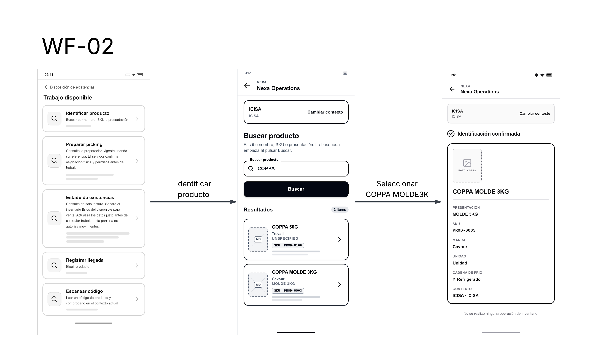

#### 3.1.2.2 Labelling Systems

Las etiquetas ayudan a reconocer el destino antes de tocar un enlace o botón. En el sitio público nombramos cada sección por lo que contiene. En las apps usamos nombres cortos para las vistas y verbos para las acciones.

*Tabla. Etiquetas de navegación y acciones de Nexa.*

| Dónde aparece | Etiqueta | Qué encuentra o hace el usuario |
| --- | --- | --- |
| Website | Plataforma | Explicación de los módulos y del flujo de trabajo. |
| Website | Buyer Portal | Información sobre la compra y el seguimiento de pedidos. |
| Website | Empresa | Información del equipo detrás de Nexa. |
| Buyer | Catálogo / Catalog | Productos y filtros de compra. |
| Buyer | Pedidos / Orders | Solicitudes, historial de pedidos y acceso a seguimiento. |
| Buyer | Seguimiento / Tracking | Estado y detalle de las entregas. |
| Buyer | Notificaciones / Notifications | Avisos de la cuenta actual. |
| Operations, wireflow WF-02 | Buscar producto, Buscar y Resultados | La primera etiqueta ubica la tarea, la segunda ejecuta la búsqueda y la tercera identifica la lista de coincidencias. |

Usamos «Identificación confirmada» cuando el flujo resuelve el artículo. En una entrega, «Confirmar recepción» nombra la acción del comprador. Cada etiqueta corresponde al paso que el usuario está realizando.

*Figura. Búsqueda manual y ficha de producto en el wireflow WF-02 de Operations.*

Fuentes de las etiquetas publicadas. [Navegación del sitio](https://github.com/nexa-suite/website/blob/2fcd3eb8c64544bebceccb6da149a8520057b12b/index.html) · [Textos de Buyer en español](https://github.com/nexa-suite/mobile/blob/v3.0.2/apps/buyer-mobile/lib/l10n/app_es.arb) · [Textos de Buyer en inglés](https://github.com/nexa-suite/mobile/blob/v3.0.2/apps/buyer-mobile/lib/l10n/app_en.arb)
