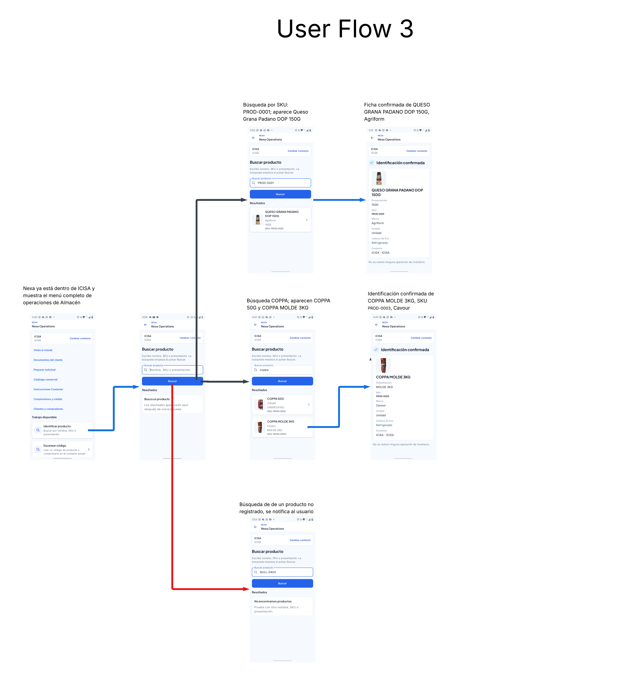

#### 3.1.2.4 Searching Systems

En Buyer, la búsqueda parte del catálogo. El comprador puede escribir el nombre del producto, una marca o un SKU. Puede acotar la consulta por categoría, familia, variante, marca, disponibilidad y condición de conservación. Los resultados muestran el nombre, la presentación, el precio y la disponibilidad que devuelve el catálogo. Desde un resultado se abre la ficha y se elige el producto para el borrador.

En Operations, el personal de almacén puede buscar por nombre, SKU o presentación y filtrar por marca o categoría. Los resultados muestran datos para distinguir variantes antes de abrir la ficha. El lector de códigos resuelve un identificador físico. Si el código es desconocido o ambiguo, o si la cámara no está disponible, la consulta manual permite continuar. El flujo comprueba el SKU antes de usarlo en la tarea de almacén.

*Figura. El flujo de búsqueda manual de Operations muestra los resultados, la ficha del producto y el estado sin coincidencias.*

Fuentes de las opciones disponibles. [Catálogo de Buyer](https://github.com/nexa-suite/mobile/blob/v3.0.2/apps/buyer-mobile/lib/contexts/catalog_commercial_policy/presentation/catalog_page.dart) · [Búsqueda de Operations](https://github.com/nexa-suite/mobile/tree/v3.0.2/apps/operations-android/contexts/catalogcommercialpolicy)
