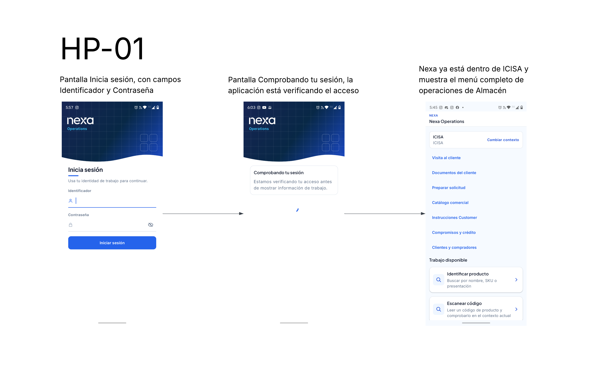
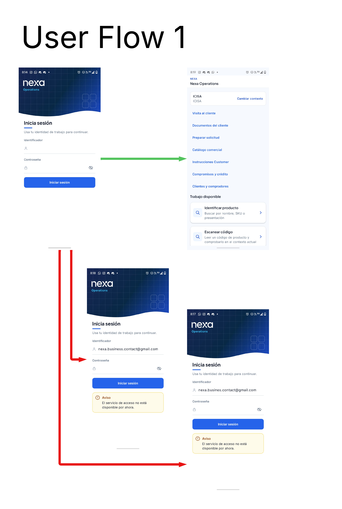
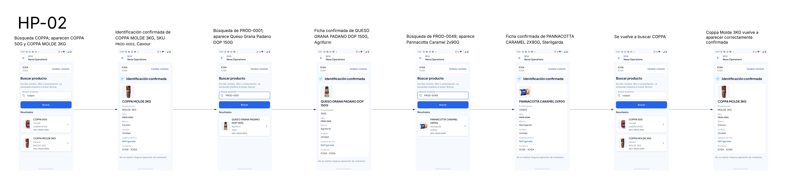
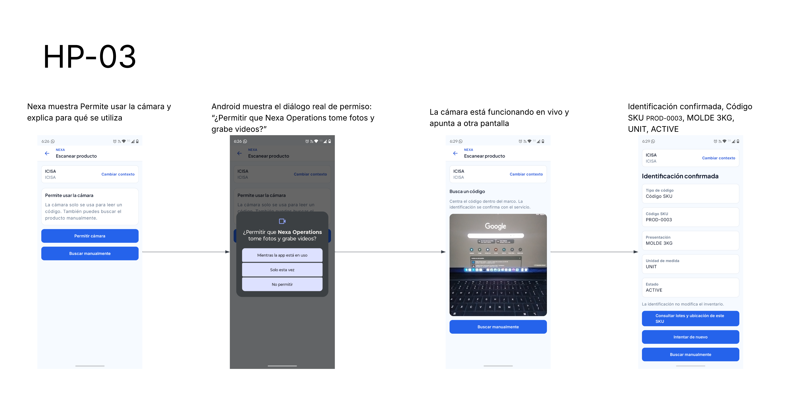
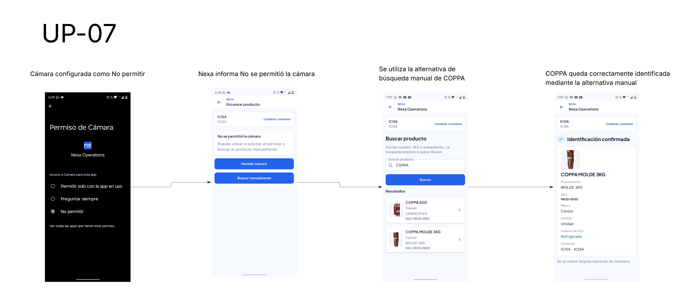
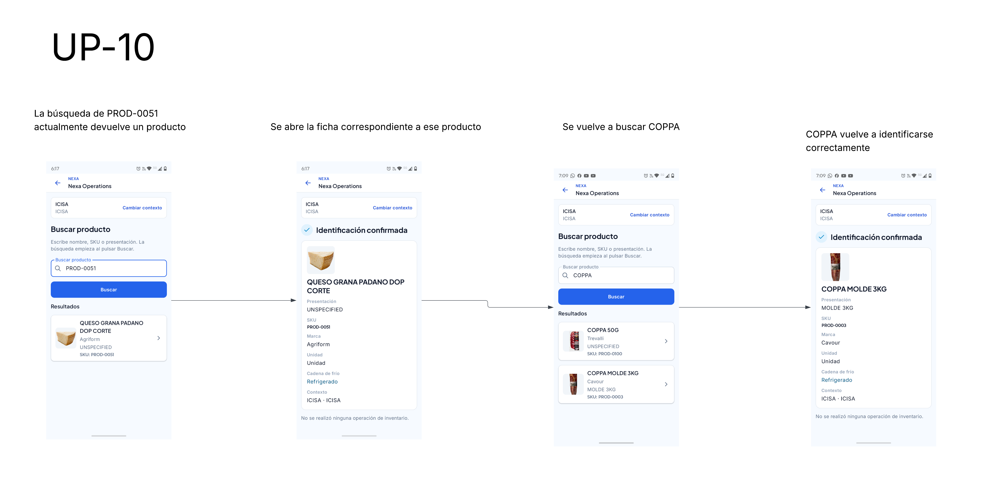
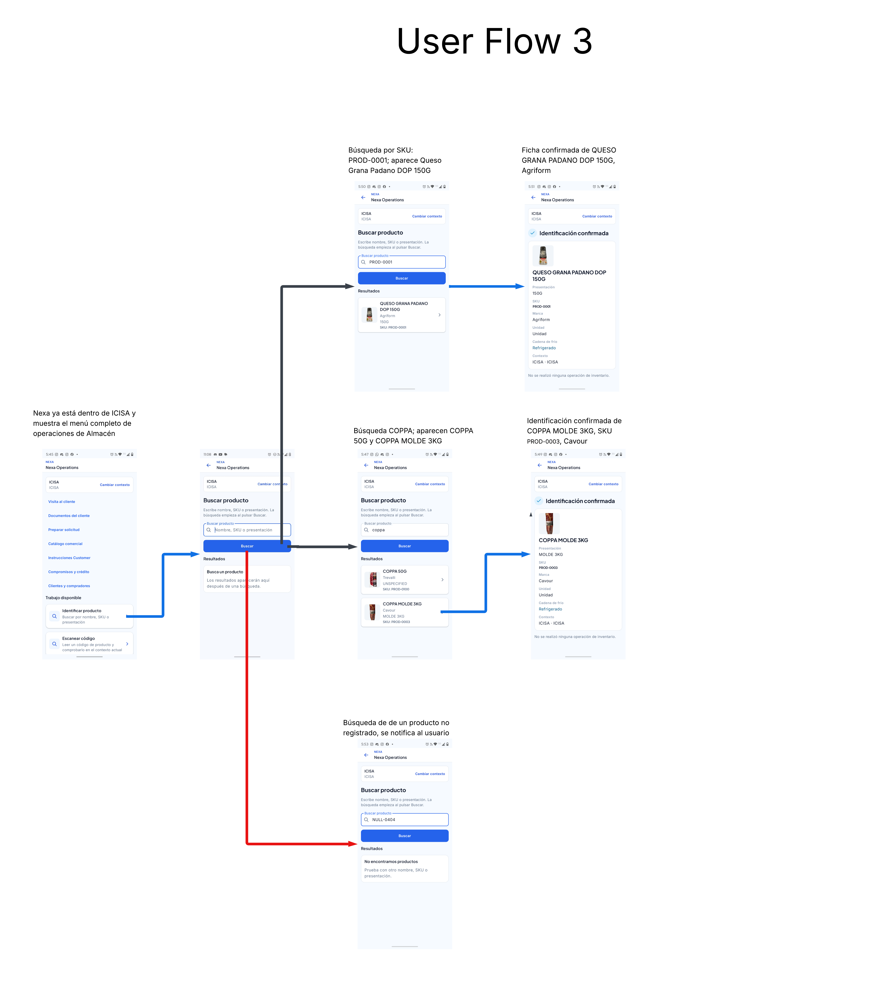

#### 3.1.4.4 Mobile Applications User Flow Diagrams

Los recorridos agrupan historias por actor y objetivo UX; no cambian su estado de Product ni demuestran aceptación. En Blueprint, el backlog canónico de 73 historias registra 30 `PLANNED` y 43 `DEFERRED`; ninguna figura como `IMPLEMENTED`, `VERIFIED` o `PRODUCT_ACCEPTED` en el corte consultado. En cada cambio de negocio, la app presenta el contexto vigente y solicita la acción al servidor, que confirma el resultado; la información local por sí sola no establece un hecho de negocio. Cada alternativa conserva la claridad cuando la identidad, asignación o dato requiere revisión. El recorrido Buyer pertenece al diseño de Buyer Mobile en Flutter; el operativo, al de Operations Mobile nativa Android en Kotlin. Las figuras y tablas organizan metas, recorridos y alternativas; por sí solas no prueban ejecución conectada. Buyer Mobile se presenta como objetivo de diseño `TARGET`.

**Retomar trabajo autorizado**

| Historias | Objetivo | Camino principal | Alternativa |
| --- | --- | --- | --- |
| MOB-US-001–003 | **1. Reanudar el contexto de trabajo** | La persona inicia sesión, selecciona Tenant/Workspace y abre una tarea que el servidor confirma para su membresía y capacidades. **Cierre:** identidad, contexto y tarea permitida quedan confirmados. | Si la sesión vence, el acceso se revoca o el contexto no está disponible, vuelve a autenticarse o actualizarlo; sin confirmación no se muestra trabajo protegido. |

*La captura recorre el inicio de sesión, el estado visible de la sesión y el menú de operaciones.*

*User Flow 1: inicio de sesión, apertura del menú operativo y aviso de indisponibilidad del servicio de acceso.*

La ruta principal conduce del inicio de sesión al menú de trabajo disponible. La alternativa mantiene el formulario y muestra «El servicio de acceso no está disponible por ahora».

**Registrar trabajo de almacén**

| Historias | Objetivo | Camino principal | Alternativa |
| --- | --- | --- | --- |
| MOB-US-011–012 | **2. Identificar un producto** | Desde una tarea de almacén, el operador escanea el código y revisa el producto coincidente antes de continuar. **Cierre:** queda confirmada una coincidencia clara y autorizada; la identificación no registra hechos de stock. | Sin cámara o permiso, busca por texto o código; si la consulta devuelve coincidencias ambiguas o ninguna, refina la búsqueda y no adivina. |
| MOB-US-013–014 | **3. Registrar la recepción física** | El operador registra SKU, cantidad, lote y vencimiento observados y solicita confirmar la recepción con esos datos. **Cierre:** el servidor confirma un arribo completo con cantidad positiva. | Si los datos físicos difieren de lo esperado, registra los hechos observados y la diferencia. Si falta un dato requerido, detiene el envío hasta corregirlo; una recepción no confirmada no aumenta el stock disponible. |
| MOB-US-015–016 | **4. Preparar el lote y la cantidad asignados** | El operador revisa la condición del stock y la Physical Allocation vigentes, selecciona el lote elegible según FEFO y solicita confirmar la cantidad asignada. **Cierre:** queda confirmado el picking contra lote elegible y cantidad restante. | Si el estado está desactualizado, el lote vencido, retenido, en cuarentena o no asignado, o la cantidad excede lo restante, detiene la acción y revisa el trabajo vigente. |
| MOB-US-017 | **5. Reportar una discrepancia de stock** | El operador registra la diferencia física, los artículos afectados, el motivo y la evidencia pertinente para que la revise el actor autorizado. **Cierre:** queda registrado el reporte autorizado; la disposición del stock se decide por separado. | Si falta permiso, motivo o evidencia requerida, conserva la diferencia para completar el reporte; sin autoridad de resolución no cambia la disposición. |
| MOB-US-018 | **6. Transferir stock entre ubicaciones (DEFERRED)** | **Diseño de evolución:** el operador identifica origen, destino, lote y cantidad; confirma el movimiento con datos vigentes y, en destino, confirma por separado lo recibido. El resultado esperado conserva distintos los hechos de origen, tránsito y recepción. | Si faltan datos o la recepción en destino difiere, el movimiento queda sin resolver; un borrador local no confirma el movimiento ni la recepción. |
| MOB-US-019 | **7. Registrar temperatura manual** | El operador selecciona el lote o almacén observado y registra el valor, unidad, momento y sujeto de la lectura. **Cierre:** queda confirmada una lectura atribuible al sujeto y alcance registrados. | Si falta sujeto o unidad, no crea evidencia incompleta. Cuando una lectura constituye una excursión según el control aplicable, el HOLD para un lote afecta solo la cantidad identificada; para un almacén se seleccionan primero los lotes y cantidades afectados. Un actor autorizado determina la disposición. |

*La secuencia muestra consultas de texto, resultados similares, una ficha y una consulta posterior.*

*La lámina reúne la explicación del permiso, el diálogo de Android, la cámara abierta y la ficha de PROD-0003 con «Identificación confirmada».*

*La captura muestra la denegación del permiso, la búsqueda manual y la apertura de una ficha.*

*La secuencia contiene una consulta por código con su ficha y otra consulta por nombre con su ficha.*

*User Flow 2: permiso de cámara, alternativa manual, identificación por código y resultados de búsqueda.*

Con el permiso concedido, el recorrido pasa al escaneo y a la ficha del producto identificado; si se deniega, ofrece abrir Ajustes o buscar manualmente. Ante un código sin coincidencia permite reintentar o buscar manualmente, y una consulta sin resultados invita a probar otro nombre, SKU o presentación.

*User Flow 3: búsqueda por SKU o nombre, ficha confirmada y consulta sin productos coincidentes.*

La consulta por SKU PROD-0001 conduce a la ficha de Queso Grana Padano DOP 150G; COPPA muestra dos resultados y permite abrir COPPA MOLDE 3KG. La búsqueda NULL-0404 no devuelve productos e invita a probar otro nombre, SKU o presentación.

**Preparar y despachar una entrega preparada**

| Historias | Objetivo | Camino principal | Alternativa |
| --- | --- | --- | --- |
| MOB-US-020–025 | **8. Preparar y despachar una entrega asignada** | El coordinador revisa una entrega preparada con datos vigentes, asigna un Driver elegible, contrasta los bienes salientes con la Physical Allocation, conserva la evidencia requerida y solicita confirmar el despacho. **Cierre:** el servidor confirma el despacho de esa entrega. | Si la entrega no está lista, la asignación no es elegible, los bienes no coinciden, falta evidencia o el estado cambió, detiene la confirmación y actualiza la información. Si la respuesta es incierta, consulta la misma entrega antes de reintentar. |

**Ejecutar trabajo como Driver**

| Historias | Objetivo | Camino principal | Alternativa |
| --- | --- | --- | --- |
| MOB-US-026–028, 031–033 | **9. Ejecutar una entrega asignada** | El Driver revisa una asignación vigente, inicia el Delivery Attempt, puede pasar el destino autorizado a navegación externa y registra el resultado físico, las cantidades y la evidencia requerida. **Cierre:** queda confirmado el resultado del intento y, cuando la política lo requiere, su POD. | Si la asignación está desactualizada, falta evidencia o el resultado no está confirmado, detiene la acción y consulta el mismo intento antes de repetirla. El resultado del Driver y el POD permanecen separados; las cantidades parciales o rechazadas no se muestran como una entrega completa. |
| MOB-US-029 | **10. Considerar la ubicación de una entrega (DEFERRED)** | **Diseño de evolución:** se conserva la intención de compartir la ubicación de una entrega para apoyar el trabajo del Driver; las reglas de esa capacidad quedan sujetas a una definición futura aceptada. | En V1, el Driver pasa el destino autorizado a navegación externa según el objetivo 9. Esa acción no registra ubicación de la entrega; la meta MOB-US-029 permanece diferida. |
| MOB-US-034 | **11. Presentar un código acotado de entrega** | Con una entrega y un intento activos, el Driver presenta el código breve asociado a esa Delivery para identificar el handoff. **Cierre:** el código verificado identifica el handoff, pero no registra Buyer Receipt, POD ni finalización. | Si el código es incorrecto, venció o ya se utilizó, no cambia la entrega. Si no está disponible, solo una alternativa aprobada mantiene explícito el handoff; no se registra una aceptación falsa. |

**Revisar una entrega como Buyer**

| Historias | Objetivo | Camino principal | Alternativa |
| --- | --- | --- | --- |
| MOB-US-044 | **12. Identificar una entrega propia que requiere atención (TARGET)** | Buyer Mobile presenta una actualización relevante de una Delivery propia; el Buyer abre la relación autorizada y consulta el estado vigente. **Cierre de diseño:** muestra el estado actual de una entrega propia; la actualización no cambia la Delivery. | Si la notificación no llega, el Buyer puede consultar la Delivery al abrir la app. Una relación ajena no revela información de la entrega. |
| MOB-US-047–049 | **13. Confirmar lo recibido o reportar una diferencia (TARGET)** | El Buyer verifica que el código corresponda a la Delivery y al intento, compara las cantidades y solicita registrar el Buyer Receipt. **Cierre de diseño:** el recibo queda confirmado y cualquier Discrepancy se conserva como hecho separado. | Si el código es inválido, venció o no puede verificarse, la recepción queda sin confirmar. Una diferencia preserva los hechos del Driver y del Buyer sin reemplazarlos. |

**Cobertura del catálogo canónico**

Las trece metas anteriores relacionan 30 historias: 28 `PLANNED` y dos `DEFERRED` (`MOB-US-018` y `MOB-US-029`). Las otras 43 historias todavía no tienen una fila propia en estas metas: dos están `PLANNED` (`MOB-US-009` y `MOB-US-073`) y 41 `DEFERRED`. La ausencia de una meta aquí representa una brecha de cobertura del informe, no una modificación del backlog ni una afirmación sobre su implementación.

*Historias sin una meta propia entre las trece metas documentadas, según el backlog canónico consultado al 30 de octubre de 2026.*

| Historias | Estado canónico | Área de resultado |
| --- | --- | --- |
| MOB-US-004–008, MOB-US-010 | `DEFERRED` | Consulta operativa, clientes y relaciones, catálogo, solicitudes de campo y seguimiento de compromisos. |
| MOB-US-009 | `PLANNED` | Direct Order desde trabajo de campo; el Owner aceptó el alcance el 8 de octubre de 2026. Implementación, verificación del contrato, validación de solución y Product Acceptance siguen pendientes. |
| MOB-US-030, MOB-US-035 | `DEFERRED` | Contacto con Buyer durante entrega y continuidad de evidencia tras perder conexión. |
| MOB-US-036–043 | `DEFERRED` | Catálogo Buyer, Purchase Requests, pedidos, cambios y estado de crédito/pagos. |
| MOB-US-045–046 | `DEFERRED` | Mapa de Driver y contacto con Driver. |
| MOB-US-050–056 | `DEFERRED` | Discrepancias de recepción, cuarentena, transferencias, conteos, sustituciones, identidad ampliada y operaciones por lote. |
| MOB-US-057–066 | `DEFERRED` | Discrepancias de despacho, reasignación, coordinación y excepciones de entrega. |
| MOB-US-067–069 | `DEFERRED` | Instrucciones, continuidad e historial de entrega para Buyer. |
| MOB-US-070–072 | `DEFERRED` | Finanzas, documentos y visita de campo. |
| MOB-US-073 | `PLANNED` | Hipótesis de almacén inteligente, Sprint `UNASSIGNED`; Blueprint registra tres Outcome Conditions y no contiene un bloque canónico de Acceptance Criteria. |

**Límites de implementación y dependencia entre superficies**

La revisión estática de Mobile `16124927d1289a8566299aa52b2136fcb5f14a71` encontró 22 nodos `GoRoute` de Buyer y 39 entradas de capacidades conectadas de Operations, 14 ocultas del hub. Son declaraciones de navegación y capacidad, no conteos de pantallas distintas ni recorridos verificados. La presencia de rutas y clientes API de Purchase Requests no eleva `MOB-US-036–043` desde `DEFERRED` ni acredita un flujo integrado aceptado. Los tests existentes en el código tampoco se consideran ejecutados por esta revisión.

Las ocho figuras del apartado muestran tres diagramas de flujo y cinco láminas de escenarios; cubren principalmente acceso, identificación de productos, búsqueda manual, consulta de existencias vacía y búsqueda de clientes. No describen por completo recepción, picking, despacho, ejecución de Driver, comercio Buyer ni recepción Buyer. La revisión que respalda esta actualización fue estática: no ejecutó aplicaciones, tests, flujos E2E ni pruebas en dispositivo físico.

El árbol Buyer contiene rutas de acceso y recuperación, catálogo, solicitudes y entregas. Esa evidencia no determina si el flujo requiere una página del Buyer Portal, una acción previa en Platform o una alternativa Web; tampoco demuestra compatibilidad de extremo a extremo con API. La documentación y el código revisados no establecen una dependencia Web obligatoria para las familias siguientes.

*Dependencias entre Mobile y Web demostradas por las fuentes revisadas.*

| Familia | Evidencia observada | Límite de la evidencia |
| --- | --- | --- |
| Acceso y recuperación | Buyer declara rutas de acceso, solicitud de recuperación y restablecimiento. | No se verificó el ciclo completo con correo, enlace, API y navegador desplegado; no se afirma una transición Web obligatoria. |
| Relación Buyer | El capítulo incluye una lámina de consulta de clientes y relación con comprador; Operations declara una entrada de clientes. | No se demostró una dependencia previa del Buyer Portal ni un recorrido conectado que compruebe la relación autorizada. |
| Purchase Requests | Buyer declara rutas y llamadas cliente relacionadas con solicitudes. | `MOB-US-036–043` continúa `DEFERRED`; no hay un flujo Mobile/Web integrado y aceptado que pueda presentarse como funcional. |
| Trabajo operativo | Operations declara entradas para almacén, despacho y Driver. | La presencia de entradas no establece una tarea previa en Platform; la integración con API no se ejecutó en esta revisión. |

Por tanto, este apartado no presenta una transición entre Mobile y Web como requisito aceptado ni como recorrido funcional verificado. Para añadirla, primero debe trazarse contra contratos y decisiones aceptados y después respaldarse con evidencia de integración.

Para `MOB-US-073`, se mantienen separados los tres Outcome Conditions de Blueprint y los cinco escenarios académicos que aparecen en el informe. Los escenarios no sustituyen Acceptance Criteria canónicos. La clasificación `PLANNED` tampoco implica que la capacidad tenga hardware, telemetría o mecanismo de medición seleccionado.

*Fuentes de alcance y evidencia técnica.*

- [Master Mobile Product Backlog, Blueprint en `d5bc761`](https://github.com/nexa-suite/blueprint/blob/d5bc761f8877ed30d7464573825e3f02b084f914/03-mobile/requirements/master-mobile-backlog.md): estados de ciclo de vida y distribución de las 73 historias.
- [Master Mobile Functional Story Registry, Blueprint en `d5bc761`](https://github.com/nexa-suite/blueprint/blob/d5bc761f8877ed30d7464573825e3f02b084f914/03-mobile/requirements/mobile-v1-catalog.md): actores, objetivos, dependencias y contenido canónico, incluido `MOB-US-073`.
- [Buyer router, Mobile en `1612492`](https://github.com/nexa-suite/mobile/blob/16124927d1289a8566299aa52b2136fcb5f14a71/apps/buyer-mobile/lib/main.dart#L372): rutas declaradas del cliente Buyer.
- [Operations capability registry, Mobile en `1612492`](https://github.com/nexa-suite/mobile/blob/16124927d1289a8566299aa52b2136fcb5f14a71/apps/operations-android/app/src/main/kotlin/com/nexa/mobile/operations/OperationsCapabilities.kt): capacidades declaradas de Operations.
- [Operations connected entries, Mobile en `1612492`](https://github.com/nexa-suite/mobile/blob/16124927d1289a8566299aa52b2136fcb5f14a71/apps/operations-android/app/src/main/kotlin/com/nexa/mobile/operations/MainActivity.kt#L4548): entradas conectadas y visibilidad configurada.
