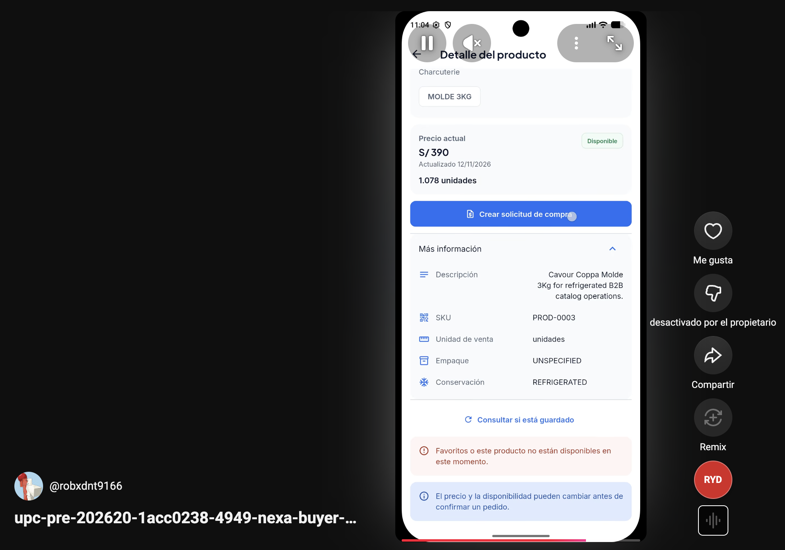

#### 3.1.4.5 Mobile Applications Prototyping

El prototipado de las experiencias móviles de Nexa permite representar y comunicar las decisiones de interacción definidas a partir de los User Goals y los Wireflow Diagrams de la sección 3.1.4.2, los User Flow Diagrams de la sección 3.1.4.4 y el sistema de navegación descrito en la sección 3.1.2.5. Los recorridos ilustran la transición entre pantallas, la organización de las acciones y los estados de interfaz previstos. En las operaciones que dependen de reglas de negocio, la representación visual de una acción no equivale a la confirmación de su resultado por parte del servidor.

**Prototipo y diseño de interfaces en Figma:** El archivo compartido [Nexa Mobile — Figma](https://www.figma.com/design/6V8PMiotchS4rY9tX97JtF/Nexa-Mobile?node-id=34-211) reúne la referencia de diseño para consultar las pantallas y decisiones visuales de la experiencia móvil. Las grabaciones de navegación presentadas a continuación complementan este recurso mostrando recorridos de interacción.

**Nexa Operations Mobile:** El prototipo de Operations aborda la experiencia prevista para las tareas de almacén, despacho y entrega, con énfasis en una navegación orientada a acciones y en la claridad de sus estados. La grabación disponible, de **1 minuto y 41 segundos**, presenta una muestra de navegación del prototipo. No constituye una demostración exhaustiva de todos los User Flows definidos para Operations.

*Vista previa del video de navegación del prototipo de Nexa Operations Mobile. Seleccionar la imagen para abrir la grabación.*

**Buyer Portal:** Se incorpora una segunda referencia audiovisual correspondiente al prototipo de navegación identificado como Buyer Portal. Esta evidencia permite consultar la presentación y el recorrido visual de la experiencia del comprador; se diferencia de Nexa Buyer Mobile, cuya dirección de construcción corresponde a Flutter/Dart para Android e iOS. Por tanto, el video del portal no se presenta como evidencia de ejecución o implementación de la aplicación móvil Buyer.

*Vista previa del video de navegación del prototipo de Nexa Buyer Portal. Seleccionar la imagen para reproducirlo en YouTube.*

Los prototipos y sus videos facilitan la revisión de la arquitectura de información, la continuidad de la navegación y la consistencia de las interacciones propuestas. Son evidencias de diseño y comunicación de la experiencia: no sustituyen la validación con usuarios, las comprobaciones de accesibilidad o autorización, la verificación de los contratos con la API ni la aceptación funcional del producto.
