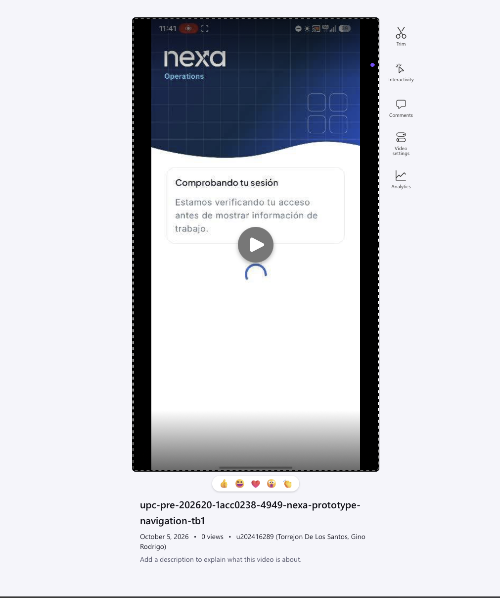

#### 3.1.4.5 Mobile Applications Prototyping

El prototipado de Nexa Mobile organiza la navegación a partir de los User Goals y Task Flows de 3.1.4.2, las decisiones de interfaz de 3.1.4.4 y las reglas de navegación de 3.1.2.5. Cada interacción distingue una acción de usuario, un cambio de vista y, cuando corresponde, una solicitud al servidor cuya confirmación no puede inferirse de la UI local.

**Nexa Operations Mobile — Android/Kotlin/Jetpack Compose.** La [grabación de navegación del prototipo móvil](https://upcedupe-my.sharepoint.com/:v:/g/personal/u202323040_upc_edu_pe/IQDZehdOpGE0TahaQPj0HA3WARS1Q_dJsDD9oO3iDeH-ygA?e=vO7Upw) se identifica en la documentación con una duración de 1 minuto y 41 segundos. Su vista previa corresponde a Operations; esta referencia audiovisual ilustra la navegación y no se atribuye como demostración exhaustiva de los siete recorridos Operations seleccionados.

*Vista previa de la grabación de navegación de Nexa Operations Mobile.*

**Nexa Buyer Mobile — Flutter/Dart.** El diseño de catálogo, solicitud y entrega/recepción se representa por separado: BY-02, BY-03 y BY-11. La referencia audiovisual anterior corresponde a Operations y no permite establecer conclusiones sobre la interacción de Buyer. Sus recorridos se evalúan según las capacidades autorizadas de la relación de compra y los estados efectivamente accesibles del cliente.

Las grabaciones de navegación o las animaciones del prototipo no sustituyen las comprobaciones de autorización, persistencia ni aceptación del Product. Tampoco equivalen a entrevistas de validación realizadas con participantes.
