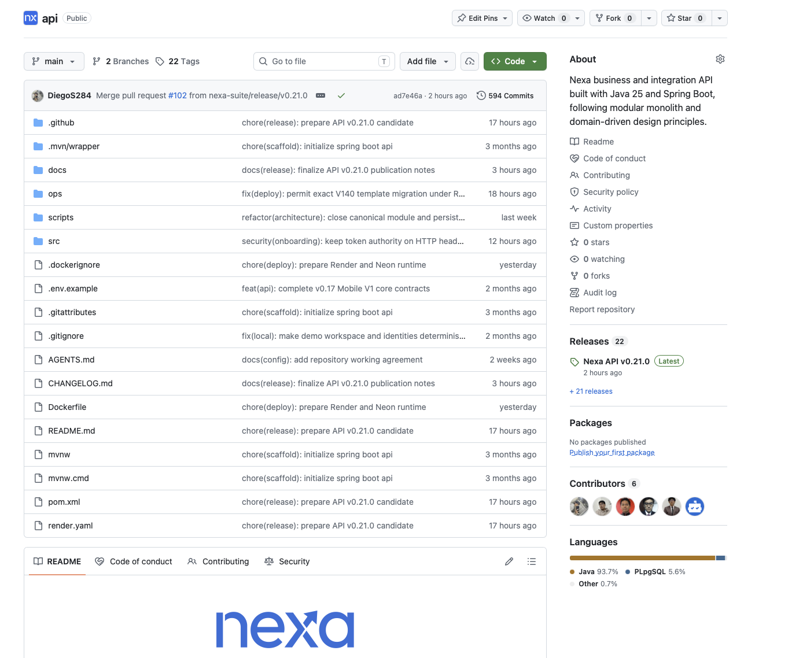
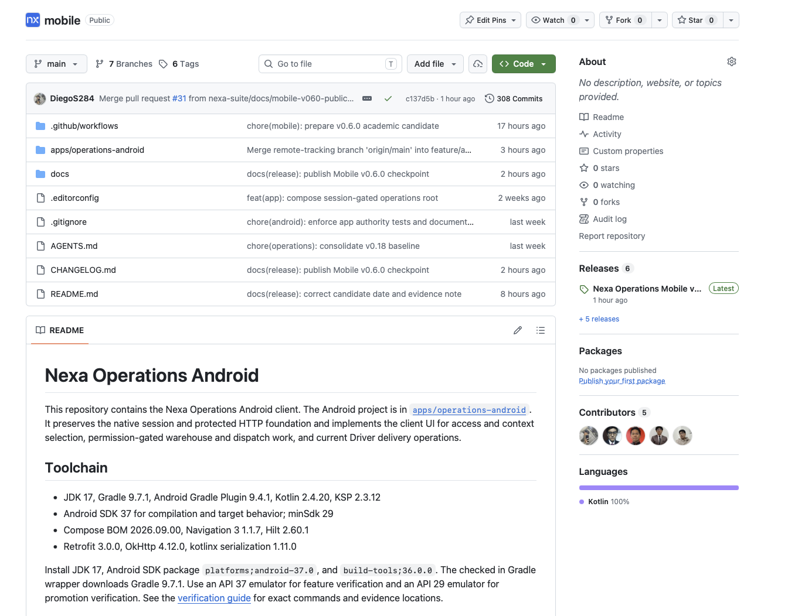
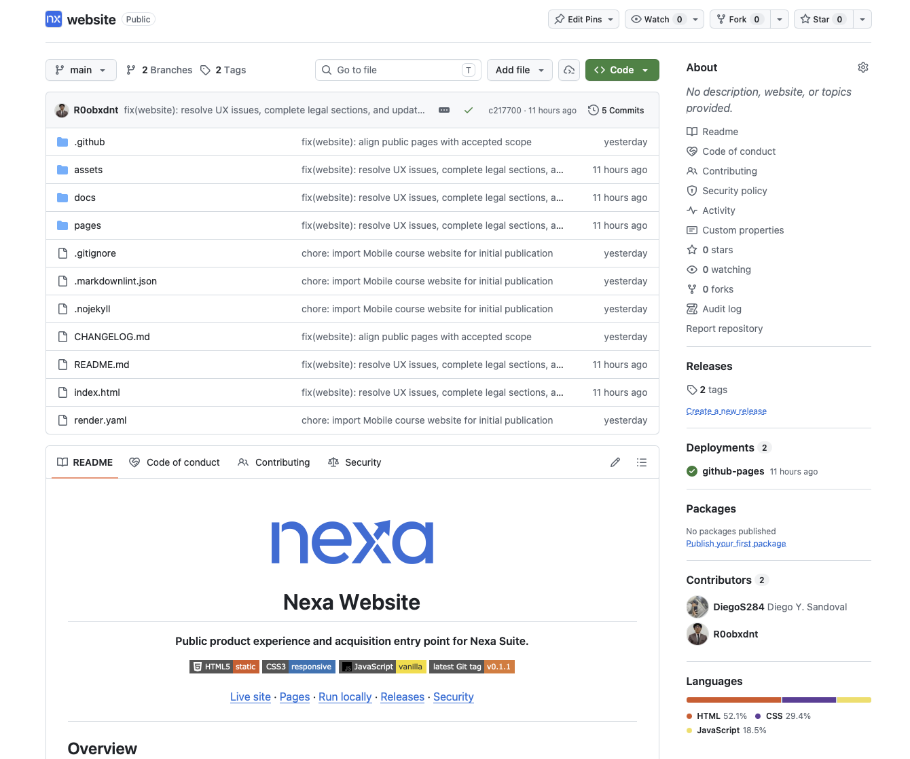
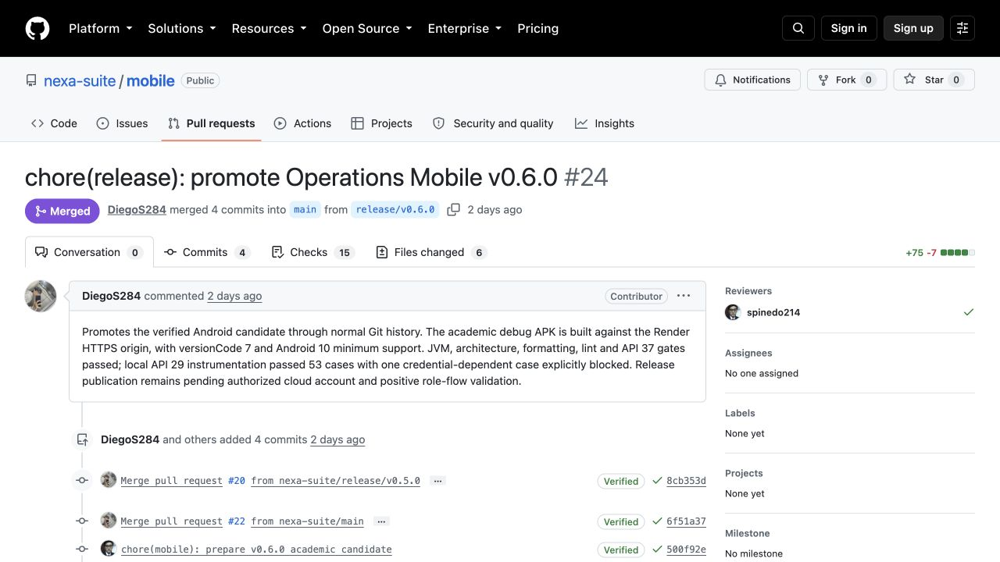

### 4.1.2. Source Code Management

Los repositorios de Nexa utilizan Git y GitHub para gestionar
el código fuente, mantener el historial de modificaciones y
facilitar el trabajo colaborativo. El equipo emplea Pull Requests
para revisar e integrar los cambios, siguiendo una organización
de ramas basada en GitFlow.

Las ramas feature/* se utilizan para desarrollar nuevas
funcionalidades, mientras que las ramas release/* permiten
preparar versiones destinadas a main. En los repositorios
Mobile y API también se realizan sincronizaciones hacia
develop para mantener la continuidad del desarrollo.

*Repositorios que componen el alcance académico de Nexa.*

| Producto | Repositorio |
| --- | --- |
| Landing Page / Website | [nexa-suite/website](https://github.com/nexa-suite/website) |
| Web Services | [nexa-suite/api](https://github.com/nexa-suite/api) |
| Web applications | [nexa-suite/web-clients](https://github.com/nexa-suite/web-clients) (monorepo Angular) |
| Mobile Applications | [nexa-suite/mobile](https://github.com/nexa-suite/mobile) |
| Academic Report | [nexa-suite/mobile-report](https://github.com/nexa-suite/mobile-report) |

*Nota.* Los enlaces identifican repositorios de trabajo; cada release se
vincula a su Pull Request y tag publicados.

Las vistas de los repositorios permiten reconocer la separación del código
fuente de los servicios, la aplicación Android y el sitio público. En los tres
casos se muestra la rama `main`, junto con los directorios del producto y el
acceso a su historial.

*Repositorio de los servicios de negocio.*

*La vista del API muestra su código fuente, documentación y archivos de
construcción y despliegue. El servicio se mantiene en un repositorio
independiente de sus clientes.*

*Repositorio de la aplicación móvil.*

*El proyecto Android se encuentra en `apps/operations-android`; la
documentación y los controles de integración se conservan en el mismo
repositorio. La vista identifica la fuente de la aplicación distribuida como
APK.*

*Repositorio del sitio público.*

*El sitio organiza sus páginas y recursos visuales en directorios propios. El
entorno GitHub Pages aparece asociado al repositorio y enlaza el código del
Website con su publicación.*

*Flujo de ramas y revisión.*

Las publicaciones vigentes muestran el paso de una rama de release a `main` y,
en Mobile y API, una sincronización posterior hacia `develop`.

*Pull Requests y releases de fuente publicados hasta el 6 de octubre de 2026.*

| Repositorio | Release integrada en `main` | Sincronización posterior |
| --- | --- | --- |
| Nexa Operations Mobile | `release/v1.0.1` → `main`: [PR #35](https://github.com/nexa-suite/mobile/pull/35), integrado; [release v1.0.1](https://github.com/nexa-suite/mobile/releases/tag/v1.0.1). GitHub registra aprobaciones de [spinedo214](https://github.com/spinedo214) y [R0obxdnt](https://github.com/R0obxdnt). | `main` → `develop`: [PR #36](https://github.com/nexa-suite/mobile/pull/36), integrado. |
| API | `release/v1.0.0` → `main`: [PR #109](https://github.com/nexa-suite/api/pull/109), integrado; [release v1.0.0](https://github.com/nexa-suite/api/releases/tag/v1.0.0). | `main` → `develop`: [PR #110](https://github.com/nexa-suite/api/pull/110), integrado. |
| Website | `release/v1.0.0` → `main`: [PR #1](https://github.com/nexa-suite/website/pull/1), integrado; [release v1.0.0](https://github.com/nexa-suite/website/releases/tag/v1.0.0). | No se incluye una sincronización posterior en el registro de esta publicación. |

**Evolución de las aplicaciones móviles**

El repositorio [Nexa Mobile](https://github.com/nexa-suite/mobile)
centraliza el desarrollo de Operations Mobile y Buyer Mobile.
Aunque ambas aplicaciones utilizan tecnologías diferentes,
comparten los mecanismos de control de versiones, revisión de
código y publicación de artefactos.

La publicación [Nexa Mobile v2.0.1](https://github.com/nexa-suite/mobile/releases/tag/v2.0.1)
incluye Operations Android `1.3.1` y Buyer Flutter `1.2.1+4`.
Estas versiones permiten identificar la implementación de
ambas aplicaciones dentro del mismo repositorio, manteniendo
sus respectivos procesos de construcción y distribución.

Las publicaciones de código permiten consultar las versiones
desarrolladas y los cambios integrados. Sin embargo, la
disponibilidad de una versión o de un archivo instalable no
garantiza que todos los procesos de negocio estén habilitados
ni que se hayan completado las pruebas de aceptación.

La siguiente captura presenta un ejemplo del proceso de
integración de versiones utilizado por el equipo. En ella
se observa la incorporación de una rama release a main,
como parte del flujo de gestión del código fuente. Este
registro complementa las publicaciones documentadas en
la tabla anterior y permite reconocer cómo se organizan
las revisiones e integraciones del proyecto.

*Registro histórico del PR #24: GitHub muestra la integración de
`release/v0.6.0` en `main`. La captura se guardó el 5 de octubre de 2026; el PR
se integró el 4 de octubre. Este registro ilustra el flujo y no sustituye a la
secuencia v1.0.1 publicada el 6 de octubre.*

Semantic Versioning usa MAJOR para cambios incompatibles, MINOR para capacidad
compatible y PATCH para correcciones compatibles. Conventional Commits expresa
tipo y alcance, por ejemplo `docs(ch4): document source control`. Los cuatro
sprints académicos conservan su planificación y evidencia progresiva; la
asignación de un Sprint no declara por sí sola que el trabajo esté implementado
o aceptado.

Los historiales de commits usados como evidencia del corte de Sprint 2 se
presentan en [desarrollo](../4.2-landing-page-and-mobile-application-implementation/4.2.2-sprint-2/4.2.2.4-development-evidence-for-sprint-review.md)
y [colaboración](../4.2-landing-page-and-mobile-application-implementation/4.2.2-sprint-2/4.2.2.9-team-collaboration-insights-during-sprint.md).
