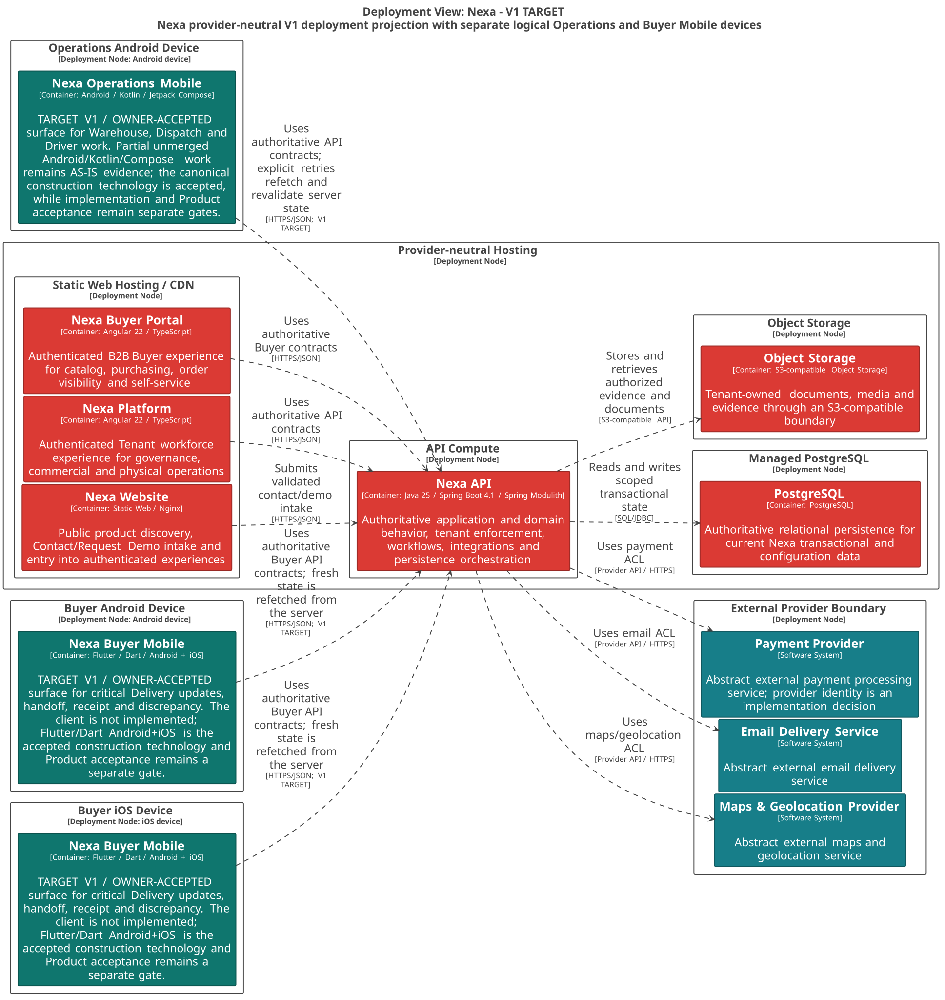
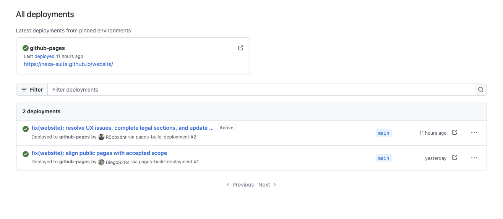

### 4.1.4. Software Deployment Configuration

La publicación del Website, el despliegue de Nexa API y la
distribución de las aplicaciones móviles se realizan mediante
procesos independientes. El Website se publica como un sitio
estático, mientras que el API se ejecuta en un entorno de
servidor y proporciona los servicios que utilizan las
aplicaciones móviles. Esta organización permite mantener
separadas las configuraciones de despliegue y preservar
la responsabilidad del servidor sobre la autorización y
las operaciones de negocio.

*C4 Deployment Diagram: topología lógica objetivo de Nexa.*

El diagrama representa la topología `TARGET`: dispositivos cliente, runtime
de aplicación, servicios de datos e integraciones externas. La tabla siguiente
identifica el despliegue observado en Render, Neon y Brevo, y la publicación
del Website y del APK; conserva la diferencia entre esa configuración y los
componentes previstos en la topología objetivo.

*Configuración y evidencia de despliegue de los componentes de Nexa*

| Componente | Configuración observada | Evidencia y estado |
| --- | --- | --- |
| Website público | `nexa-suite/website`, rama `main`, publicado como sitio estático con GitHub Pages. La publicación fuente vigente es [Website v1.0.0](https://github.com/nexa-suite/website/releases/tag/v1.0.0). | La URL [nexa-suite.github.io/website](https://nexa-suite.github.io/website/) respondió HTTP 200 en la comprobación registrada. Las capturas de GitHub Pages del 4 de octubre y las vistas de escritorio y móvil del 5 de octubre se conservan en 4.2.2.8. |
| API en Render | `nexa-suite/api`, rama `main`, `Dockerfile` en la raíz y contexto de construcción `.`. Servicio Docker `nexa-api`, plan Free, región Ohio (US East), disponible en [nexa-api-69bj.onrender.com](https://nexa-api-69bj.onrender.com). `autoDeployTrigger` está en `off`; Render ejecuta despliegues manuales y usa `/actuator/health/readiness` como ruta de comprobación. | La captura del 6 de octubre muestra el servicio `Live` en `main` con el commit `78a3060`. Una consulta HTTP del 6 de octubre a las 06:09 UTC obtuvo HTTP 200 y estado `UP` en salud, liveness y readiness; Swagger UI respondió HTTP 200. El historial de despliegues del 4 de octubre y la configuración actual se documentan en 4.2.2.8. |
| Base de datos | La configuración versionada en [`render.yaml`](https://github.com/nexa-suite/api/blob/main/render.yaml) conecta PostgreSQL por JDBC con Neon. Define credenciales separadas para migración y runtime, y activa el requisito de privilegio mínimo para el usuario de ejecución. | El grupo de readiness incluye el chequeo `db`; readiness respondió `UP` en la consulta del 6 de octubre a las 06:09 UTC. La captura del servicio muestra nombres de configuración con sus valores ocultos. |
| Correo transaccional | El API obtiene la configuración SMTP del entorno Render y usa el relay Brevo `smtp-relay.brevo.com`, puerto `587`. | El recorte versionado de configuración SMTP se documenta en la evidencia de despliegue del Sprint 2. |
| Operations Mobile | APK Android firmado de la publicación [Nexa Operations v1.0.1](https://github.com/nexa-suite/mobile/releases/tag/v1.0.1), con `versionCode` 9 y origen HTTPS de Render aprobado para la aplicación. | La descarga oficial y el checksum se encuentran en la release. El APK envía solicitudes al API; el servicio conserva la autoridad de sesión, Tenant/Workspace y decisiones de negocio. La publicación de fuente v1.0.1 y su promoción se registran en 4.1.2. |
| Buyer Mobile | Aplicación móvil desarrollada con Flutter y Dart, orientada a compradores empresariales. | Su implementación se gestiona de forma independiente de Operations Mobile. El repositorio incluye código fuente y artefactos de distribución para Android, aunque algunas funcionalidades todavía presentan limitaciones de integración con los servicios del API. |

**Implementación y distribución de Buyer Mobile**

Buyer Mobile cuenta con una implementación desarrollada en
Flutter y Dart, orientada a facilitar las actividades de los
compradores empresariales. Su código fuente se encuentra en
el [repositorio Nexa Mobile](https://github.com/nexa-suite/mobile/tree/main/apps/buyer-mobile),
que también dispone de publicaciones de versiones y
artefactos académicos para Android.

La aplicación incorpora funcionalidades relacionadas con
la consulta de productos, información de la cuenta, pedidos,
pagos y seguimiento de entregas. No obstante, la integración
con los servicios publicados todavía presenta limitaciones,
especialmente en los procesos comerciales y de entrega.

Es importante distinguir la implementación de la aplicación
de su disponibilidad funcional. La existencia del código
fuente y de un artefacto instalable no demuestra que todos
los procesos estén habilitados ni que el producto haya
completado sus pruebas de aceptación.

El Dockerfile del API compila con Maven sobre Eclipse Temurin 25 y ejecuta el
JAR en una imagen Eclipse Temurin 25 JRE. El proceso del contenedor usa un
usuario sin privilegios, escucha en el puerto 8080 y dispone de un chequeo de
salud de contenedor. Render construye desde la rama `main`; el último despliegue
que presenta el dashboard fue manual y apunta al commit `78a3060`. La release
API [v1.0.0](https://github.com/nexa-suite/api/releases/tag/v1.0.0) es una
publicación de fuente basada en el corte compatible v0.21.0. El registro de
Render identifica el commit desplegado en `main`, no una promoción directa de
la etiqueta v1.0.0.

El Website es estático y no comparte el rol de servidor del API. Operations
Mobile usa el origen HTTPS para solicitar operaciones autorizadas; la interfaz
no concede permisos ni cambia por sí sola el estado de negocio. La
configuración de base de datos y correo se describe desde el manifiesto y el
recorte de configuración visibles, sin reproducir secretos o valores de
entorno.

*Publicación del Website mediante GitHub Pages.*

*Captura histórica de GitHub Pages: el entorno `github-pages` activo y dos
despliegues desde `main` aparecen en la vista guardada. La comprobación de la
URL pública y las vistas del Website tienen sus fechas propias en 4.2.2.8.*

Las capturas de Render y Brevo, y la configuración de Neon consultada en el
manifiesto del servicio, se relacionan con sus fuentes en
[Software Deployment Evidence for Sprint Review](../4.2-landing-page-and-mobile-application-implementation/4.2.2-sprint-2/4.2.2.8-software-deployment-evidence-for-sprint-review.md).
