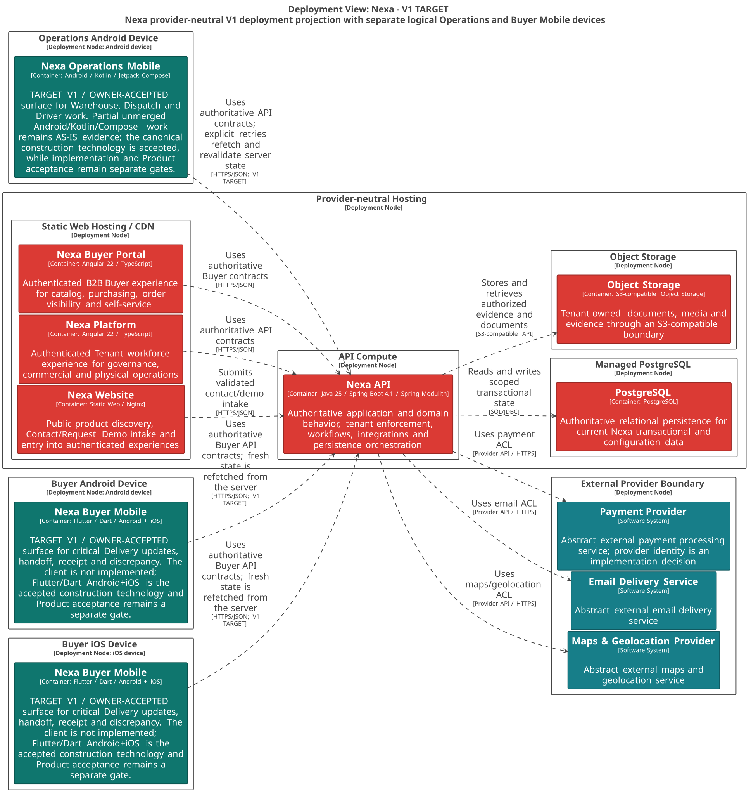
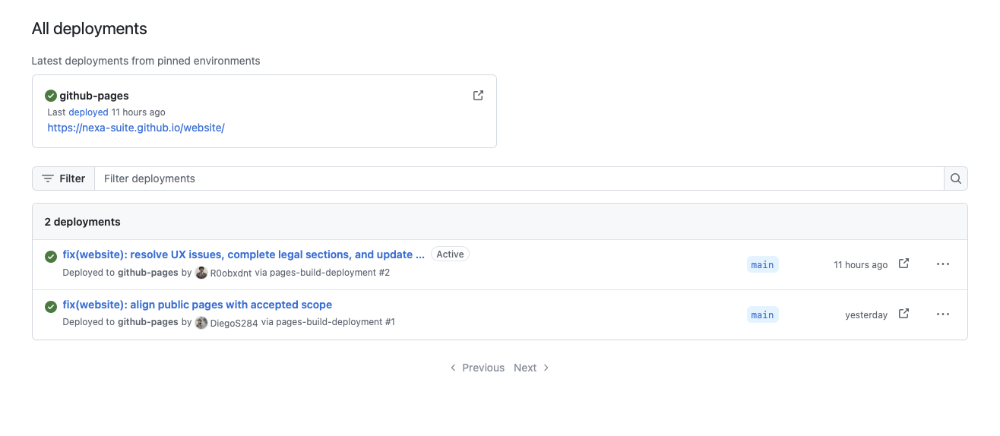

### 4.1.4. Software Deployment Configuration

El Website se publica como sitio estático. Buyer y Operations se distribuyen como APK independientes y consumen Nexa API por HTTPS. La API autoriza las operaciones y confirma el estado que muestran ambas aplicaciones.

*C4 Deployment Diagram: topología lógica objetivo de Nexa.*

El diagrama muestra la topología objetivo. La tabla registra el despliegue y los artefactos que se usaron durante la revisión de Sprint 4.

| Componente | Despliegue o artefacto | Cómo se comprueba |
| --- | --- | --- |
| Website | [GitHub Pages](https://nexa-suite.github.io/website/) publica el sitio estático del [repositorio Website](https://github.com/nexa-suite/website). | Abrir el landing y las páginas del equipo y del producto. Los APK se descargan desde la publicación de Mobile. |
| Nexa API | El servicio Docker de Render Free construye desde `main`. El contrato público declara la versión [v3.0.3](https://github.com/nexa-suite/api/releases/tag/v3.0.3). | Consultar [readiness](https://nexa-api-69bj.onrender.com/actuator/health/readiness) y [Swagger UI](https://nexa-api-69bj.onrender.com/swagger-ui/index.html). Las operaciones protegidas requieren una cuenta con el rol correspondiente. |
| PostgreSQL | Render conecta con Neon por JDBC. El [manifiesto](https://github.com/nexa-suite/api/blob/main/render.yaml) separa la configuración de aplicación y migraciones. | Consultar en Neon los registros de prueba por el identificador devuelto por la API. |
| Correo transaccional | La API usa el relay SMTP de Brevo mediante configuración de Render. | La configuración observada se documenta en la [evidencia de Sprint 2](../4.2-landing-page-and-mobile-application-implementation/4.2.2-sprint-2/4.2.2.8-software-deployment-evidence-for-sprint-review.md). |
| Buyer Mobile | APK Android Flutter 2.0.1, build 6, en [Mobile v3.0.2](https://github.com/nexa-suite/mobile/releases/tag/v3.0.2). | El artefacto y su checksum figuran en la publicación. |
| Operations Mobile | APK Android Kotlin 3.0.2, build 16, en [Mobile v3.0.2](https://github.com/nexa-suite/mobile/releases/tag/v3.0.2). | El artefacto y su checksum figuran en la misma publicación. |
| Firebase | Firebase App Distribution gestiona la entrega de los APK a cuentas invitadas. Firebase Cloud Messaging transporta los avisos de las apps. | Consultar las versiones y los registros de comprobación en la [evidencia de Sprint 4](../4.2-landing-page-and-mobile-application-implementation/4.2.4-sprint-4/4.2.4.8-software-deployment-evidence-for-sprint-review.md). |

El Dockerfile del API compila con Maven y Eclipse Temurin 25. El JAR se ejecuta con un usuario sin privilegios y escucha en el puerto 8080. El chequeo del contenedor y la ruta de readiness permiten comprobar el estado del servicio. La disponibilidad de una operación se verifica con su ruta y la sesión correspondiente.

*Captura histórica del entorno de publicación de Website en GitHub Pages durante Sprint 2.*

