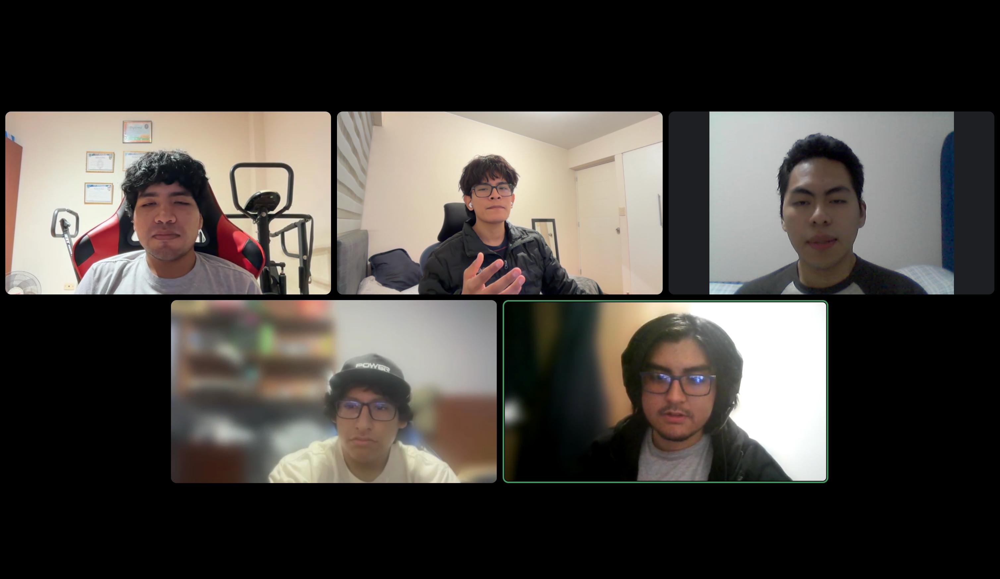

#### 4.2.1.9. Team Collaboration Insights during Sprint

La colaboración del equipo durante Sprint 1 se refleja
en la distribución de responsabilidades y en las
contribuciones registradas en los repositorios del proyecto.

El historial de GitHub permite identificar actividades
relacionadas con la implementación de Operations Mobile,
la integración con Nexa API, las pruebas técnicas y
la documentación del desarrollo.

La siguiente tabla presenta las principales áreas
de contribución identificadas para cada integrante.
Estos registros complementan la matriz de líderes y
colaboradores de la sección 4.2.1.2 y permiten
reconocer las actividades desarrolladas por el equipo.

| Contributor | Área técnica observada | Límite de interpretación |
| --- | --- | --- |
| DiegoS284 | Base Android, recuperación de sesión, acceso confirmado y contexto Warehouse. | Fuente técnica; no demuestra coordinación ni aceptación. |
| GerardRojasMancilla | Transporte, cliente SKU, refresh y cancelación. | Fuente técnica; no demuestra participación total. |
| JoaquinBV511 | Estados de acceso y preview de identificación Warehouse. | Parte del trabajo observado; no demuestra aceptación del flujo. |
| R0obxdnt | Gates reproducibles y pruebas unitarias nativas. | Evidencia técnica; no demuestra revisión de equipo. |
| spinedo214 | Documentación de acceso, Warehouse, emulador y resolver. | Fuente documental; no demuestra contribución completa. |

*Figura. Registro fotográfico de una reunión de coordinación del equipo durante Sprint 1.*

Las contribuciones registradas muestran la participación
del equipo en distintas actividades de implementación,
verificación técnica y documentación. La distribución
de responsabilidades se encuentra representada en la
matriz LACX, mientras que el Sprint Backlog presenta
las tareas asignadas y su seguimiento mediante Jira.

La información de estas herramientas permite analizar
la colaboración desde perspectivas complementarias:
GitHub conserva el historial de modificaciones, Jira
registra las actividades del sprint y la matriz LACX
describe las responsabilidades de los integrantes.

De esta manera, la participación del equipo puede
examinarse sin considerar la cantidad de commits
como una medida directa del esfuerzo individual,
la calidad del trabajo o el cumplimiento de las
historias de usuario.
