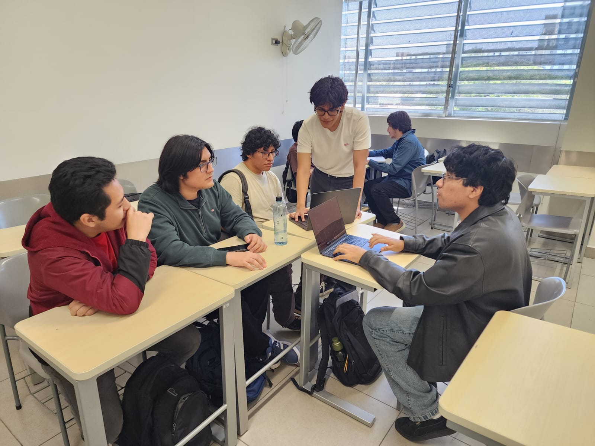

### 4.2.2. Sprint 2

#### 4.2.2.1. Sprint Planning 2

En el Sprint 2 se planificó ampliar las funciones de Nexa mediante el desarrollo de la Landing Page y nuevas herramientas para el personal comercial y de almacén. El alcance incluyó la consulta de productos, el seguimiento de solicitudes comerciales y las operaciones de recepción, preparación y despacho de mercadería.

La reunión de planificación se realizó el 18 de septiembre de 2026 en la UPC, campus San Isidro. El equipo estableció un alcance inicial de 36 elementos, equivalentes a 144 Story Points, y organizó las tareas necesarias para desarrollarlos.

*Planificación de Sprint 2.*

<table>
  <tbody>
    <tr>
      <th scope="row">Sprint #</th>
      <td>Sprint 2</td>
    </tr>
    <tr>
      <th colspan="2">Sprint Planning Background</th>
    </tr>
    <tr>
      <td>Date</td>
      <td>2026-09-18</td>
    </tr>
    <tr>
      <td>Time</td>
      <td>01:38 PM</td>
    </tr>
    <tr>
      <td>Location</td>
      <td>UPC, campus San Isidro, Lima, Perú</td>
    </tr>
    <tr>
      <td>Prepared By</td>
      <td>No se dispone de un registro que identifique por separado a la persona que preparó el acta. La reunión fue organizada por Yucra Sandoval, Diego Sebastián.</td>
    </tr>
    <tr>
      <td>Attendees (to planning meeting)</td>
      <td>
        
Según el registro de planificación:

        
Pinedo Sanchez, Sebastián Martín; Rojas Mancilla, Gerard Gianpier; Torrejón De Los Santos, Gino Rodrigo; Verde Bueno, Joaquín Francisco; Yucra Sandoval, Diego Sebastián.

      </td>
    </tr>
    <tr>
      <td>Sprint 1 Review Summary</td>
      <td>No se dispone de un registro de Sprint Review 1 que permita resumir los resultados, comentarios del equipo o retroalimentación recibida.</td>
    </tr>
    <tr>
      <td>Sprint 1 Retrospective Summary</td>
      <td>No se dispone de un registro de retrospectiva del Sprint 1 que permita identificar formalmente los aciertos y las oportunidades de mejora.</td>
    </tr>
    <tr>
      <th colspan="2">Sprint Goal &amp; User Stories</th>
    </tr>
    <tr>
      <td>Sprint 2 Goal</td>
      <td>
        
<strong>Our focus is on</strong> facilitar el conocimiento de Nexa mediante la Landing Page y ampliar las funciones móviles para que el personal comercial y de almacén pueda continuar sus actividades desde la consulta de productos hasta la preparación y el despacho de mercadería.

        
<strong>We believe it delivers</strong> información más clara sobre Nexa para los visitantes y una mejor continuidad del trabajo para los equipos comerciales y de almacén, al permitirles consultar información relevante y conocer el resultado de sus operaciones.

        
<strong>This will be confirmed when</strong> los visitantes puedan conocer la propuesta de Nexa y encontrar los medios de contacto; el personal comercial pueda consultar productos y dar seguimiento a sus solicitudes; y el personal de almacén pueda realizar las operaciones previstas de recepción, preparación y despacho, identificando si cada acción fue confirmada o requiere atención.

      </td>
    </tr>
    <tr>
      <td>Sprint 2 Velocity</td>
      <td>No se dispone de una velocidad histórica medida. Se planificó una capacidad de 144 Story Points para este sprint.</td>
    </tr>
    <tr>
      <td>Sum of Story Points</td>
      <td>144 Story Points</td>
    </tr>
  </tbody>
</table>

*Alcance de Sprint 2.*

<table>
  <thead>
    <tr>
      <th>PBI</th>
      <th>Tipo</th>
      <th>Story Points</th>
      <th>Resultado planificado</th>
    </tr>
  </thead>
  <tbody>
    <tr>
      <td>LAND-US-001 a LAND-US-006</td>
      <td>Functional</td>
      <td>15</td>
      <td>Presentar la propuesta de Nexa, sus funcionalidades, información comercial y medios de contacto mediante la Landing Page.</td>
    </tr>
    <tr>
      <td>MOB-US-004 a MOB-US-010</td>
      <td>Functional</td>
      <td>36</td>
      <td>Ampliar las funciones comerciales y operativas, incluyendo la consulta de productos, la relación con clientes y el seguimiento de solicitudes.</td>
    </tr>
    <tr>
      <td>MOB-US-012 a MOB-US-025</td>
      <td>Functional</td>
      <td>52</td>
      <td>Incorporar búsqueda manual, recepción, registro de lotes, preparación de mercadería y operaciones iniciales de despacho.</td>
    </tr>
    <tr>
      <td>TS-MOB-002, TS-MOB-004, TS-MOB-005, TS-MOB-006, TS-MOB-010</td>
      <td>Technical</td>
      <td>23</td>
      <td>Preparar compatibilidad Android, uso seguro de recursos del dispositivo, continuidad del trabajo, reintentos y accesibilidad.</td>
    </tr>
    <tr>
      <td>SPIKE-001 a SPIKE-004</td>
      <td>Spike</td>
      <td>18</td>
      <td>Investigar una funcionalidad de aprendizaje autónomo y evaluar aspectos técnicos relacionados con las aplicaciones y la recuperación de información.</td>
    </tr>
    <tr>
      <th>Total</th>
      <td>36 PBIs</td>
      <th>144</th>
      <td>Alcance inicial planificado del Sprint 2.</td>
    </tr>
  </tbody>
</table>

*Nota.* El Sprint 2 se planificó para el periodo comprendido entre el 16 de septiembre y el 7 de octubre de 2026. El alcance inicial incluyó 36 PBIs y 144 Story Points, distribuidos en funciones de Landing Page, aplicaciones móviles, tareas técnicas e investigación. Estas estimaciones no representan trabajo completado. Elaboración propia.

*Reunión presencial de planificación de Sprint 2 en UPC, campus San Isidro.*

La tabla siguiente conserva los paquetes, responsables, niveles y estimaciones
propuestos durante la planificación inicial. La correspondencia actual con
los issues de Jira y sus estados se documenta en 4.2.2.3.

##### Tareas y subtareas planificadas

La planificación inicial del Sprint 2 incluyó 16 paquetes de trabajo, distribuidos entre los integrantes del equipo según las actividades previstas. En conjunto, estos paquetes representan 116 horas estimadas.

La siguiente tabla presenta las tareas, responsabilidades y estimaciones acordadas durante la planificación. Esta información corresponde al alcance inicial de 36 PBIs y 144 Story Points, y se distingue del estado registrado posteriormente en Jira.

| Elementos | ID del paquete de trabajo | Tarea | Trabajo desglosado (síntesis) | Estimación (horas) | Assigned To | Level |
| --- | --- | --- | --- | ---: | --- | --- |
| `LAND-US-001`, `LAND-US-002`, `LAND-US-003` | SB2-T01 | Preparar descubrimiento público | Mensaje B2B, ajuste operativo y límites comunicables. | 6 | Yucra Sandoval, Diego Sebastián | Lead |
| `LAND-US-004`, `LAND-US-005`, `LAND-US-006` | SB2-T02 | Preparar información comercial y contacto | Precios, FAQ, legal, onboarding y ruta de contacto. | 6 | Rojas Mancilla, Gerard Gianpier | Lead |
| `MOB-US-004`, `MOB-US-005`, `MOB-US-006`, `MOB-US-007` | SB2-T03 | Delimitar overview, contexto comercial y catálogo | Overview operativo, excepciones, relación cliente-comprador, productos, precios y disponibilidad. | 8 | Pinedo Sanchez, Sebastián Martín | Lead |
| `MOB-US-008`, `MOB-US-009`, `MOB-US-010` | SB2-T04 | Preparar solicitud, Direct Order y seguimiento | Solicitud, compromiso, crédito y estado pendiente sin confirmación del cliente. | 8 | Torrejón De Los Santos, Gino Rodrigo | Lead |
| `MOB-US-012` | SB2-T05 | Preparar búsqueda manual posterior | Entrada manual, coincidencia ambigua y resultado confirmado por servidor. | 6 | Verde Bueno, Joaquín Francisco | Lead |
| `MOB-US-013`, `MOB-US-014` | SB2-T06 | Delimitar recepción y lote | Stock recibido, lote, vencimiento, cantidad y resultado pendiente del servidor. | 8 | Pinedo Sanchez, Sebastián Martín | Lead |
| `MOB-US-015`, `MOB-US-016` | SB2-T07 | Preparar condición y trabajo físico | Elegibilidad, condición, lote y cantidad correctos antes del trabajo físico. | 8 | Rojas Mancilla, Gerard Gianpier | Lead |
| `MOB-US-017`, `MOB-US-019` | SB2-T08 | Preparar discrepancia y temperatura | Registrar discrepancia y evidencia de temperatura sin borrar hechos previos. | 8 | Verde Bueno, Joaquín Francisco | Lead |
| `MOB-US-018`, `MOB-US-020`, `MOB-US-021`, `MOB-US-022`, `MOB-US-023`, `MOB-US-024`, `MOB-US-025` | SB2-T09 | Preparar movimiento, despacho y transferencia inicial | Movimiento autorizado, lista de entrega, asignación, contraste, transferencia y salida de bienes. | 8 | Pinedo Sanchez, Sebastián Martín | Lead |
| `TS-MOB-002`, `TS-MOB-004` | SB2-T10 | Delimitar compatibilidad y dispositivo | Compatibilidad autorizada, cámara, navegación y almacenamiento sin crear autoridad del cliente. | 8 | Torrejón De Los Santos, Gino Rodrigo | Lead |
| `TS-MOB-005`, `TS-MOB-006` | SB2-T11 | Preparar continuidad y reintentos | Estado de trabajo seguro, reintentos, idempotencia y conflictos sin autoridad del cliente. | 8 | Rojas Mancilla, Gerard Gianpier | Lead |
| `TS-MOB-010` | SB2-T12 | Preparar i18n y accesibilidad | Estados, foco, etiquetas, idioma y reflujo para las superficies Mobile. | 4 | Verde Bueno, Joaquín Francisco | Lead |
| `SPIKE-001` | SB2-T13 | Investigar, evaluar e integrar funcionalidad de aprendizaje autónomo | Pregunta, alternativas, selección justificada, PoC reproducible e integración técnica acotada con fallo, reversión o aislamiento. | 8 | Rojas Mancilla, Gerard Gianpier | Lead |
| `SPIKE-002` | SB2-T14 | Delimitar tracks y límites de contratos | Comparar opciones permitidas y documentar decisión de adoptar, diferir o rechazar. | 8 | Torrejón De Los Santos, Gino Rodrigo | Lead |
| `SPIKE-003` | SB2-T15 | Delimitar identificadores de producto | Comparar formatos, ambigüedad, permisos y alternativa manual. | 6 | Verde Bueno, Joaquín Francisco | Lead |
| `SPIKE-004` | SB2-T16 | Delimitar persistencia y recuperación de estado | Documentar protección, expiración, recuperación, limpieza y casos diferidos. | 8 | Torrejón De Los Santos, Gino Rodrigo | Lead |

*Nota.* Las 116 horas corresponden al esfuerzo estimado durante la planificación inicial y no representan tiempo de trabajo registrado ni funcionalidades necesariamente completadas. Elaboración propia.

El registro de Jira del 5 de octubre de 2026, presentado en la sección [4.2.2.3. Sprint Backlog 2](4.2.2.3-sprint-backlog-2.md), muestra 71 elementos y 317 Story Points, frente a los 36 elementos y 144 Story Points de la planificación inicial. No se dispone de evidencia de una aprobación que sustituyera formalmente el alcance original, por lo que ambos registros se mantienen diferenciados.

