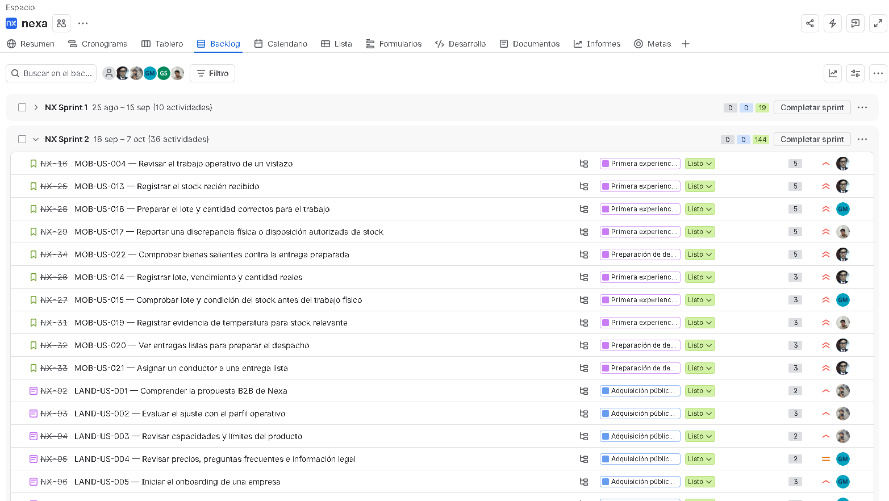
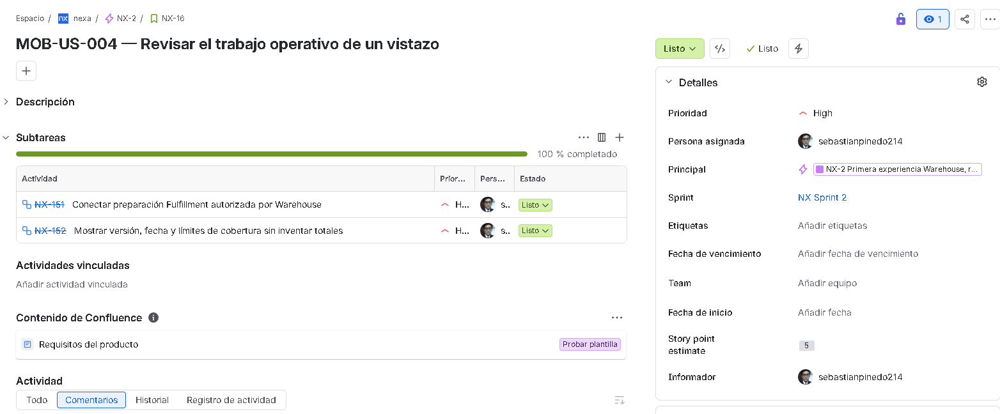

#### 4.2.2.3. Sprint Backlog 2

El Sprint Backlog 2 reúne las actividades destinadas a ampliar las funcionalidades de Nexa Mobile y desarrollar la Landing Page del proyecto. Su alcance comprende procesos comerciales, operaciones de almacén, preparación del despacho y actividades técnicas relacionadas con la integración y continuidad de la solución.

El sprint comprende 36 elementos del Product Backlog, equivalentes a 144 Story Points, distribuidos entre historias funcionales Mobile, historias de la Landing Page, Technical Stories y Spike Stories. Esta distribución corresponde a la planificación académica establecida para Sprint 2.

*Distribución de elementos del Sprint Backlog 2.*

| Tipo de elemento | PBIs | Story Points |
| --- | ---: | ---: |
| Historias funcionales Mobile | 21 | 88 |
| Historias funcionales Landing Page | 6 | 15 |
| Technical Stories | 5 | 23 |
| Spike Stories | 4 | 18 |
| **Total** | **36** | **144** |

##### Seguimiento del Sprint Backlog

El seguimiento de las actividades se realiza mediante Jira Software, donde se registran las historias, sus responsables, prioridades, estimaciones y estados. La consulta del 12 de noviembre de 2026 confirmó la presencia de los 36 elementos planificados y sus 144 Story Points.

*Backlog del Sprint 2 en Jira, consultado el 12 de noviembre de 2026. El encabezado muestra los 36 elementos principales y los 144 Story Points del sprint.*

Los 36 elementos principales cuentan con 72 subtareas asociadas, utilizadas para organizar las actividades de desarrollo y verificación. Estas registran un total de 390 horas estimadas, correspondientes al esfuerzo previsto y no al tiempo efectivamente trabajado.

En el registro consultado, los 36 elementos principales se encontraban en estado «Listo». Respecto a sus subtareas, 25 figuraban en «Listo» y 47 en «Por hacer». Esta diferencia evidencia la necesidad de distinguir el seguimiento administrativo del cumplimiento verificable de las actividades.

##### Evidencia de historias y subtareas

Como ejemplo del seguimiento realizado, la historia `MOB-US-004` (`NX-16`) corresponde a la revisión general del trabajo operativo. Esta historia tiene una estimación de cinco Story Points y se encuentra asignada a Sebastián Pinedo.

*Historia NX-16, correspondiente a MOB-US-004, con las subtareas NX-151 y NX-152 registradas en estado «Listo». La captura muestra el responsable, la estimación y la pertenencia al Sprint 2.*

El historial de la subtarea `NX-151` permite consultar los cambios de estado, prioridad y responsable registrados durante su seguimiento. Esta trazabilidad complementa la información del Sprint Backlog y permite identificar la evolución administrativa de las actividades.

*Historial de NX-151 en Jira, consultado el 12 de noviembre de 2026. Se observan los cambios de estado de «Por hacer» a «Listo», así como modificaciones de prioridad y responsable.*

Los registros de Jira permiten documentar la organización y evolución del trabajo. Sin embargo, los estados y estimaciones no sustituyen las evidencias técnicas, las pruebas funcionales ni la aceptación de los criterios establecidos para cada historia.

*Registro de historias y subtareas del Sprint 2.*

La siguiente tabla presenta los 36 elementos principales del Sprint Backlog, sus Story Points, responsables, estados y subtareas asociadas, incluyendo las estimaciones originales registradas en Jira.

| PBI / issue | Historia (Story Points; responsable; estado) | Subtareas (ID — título — Original Estimate (h) — responsable — estado) |
| --- | --- | --- |
| `LAND-US-001` / `NX-92` | Comprender la propuesta B2B de Nexa (`LAND-US-001`) — 2 SP; Diego Y. Sandoval; Listo | `NX-282` — Redactar introducción y valor B2B — 4 h — Diego Y. Sandoval — Por hacer `NX-283` — Revisar escenarios de propuesta y especialización — 5 h — Diego Y. Sandoval — Por hacer |
| `LAND-US-002` / `NX-93` | Evaluar el ajuste con el perfil operativo (`LAND-US-002`) — 3 SP; Diego Y. Sandoval; Listo | `NX-286` — Mapear perfiles a soluciones comunicables — 4 h — Diego Y. Sandoval — Por hacer `NX-287` — Verificar continuidad del siguiente paso — 5 h — sebastianpinedo214 — Por hacer |
| `LAND-US-003` / `NX-94` | Revisar capacidades y límites del producto (`LAND-US-003`) — 2 SP; Diego Y. Sandoval; Listo | `NX-284` — Trazar capacidades públicas a evidencia — 5 h — Gino Rodrigo Torrejon de Los Santos — Por hacer `NX-285` — Verificar límites de las promesas — 5 h — Diego Y. Sandoval — Por hacer |
| `LAND-US-004` / `NX-95` | Revisar precios, preguntas frecuentes e información legal (`LAND-US-004`) — 2 SP; Gerard Gianpier Rojas Mancilla; Listo | `NX-288` — Consolidar contenido aprobado y registrar vacíos — 5 h — Gerard Gianpier Rojas Mancilla — Por hacer `NX-289` — Verificar FAQ y ruta para preguntas abiertas — 5 h — sebastianpinedo214 — Por hacer |
| `LAND-US-005` / `NX-96` | Iniciar el onboarding de una empresa (`LAND-US-005`) — 3 SP; Gerard Gianpier Rojas Mancilla; Listo | `NX-290` — Definir datos requeridos y estados de solicitud — 4 h — Gerard Gianpier Rojas Mancilla — Por hacer `NX-291` — Verificar solicitud válida, incompleta y servicio no disponible — 6 h — Diego Y. Sandoval — Por hacer |
| `LAND-US-006` / `NX-97` | Contactar a Nexa o solicitar una demostración (`LAND-US-006`) — 3 SP; Gerard Gianpier Rojas Mancilla; Listo | `NX-292` — Definir canal y contexto mínimo de contacto — 4 h — Gerard Gianpier Rojas Mancilla — Por hacer `NX-293` — Verificar validación y respuesta del canal — 6 h — Joaquín Francisco Verde Bueno — Por hacer |
| `MOB-US-004` / `NX-16` | Revisar el trabajo operativo de un vistazo (`MOB-US-004`) — 5 SP; sebastianpinedo214; Listo | `NX-151` — Conectar preparación Fulfillment autorizada por Warehouse — 6 h — sebastianpinedo214 — Listo `NX-152` — Mostrar versión, fecha y límites de cobertura sin inventar totales — 4 h — sebastianpinedo214 — Listo |
| `MOB-US-005` / `NX-17` | Identificar excepciones operativas críticas (`MOB-US-005`) — 5 SP; sebastianpinedo214; Listo | `NX-193` — Integrar tipos y severidad del servidor; listar casos y responsables actuales — 6 h — sebastianpinedo214 — Por hacer `NX-194` — Conectar claim, reasignación, seguimiento y cierre sin conceder autoridad de disposición — 5 h — sebastianpinedo214 — Por hacer |
| `MOB-US-006` / `NX-18` | Encontrar un cliente y su relación con el comprador (`MOB-US-006`) — 3 SP; sebastianpinedo214; Listo | `NX-195` — Conectar búsqueda y detalle de relaciones autorizadas — 6 h — sebastianpinedo214 — Por hacer `NX-196` — Mostrar vínculo comercial vigente sin ampliar acceso a otros contextos — 5 h — sebastianpinedo214 — Por hacer |
| `MOB-US-007` / `NX-19` | Revisar productos, precios y disponibilidad (`MOB-US-007`) — 5 SP; sebastianpinedo214; Listo | `NX-197` — Conectar catálogo y detalle con hechos del servidor — 5 h — sebastianpinedo214 — Por hacer `NX-198` — Separar disponibilidad proyectada de reserva/asignación física — 4 h — Gino Rodrigo Torrejon de Los Santos — Por hacer |
| `MOB-US-008` / `NX-20` | Preparar una solicitud de cliente (`MOB-US-008`) — 5 SP; Gino Rodrigo Torrejon de Los Santos; Listo | `NX-199` — Implementar borrador de cliente, productos y cantidades — 5 h — Gino Rodrigo Torrejon de Los Santos — Listo `NX-200` — Proteger intención local por contexto antes de envío — 6 h — Gino Rodrigo Torrejon de Los Santos — Por hacer |
| `MOB-US-009` / `NX-21` | Enviar una solicitud o Direct Order asistido desde el trabajo de campo (`MOB-US-009`) — 8 SP; Gino Rodrigo Torrejon de Los Santos; Listo | `NX-201` — Conectar envío comercial con clave y cuerpo exactos — 6 h — Gino Rodrigo Torrejon de Los Santos — Por hacer `NX-202` — Mostrar rechazo, conflicto y resultado incierto; recuperación manual — 6 h — Gino Rodrigo Torrejon de Los Santos — Listo |
| `MOB-US-010` / `NX-22` | Seguir compromisos del cliente y crédito (`MOB-US-010`) — 5 SP; Gino Rodrigo Torrejon de Los Santos; Listo | `NX-203` — Conectar consulta de compromiso, crédito y estado actual — 6 h — Gino Rodrigo Torrejon de Los Santos — Listo `NX-204` — Mostrar hechos y límites sin confirmar pagos o recepción localmente — 4 h — Gino Rodrigo Torrejon de Los Santos — Listo |
| `MOB-US-012` / `NX-24` | Buscar manualmente un producto cuando no hay escaneo (`MOB-US-012`) — 2 SP; Joaquín Francisco Verde Bueno; Listo | `NX-191` — Implementar búsqueda manual alternativa al escaneo — 5 h — Joaquín Francisco Verde Bueno — Listo `NX-192` — Conectar selección de SKU confirmado para consulta autorizada — 6 h — Joaquín Francisco Verde Bueno — Listo |
| `MOB-US-013` / `NX-25` | Registrar el stock recién recibido (`MOB-US-013`) — 5 SP; sebastianpinedo214; Listo | `NX-153` — Conectar recepción actual con Warehouse autorizado — 7 h — sebastianpinedo214 — Listo `NX-154` — Persistir comando protegido y confirmar únicamente respuesta del servidor — 5 h — sebastianpinedo214 — Listo |
| `MOB-US-014` / `NX-26` | Registrar lote, vencimiento y cantidad reales (`MOB-US-014`) — 3 SP; sebastianpinedo214; Listo | `NX-161` — Capturar hechos observados de lote, unidad, cantidad y fecha — 5 h — sebastianpinedo214 — Listo `NX-162` — Validar contexto de recepción y conservar hechos esperados separados — 5 h — sebastianpinedo214 — Listo |
| `MOB-US-015` / `NX-27` | Comprobar lote y condición del stock antes del trabajo físico (`MOB-US-015`) — 3 SP; Gerard Gianpier Rojas Mancilla; Listo | `NX-163` — Conectar detalle de lote y condición bajo grant explícito — 5 h — Gerard Gianpier Rojas Mancilla — Listo `NX-164` — Cruzar Membership/Warehouse con capacidades y contexto vigente — 5 h — Gerard Gianpier Rojas Mancilla — Listo |
| `MOB-US-016` / `NX-28` | Preparar el lote y cantidad correctos para el trabajo (`MOB-US-016`) — 5 SP; Gerard Gianpier Rojas Mancilla; Listo | `NX-155` — Conectar trabajo preparado, asignación física y selección de lote — 5 h — Gerard Gianpier Rojas Mancilla — Listo `NX-156` — Enviar cantidades/versiones vigentes sin reemplazar FEFO por decisión local — 6 h — Gerard Gianpier Rojas Mancilla — Listo |
| `MOB-US-017` / `NX-29` | Reportar una discrepancia física o disposición autorizada de stock (`MOB-US-017`) — 5 SP; Joaquín Francisco Verde Bueno; Listo | `NX-157` — Conectar registro de diferencias con razón y evidencia — 6 h — Joaquín Francisco Verde Bueno — Listo `NX-158` — Distinguir observación, revisión y disposición; evitar corrección automática — 4 h — Joaquín Francisco Verde Bueno — Listo |
| `MOB-US-018` / `NX-30` | Mover stock entre ubicaciones del almacén (`MOB-US-018`) — 5 SP; sebastianpinedo214; Listo | `NX-205` — Conectar origen/destino autorizados y movimiento versionado — 8 h — sebastianpinedo214 — Por hacer `NX-206` — Conservar intención idempotente y conflicto sin duplicar movimiento — 7 h — sebastianpinedo214 — Por hacer |
| `MOB-US-019` / `NX-31` | Registrar evidencia de temperatura para stock relevante (`MOB-US-019`) — 3 SP; Joaquín Francisco Verde Bueno; Listo | `NX-165` — Conectar lectura Celsius atribuible al lote/stock relevante — 7 h — Joaquín Francisco Verde Bueno — Listo `NX-166` — Separar evidencia de decisión autorizada y estado HOLD — 6 h — Joaquín Francisco Verde Bueno — Listo |
| `MOB-US-020` / `NX-32` | Ver entregas listas para preparar el despacho (`MOB-US-020`) — 3 SP; sebastianpinedo214; Listo | `NX-167` — Conectar readiness de Fulfillment por Warehouse — 6 h — sebastianpinedo214 — Listo `NX-168` — Mostrar bloqueos actuales y no asumir READY por caché — 5 h — sebastianpinedo214 — Listo |
| `MOB-US-021` / `NX-33` | Asignar un conductor a una entrega lista (`MOB-US-021`) — 3 SP; sebastianpinedo214; Listo | `NX-169` — Conectar candidatos autorizados y asignación versionada — 8 h — sebastianpinedo214 — Listo `NX-170` — Invalidar responsabilidad anterior y preservar historia — 6 h — sebastianpinedo214 — Por hacer |
| `MOB-US-022` / `NX-34` | Comprobar bienes salientes contra la entrega preparada (`MOB-US-022`) — 5 SP; sebastianpinedo214; Listo | `NX-159` — Capturar lote/cantidad observada frente a asignación física — 5 h — sebastianpinedo214 — Listo `NX-160` — Conectar check actual y recuperación con cuerpo JSON exacto — 6 h — sebastianpinedo214 — Listo |
| `MOB-US-023` / `NX-35` | Conservar evidencia del handoff entre almacén y conductor (`MOB-US-023`) — 3 SP; sebastianpinedo214; Listo | `NX-171` — Conectar hechos de preparación y traslado de responsabilidad — 5 h — sebastianpinedo214 — Por hacer `NX-172` — Conservar evidencia sin convertirla en POD o Buyer Receipt — 7 h — sebastianpinedo214 — Por hacer |
| `MOB-US-024` / `NX-36` | Identificar de forma confiable un handoff de despacho (`MOB-US-024`) — 2 SP; sebastianpinedo214; Listo | `NX-181` — Integrar DISPATCH_HANDOFF ligado a assignment/Driver/Delivery/version — 8 h — sebastianpinedo214 — Por hacer `NX-182` — Emitir y validar identidad sin devolver secreto ni aceptar recepción — 6 h — sebastianpinedo214 — Por hacer |
| `MOB-US-025` / `NX-37` | Confirmar que los bienes dejaron el control del almacén (`MOB-US-025`) — 5 SP; sebastianpinedo214; Listo | `NX-173` — Conectar despacho físico con validaciones/versiones actuales — 7 h — sebastianpinedo214 — Por hacer `NX-174` — Preservar hecho autoritativo de salida sin resultado de entrega implícito — 4 h — sebastianpinedo214 — Por hacer |
| `TS-MOB-002` / `NX-99` | Implementar baseline técnico de compatibilidad de plataforma (`TS-MOB-002`) — 5 SP; Gino Rodrigo Torrejon de Los Santos; Listo | `NX-251` — Registrar versiones y restricciones del baseline — 7 h — Gino Rodrigo Torrejon de Los Santos — Por hacer `NX-252` — Ejecutar validación reproducible del baseline — 5 h — Diego Y. Sandoval — Por hacer |
| `TS-MOB-004` / `NX-101` | Aislar capacidades de dispositivo de las reglas de negocio (`TS-MOB-004`) — 5 SP; Gino Rodrigo Torrejon de Los Santos; Listo | `NX-253` — Trazar capacidades a adaptadores y límites — 5 h — Gino Rodrigo Torrejon de Los Santos — Por hacer `NX-254` — Verificar estados disponible, denegado y fallido — 5 h — sebastianpinedo214 — Por hacer |
| `TS-MOB-005` / `NX-102` | Proteger el estado local selectivo y no autoritativo (`TS-MOB-005`) — 5 SP; Gerard Gianpier Rojas Mancilla; Listo | `NX-255` — Clasificar datos locales permitidos — 5 h — Gerard Gianpier Rojas Mancilla — Por hacer `NX-256` — Verificar aislamiento tras cierre o cambio de Tenant — 7 h — Diego Y. Sandoval — Por hacer |
| `TS-MOB-006` / `NX-103` | Resolver reintentos, resultados inciertos e idempotencia (`TS-MOB-006`) — 5 SP; Gerard Gianpier Rojas Mancilla; Listo | `NX-257` — Trazar comandos inciertos a contratos e identificadores — 5 h — Gerard Gianpier Rojas Mancilla — Por hacer `NX-258` — Verificar reenvío idempotente y conflicto de versión — 7 h — sebastianpinedo214 — Por hacer |
| `TS-MOB-010` / `NX-107` | Aplicar i18n y accesibilidad en las aplicaciones móviles (`TS-MOB-010`) — 3 SP; Gerard Gianpier Rojas Mancilla; Listo | `NX-260` — Revisar traducción de contenido, estados y errores — 5 h — Joaquín Francisco Verde Bueno — Por hacer `NX-261` — Verificar controles y orden para lectura asistida — 5 h — sebastianpinedo214 — Por hacer |
| `SPIKE-001` / `NX-110` | Investigar, seleccionar e integrar una feature de aprendizaje autónomo (`SPIKE-001`) — 5 SP; Gerard Gianpier Rojas Mancilla; Listo | `NX-262` — Definir pregunta, alternativas y criterios de comparación — 5 h — Gerard Gianpier Rojas Mancilla — Por hacer `NX-263` — Ejecutar PoC reproducible o justificar no proceder — 5 h — Gerard Gianpier Rojas Mancilla — Por hacer |
| `SPIKE-002` / `NX-111` | Establecer tracks Mobile y límites de contratos (`SPIKE-002`) — 5 SP; Gino Rodrigo Torrejon de Los Santos; Listo | `NX-264` — Preparar matriz de baseline y prueba contractual — 4 h — sebastianpinedo214 — Por hacer `NX-265` — Documentar diferencias, riesgos y decisión técnica — 4 h — Gino Rodrigo Torrejon de Los Santos — Por hacer |
| `SPIKE-003` / `NX-112` | Delimitar identificadores de producto (`SPIKE-003`) — 3 SP; Joaquín Francisco Verde Bueno; Listo | `NX-266` — Comparar formatos con fuentes y casos representativos — 5 h — Joaquín Francisco Verde Bueno — Por hacer `NX-267` — Verificar resolución, ambigüedad y alternativa manual — 5 h — Diego Y. Sandoval — Por hacer |
| `SPIKE-004` / `NX-113` | Delimitar persistencia y recuperación local (`SPIKE-004`) — 5 SP; Gino Rodrigo Torrejon de Los Santos; Listo | `NX-268` — Clasificar datos, propósito, protección y expiración — 4 h — Gino Rodrigo Torrejon de Los Santos — Por hacer `NX-269` — Verificar interrupción, recuperación y resultado incierto — 5 h — sebastianpinedo214 — Por hacer |
