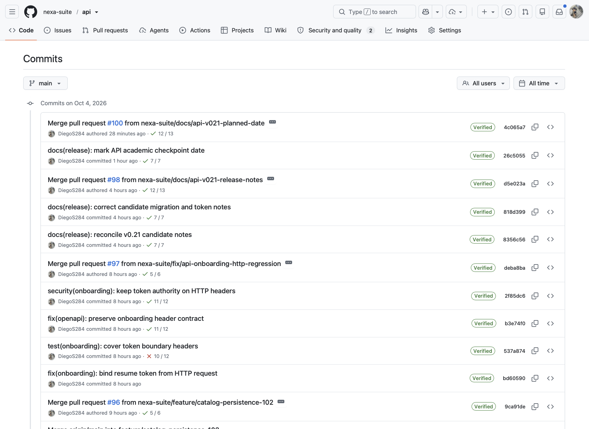
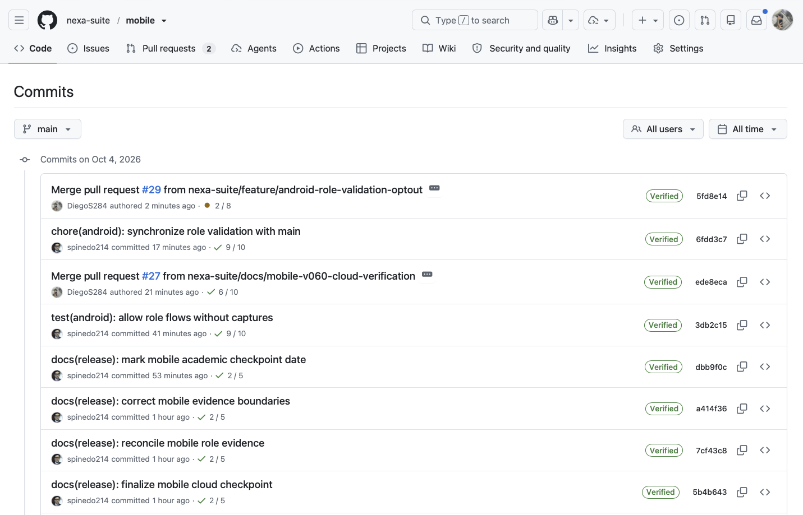

#### 4.2.2.4. Development Evidence for Sprint Review

**Corte de evidencia: 1–4 de octubre de 2026.**
Los registros seleccionados corresponden a cambios de código y
documentación realizados durante Sprint 2. Se mantiene la
planificación inicial de 36 elementos y 144 Story Points,
diferenciándola de los 71 elementos y 317 Story Points
observados posteriormente en Jira. La integración de un
commit no demuestra por sí sola que una historia haya
superado sus criterios de aceptación.

| Repositorio | Evidencia observada | Lectura del alcance | Estado |
| --- | --- | --- | --- |
| `nexa-suite/api` | El historial de `main` del 4 de octubre muestra cambios de persistencia del catálogo, contrato de onboarding y documentación técnica. | El historial registra cambios publicados en la fuente API; el uso en tareas operativas y la salud del servicio se describen con sus comprobaciones específicas. | Evidencia de fuente |
| `nexa-suite/mobile` | El 4 de octubre, el PR #30 integró en `main` la corrección del adaptador para consultar el catálogo interno. GitHub muestra revisión aprobada y comprobaciones CI satisfactorias. | La integración y CI registran el cambio de fuente; los recorridos móviles, las mutaciones, la prueba con usuarios y la aceptación se presentan en sus registros específicos. | Evidencia de fuente |
| `nexa-suite/mobile-report` | El historial público de `main` registra cambios del informe y la trazabilidad del Sprint 2 hasta el 3 de octubre. La figura registra el historial disponible en esa fecha. | La captura de `main` es anterior a esta actualización y no la muestra. | Evidencia documental |

*Commits de desarrollo y documentación relacionados con Sprint 2.*

| Repository | Branch | Commit Id | Commit Message | Commit Message Body | Committed on (Date) |
| --- | --- | --- | --- | --- | --- |
| `nexa-suite/api` | `main` | [6af902a2](https://github.com/nexa-suite/api/commit/6af902a2a3b2de3966264dda64bda8b11309f89d) | `docs: regenerate integrated operations API contract` | Sin cuerpo adicional. | 1 de octubre de 2026 |
| `nexa-suite/api` | `main` | [92c96323](https://github.com/nexa-suite/api/commit/92c96323e495fa5dce334ad49aaaebb8bf4e47f7) | `docs(api): regenerate and verify operational instruction contract` | Sin cuerpo adicional. | 1 de octubre de 2026 |
| `nexa-suite/mobile` | `main` | [09046922](https://github.com/nexa-suite/mobile/commit/09046922ecd85ed0ad2e4ce68a8f85e4543982d3) | `Merge pull request #30 from nexa-suite/feature/android-catalog-operations-contract` | `fix(android): use authorized Operations catalog projection` | 4 de octubre de 2026 |

*Nota.* Los dos primeros commits registran actualizaciones
del contrato OpenAPI y sus comprobaciones asociadas. El
tercero corresponde a la integración del PR #30, que
corrigió la consulta del catálogo autorizado de Operations
Mobile. Estos registros acreditan cambios en los
repositorios, pero no sustituyen las pruebas funcionales
ni la aceptación de las historias del sprint.

*Historial de `main` del API observado el 4 de octubre de
2026. La captura incluye verificaciones con resultados distintos; en
particular, una ejecución anterior de onboarding muestra 10 de 12 checks, por
lo que la figura no respalda la afirmación de que toda la actividad estuviera
verde.*

*Historial de `main` de Operations Mobile observado el 4 de
octubre de 2026. Se distinguen la sincronización de validación de roles y la
actividad del PR #29; el estado de checks visible en esa captura era parcial.*

Las verificaciones automatizadas y las pruebas realizadas
en dispositivos conservan sus propias fechas y resultados,
documentados en las secciones 4.2.2.5 y 4.2.2.6. Las
capturas disponibles muestran estados concretos de la
aplicación, incluyendo identificación de productos y
búsqueda manual, pero no demuestran por sí solas la
ejecución completa de los procesos comerciales, de
almacén y despacho.

De esta manera, se distingue la evidencia de desarrollo
de las pruebas técnicas y de la aceptación funcional.
Los commits presentados permiten reconocer avances
del Sprint 2, sin atribuir automáticamente su integración
al cumplimiento de todos los PBIs planificados.
*Síntesis del proceso de ingeniería de Sprint 2.*

| Área | Evidencia principal | Corte | Sección | Qué establece |
| --- | --- | --- | --- | --- |
| Development | Revisiones integradas de Operations Mobile y API, vinculadas con tareas y contratos de servicio. | 4–5 de octubre de 2026 | 4.1.2 y 4.2.2.4 | Existencia del código integrado y trazabilidad de sus cambios. |
| Testing | [Verificación Android](https://github.com/nexa-suite/mobile/actions/runs/37224557108) y [API CI](https://github.com/nexa-suite/api/actions/runs/37366453555). | Android: 4 de octubre; API: 5 de octubre de 2026 | 4.2.2.5 | Resultado satisfactorio de esos workflows y de sus comprobaciones ejecutadas; la aceptación de usuario tiene objetivos distintos. |
| Execution | Instalación y estados observados en Samsung S22; consulta protegida desde Swagger sin credenciales. | 4–5 de octubre de 2026 | 4.2.2.6 y 4.2.2.7 | Comportamiento visible de las acciones registradas, incluida la respuesta HTTP 401. |
| Documentation | Contrato OpenAPI, Swagger UI y registro de versiones, tareas y evidencia. | 5 de octubre de 2026 | 4.2.2.3 y 4.2.2.7; Registro de Versiones; Anexos B y C | Descripción de interfaces, seguimiento del trabajo y ubicación de las fuentes. |
| Deployment | Publicación del Website y APK; entorno API en Render, datos en Neon y configuración SMTP de Brevo. | 4–5 de octubre de 2026 | 4.1.4 y 4.2.2.8 | Entornos y artefactos publicados documentados, separados de la evaluación de los recorridos por usuario. |
