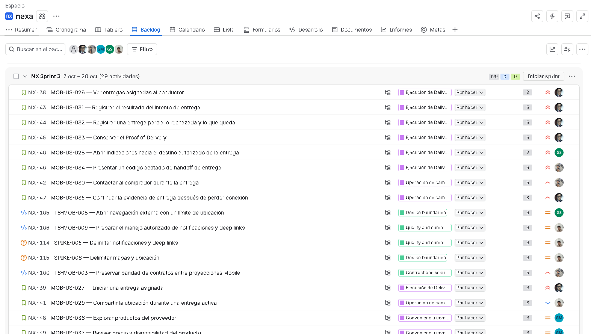
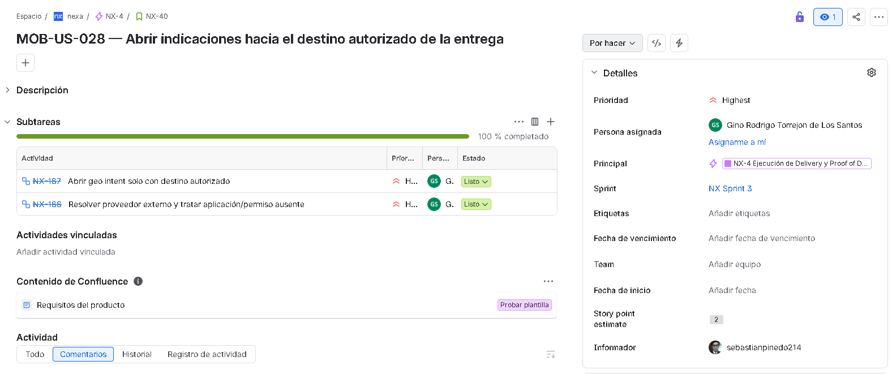
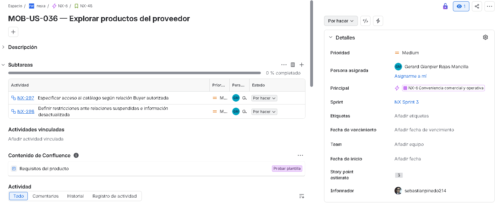

#### 4.2.3.3. Sprint Backlog 3

El Sprint Backlog 3 reúne las actividades orientadas a ampliar las funcionalidades de Nexa Mobile para la ejecución de entregas, el registro de resultados y evidencias, la recepción de mercadería y la continuidad comercial de los compradores empresariales. Su alcance también comprende actividades técnicas y de investigación relacionadas con la navegación, las notificaciones y la integración entre las aplicaciones móviles.

El sprint comprende 29 elementos del Product Backlog, equivalentes a 129 Story Points, distribuidos entre historias funcionales Mobile, Technical Stories y Spike Stories. Esta distribución corresponde a la planificación académica establecida para Sprint 3.

*Distribución de elementos del Sprint Backlog 3.*

| Tipo de elemento | PBIs | Story Points |
| --- | ---: | ---: |
| Historias funcionales Mobile | 24 | 112 |
| Technical Stories | 3 | 11 |
| Spike Stories | 2 | 6 |
| **Total** | **29** | **129** |

##### Seguimiento del Sprint Backlog

El seguimiento de las actividades se realiza mediante Jira Software, donde se registran las historias, sus responsables, prioridades, estimaciones y estados. La consulta del 12 de noviembre de 2026 confirmó la presencia de los 29 elementos planificados y sus 129 Story Points.

*Backlog del Sprint 3 en Jira, consultado el 12 de noviembre de 2026. El encabezado muestra los 29 elementos principales y los 129 Story Points correspondientes al sprint.*

**Sprint Board:** [Nexa — Jira Backlog](https://nexa-suite.atlassian.net/jira/software/projects/NX/boards/2/backlog)

Los 29 elementos principales cuentan con 58 subtareas asociadas, utilizadas para organizar actividades de implementación, investigación y verificación. De estas, 28 disponen de estimaciones originales que suman 161 horas, mientras que las otras 30 no registran una estimación de tiempo. En consecuencia, las 161 horas corresponden únicamente al esfuerzo estimado de las subtareas que cuentan con dicho registro y no representan el esfuerzo total ni el tiempo efectivamente trabajado.

En el registro consultado, los 29 elementos principales se encontraban en estado «Por hacer». Respecto de sus subtareas, dos figuraban en «Listo» y 56 en «Por hacer». Estas diferencias deben interpretarse como parte del seguimiento administrativo y no como indicadores suficientes de implementación, aceptación funcional o cierre del sprint.

##### Evidencia de historias y subtareas

Como ejemplo del seguimiento realizado, la historia `MOB-US-028` (`NX-40`) corresponde a la apertura de indicaciones hacia el destino autorizado de una entrega. Esta historia tiene una estimación de dos Story Points y se encuentra asignada a Gino Torrejón.

*Historia NX-40, correspondiente a MOB-US-028, con las subtareas NX-187 y NX-188 registradas en estado «Listo». La captura muestra el responsable, la estimación, la pertenencia al Sprint 3 y la diferencia entre el estado de la historia principal y sus subtareas.*

Por otra parte, la historia `MOB-US-036` (`NX-48`) corresponde a la exploración de productos del proveedor por parte del comprador empresarial. Esta historia tiene una estimación de tres Story Points y se encuentra asignada a Gerard Rojas. Sus subtareas `NX-297` y `NX-298` permanecen en estado «Por hacer» y no cuentan con una estimación original de tiempo registrada en Jira.

*Historia NX-48, correspondiente a MOB-US-036, con sus subtareas NX-297 y NX-298 en estado «Por hacer». La captura permite identificar el responsable, el estado de las actividades y su pertenencia al Sprint 3.*

Los registros permiten documentar la organización del trabajo y reconocer las diferencias entre historias y subtareas. Sin embargo, los estados administrativos y las estimaciones no sustituyen las evidencias técnicas, las pruebas funcionales ni la aceptación de los criterios establecidos para cada historia.

##### Registro de historias y subtareas del Sprint 3

La siguiente tabla presenta los 29 elementos principales del Sprint Backlog, sus Story Points, responsables, estados y subtareas asociadas. Las estimaciones corresponden a los valores originales registrados en Jira; el símbolo «—» indica que la subtarea no dispone de estimación de tiempo.

*Historias y subtareas registradas en Jira para el Sprint 3.*

<table>
  <thead>
    <tr>
      <th scope="row">Sprint #</th>
      <td colspan="7">Sprint 3</td>
    </tr>
    <tr>
      <th colspan="2">User Story / PBI</th>
      <th colspan="6">Work-Item / Task</th>
    </tr>
    <tr>
      <th>Id</th>
      <th>Title</th>
      <th>Id</th>
      <th>Title</th>
      <th>Description</th>
      <th>Estimation (Hours)</th>
      <th>Assigned To</th>
      <th>Status</th>
    </tr>
  </thead>
  <tbody>
    <tr>
      <td rowspan="2">MOB-US-026 NX-38</td>
      <td rowspan="2">Ver entregas asignadas al conductor</td>
      <td>NX-183</td>
      <td>Conectar lista/detalle del Driver actualmente asignado</td>
      <td>Mostrar únicamente las asignaciones actuales del conductor autorizado.</td>
      <td>6</td>
      <td>Sebastián Pinedo</td>
      <td>To-do</td>
    </tr>
    <tr>
      <td>NX-184</td>
      <td>Excluir entregas ajenas y descartar respuesta de contexto obsoleto</td>
      <td>Excluir entregas de otros conductores y descartar respuestas de contextos anteriores.</td>
      <td>5</td>
      <td>Sebastián Pinedo</td>
      <td>To-do</td>
    </tr>
    <tr>
      <td rowspan="2">MOB-US-027 NX-39</td>
      <td rowspan="2">Iniciar una entrega asignada</td>
      <td>NX-185</td>
      <td>Conectar inicio y Delivery Attempt con precondiciones actuales</td>
      <td>Registrar un único intento de entrega activo cuando se cumplan las precondiciones.</td>
      <td>7</td>
      <td>Sebastián Pinedo</td>
      <td>To-do</td>
    </tr>
    <tr>
      <td>NX-186</td>
      <td>Exigir ACK crítico vigente y preservar intención idempotente</td>
      <td>Exigir confirmación crítica vigente y evitar la creación de intentos duplicados.</td>
      <td>7</td>
      <td>Sebastián Pinedo</td>
      <td>To-do</td>
    </tr>
    <tr>
      <td rowspan="2">MOB-US-028 NX-40</td>
      <td rowspan="2">Abrir indicaciones hacia el destino autorizado de la entrega</td>
      <td>NX-187</td>
      <td>Abrir geo intent solo con destino autorizado</td>
      <td>Entregar el destino permitido al servicio de navegación sin alterar el Delivery Attempt.</td>
      <td>5</td>
      <td>Gino Torrejón</td>
      <td>Done</td>
    </tr>
    <tr>
      <td>NX-188</td>
      <td>Resolver proveedor externo y tratar aplicación/permiso ausente</td>
      <td>Informar fallos de aplicación o permisos sin modificar el estado de entrega.</td>
      <td>5</td>
      <td>Gino Torrejón</td>
      <td>Done</td>
    </tr>
    <tr>
      <td rowspan="2">MOB-US-029 NX-41</td>
      <td rowspan="2">Compartir la ubicación durante una entrega activa</td>
      <td>NX-207</td>
      <td>Conectar inicio/cierre de jornada y captura solo en jornada activa</td>
      <td>Restringir la captura a una jornada y entrega activas, con consentimiento y retención explícitos.</td>
      <td>—</td>
      <td>Joaquín Verde</td>
      <td>To-do</td>
    </tr>
    <tr>
      <td>NX-208</td>
      <td>Detener captura antes de END o pérdida de permiso; TTL raw máximo 24 h y mapa Buyer acotado</td>
      <td>Detener la captura al terminar la jornada o perder permisos y respetar los límites de retención y divulgación.</td>
      <td>—</td>
      <td>Joaquín Verde</td>
      <td>To-do</td>
    </tr>
    <tr>
      <td rowspan="2">MOB-US-030 NX-42</td>
      <td rowspan="2">Contactar al comprador durante la entrega</td>
      <td>NX-209</td>
      <td>Retirar exposición de chat Driver–Buyer según decisión Owner</td>
      <td>Respetar la decisión del Owner que excluye el chat directo Driver–Buyer.</td>
      <td>5</td>
      <td>Joaquín Verde</td>
      <td>To-do</td>
    </tr>
    <tr>
      <td>NX-210</td>
      <td>Mantener Sales↔Buyer como capacidad separada; no crear chat Driver</td>
      <td>Mantener la comunicación Sales–Buyer separada, sin incorporar un canal Driver–Buyer.</td>
      <td>5</td>
      <td>Diego Y. Sandoval</td>
      <td>To-do</td>
    </tr>
    <tr>
      <td rowspan="2">MOB-US-031 NX-43</td>
      <td rowspan="2">Registrar el resultado del intento de entrega</td>
      <td>NX-175</td>
      <td>Conectar resultado actual de Delivery Attempt</td>
      <td>Conservar resultado, responsable y momento del intento de entrega.</td>
      <td>7</td>
      <td>Sebastián Pinedo</td>
      <td>To-do</td>
    </tr>
    <tr>
      <td>NX-176</td>
      <td>Registrar resultado explícito sin asumir recepción Buyer</td>
      <td>Registrar el resultado físico sin convertirlo automáticamente en una recepción del comprador.</td>
      <td>6</td>
      <td>Gerard Rojas</td>
      <td>To-do</td>
    </tr>
    <tr>
      <td rowspan="2">MOB-US-032 NX-44</td>
      <td rowspan="2">Registrar una entrega parcial o rechazada y lo que queda</td>
      <td>NX-177</td>
      <td>Capturar resultado y cantidades remanentes por línea</td>
      <td>Conservar por separado las cantidades entregadas, rechazadas y pendientes.</td>
      <td>5</td>
      <td>Sebastián Pinedo</td>
      <td>To-do</td>
    </tr>
    <tr>
      <td>NX-178</td>
      <td>Conservar intento y restricciones antes de iniciar nuevo intento</td>
      <td>Preservar el resultado anterior y permitir continuaciones únicamente cuando estén autorizadas.</td>
      <td>5</td>
      <td>Sebastián Pinedo</td>
      <td>To-do</td>
    </tr>
    <tr>
      <td rowspan="2">MOB-US-033 NX-45</td>
      <td rowspan="2">Conservar el Proof of Delivery</td>
      <td>NX-179</td>
      <td>Crear proof y conectar carga/scan/adjunto AVAILABLE de sujeto exacto</td>
      <td>Vincular la evidencia disponible al intento, conservando identidad, persona y momento.</td>
      <td>8</td>
      <td>Sebastián Pinedo</td>
      <td>To-do</td>
    </tr>
    <tr>
      <td>NX-180</td>
      <td>Preservar evidencia privada y diferenciar POD de Buyer Receipt</td>
      <td>Proteger la evidencia de entrega y distinguir el POD de una recepción del comprador.</td>
      <td>6</td>
      <td>Sebastián Pinedo</td>
      <td>To-do</td>
    </tr>
    <tr>
      <td rowspan="2">MOB-US-034 NX-46</td>
      <td rowspan="2">Presentar un código acotado de handoff de entrega</td>
      <td>NX-189</td>
      <td>Conectar emisión/display sobre intento activo y autoridad actual</td>
      <td>Vincular el código de transferencia con la entrega y el intento correspondientes.</td>
      <td>6</td>
      <td>Diego Y. Sandoval</td>
      <td>To-do</td>
    </tr>
    <tr>
      <td>NX-190</td>
      <td>Mantener secreto solo en memoria; replay sin secreto explícito</td>
      <td>Evitar persistir o revelar el secreto y prevenir aceptaciones falsas por reutilización.</td>
      <td>7</td>
      <td>Diego Y. Sandoval</td>
      <td>To-do</td>
    </tr>
    <tr>
      <td rowspan="2">MOB-US-035 NX-47</td>
      <td rowspan="2">Continuar la evidencia de entrega después de perder conexión</td>
      <td>NX-211</td>
      <td>Retener selección privada de archivo bajo identidad exacta</td>
      <td>Conservar la identidad del archivo pendiente de recuperación y revisión.</td>
      <td>7</td>
      <td>Sebastián Pinedo</td>
      <td>To-do</td>
    </tr>
    <tr>
      <td>NX-212</td>
      <td>Recuperar intención cifrada y revisión manual sin cola genérica</td>
      <td>Recuperar la intención para revisión manual sin asumir una entrega exitosa.</td>
      <td>8</td>
      <td>Sebastián Pinedo</td>
      <td>To-do</td>
    </tr>
    <tr>
      <td rowspan="2">MOB-US-036 NX-48</td>
      <td rowspan="2">Explorar productos del proveedor</td>
      <td>NX-297</td>
      <td>Especificar acceso al catálogo según relación Buyer autorizada</td>
      <td>Permitir la consulta únicamente de productos autorizados por la relación comercial vigente.</td>
      <td>—</td>
      <td>Gerard Rojas</td>
      <td>To-do</td>
    </tr>
    <tr>
      <td>NX-298</td>
      <td>Definir restricciones ante relaciones suspendidas e información desactualizada</td>
      <td>Restringir productos privados y diferenciar información orientativa de datos vigentes.</td>
      <td>—</td>
      <td>Gerard Rojas</td>
      <td>To-do</td>
    </tr>
    <tr>
      <td rowspan="2">MOB-US-037 NX-49</td>
      <td rowspan="2">Revisar precio y disponibilidad del producto</td>
      <td>NX-299</td>
      <td>Delimitar fuentes y vigencia de precios y disponibilidad</td>
      <td>Identificar fuentes y vigencia sin confundir disponibilidad con reserva de inventario.</td>
      <td>—</td>
      <td>Gerard Rojas</td>
      <td>To-do</td>
    </tr>
    <tr>
      <td>NX-300</td>
      <td>Especificar revalidación y tratamiento de productos no disponibles</td>
      <td>Revalidar hechos actuales antes de tratarlos como compromisos comerciales.</td>
      <td>—</td>
      <td>Gerard Rojas</td>
      <td>To-do</td>
    </tr>
    <tr>
      <td rowspan="2">MOB-US-038 NX-50</td>
      <td rowspan="2">Preparar una Purchase Request</td>
      <td>NX-301</td>
      <td>Definir borradores sin reserva de stock ni compromiso comercial</td>
      <td>Conservar el borrador sin reservar inventario ni generar compromisos comerciales.</td>
      <td>—</td>
      <td>Gino Torrejón</td>
      <td>To-do</td>
    </tr>
    <tr>
      <td>NX-302</td>
      <td>Evaluar recuperación local y revalidación de información</td>
      <td>Permitir recuperación del borrador y exigir revisión de información modificada.</td>
      <td>—</td>
      <td>Gino Torrejón</td>
      <td>To-do</td>
    </tr>
    <tr>
      <td rowspan="2">MOB-US-039 NX-51</td>
      <td rowspan="2">Repetir una compra anterior</td>
      <td>NX-303</td>
      <td>Especificar reutilización autorizada del historial como nuevo borrador</td>
      <td>Generar un borrador independiente utilizando únicamente información autorizada del historial.</td>
      <td>—</td>
      <td>Gino Torrejón</td>
      <td>To-do</td>
    </tr>
    <tr>
      <td>NX-304</td>
      <td>Definir revalidación de productos y prevención de compromisos duplicados</td>
      <td>Revisar cambios de productos y evitar compromisos comerciales duplicados.</td>
      <td>—</td>
      <td>Gino Torrejón</td>
      <td>To-do</td>
    </tr>
    <tr>
      <td rowspan="2">MOB-US-040 NX-52</td>
      <td rowspan="2">Enviar una solicitud o realizar un Direct Order</td>
      <td>NX-305</td>
      <td>Delimitar Purchase Request y Direct Order según autorización</td>
      <td>Distinguir el envío de una solicitud de la creación directa de un pedido autorizado.</td>
      <td>—</td>
      <td>Gino Torrejón</td>
      <td>To-do</td>
    </tr>
    <tr>
      <td>NX-306</td>
      <td>Especificar rechazos ante cambios comerciales sin compromisos parciales</td>
      <td>Solicitar decisiones del servidor sobre información vigente y evitar compromisos parciales no autorizados.</td>
      <td>—</td>
      <td>Gino Torrejón</td>
      <td>To-do</td>
    </tr>
    <tr>
      <td rowspan="2">MOB-US-041 NX-53</td>
      <td rowspan="2">Responder a un cambio material</td>
      <td>NX-307</td>
      <td>Definir aceptación y rechazo explícitos de cambios materiales</td>
      <td>Registrar la decisión y versión correspondientes, preservando el compromiso original.</td>
      <td>—</td>
      <td>Gerard Rojas</td>
      <td>To-do</td>
    </tr>
    <tr>
      <td>NX-308</td>
      <td>Especificar control de versiones y preservación del compromiso original</td>
      <td>Conservar las decisiones originales y presentar el cambio vigente antes de continuar.</td>
      <td>—</td>
      <td>Gerard Rojas</td>
      <td>To-do</td>
    </tr>
    <tr>
      <td rowspan="2">MOB-US-042 NX-54</td>
      <td rowspan="2">Seguir solicitudes y pedidos</td>
      <td>NX-309</td>
      <td>Diferenciar historial y estados de solicitudes y pedidos</td>
      <td>Distinguir intención de compra, compromiso y progreso comercial.</td>
      <td>—</td>
      <td>Gerard Rojas</td>
      <td>To-do</td>
    </tr>
    <tr>
      <td>NX-310</td>
      <td>Especificar restricciones de acceso y tratamiento de información obsoleta</td>
      <td>Proteger información comercial privada y reconocer estados no disponibles o desactualizados.</td>
      <td>—</td>
      <td>Gerard Rojas</td>
      <td>To-do</td>
    </tr>
    <tr>
      <td rowspan="2">MOB-US-043 NX-55</td>
      <td rowspan="2">Revisar estado de crédito y pago</td>
      <td>NX-311</td>
      <td>Delimitar consulta autorizada de crédito y vigencia</td>
      <td>Identificar importe, moneda, fuente y vigencia de la información de crédito.</td>
      <td>—</td>
      <td>Gerard Rojas</td>
      <td>To-do</td>
    </tr>
    <tr>
      <td>NX-312</td>
      <td>Diferenciar pagos reportados, confirmados y rechazados</td>
      <td>Distinguir Payment Reported, Payment Confirmed y los estados de rechazo.</td>
      <td>—</td>
      <td>Gerard Rojas</td>
      <td>To-do</td>
    </tr>
    <tr>
      <td rowspan="2">MOB-US-044 NX-56</td>
      <td rowspan="2">Saber cuándo una entrega requiere atención</td>
      <td>NX-313</td>
      <td>Integrar avisos de entrega relevantes para el comprador autorizado</td>
      <td>Relacionar los avisos con entregas autorizadas y permitir consultar su estado vigente.</td>
      <td>—</td>
      <td>Joaquín Verde</td>
      <td>To-do</td>
    </tr>
    <tr>
      <td>NX-314</td>
      <td>Verificar privacidad, fallas y reintentos sin duplicar hechos</td>
      <td>Recuperar información autorizada sin duplicar entregas, recepciones o discrepancias.</td>
      <td>—</td>
      <td>Joaquín Verde</td>
      <td>To-do</td>
    </tr>
    <tr>
      <td rowspan="2">MOB-US-045 NX-57</td>
      <td rowspan="2">Ver un conductor activo en un mapa</td>
      <td>NX-315</td>
      <td>Investigar consentimiento y privacidad para ubicación futura</td>
      <td>Identificar requisitos de autorización, consentimiento y divulgación de ubicación.</td>
      <td>—</td>
      <td>Joaquín Verde</td>
      <td>To-do</td>
    </tr>
    <tr>
      <td>NX-316</td>
      <td>Delimitar restricciones de seguimiento, retención y autorización</td>
      <td>Excluir seguimiento continuo, almacenamiento periódico y ETA no autorizada.</td>
      <td>—</td>
      <td>Joaquín Verde</td>
      <td>To-do</td>
    </tr>
    <tr>
      <td rowspan="2">MOB-US-046 NX-58</td>
      <td rowspan="2">Contactar al conductor</td>
      <td>NX-317</td>
      <td>Evaluar canales autorizados y consentimiento para contacto futuro</td>
      <td>Establecer requisitos de consentimiento y autorización para posibles canales de contacto.</td>
      <td>—</td>
      <td>Joaquín Verde</td>
      <td>To-do</td>
    </tr>
    <tr>
      <td>NX-318</td>
      <td>Especificar restricciones de privacidad y separación de hechos de entrega</td>
      <td>Evitar que la comunicación altere resultados de entrega y no habilitar chat Driver–Buyer sin aprobación.</td>
      <td>—</td>
      <td>Joaquín Verde</td>
      <td>To-do</td>
    </tr>
    <tr>
      <td rowspan="2">MOB-US-047 NX-59</td>
      <td rowspan="2">Verificar una entrega mediante el código de handoff</td>
      <td>NX-319</td>
      <td>Conectar verificación del código de handoff con Delivery y Attempt</td>
      <td>Identificar la entrega y el intento sin confirmar automáticamente la recepción.</td>
      <td>—</td>
      <td>Diego Y. Sandoval</td>
      <td>To-do</td>
    </tr>
    <tr>
      <td>NX-320</td>
      <td>Rechazar códigos inválidos, vencidos o reutilizados sin confirmar recepción</td>
      <td>Rechazar códigos no válidos y mantener la recepción sin confirmar.</td>
      <td>—</td>
      <td>Diego Y. Sandoval</td>
      <td>To-do</td>
    </tr>
    <tr>
      <td rowspan="2">MOB-US-048 NX-60</td>
      <td rowspan="2">Confirmar las cantidades realmente recibidas</td>
      <td>NX-321</td>
      <td>Conectar confirmación de cantidades recibidas con Nexa API</td>
      <td>Registrar Buyer Receipt con persona, fecha, entrega y cantidades confirmadas por el servidor.</td>
      <td>—</td>
      <td>Sebastián Pinedo</td>
      <td>To-do</td>
    </tr>
    <tr>
      <td>NX-322</td>
      <td>Verificar discrepancias, idempotencia y resultados sin confirmación</td>
      <td>Evitar duplicar recepciones y distinguir resultados confirmados de resultados inciertos.</td>
      <td>—</td>
      <td>Sebastián Pinedo</td>
      <td>To-do</td>
    </tr>
    <tr>
      <td rowspan="2">MOB-US-049 NX-61</td>
      <td rowspan="2">Reportar una discrepancia sin borrar los hechos</td>
      <td>NX-323</td>
      <td>Preparar registro de discrepancias con motivo, cantidad y evidencia</td>
      <td>Conservar motivo, cantidad, responsable, fecha y evidencia de la diferencia observada.</td>
      <td>—</td>
      <td>Gerard Rojas</td>
      <td>To-do</td>
    </tr>
    <tr>
      <td>NX-324</td>
      <td>Preservar hechos anteriores y controlar rechazos y reintentos</td>
      <td>Conservar hechos originales y prevenir duplicaciones o cambios comerciales automáticos.</td>
      <td>—</td>
      <td>Gerard Rojas</td>
      <td>To-do</td>
    </tr>
    <tr>
      <td rowspan="2">TS-MOB-003 NX-100</td>
      <td rowspan="2">Preservar paridad de contratos entre proyecciones Mobile</td>
      <td>NX-276</td>
      <td>Implementar comportamiento — TS-MOB-003</td>
      <td>Mantener el mismo significado de los resultados de negocio entre plataformas.</td>
      <td>6</td>
      <td>Diego Y. Sandoval</td>
      <td>To-do</td>
    </tr>
    <tr>
      <td>NX-277</td>
      <td>Verificar comportamiento — TS-MOB-003</td>
      <td>Comprobar que las adaptaciones no alteren autorización, Tenant o resultados de negocio.</td>
      <td>5</td>
      <td>Diego Y. Sandoval</td>
      <td>To-do</td>
    </tr>
    <tr>
      <td rowspan="2">TS-MOB-008 NX-105</td>
      <td rowspan="2">Abrir navegación externa con un límite de ubicación</td>
      <td>NX-270</td>
      <td>Implementar comportamiento — TS-MOB-008</td>
      <td>Compartir solo el destino autorizado, sin seguimiento continuo ni autoridad local adicional.</td>
      <td>6</td>
      <td>Gino Torrejón</td>
      <td>To-do</td>
    </tr>
    <tr>
      <td>NX-271</td>
      <td>Verificar comportamiento — TS-MOB-008</td>
      <td>Comprobar que los resultados de navegación no alteren el estado de Delivery.</td>
      <td>5</td>
      <td>Diego Y. Sandoval</td>
      <td>To-do</td>
    </tr>
    <tr>
      <td rowspan="2">TS-MOB-009 NX-106</td>
      <td rowspan="2">Preparar el manejo autorizado de notificaciones y deep links</td>
      <td>NX-272</td>
      <td>Implementar comportamiento — TS-MOB-009</td>
      <td>Revalidar Tenant, relación y permisos antes de consumir enlaces o mostrar información.</td>
      <td>6</td>
      <td>Joaquín Verde</td>
      <td>To-do</td>
    </tr>
    <tr>
      <td>NX-273</td>
      <td>Verificar comportamiento — TS-MOB-009</td>
      <td>Evitar exposición de datos y comunicar estados recuperables cuando corresponda.</td>
      <td>5</td>
      <td>Sebastián Pinedo</td>
      <td>To-do</td>
    </tr>
    <tr>
      <td rowspan="2">SPIKE-005 NX-114</td>
      <td rowspan="2">Delimitar notificaciones y deep links</td>
      <td>NX-274</td>
      <td>Implementar comportamiento — SPIKE-005</td>
      <td>Evaluar alternativas sin presentar proveedores o integraciones como decisiones aceptadas.</td>
      <td>4</td>
      <td>Joaquín Verde</td>
      <td>To-do</td>
    </tr>
    <tr>
      <td>NX-275</td>
      <td>Verificar comportamiento — SPIKE-005</td>
      <td>Evaluar privacidad y documentar la decisión de adoptar, diferir o rechazar.</td>
      <td>5</td>
      <td>Joaquín Verde</td>
      <td>To-do</td>
    </tr>
    <tr>
      <td rowspan="2">SPIKE-006 NX-115</td>
      <td rowspan="2">Delimitar mapas y ubicación</td>
      <td>NX-294</td>
      <td>Implementar comportamiento — SPIKE-006</td>
      <td>Evaluar ubicación, permisos y alternativas sin introducir seguimiento continuo ni ETA.</td>
      <td>4</td>
      <td>Joaquín Verde</td>
      <td>To-do</td>
    </tr>
    <tr>
      <td>NX-295</td>
      <td>Verificar comportamiento — SPIKE-006</td>
      <td>Verificar límites de Delivery y registrar la decisión de adoptar, diferir o rechazar.</td>
      <td>5</td>
      <td>Gerard Rojas</td>
      <td>To-do</td>
    </tr>
  </tbody>
</table>

*Nota.* La tabla presenta los 29 PBIs y las 58 subtareas del Sprint 3, conforme a los registros de Jira consultados el 12 de noviembre de 2026. Las descripciones sintetizan las condiciones documentadas en las incidencias. Los estados «To-do» y «Done» corresponden, respectivamente, a «Por hacer» y «Listo» en Jira. El símbolo «—» indica que no se registró una estimación original para la subtarea. Los elementos Technical Stories y Spike Stories se incluyen como PBIs de planificación, sin considerarse User Stories funcionales. Las estimaciones corresponden a esfuerzo previsto y no a tiempo ejecutado.
