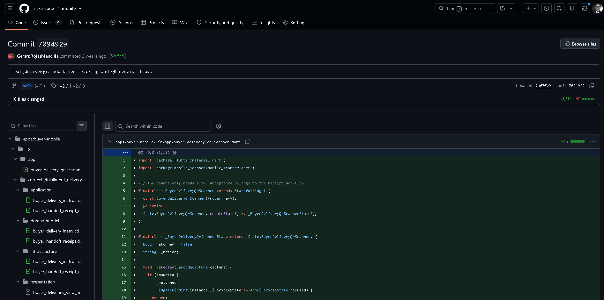
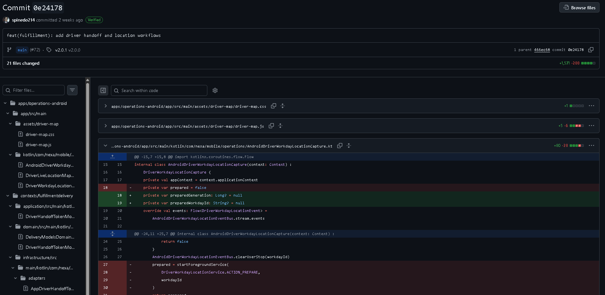
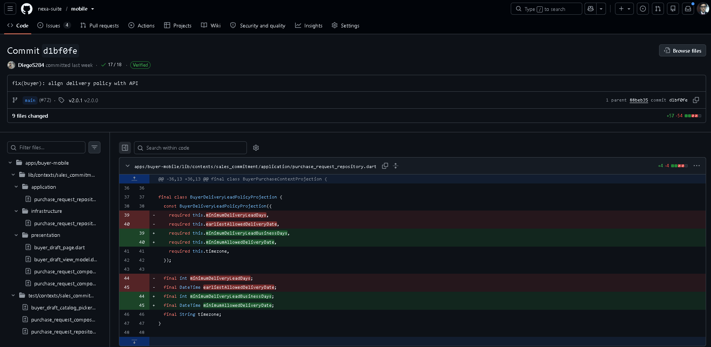

#### 4.2.3.4. Development Evidence for Sprint Review

El desarrollo de las funcionalidades relacionadas con Sprint 3
comprende avances en Operations Mobile y Buyer Mobile, orientados
a la consulta y seguimiento de entregas, la interacción entre
repartidores y compradores y el tratamiento de información
asociada con la recepción de mercadería.

El repositorio Nexa Mobile registra modificaciones en ambas
aplicaciones. En Operations Android se incorporaron componentes
relacionados con los flujos de entrega, transferencia y ubicación.
Por su parte, Buyer Mobile presenta funcionalidades de
seguimiento y mecanismos de interacción con los procesos de
recepción.

La siguiente tabla identifica cambios representativos del
código fuente y su integración en el repositorio.

*Commits relacionados con las funcionalidades de Sprint 3.*

| Repository | Branch | Commit Id | Commit Message | Commit Message Body | Committed on (Date) |
| --- | --- | --- | --- | --- | --- |
| `nexa-suite/mobile` | Historial integrado en `main` | [70949291](https://github.com/nexa-suite/mobile/commit/70949291e09910bd60aa1eea9d4f4fdc5d2177d4) | `feat(delivery): add buyer tracking and QR receipt flows` | Sin cuerpo adicional. | 30 de octubre de 2026 |
| `nexa-suite/mobile` | Historial integrado en `main` | [0e241783](https://github.com/nexa-suite/mobile/commit/0e2417837070311231334b7336d33cea1a1f8ebb) | `feat(fulfillment): add driver handoff and location workflows` | Sin cuerpo adicional. | 30 de octubre de 2026 |
| `nexa-suite/mobile` | Historial integrado en `main` | [d1bf0fef](https://github.com/nexa-suite/mobile/commit/d1bf0fef2ed76e89cd26c16bf3e07905b5e9b18f) | `fix(buyer): align delivery policy with API` | Sin cuerpo adicional. | 2 de noviembre de 2026 |
| `nexa-suite/mobile` | `main` | [5fed7c6b](https://github.com/nexa-suite/mobile/commit/5fed7c6bf08638f34fc8a01b4fa70300c683e29b) | `Merge pull request #72 from nexa-suite/feature/mobile-latest-work` | `feat: integrate latest buyer and operations work` | 2 de noviembre de 2026 |

*Evidencia visual de desarrollo de Buyer Mobile.*

El commit `70949291` registra modificaciones relacionadas
con el seguimiento de entregas y la interacción del comprador
con los procesos de recepción.

Entre los archivos incorporados se encuentra
`buyer_delivery_qr_scanner.dart`, que contiene un componente
Flutter para la lectura de códigos QR asociados con el
flujo de entrega del comprador.

La captura permite identificar el archivo agregado,
la estructura del componente y parte de las condiciones
utilizadas para tratar la captura del código.

*Figura. Cambios registrados en el commit 70949291 del repositorio Nexa Mobile, mostrando la incorporación del componente buyer_delivery_qr_scanner.dart para la lectura de códigos QR en Buyer Mobile.*

La presencia de este componente evidencia implementación
del cliente, pero no demuestra por sí sola que una
transferencia o recepción haya sido confirmada
satisfactoriamente por Nexa API.

*Evidencia visual de desarrollo de Operations Android.*

El commit `0e241783` incorpora modificaciones relacionadas
con la transferencia de entregas y la gestión de la
ubicación del conductor en Operations Android.

La captura presenta cambios realizados en
`AndroidDriverWorkdayLocationCapture.kt`, donde se observan
ajustes en la preparación de la captura de ubicación
asociada con la jornada de trabajo del conductor.

*Figura. Cambios registrados en el commit 0e241783 del repositorio Nexa Mobile, mostrando modificaciones del componente AndroidDriverWorkdayLocationCapture.kt relacionado con la captura de ubicación del conductor.*

Estos cambios permiten identificar trabajo de
implementación sobre componentes operativos de
Operations Android. La evidencia del repositorio
no sustituye la ejecución del flujo en un dispositivo
ni la verificación de sus resultados con el servidor.

*Evidencia visual de compatibilidad de Buyer Mobile con Nexa API.*

El commit `d1bf0fef` registra ajustes relacionados
con la política de fechas de entrega del comprador.

La captura muestra modificaciones en
`purchase_request_repository.dart`, específicamente
en la representación de la política de entrega
mediante los campos `minimumDeliveryLeadBusinessDays`
y `minimumAllowedDeliveryDate`.

*Figura. Cambios registrados en el commit d1bf0fef del repositorio Nexa Mobile, mostrando la actualización de los campos utilizados por Buyer Mobile para representar la política de fechas de entrega proporcionada por Nexa API.*

Estas modificaciones permiten reconocer la adaptación
del cliente a la estructura del contrato del API,
sin atribuir a Buyer Mobile la autoridad para
establecer independientemente la política comercial.

Estos cambios están relacionados con componentes previstos en
la planificación de Sprint 3, especialmente los flujos de
Delivery y la recepción del comprador. Sin embargo, la
correspondencia temática entre un commit y una historia no
demuestra por sí sola que se hayan satisfecho todos sus
criterios de aceptación.

La integración del [Pull Request #72](https://github.com/nexa-suite/mobile/pull/72)
incorporó avances de ambas aplicaciones en la rama principal,
incluyendo funcionalidades de acceso, catálogo, compras,
entregas y accesibilidad.

Posteriormente, [Nexa Mobile v2.0.0](https://github.com/nexa-suite/mobile/releases/tag/v2.0.0)
reunió el código de Operations Android y Buyer Flutter.
Esta publicación constituye evidencia de versionamiento
e integración del código fuente, pero no demuestra
la disponibilidad de todos los recorridos comerciales
y de entrega en el API desplegado.

En consecuencia, la evidencia presentada permite
identificar avances de implementación vinculados al
alcance funcional de Sprint 3. La verificación técnica
se desarrolla en la sección 4.2.3.5, mientras que
la ejecución de las aplicaciones y la evaluación de
los recorridos completos requieren evidencias específicas.
