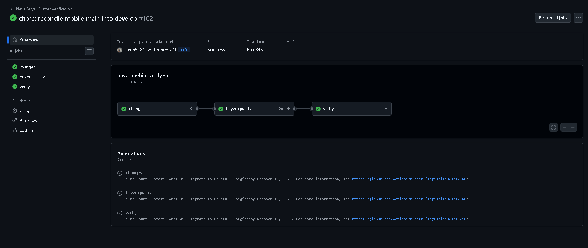
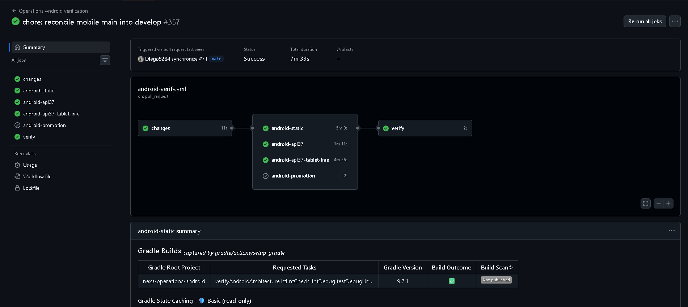
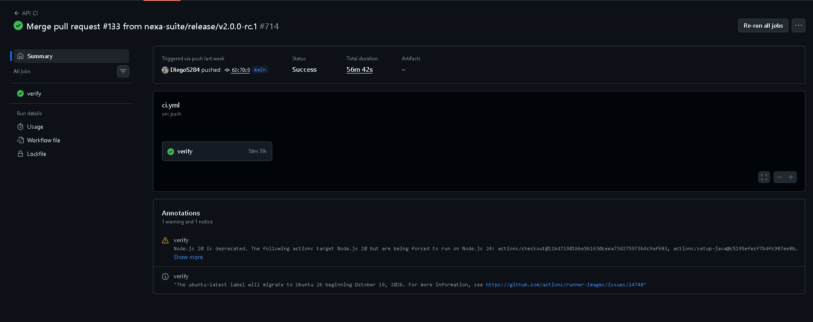
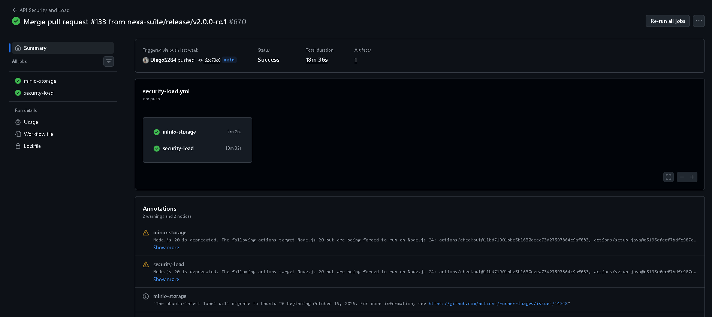

#### 4.2.3.5. Testing Suite Evidence for Sprint Review

Las actividades de verificación técnica relacionadas con
Sprint 3 comprenden comprobaciones automatizadas de
Operations Android y Buyer Mobile, desarrolladas mediante
Kotlin y Jetpack Compose, y Flutter y Dart, respectivamente.

Ambas aplicaciones disponen de flujos de integración continua
en GitHub Actions. Estos permiten comprobar aspectos técnicos
del código fuente y conservar los resultados asociados a
una revisión determinada.

La publicación de Nexa Mobile v2.0.0 cuenta con ejecuciones
satisfactorias de los workflows correspondientes a las dos
aplicaciones, realizadas sobre el commit
`fe1a320b61c9772311edbd2701d5d279b1ea01d1`.

*Verificaciones automatizadas de Nexa Mobile.*

| Componente | Evidencia | Resultado registrado | Alcance |
| --- | --- | --- | --- |
| Buyer Mobile | [Nexa Buyer Flutter verification](https://github.com/nexa-suite/mobile/actions/runs/41639201171) | Success | Verificación automatizada del código Flutter correspondiente a la revisión indicada. |
| Operations Mobile | [Operations Android verification](https://github.com/nexa-suite/mobile/actions/runs/41639201150) | Success | Verificación automatizada del código Android correspondiente a la misma revisión. |

Ambas ejecuciones finalizaron correctamente el 3 de
noviembre de 2026 y permiten comprobar que los respectivos
workflows concluyeron satisfactoriamente sobre la
revisión identificada.

*Evidencia visual de las verificaciones de Nexa Mobile.*

La ejecución de Nexa Buyer Flutter verification presenta
un resultado satisfactorio en GitHub Actions. El registro
muestra las etapas de detección de cambios, comprobación
de calidad de Buyer Mobile y verificación final.

*Figura. Resultado satisfactorio del workflow Nexa Buyer Flutter verification, mostrando las etapas registradas y su conclusión en GitHub Actions.*

Por su parte, la ejecución de Operations Android verification
muestra las comprobaciones estáticas y los trabajos
relacionados con las configuraciones Android verificadas
por el workflow.

El resultado general es satisfactorio. La etapa
`android-promotion` aparece omitida en esta ejecución,
sin representar una falla del workflow.

*Figura. Resultado satisfactorio del workflow Operations Android verification, mostrando las comprobaciones registradas, la etapa omitida y la verificación final.*

Estas capturas documentan resultados de integración
continua asociados con una revisión específica del
repositorio. No representan pruebas de aceptación
funcional de todas las historias de Sprint 3.

*Verificaciones del API relacionadas con Sprint 3.*

La publicación [Nexa API v2.0.0](https://github.com/nexa-suite/api/releases/tag/v2.0.0)
dispone de resultados satisfactorios de integración
continua y de las verificaciones de seguridad y carga,
correspondientes al commit
`62c70c8ccca69ba0c2901df3d0fc3acf4214eaa2`.

| Verificación | Referencia | Resultado registrado |
| --- | --- | --- |
| API CI | [GitHub Actions](https://github.com/nexa-suite/api/actions/runs/41627855961) | Success |
| API Security and Load | [GitHub Actions](https://github.com/nexa-suite/api/actions/runs/41627857247) | Success |

*Evidencia visual de las verificaciones de Nexa API.*

El workflow API CI presenta una ejecución satisfactoria
sobre la revisión indicada. La captura permite observar
el trabajo `verify` y el resultado general registrado
por GitHub Actions.

*Figura. Ejecución satisfactoria del workflow API CI de Nexa API, mostrando el trabajo verify y el estado Success registrado en GitHub Actions.*

Asimismo, API Security and Load registra una ejecución
satisfactoria con los trabajos `minio-storage` y
`security-load`, relacionados con las comprobaciones
técnicas definidas para ese workflow.

*Figura. Ejecución satisfactoria del workflow API Security and Load, mostrando los trabajos minio-storage y security-load y sus resultados en GitHub Actions.*

En las capturas del API se observan advertencias
relacionadas con la obsolescencia de Node.js 20
en determinadas acciones y avisos sobre los runners
de GitHub Actions. Estas anotaciones no alteran
el resultado satisfactorio registrado para las
ejecuciones presentadas, pero identifican aspectos
de mantenimiento de la infraestructura de CI.

Entre las pruebas relacionadas con el alcance comercial
se encuentra `BuyerDeliveryLeadBusinessPolicyTests`,
que comprueba el cálculo de fechas de entrega considerando
los días de la semana y la política establecida por el API.

*Clases de prueba y comportamientos relacionados con la verificación técnica.*

| Repositorio | Archivo o clase de prueba | Comportamiento comprobado | Relación con el alcance |
| --- | --- | --- | --- |
| `nexa-suite/mobile` | `apps/buyer-mobile/test/widget_test.dart` | Navegación de Buyer Mobile entre cuenta, otros servicios y catálogo, incluyendo la adaptación de las interacciones a la navegación vigente. | Navegación transversal de Buyer Mobile. |
| `nexa-suite/mobile` | `apps/buyer-mobile/test/widget_test.dart` | Navegación hacia productos, pedidos y seguimiento de entregas; comprobación de información visible y ausencia de detalles privados en la interfaz. | Relación parcial con `MOB-US-042` y `MOB-US-044`, sin acreditar su aceptación integral. |
| `nexa-suite/mobile` | `apps/operations-android/app/src/androidTest/kotlin/com/nexa/mobile/operations/RootNavigationSecurityTest.kt` | Interacción con la hoja de perfil, desplazamiento hasta la opción de cierre de sesión y ejecución de la acción correspondiente. | Navegación y seguridad transversal de Operations Mobile. |
| `nexa-suite/api` | `src/test/java/com/nexa/api/salescommitment/application/policy/BuyerDeliveryLeadBusinessPolicyTests.java` | Cálculo de la fecha mínima permitida considerando los días laborables y validación de fechas de entrega. | Política comercial aplicada por Nexa API. |

*Nota.* Las pruebas identificadas comprenden verificaciones de widgets Flutter, pruebas instrumentadas de interfaz Android y pruebas unitarias del API. Las relaciones con historias funcionales señalan correspondencia de alcance y no equivalen a la aceptación de todos sus criterios. Las evidencias de commits y ejecuciones automatizadas se presentan en esta misma sección.

Las verificaciones registradas corresponden al código
fuente de la revisión indicada. No demuestran por sí
solas que todos los servicios estén disponibles en
el entorno desplegado ni que los recorridos completos
de las aplicaciones móviles hayan superado sus
criterios de aceptación.

*Commits relacionados con las pruebas de Sprint 3.*

| Repository | Branch | Commit Id | Commit Message | Commit Message Body | Committed on (Date) |
| --- | --- | --- | --- | --- | --- |
| `nexa-suite/mobile` | Historial integrado | [f477782e](https://github.com/nexa-suite/mobile/commit/f477782e0abd577f02a075fbcf4a736520182dc3) | `test(buyer): align widget tests with current navigation` | Sin cuerpo adicional. | 30 de octubre de 2026 |
| `nexa-suite/mobile` | Historial integrado | [ccccfdec](https://github.com/nexa-suite/mobile/commit/ccccfdecac14dbab55603051c595d400d8bcae1b) | `test(buyer): follow current catalog and order flows` | Sin cuerpo adicional. | 30 de octubre de 2026 |
| `nexa-suite/mobile` | Historial integrado | [15ff1b9d](https://github.com/nexa-suite/mobile/commit/15ff1b9d689ba7a4fc85af666a3a1d9ed34e9b08) | `Merge pull request #68 from nexa-suite/fix/operations-profile-sheet-test` | `test(android): expand profile sheet before sign out` | 29 de octubre de 2026 |
| `nexa-suite/api` | Historial del repositorio | [8338252e](https://github.com/nexa-suite/api/commit/8338252eaafcb677250ffdf3ca03353420ea4077) | `test(sales): cover all delivery weekdays` | Sin cuerpo adicional. | 29 de octubre de 2026 |

Los cambios seleccionados muestran modificaciones en
las pruebas de navegación de Buyer Mobile, las pruebas
instrumentadas de Operations Android y las comprobaciones
de la política de fechas de entrega del API.

Estas modificaciones permiten identificar actividades
de mantenimiento y ampliación de las pruebas. Su
incorporación al repositorio no sustituye los resultados
de las ejecuciones automatizadas ni la evaluación
funcional de las historias correspondientes.

La publicación
[Nexa Mobile v2.0.0](https://github.com/nexa-suite/mobile/releases/tag/v2.0.0)
también documenta la construcción de APK académicos
de ambas aplicaciones y comprobaciones acotadas en
un dispositivo Samsung. Estas observaciones se
distinguen de una evaluación integral de los flujos
conectados al servidor.

Aunque los resultados automatizados fueron satisfactorios,
no permiten concluir que todas las funcionalidades
previstas para Sprint 3 estén completamente integradas
con el entorno cloud. Los procesos de compra, entrega
y recepción requieren verificaciones funcionales
adicionales en condiciones representativas de uso.

Por ello, las pruebas presentadas constituyen evidencia
de verificación técnica del software, sin sustituir
la aceptación de las historias ni la validación de
la experiencia de los usuarios.
