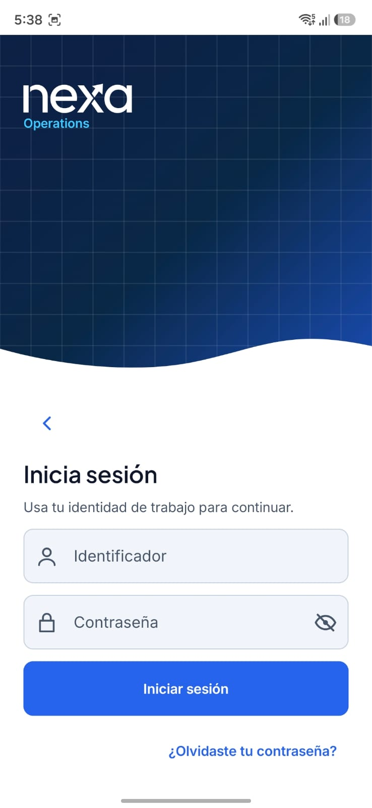
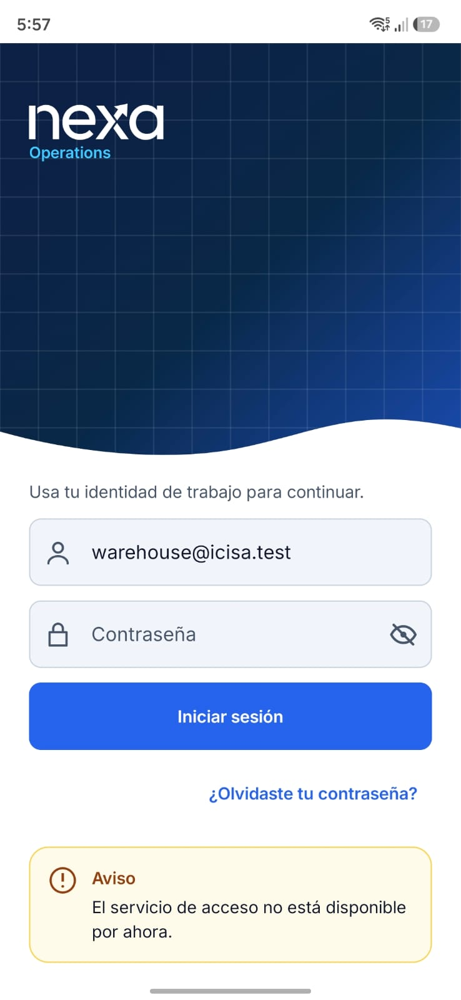
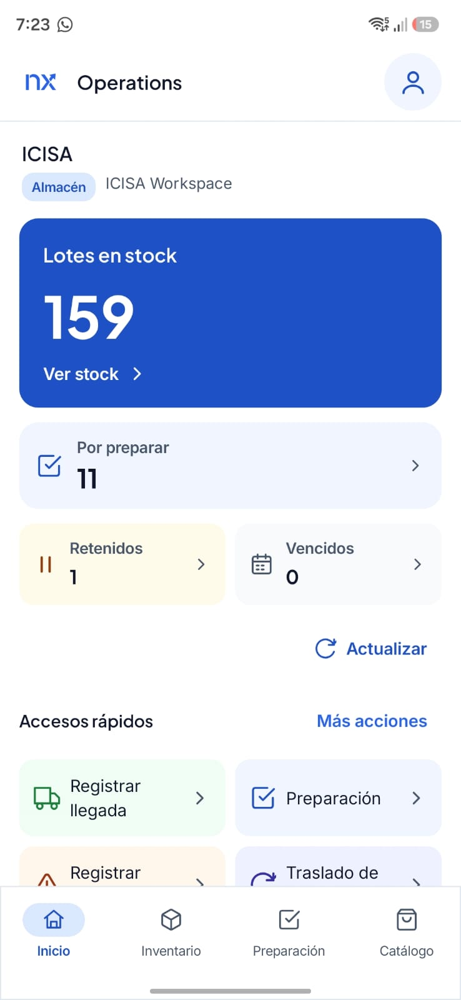
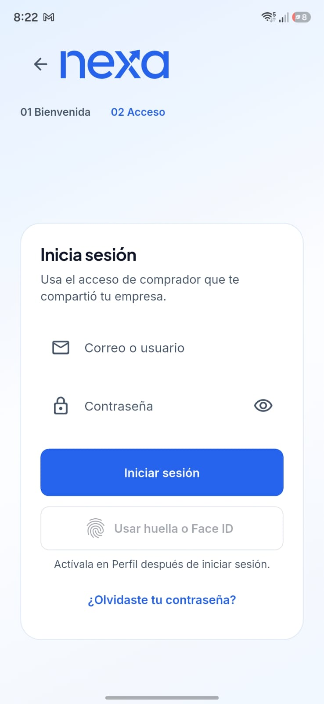
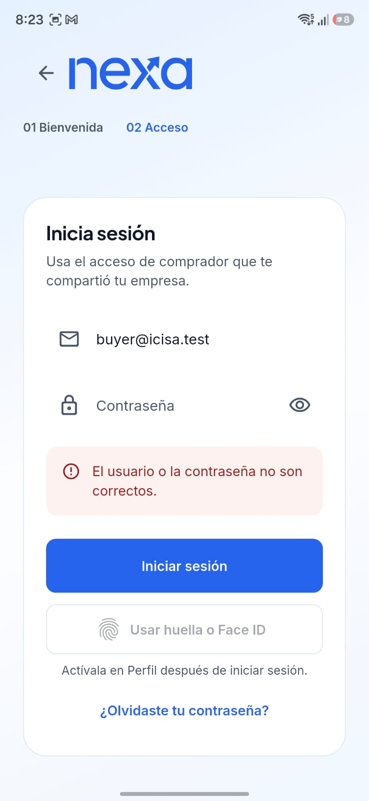
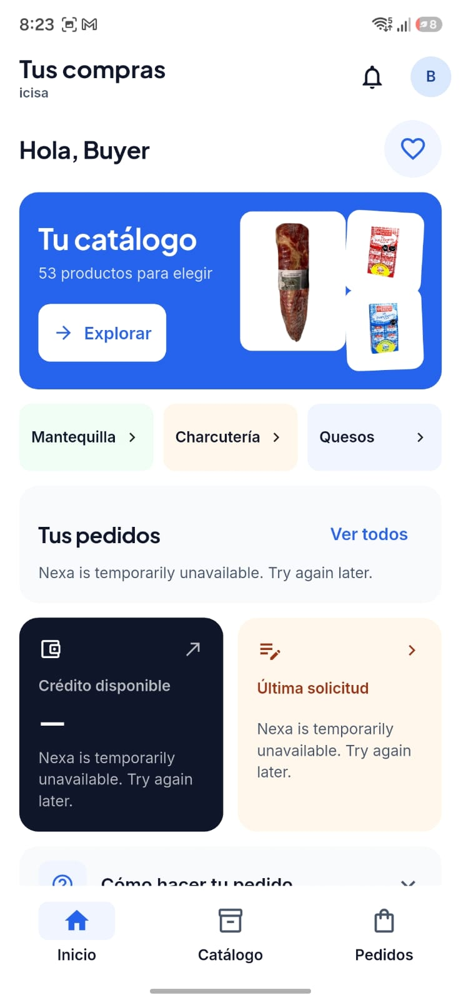
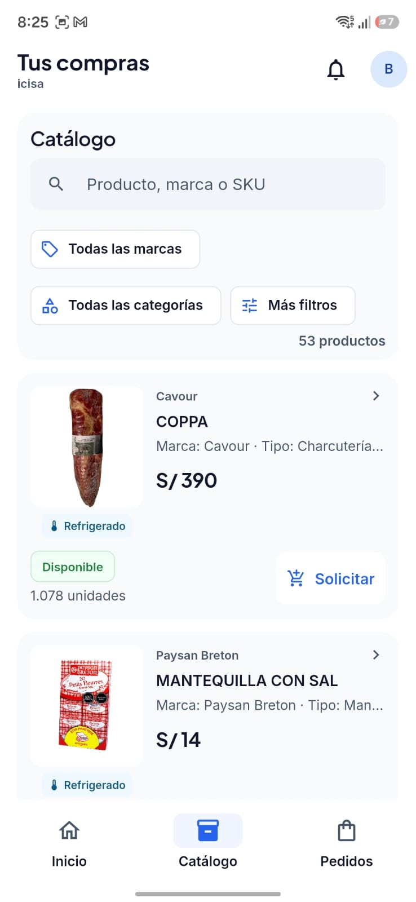
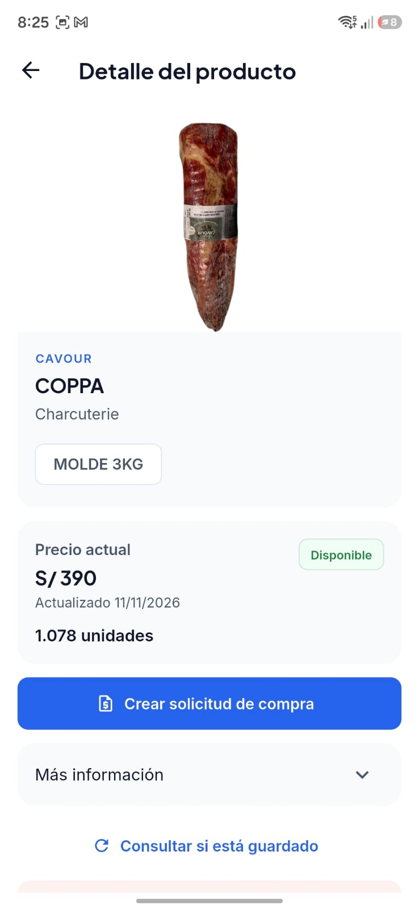

#### 4.2.3.6. Execution Evidence for Sprint Review

La evidencia de ejecución relacionada con Sprint 3 comprende comprobaciones realizadas sobre Operations Android y Buyer Mobile, mediante instalaciones de sus aplicaciones en un emulador Android y en un dispositivo físico.

Estas verificaciones permiten observar aspectos específicos de la instalación, la autenticación, la navegación y la recuperación de sesiones. Asimismo, proporcionan una referencia técnica para evaluar el comportamiento de las interfaces que participan en los recorridos operativos y comerciales de Nexa Mobile.

Las capturas obtenidas corresponden a Operations Android 1.3.1 y Buyer Flutter 1.2.1+4, disponibles en la publicación Nexa Mobile v2.0.1. Su análisis distingue las funcionalidades accesibles de aquellas que presentan restricciones de integración o disponibilidad de servicios.

*Comprobaciones de ejecución registradas para Nexa Mobile.*

| Aplicación | Entorno y versión | Resultado documentado | Alcance de la evidencia |
| --- | --- | --- | --- |
| Operations Mobile y Buyer Mobile | Emulador Android API 37 ARM64; artefactos académicos vinculados con Mobile v2.0.0. | Instalación de ambas aplicaciones mediante APK de depuración. | Evidencia de instalación en emulador; no demuestra recorridos comerciales completos. |
| Operations Mobile y Buyer Mobile | Dispositivo Samsung; APK académicos de Mobile v2.0.0. | Instalación de ambas aplicaciones y comprobación de acceso con credenciales inválidas. | Se registró una respuesta HTTP 401. Esta comprobación no acredita un inicio de sesión satisfactorio ni la ejecución de entregas. |
| Operations Mobile | Dispositivo Samsung; Operations Android 1.3.1, publicado en Mobile v2.0.1. | Se observó el reingreso biométrico después de una huella válida, con verificación de sesión y recuperación del contexto Warehouse. | Comprobación acotada de recuperación de acceso; no constituye una prueba funcional de Delivery. |
| Operations Mobile y Buyer Mobile | Dispositivo Android; APK académicos incluidos en Mobile v2.0.1. | Capturas de las interfaces de acceso, navegación autorizada, consultas comerciales y mensajes de indisponibilidad. | Evidencia visual de los estados observados durante la ejecución de ambas aplicaciones; no acredita la finalización de procesos transaccionales. |

Los registros correspondientes a las comprobaciones de instalación y autenticación se encuentran en las publicaciones [Nexa Mobile v2.0.0](https://github.com/nexa-suite/mobile/releases/tag/v2.0.0) y [Nexa Mobile v2.0.1](https://github.com/nexa-suite/mobile/releases/tag/v2.0.1).

La versión v2.0.1 incorpora una corrección del reingreso biométrico de Operations Android. Este mecanismo conserva la necesidad de confirmar la sesión y el contexto autorizado mediante el servidor. Buyer Mobile mantiene la versión 1.2.1+4, sin cambios en su código respecto de la publicación anterior.

##### Evidencias de ejecución de Operations Mobile

Las comprobaciones de Operations Mobile permiten observar la experiencia de acceso del personal operativo y la navegación hacia funcionalidades disponibles según el contexto autorizado.

La pantalla de inicio de sesión presenta los campos de identificación y contraseña, junto con las opciones para iniciar sesión y recuperar el acceso. Esta interfaz constituye el punto de entrada a las funcionalidades operativas de la aplicación.

*Figura.* Pantalla de autenticación de Nexa Operations Mobile ejecutada en un dispositivo Android, mostrando los campos de acceso y las opciones disponibles para el usuario.

Durante las comprobaciones también se observó un mensaje de indisponibilidad del servicio de acceso. La aplicación informó al usuario que el servicio no se encontraba disponible temporalmente, evitando presentar el intento como una autenticación satisfactoria.

*Figura.* Retroalimentación presentada por Operations Mobile ante la indisponibilidad temporal del servicio de autenticación.

Esta evidencia permite identificar el tratamiento visual de una situación de error durante el acceso. Sin embargo, el mensaje mostrado no permite determinar por sí solo la causa técnica de la indisponibilidad ni sustituye el análisis de las respuestas del servidor.

Por otra parte, se obtuvo una captura de la pantalla principal de Operations Mobile con el contexto de Almacén correspondiente a ICISA Workspace. En ella se presentan indicadores operativos relacionados con existencias, preparación y otras actividades disponibles para el usuario.

*Figura.* Pantalla principal de Nexa Operations Mobile en el contexto de Almacén de ICISA Workspace, mostrando información operativa y accesos a las funcionalidades disponibles.

La visualización de esta pantalla evidencia que la aplicación permitió acceder a un contexto operativo y presentar su navegación principal. Los indicadores observados corresponden a la información mostrada durante la captura y no constituyen, por sí solos, una verificación de la consistencia de los datos del servidor.

Aunque Operations Mobile incluye componentes relacionados con las entregas asignadas, los intentos de entrega, la ubicación del conductor y los mecanismos de transferencia, las capturas presentadas no demuestran la ejecución completa de estos recorridos en el entorno conectado.

##### Evidencias de ejecución de Buyer Mobile

Las comprobaciones de Buyer Mobile comprenden la autenticación, el acceso a la interfaz principal y la consulta de información comercial disponible para el comprador.

La pantalla de inicio de sesión presenta los campos de correo o usuario y contraseña. También incluye controles para la autenticación biométrica y la recuperación de contraseña, sujetos a las condiciones correspondientes de habilitación y autorización.

*Figura.* Pantalla de autenticación de Nexa Buyer Mobile, mostrando los campos de identificación, contraseña y las opciones de acceso disponibles para el comprador.

Como parte de las comprobaciones de acceso, se observó el comportamiento de Buyer Mobile ante credenciales incorrectas. La aplicación presentó un mensaje específico que informa al usuario sobre el rechazo de sus datos de autenticación.

*Figura.* Mensaje de validación presentado por Nexa Buyer Mobile ante un intento de autenticación con credenciales incorrectas.

Esta evidencia es consistente con la corrección documentada en Nexa Mobile v2.0.0, orientada a diferenciar las credenciales rechazadas de una sesión expirada. La captura permite comprobar la retroalimentación visual observada, sin acreditar por sí sola otros escenarios de seguridad o recuperación de sesiones.

Adicionalmente, se obtuvo una captura de la pantalla principal de Buyer Mobile dentro del contexto comercial de ICISA. La interfaz presenta accesos al catálogo y a las funcionalidades de pedidos, además de información relacionada con el comprador.

*Figura.* Pantalla principal de Nexa Buyer Mobile en el contexto comercial de ICISA, mostrando la navegación de compras y mensajes de indisponibilidad parcial en determinadas consultas.

En esta ejecución, la aplicación permitió visualizar la interfaz principal y acceder a opciones comerciales. No obstante, los apartados relacionados con pedidos, crédito y solicitudes presentaron mensajes de indisponibilidad temporal.

Esta situación permite observar que la interfaz distingue la información comercial visible de las consultas que no pudieron completarse. Por tanto, no corresponde interpretar la navegación disponible como evidencia de funcionamiento integral de los procesos de compra, crédito o seguimiento de pedidos.

La consulta del catálogo permitió visualizar una lista de productos con imágenes, descripciones, precios y controles de búsqueda y filtrado. La pantalla también presentó información de disponibilidad y unidades para los artículos mostrados.

*Figura.* Catálogo comercial de Nexa Buyer Mobile, mostrando productos, precios, disponibilidad y herramientas de búsqueda y filtrado.

La captura permite identificar el funcionamiento visual de la consulta comercial y la organización de los productos en la interfaz. Sin embargo, no demuestra por sí sola que los precios o las cantidades presentadas hayan sido confirmados nuevamente por el servidor durante la captura.

Asimismo, se accedió a la pantalla de detalle de un producto, en la que se presenta su identificación comercial, imagen, presentación, precio y disponibilidad. La interfaz también incluye una opción para iniciar una solicitud de compra.

*Figura.* Pantalla de detalle de producto en Nexa Buyer Mobile, mostrando información comercial y la opción para iniciar una solicitud de compra.

Esta evidencia demuestra la navegación hasta la vista de detalle y la presentación de los controles correspondientes. La presencia de la opción para crear una solicitud no acredita que dicha operación se haya enviado, confirmado o registrado satisfactoriamente por Nexa API.

##### Alcance y limitaciones de las comprobaciones

Las evidencias visuales incorporadas documentan la ejecución de ambas aplicaciones en Android y permiten reconocer aspectos concretos de su comportamiento durante las comprobaciones realizadas.

En Operations Mobile se observaron la interfaz de autenticación, el tratamiento de una situación de indisponibilidad y la navegación dentro de un contexto operativo autorizado.

En Buyer Mobile se observaron la interfaz de autenticación, la retroalimentación ante credenciales incorrectas, la pantalla principal y la navegación hacia el catálogo y el detalle de productos.

Estas comprobaciones complementan las evidencias de implementación y pruebas automatizadas documentadas en las secciones 4.2.3.4 y 4.2.3.5, respectivamente.

Sin embargo, las capturas disponibles no demuestran que un repartidor haya completado un intento de entrega ni que un comprador haya confirmado satisfactoriamente la recepción de mercadería contra el servicio desplegado.

Tampoco acreditan la ejecución completa de solicitudes de compra, pagos, actualizaciones de inventario o procesos de transferencia. La presencia de componentes y controles relacionados con estas operaciones debe diferenciarse de su ejecución funcional y de la confirmación autoritativa del servidor.

Para verificar los recorridos completos previstos en Sprint 3 se requieren pruebas que identifiquen las acciones realizadas, las respuestas del servidor y los resultados observados en las aplicaciones, utilizando contextos y datos de prueba autorizados.

En consecuencia, la evidencia presentada permite documentar comprobaciones reales de ejecución, acceso y navegación en Nexa Mobile, reconociendo las limitaciones observadas en la disponibilidad de determinados servicios.

Estos resultados constituyen evidencia técnica de las interfaces y de los recorridos efectivamente observados, sin sustituir la aceptación funcional de las historias de usuario ni la validación integral de los procesos de Delivery y recepción del comprador.
