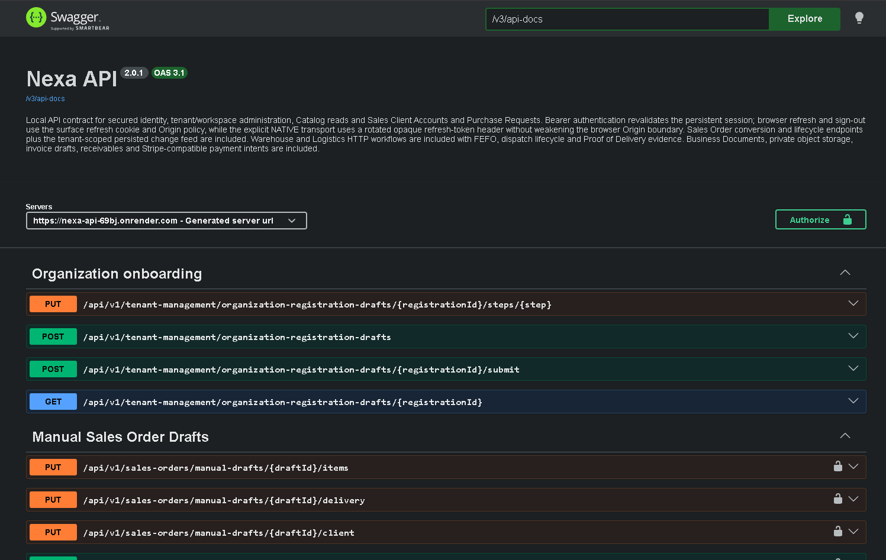
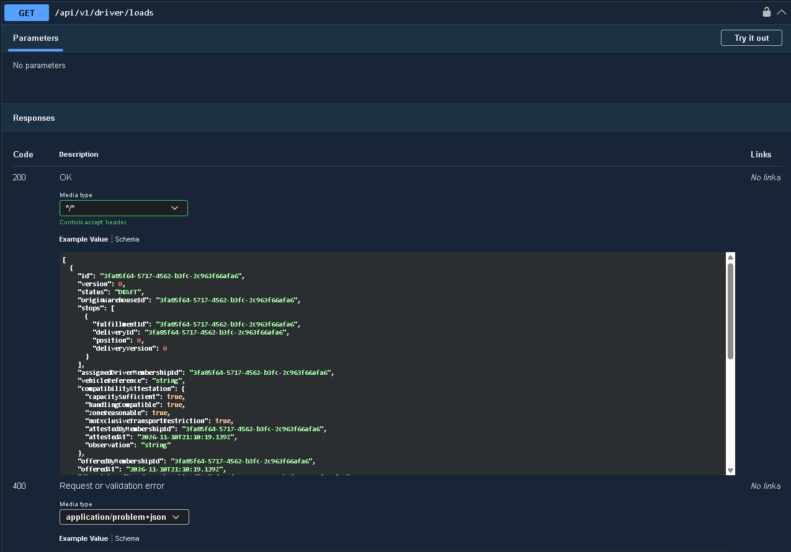
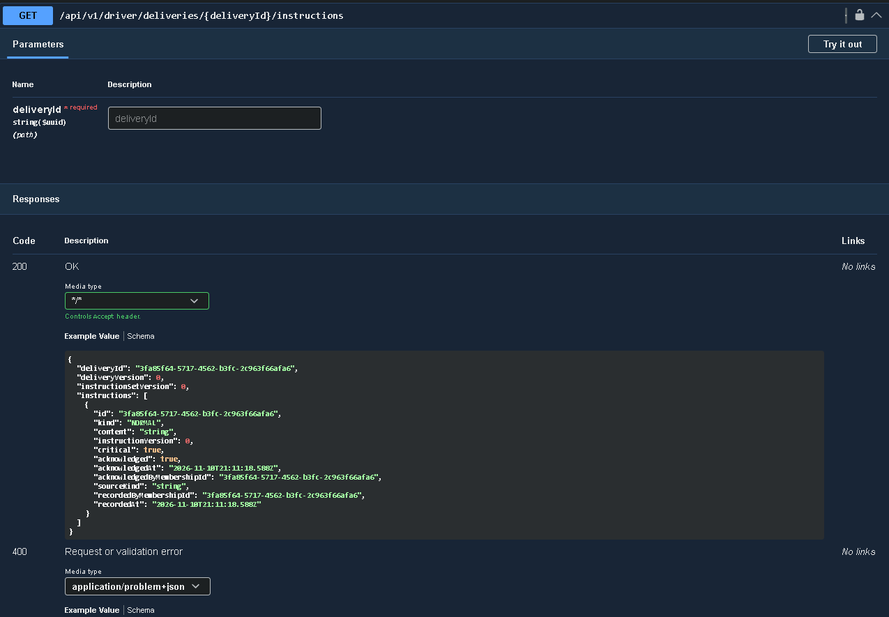
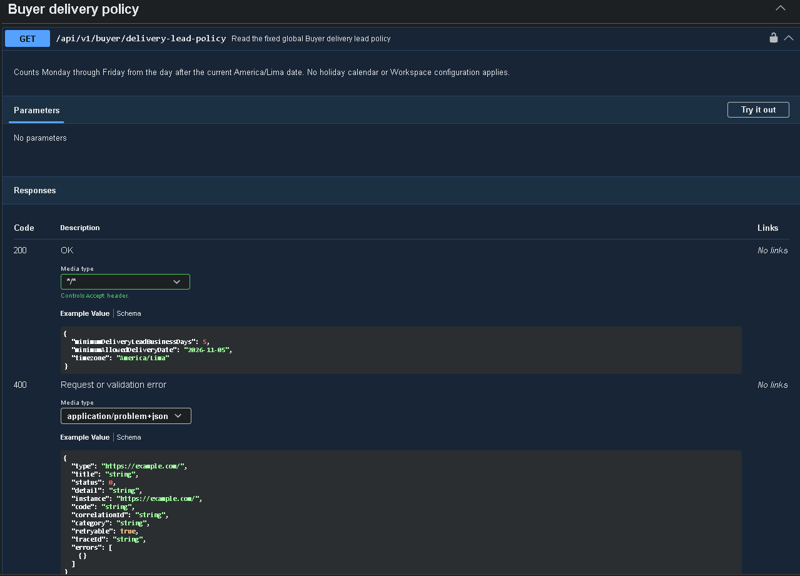

#### 4.2.3.7. Services Documentation Evidence for Sprint Review

Las funcionalidades previstas para Sprint 3 requieren servicios que permitan consultar información autorizada de las entregas, gestionar operaciones del personal de reparto y proporcionar al comprador los datos necesarios para sus actividades comerciales y de recepción.

Nexa API proporciona contratos REST que establecen las operaciones disponibles y las condiciones de acceso. Las aplicaciones móviles consumen estos servicios, mientras que el servidor conserva la responsabilidad de validar permisos, gestionar los cambios de estado y confirmar los resultados de negocio.

La publicación [Nexa API v2.0.0](https://github.com/nexa-suite/api/releases/tag/v2.0.0) incluye modificaciones relacionadas con las políticas de entrega, la información del comprador y la compatibilidad de los contratos. La siguiente tabla presenta operaciones documentadas que se relacionan con el alcance funcional del sprint.

Posteriormente se publicó
[Nexa API v2.0.1](https://github.com/nexa-suite/api/releases/tag/v2.0.1),
correspondiente a la revisión
`c365ea02a642714887e4ca506031c24493252c91`.

Esta actualización mantiene los contratos de la versión
anterior. La comparación OpenAPI publicada registra
como diferencia únicamente el campo `info.version`,
sin incompatibilidades identificadas.

La versión incorpora ajustes de infraestructura y
habilitación controlada de determinadas consultas,
sin establecer la disponibilidad completa de los
procesos comerciales y de entrega en el entorno cloud.

El despliegue observado de esta revisión se documenta
en la sección 4.2.3.8.

*Documentación de servicios mediante Swagger UI.*

Swagger UI permite consultar las operaciones documentadas
en Nexa API, incluyendo sus métodos HTTP, parámetros,
modelos de respuesta y códigos de estado.

La documentación consultada corresponde a Nexa API
v2.0.1 y utiliza OpenAPI Specification 3.1.

*Figura. Vista general de Swagger UI correspondiente a Nexa API v2.0.1, mostrando la versión del contrato, la especificación OpenAPI y los grupos de operaciones disponibles en la documentación.*

La interfaz proporciona una referencia para identificar
los contratos utilizados por Operations Mobile y Buyer
Mobile. La presencia de estas operaciones en Swagger
no demuestra por sí sola su disponibilidad funcional
en el entorno desplegado.

*Operaciones del API relacionadas con Sprint 3.*

| Método y ruta | Funcionalidad | Condiciones principales |
| --- | --- | --- |
| `GET /api/v1/driver/loads` | Consultar cargas asignadas al conductor. | Requiere el contexto autorizado y el permiso `dispatch.read`. La consulta se limita a las asignaciones correspondientes al conductor. |
| `POST /api/v1/driver/loads/{loadId}/acceptances` | Registrar la aceptación de una carga asignada. | Requiere `dispatch.start_route`, `If-Match`, `Idempotency-Key` y que el usuario sea el conductor asignado. No representa la confirmación de entrega al comprador. |
| `GET /api/v1/driver/deliveries/{deliveryId}/instructions` | Consultar las instrucciones relacionadas con una entrega asignada. | La información se limita al conductor autorizado y a los estados admitidos por el contrato. |
| `POST /api/v1/driver/deliveries/{deliveryId}/instruction-acknowledgements` | Registrar el reconocimiento de instrucciones críticas de entrega. | Requiere la versión correspondiente mediante `If-Match` y una clave de idempotencia. |
| `GET /api/v1/buyer/delivery-lead-policy` | Consultar la política aplicable a las fechas de entrega del comprador. | Requiere un contexto `PORTAL`, una membresía `BUYER` y el permiso `buyer.sales.read`. |

Las operaciones de cargas e instrucciones se encuentran documentadas en los contratos de [Delivery Loads](https://github.com/nexa-suite/api/blob/v2.0.0/docs/openapi/delivery-loads.md) y [Operational Delivery Instructions](https://github.com/nexa-suite/api/blob/v2.0.0/docs/openapi/delivery-instructions.md).

Estas operaciones permiten distinguir la aceptación de una carga, el reconocimiento de instrucciones y el registro del resultado de una entrega. Cada acción tiene un propósito específico y no debe interpretarse como equivalente a las demás.

*Consulta de cargas asignadas al conductor.*

La operación `GET /api/v1/driver/loads` permite consultar
las cargas asociadas con el conductor autorizado.
Su contrato presenta información sobre identificadores,
estados y entregas relacionadas con cada carga.

*Figura. Documentación de la operación GET /api/v1/driver/loads en Swagger UI, mostrando el modelo de respuesta HTTP 200 y los posibles resultados de error.*

La estructura de respuesta documentada permite reconocer
los datos que Operations Mobile necesita interpretar
para presentar las cargas asignadas.

La captura muestra un ejemplo generado por OpenAPI,
no una consulta ejecutada con una sesión autenticada
de conductor.

*Consulta de instrucciones de entrega.*

La operación
`GET /api/v1/driver/deliveries/{deliveryId}/instructions`
permite consultar las instrucciones asociadas con una
entrega específica.

El contrato requiere el identificador `deliveryId`
y documenta información relacionada con el contenido,
la versión y el reconocimiento de las instrucciones.

*Figura. Documentación de la operación GET /api/v1/driver/deliveries/{deliveryId}/instructions, mostrando el parámetro deliveryId y el modelo de respuesta correspondiente.*

Esta información permite identificar los datos que
Operations Mobile debe interpretar cuando solicita
instrucciones de una entrega asignada.

El acceso efectivo depende de la identidad del conductor,
la asignación correspondiente y las verificaciones
realizadas por Nexa API. La captura documenta el contrato,
sin acreditar una consulta ejecutada.

*Respuestas y condiciones de error documentadas.*

Los contratos del API también definen las respuestas
que deben interpretar las aplicaciones móviles y las
condiciones que pueden impedir una operación.

| Operación | Información de respuesta | Condiciones relevantes |
| --- | --- | --- |
| `GET /api/v1/driver/deliveries/{deliveryId}/instructions` | Identificador y versión de entrega, versión del conjunto de instrucciones y detalle de las instrucciones autorizadas. | La información está restringida al conductor actualmente asignado y a los estados admitidos. |
| `POST /api/v1/driver/loads/{loadId}/acceptances` | Resultado de la operación de aceptación sobre la carga y versión actualizada para control de concurrencia. | Una versión desactualizada devuelve HTTP 412; la ausencia de precondiciones requeridas devuelve HTTP 428. Los conflictos de estado se rechazan con HTTP 409. |
| `GET /api/v1/buyer/delivery-lead-policy` | `minimumDeliveryLeadBusinessDays`, `minimumAllowedDeliveryDate` y `timezone`. | La respuesta depende de un contexto Buyer autorizado; la fecha mínima se calcula utilizando la política vigente del servidor. |

En las operaciones que modifican información, el
control de versiones y las claves de idempotencia
permiten tratar solicitudes repetidas y detectar
conflictos sin asumir que el último resultado
recibido representa necesariamente una nueva operación.

Estos comportamientos corresponden a las
especificaciones documentadas del servicio.
Su presencia en el contrato no demuestra que
se hayan ejecutado satisfactoriamente desde
las aplicaciones móviles contra el entorno cloud.

Por su parte, la política de entrega del comprador establece un mínimo de cinco días hábiles, calculados de lunes a viernes en la zona horaria `America/Lima`, sin considerar un calendario de feriados. El API proporciona la primera fecha permitida y vuelve a verificar la regla cuando se presentan las operaciones comerciales correspondientes. Su contrato se documenta en [Buyer Delivery Lead Policy](https://github.com/nexa-suite/api/blob/v2.0.0/docs/integration/buyer-delivery-lead-policy.md).

*Política de fechas de entrega del comprador.*

La operación `GET /api/v1/buyer/delivery-lead-policy`
proporciona la política de fechas de entrega aplicable
al comprador.

Su respuesta documentada incluye los campos
`minimumDeliveryLeadBusinessDays`,
`minimumAllowedDeliveryDate` y `timezone`.

*Figura. Documentación de la operación GET /api/v1/buyer/delivery-lead-policy, mostrando el ejemplo de respuesta HTTP 200 y la estructura de los errores de validación.*

El contrato establece un mínimo de cinco días hábiles,
calculados de lunes a viernes en la zona horaria
`America/Lima`, sin considerar un calendario de
feriados ni configuraciones particulares del Workspace.

La aplicación móvil obtiene esta información del
servidor, evitando establecer una regla comercial
independiente en el cliente.

La fecha visible en la captura corresponde a un
ejemplo generado por Swagger y no representa el
resultado de una ejecución autenticada.

Buyer Mobile también incorpora un adaptador para solicitar la confirmación de recepción mediante un código de transferencia. El componente [BuyerHandoffReceiptRepositoryImpl](https://github.com/nexa-suite/mobile/blob/main/apps/buyer-mobile/lib/contexts/fulfillment_delivery/infrastructure/buyer_handoff_receipt_repository_impl.dart) prepara la solicitud, conserva una clave de idempotencia y comprueba la coherencia de la respuesta recibida. La presencia de este adaptador acredita implementación del cliente, pero no demuestra por sí sola que la operación haya finalizado correctamente contra el API publicado.

*Verificaciones del servicio y disponibilidad funcional.*

La publicación de Nexa API v2.0.0 dispone de registros satisfactorios de [integración continua](https://github.com/nexa-suite/api/actions/runs/41627855961) y [verificación de seguridad y carga](https://github.com/nexa-suite/api/actions/runs/41627857247), correspondientes a la revisión `62c70c8ccca69ba0c2901df3d0fc3acf4214eaa2`.

Estas comprobaciones respaldan la verificación técnica de la revisión publicada. No obstante, la disponibilidad de código y contratos no implica que todas las operaciones estén habilitadas en el entorno cloud.

El perfil cloud documentado contempla la autenticación, el contexto y el perfil del usuario, además de determinadas consultas del catálogo y de la cuenta del comprador. Los recorridos completos de compra, preparación, entrega y recepción requieren verificaciones adicionales de integración y disponibilidad.

En consecuencia, los contratos presentados permiten identificar responsabilidades y mecanismos de comunicación entre Nexa API y las aplicaciones móviles. La validación de los procesos completos debe sustentarse en pruebas funcionales que demuestren las respuestas del servidor y los resultados obtenidos por los usuarios autorizados.
