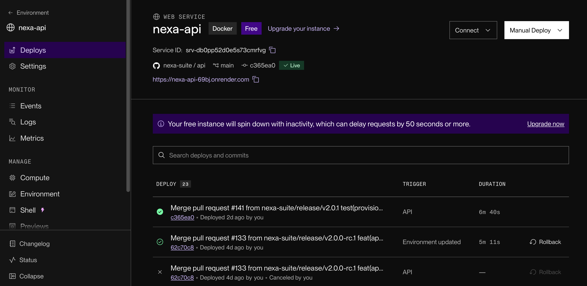
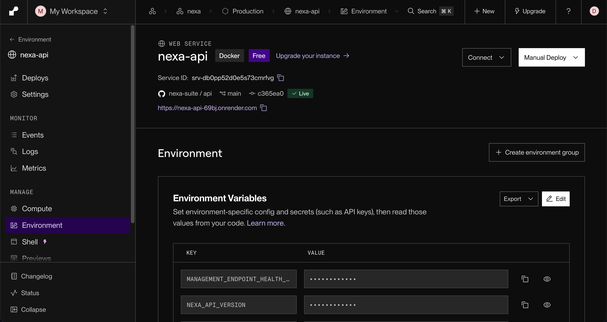

#### 4.2.3.8. Software Deployment Evidence for Sprint Review

La distribución de las aplicaciones móviles de Nexa se documenta mediante las publicaciones de GitHub Releases, que permiten identificar las versiones del código fuente y los artefactos asociados a cada publicación.

Durante el desarrollo relacionado con Sprint 3 se publicaron versiones que integran Operations Mobile y Buyer Mobile en un mismo repositorio, manteniendo independientes las versiones de cada aplicación.

*Publicaciones de Nexa Mobile relacionadas con Sprint 3.*

| Publicación | Versiones de las aplicaciones | Artefactos y resultados documentados |
| --- | --- | --- |
| [Nexa Mobile v2.0.0](https://github.com/nexa-suite/mobile/releases/tag/v2.0.0), publicada el 3 de noviembre de 2026 | Operations Android 1.3.0 (`versionCode` 12) y Buyer Flutter 1.2.1+4. | Publicación del código fuente y de dos APK académicos de depuración, acompañados de sus valores de verificación SHA-256. |
| [Nexa Mobile v2.0.1](https://github.com/nexa-suite/mobile/releases/tag/v2.0.1), publicada el 4 de noviembre de 2026 | Operations Android 1.3.1 (`versionCode` 13). Buyer Flutter conserva la versión 1.2.1+4. | Publicación de la corrección del reingreso biométrico de Operations Android. El artefacto de Buyer Mobile mantiene el contenido publicado anteriormente. |

La versión v2.0.0 integra código de ambas aplicaciones relacionado con acceso, catálogo, solicitudes, compras, entregas y accesibilidad. La versión v2.0.1 incorpora una corrección específica del mecanismo de recuperación de acceso de Operations Android.

Las publicaciones incluyen paquetes APK destinados a actividades académicas de construcción y evaluación. Estos artefactos cuentan con firma de depuración y no deben confundirse con paquetes preparados para distribución productiva.

Los registros de publicación permiten identificar las versiones y comprobar la procedencia de sus artefactos. Las verificaciones de instalación y ejecución se presentan de manera independiente en la sección 4.2.3.6.

*Publicación del API y disponibilidad de servicios.*

La publicación [Nexa API v2.0.0](https://github.com/nexa-suite/api/releases/tag/v2.0.0),
realizada el 3 de noviembre de 2026, incorpora cambios
relacionados con los contratos de servicio, la política
de fechas de entrega y los mecanismos de acceso y
consulta de información del comprador.

La publicación del código fuente debe distinguirse de
la disponibilidad de las operaciones en el entorno cloud.
El perfil documentado del servicio proporciona autenticación,
contexto y perfil del usuario, además de determinadas
consultas autorizadas del catálogo y de la cuenta del
comprador.

*Evidencia del despliegue del API en Render.*

El panel de Render presenta el servicio `nexa-api`
desplegado mediante Docker, asociado con el repositorio
`nexa-suite/api` y la rama `main`.

En el historial de despliegues se identifica la revisión
`c365ea0`, correspondiente a Nexa API v2.0.1, con
estado `Live`. Esta versión fue publicada el 5 de
noviembre de 2026 y sucede a la publicación v2.0.0.

*Figura. Historial de despliegues de Nexa API en Render.
La revisión c365ea0 aparece con estado Live; el registro
también conserva despliegues e intentos anteriores.*

La evidencia permite identificar la revisión mostrada
como desplegada por el proveedor. No sustituye las
pruebas de disponibilidad de cada operación ni la
evaluación funcional de las aplicaciones móviles.

*Configuración del entorno de ejecución.*

La configuración de Render identifica a `nexa-api`
como un servicio Docker asociado con la rama principal
del repositorio. El panel muestra el entorno Free
y la dirección HTTPS utilizada para acceder al servicio.

*Figura. Configuración del servicio Nexa API en Render.
Se muestran la revisión desplegada y las variables de
entorno administradas por la plataforma, cuyos valores
permanecen ocultos.*

Las variables de configuración se mantienen separadas
del código fuente. La captura documenta su presencia
en el proveedor, pero no permite verificar sus valores,
permisos ni funcionamiento efectivo.

Los registros de Mobile v2.0.1 documentan comprobaciones
de autenticación y catálogo utilizando el servicio cloud.
Sin embargo, estas comprobaciones no demuestran la
ejecución completa de compras, preparación de pedidos,
entregas o recepción de mercadería.

Por tanto, las publicaciones documentadas acreditan
la existencia de versiones del software y de artefactos
distribuidos para evaluación. La integración funcional
de las operaciones previstas en Sprint 3 requiere
verificaciones adicionales del API, las aplicaciones
móviles y los resultados confirmados por el servidor.
*Evidencia del despliegue del API en Render.*

La consola de Render muestra el servicio `nexa-api`
asociado al repositorio `nexa-suite/api`, utilizando
Docker y la rama `main`.

En el historial de despliegues se observa la revisión
`c365ea0` con estado `Live`. Este commit corresponde
a la publicación de Nexa API v2.0.1, que incorpora
una actualización de compatibilidad y verificación
técnica de los servicios.

La captura también conserva registros de despliegues
anteriores, incluyendo una ejecución completada sobre
la revisión `62c70c8` y un intento cancelado.

*Figura. Historial de despliegues de Nexa API en Render.
La revisión c365ea0 aparece como Live en el momento
de la captura.*

El estado observado documenta la publicación de una
revisión específica del servicio. No constituye una
prueba de que todas las operaciones comerciales,
de inventario y entrega estén habilitadas ni de
que sus recorridos hayan sido aceptados.
