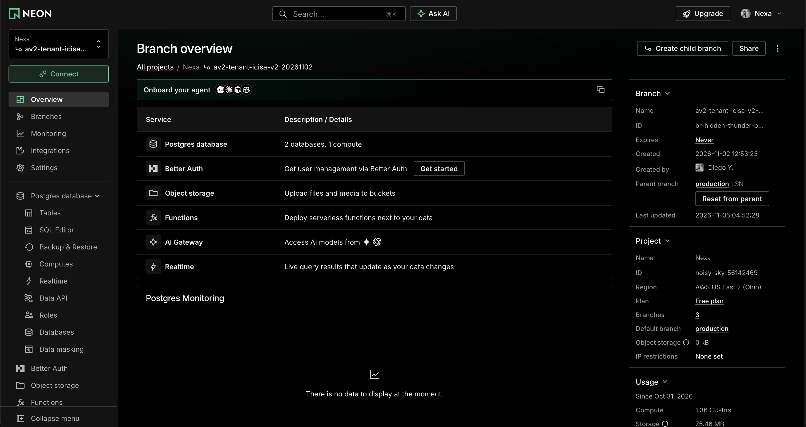

#### 4.2.3.8. Software Deployment Evidence for Sprint Review

La evidencia de despliegue del Sprint 3 comprende las publicaciones de Nexa Mobile, la distribución de artefactos Android y los registros de infraestructura correspondientes a Nexa API y PostgreSQL. Estas fuentes permiten identificar las versiones del software, los servicios alojados y la configuración general de los entornos utilizados.

Las publicaciones del código fuente, los despliegues de servicios y las verificaciones funcionales se presentan de manera diferenciada, debido a que cada actividad aporta evidencia sobre aspectos distintos del sistema.

*Publicaciones de Nexa Mobile relacionadas con Sprint 3.*

| Publicación | Versiones de las aplicaciones | Artefactos y resultados documentados |
| --- | --- | --- |
| [Nexa Mobile v2.0.0](https://github.com/nexa-suite/mobile/releases/tag/v2.0.0), publicada el 3 de noviembre de 2026 | Operations Android 1.3.0 (`versionCode` 12) y Buyer Flutter 1.2.1+4. | Publicación del código fuente y de dos APK académicos de depuración, acompañados de sus valores de verificación SHA-256. |
| [Nexa Mobile v2.0.1](https://github.com/nexa-suite/mobile/releases/tag/v2.0.1), publicada el 4 de noviembre de 2026 | Operations Android 1.3.1 (`versionCode` 13). Buyer Flutter conserva la versión 1.2.1+4. | Publicación de una corrección del reingreso biométrico de Operations Android. El artefacto de Buyer Mobile mantiene el contenido publicado anteriormente. |

La versión v2.0.0 integra código de ambas aplicaciones relacionado con acceso, catálogo, solicitudes, compras, entregas y accesibilidad. Posteriormente, la versión v2.0.1 incorpora una corrección específica del mecanismo de recuperación de acceso de Operations Android, manteniendo la verificación de sesión y contexto autorizado mediante el servidor.

Los APK publicados están destinados a actividades académicas de construcción y evaluación. Estos artefactos utilizan firma de depuración y no deben confundirse con paquetes preparados para distribución productiva. Las comprobaciones de instalación y ejecución de las aplicaciones se presentan en la sección 4.2.3.6.

*Publicación del API y despliegue en Render.*

La publicación [Nexa API v2.0.0](https://github.com/nexa-suite/api/releases/tag/v2.0.0), realizada el 3 de noviembre de 2026, incorpora modificaciones relacionadas con los contratos de servicio, la política de fechas de entrega y los mecanismos de acceso y consulta de información del comprador.

Posteriormente, se publicó [Nexa API v2.0.1](https://github.com/nexa-suite/api/releases/tag/v2.0.1), correspondiente a una actualización de compatibilidad y configuración de infraestructura para determinadas capacidades del servicio.

El panel de Render presenta `nexa-api` como un servicio web desplegado mediante Docker, asociado con el repositorio `nexa-suite/api` y la rama `main`. El proveedor identifica la región Ohio y muestra el estado del servicio como `Live`.

En el historial de despliegues se observa la revisión `c365ea0`, correspondiente a Nexa API v2.0.1. El registro también conserva despliegues anteriores, incluyendo una ejecución completada sobre la revisión `62c70c8` y un intento cancelado.

*Figura. Historial de despliegues del servicio Nexa API en Render. La revisión c365ea0 aparece con estado Live y se muestran registros de ejecuciones anteriores.*

La evidencia permite identificar una revisión del servicio desplegada mediante el proveedor de alojamiento. Sin embargo, este resultado no demuestra por sí solo que todas las operaciones comerciales, de inventario y de entrega estén habilitadas o hayan superado las pruebas funcionales correspondientes.

*Configuración del entorno de ejecución.*

El servicio `nexa-api` dispone de una configuración de entorno administrada desde Render. El panel identifica el servicio Docker, su asociación con la rama principal del repositorio y la dirección HTTPS utilizada para acceder al API.

La sección Environment presenta variables de configuración, incluyendo `NEXA_API_VERSION`, cuyos valores permanecen ocultos en la captura.

*Figura. Panel de configuración del servicio Nexa API en Render. Se muestran la revisión desplegada y las variables de entorno con sus valores ocultos.*

La administración de estas variables permite mantener la configuración del servicio separada del código fuente. No obstante, la captura únicamente acredita la presencia de los parámetros en el proveedor y no permite comprobar sus valores efectivos, permisos ni funcionamiento durante la ejecución.

*Infraestructura PostgreSQL en Neon.*

La infraestructura de persistencia utiliza Neon como proveedor de PostgreSQL. El panel del proyecto Nexa muestra tres ramas registradas: `production`, `av2-tenant-icisa-v2-20261102` y `release-v2-validation-20261102`.

La rama `production` aparece como predeterminada y con su recurso de cómputo activo. Las otras dos ramas se muestran derivadas de ella, con sus respectivos recursos en estado de inactividad al momento de la captura.

*Figura. Ramas PostgreSQL registradas en el proyecto Nexa de Neon, diferenciando la rama principal y las ramas utilizadas para actividades de validación.*

La vista de la rama `av2-tenant-icisa-v2-20261102`, creada el 2 de noviembre de 2026, presenta dos bases de datos asociadas con un recurso de cómputo. Asimismo, el panel identifica a `production` como su rama de origen.

*Figura. Vista general de la rama av2-tenant-icisa-v2-20261102 en Neon, mostrando sus recursos PostgreSQL y la relación con la rama de origen.*

Estas capturas documentan la organización de los recursos disponibles en Neon y la existencia de ramas utilizadas para actividades de validación.

Sin embargo, la visualización de ramas y bases de datos no acredita por sí sola la aplicación de todas las migraciones, la configuración efectiva de permisos, el aislamiento de datos entre Tenant ni la disponibilidad de transacciones comerciales completas. Estos aspectos requieren comprobaciones técnicas adicionales sobre los recursos y conexiones correspondientes.

*Alcance de las evidencias de despliegue.*

Las publicaciones de Nexa Mobile permiten identificar versiones del código fuente y artefactos Android distribuidos para evaluación. Por su parte, las capturas de Render y Neon documentan el estado observado de los servicios y recursos de infraestructura.

Los registros de Mobile v2.0.1 también describen comprobaciones acotadas de autenticación y catálogo utilizando el servicio cloud. Sin embargo, estos resultados no constituyen una demostración completa de los procesos de compra, preparación de pedidos, entrega o recepción de mercadería.

En consecuencia, las evidencias presentadas permiten sustentar la publicación del software y describir parte de su infraestructura de ejecución y persistencia. La integración funcional de los recorridos previstos en Sprint 3 requiere verificaciones adicionales de los servicios, las aplicaciones móviles y los resultados confirmados por el servidor.
