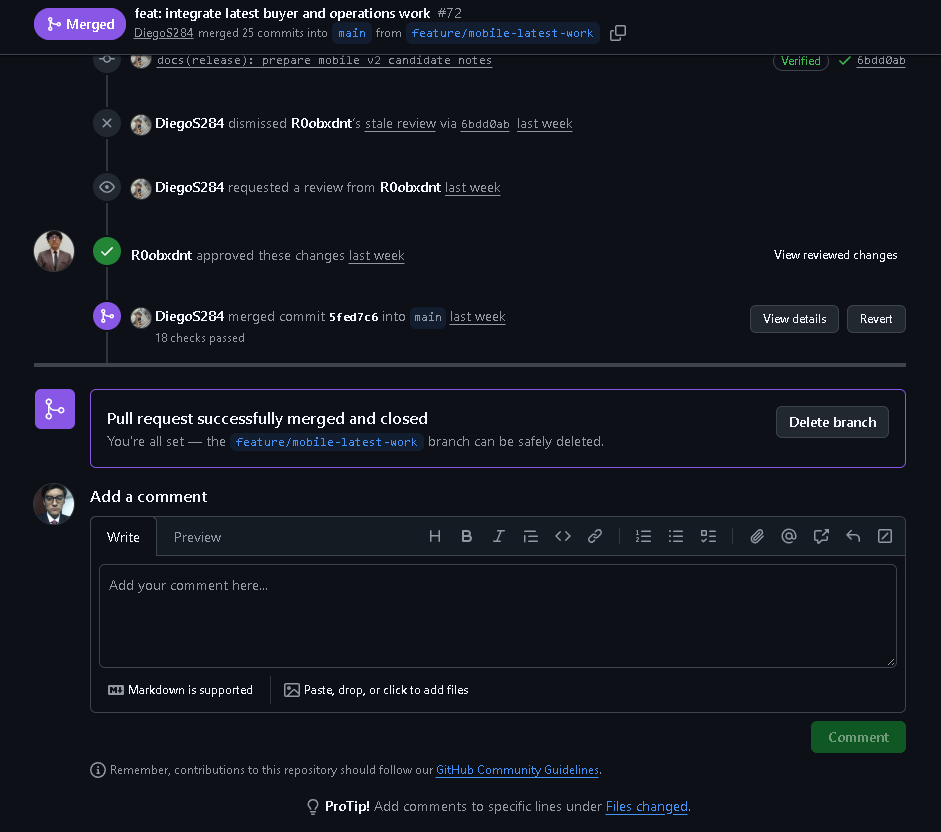
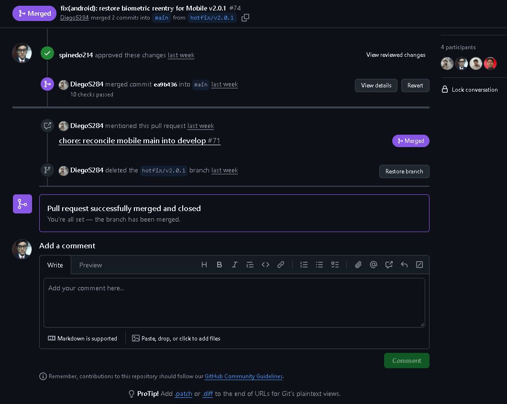
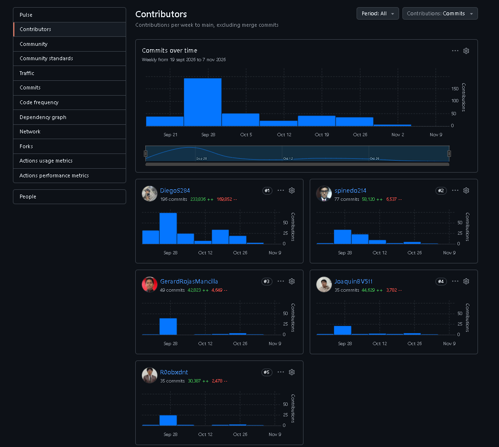

#### 4.2.3.9. Team Collaboration Insights during Sprint

La colaboración técnica relacionada con Sprint 3 se refleja en las actividades de integración y revisión realizadas en el repositorio Nexa Mobile. GitHub permitió registrar propuestas de cambio, comprobar sus resultados y revisar las modificaciones antes de incorporarlas a la rama principal.

Los Pull Requests proporcionan información sobre las contribuciones registradas, las revisiones efectuadas y la integración del código fuente. Estos registros permiten reconocer actividades de coordinación técnica relacionadas con Operations Mobile y Buyer Mobile.

*Pull Requests y revisiones relacionados con Sprint 3.*

| Pull Request | Trabajo desarrollado | Autor de la propuesta | Revisión registrada | Integración |
| --- | --- | --- | --- | --- |
| [PR #72](https://github.com/nexa-suite/mobile/pull/72) | Integración de funcionalidades de Buyer Mobile y Operations Android. | `spinedo214` | [Aprobación de `R0obxdnt`](https://github.com/nexa-suite/mobile/pull/72#pullrequestreview-5745068511). | 2 de noviembre de 2026 |
| [PR #73](https://github.com/nexa-suite/mobile/pull/73) | Corrección del mensaje presentado ante credenciales inválidas en Buyer Mobile. | `DiegoS284` | [Aprobación de `spinedo214`](https://github.com/nexa-suite/mobile/pull/73#pullrequestreview-5752417853). | 3 de noviembre de 2026 |
| [PR #74](https://github.com/nexa-suite/mobile/pull/74) | Corrección del reingreso biométrico y recuperación del contexto autorizado en Operations Android. | `DiegoS284` | [Aprobación de `spinedo214`](https://github.com/nexa-suite/mobile/pull/74#pullrequestreview-5769566345). | 4 de noviembre de 2026 |

*Evidencia de revisión e integración de Pull Requests.*

El Pull Request #72 integró modificaciones de Buyer Mobile y Operations Android en la rama `main`. Su historial registra la aprobación de `R0obxdnt` y la integración posterior de los cambios. La captura también muestra 18 comprobaciones satisfactorias asociadas con el Pull Request.

*Figura. Historial del Pull Request #72 de Nexa Mobile, mostrando la aprobación de R0obxdnt, las comprobaciones registradas y la integración de las modificaciones en la rama main.*

El Pull Request #74 documenta una corrección relacionada con el reingreso biométrico en Operations Android. Su historial muestra la aprobación de `spinedo214`, diez comprobaciones satisfactorias y la integración de los cambios en `main`.

*Figura. Historial del Pull Request #74 de Nexa Mobile, mostrando la aprobación de spinedo214 y la integración de la corrección relacionada con el reingreso biométrico.*

Las capturas permiten observar revisiones aprobadas entre integrantes del equipo y la posterior integración del código. Los resultados de las comprobaciones corresponden a los registros mostrados por GitHub y no sustituyen la validación funcional de las aplicaciones móviles.

*Contribuciones registradas en Nexa Mobile.*

La sección Contributors de GitHub presenta la actividad de las cuentas que realizaron contribuciones al repositorio. La captura consultada el 10 de noviembre de 2026 muestra la evolución semanal de los commits y las contribuciones asociadas con cinco cuentas del equipo.

*Figura. Vista de GitHub Contributors de Nexa Mobile, consultada el 10 de noviembre de 2026, mostrando la actividad semanal y las cuentas participantes en el intervalo visible.*

El panel utiliza la selección `Period: All` y presenta un período de actividad que incluye fechas anteriores a Sprint 3. Por tanto, las cantidades mostradas no representan exclusivamente el trabajo realizado durante este sprint.

Los registros muestran actividades de revisión e integración asociadas con funcionalidades de ambas aplicaciones. La revisión de los cambios permite mantener un historial consultable y relacionar las modificaciones con las comprobaciones técnicas correspondientes.

*Relación entre las responsabilidades y el trabajo registrado.*

La matriz LACX de la sección 4.2.3.2 describe
la distribución prevista de responsabilidades
para Sprint 3. Por su parte, los Pull Requests
documentan actividades específicas de desarrollo,
revisión e integración de código.

La información de ambas fuentes es complementaria.
La matriz LACX presenta la organización del equipo,
mientras que GitHub permite identificar modificaciones
realizadas y revisiones registradas sobre el proyecto.

Las aprobaciones documentadas evidencian la revisión
técnica de determinados cambios entre integrantes.
Sin embargo, el número de commits o revisiones no
constituye una medida directa del esfuerzo individual,
la calidad del trabajo o el cumplimiento de las
historias de usuario.

Asimismo, la integración del código debe diferenciarse
de los resultados de pruebas y de la aceptación
funcional. Las verificaciones técnicas correspondientes
se presentan en la sección 4.2.3.5 y las comprobaciones
de ejecución en la sección 4.2.3.6.

En conjunto, estos registros permiten examinar
la colaboración desde la distribución del trabajo
hasta la integración de modificaciones, sin atribuir
a las herramientas de seguimiento resultados que
requieren otras evidencias.
