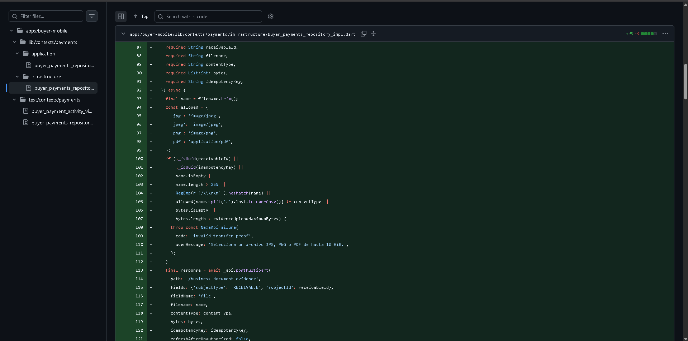
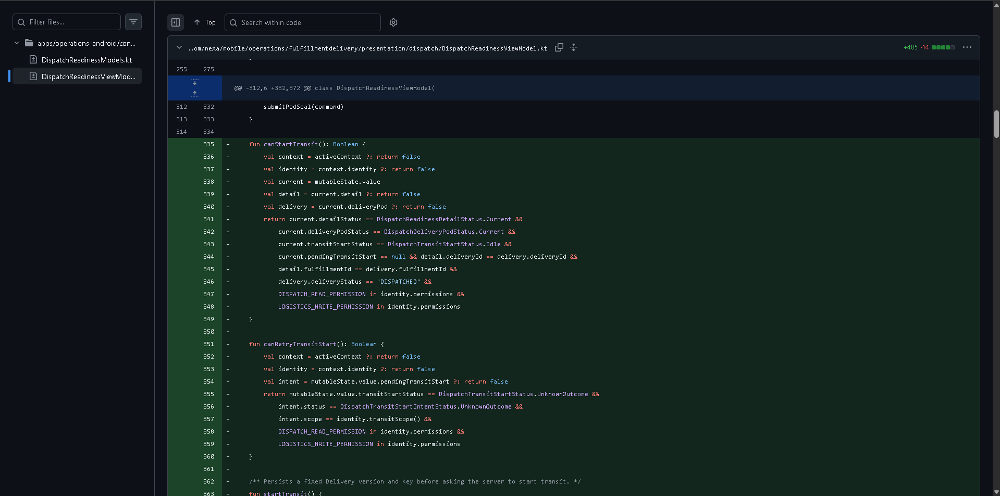
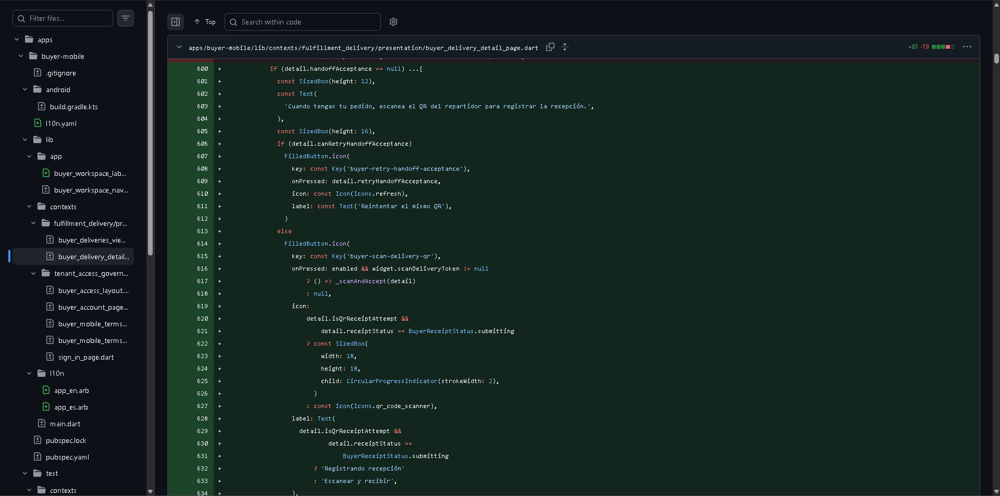

#### 4.2.4.4. Development Evidence for Sprint Review

El desarrollo relacionado con Sprint 4 comprende modificaciones en Nexa Operations Mobile y Nexa Buyer Mobile, orientadas a fortalecer la continuidad de las operaciones, mejorar el tratamiento de información comercial y ampliar los mecanismos de interacción con Nexa API.

Entre los cambios registrados se encuentran la integración de flujos de despacho, la conservación protegida de información para consultas sin conexión y el reporte de evidencias de transferencias bancarias. Asimismo, se incorporaron ajustes relacionados con la navegación, la localización de interfaces y las condiciones de acceso a las aplicaciones.

El repositorio Nexa Mobile conserva los commits correspondientes a estas modificaciones. La siguiente tabla presenta cambios representativos del desarrollo y su relación con el alcance funcional previsto.

*Commits relacionados con las funcionalidades de Sprint 4.*

| Repository | Branch | Commit Id | Commit Message | Commit Message Body | Committed on (Date) |
| --- | --- | --- | --- | --- | --- |
| `nexa-suite/mobile` | Historial integrado en `main` (v3.0.0) | [e771272a](https://github.com/nexa-suite/mobile/commit/e771272a41886cc652a20a2ad783c8d76a9f2942) | `feat(payments): upload and verify receivable transfer proofs` | Sin cuerpo adicional. | 16 de noviembre de 2026 |
| `nexa-suite/mobile` | Historial integrado en `main` (v3.0.0) | [571e8c8b](https://github.com/nexa-suite/mobile/commit/571e8c8befcb5ca219cd32a4d538b8c43be07414) | `feat(warehouse): persist encrypted picking summary cache` | Sin cuerpo adicional. | 16 de noviembre de 2026 |
| `nexa-suite/mobile` | Historial integrado en `main` (v3.0.0) | [5eea75a7](https://github.com/nexa-suite/mobile/commit/5eea75a75af5e7431dcbb4db67a63a4cdcda4a65) | `feat(dispatch): reconcile durable transit outcomes` | Sin cuerpo adicional. | 17 de noviembre de 2026 |
| `nexa-suite/mobile` | Historial integrado en `main` (v3.0.0) | [24b2c8ef](https://github.com/nexa-suite/mobile/commit/24b2c8ef510f875145b22b06a134eea941498fdd) | `feat(mobile): integrate connected operations and buyer flows` | Complete missing mobile flows with scoped Firebase and offline support | 18 de noviembre de 2026 |
| `nexa-suite/mobile` | Historial integrado en `main` (v3.0.0) | [aec213a6](https://github.com/nexa-suite/mobile/commit/aec213a63afe098fe856ae8b467249bb19341d8a) | `feat(mobile): integrate the Sprint 4 workflows` | Bring Buyer and Operations changes together for the next Android release. | 18 de noviembre de 2026 |

*Nota.* Las fechas de los commits corresponden a la hora local del Perú (UTC-5). Elaboración propia a partir del historial del repositorio Nexa Mobile.

##### Avances de implementación en Buyer Mobile

Las modificaciones de Buyer Mobile incluyen la incorporación de mecanismos para reportar evidencia relacionada con transferencias bancarias y conservar información asociada con las entregas. El commit `e771272a` registra cambios en los repositorios de pagos y en sus pruebas, mientras que la integración registrada en `24b2c8ef` reúne componentes adicionales de interacción, notificaciones y recuperación de información.

Estos cambios se relacionan con las necesidades de seguimiento comercial y continuidad del comprador. El reporte de una evidencia de pago mantiene una diferencia fundamental respecto de su confirmación: Buyer Mobile comunica información al proceso responsable, pero no determina por sí mismo que una obligación financiera ha sido satisfecha.

*Evidencia visual del registro de transferencias bancarias.*

En el archivo `buyer_payments_repository_impl.dart` se incorporó el método `uploadTransferProof`, encargado de validar los archivos adjuntos y enviarlos a Nexa API como evidencia de una transferencia bancaria. Las validaciones consideran el formato, el tamaño del archivo y los identificadores asociados con la operación.

*Figura. Cambios registrados en el commit e771272a del repositorio Nexa Mobile, mostrando las validaciones y el envío de evidencia de transferencias bancarias desde Buyer Mobile.*

La aplicación también incorpora mecanismos de consulta protegida de información previamente obtenida. Esta capacidad permite presentar determinados datos durante una interrupción de conectividad, sin convertir las copias locales en fuentes autoritativas de información comercial o de entrega.

##### Avances de implementación en Operations Mobile

En Operations Android se registraron modificaciones relacionadas con el despacho y el tratamiento de resultados de tránsito. El commit `5eea75a7` introduce cambios en los modelos y componentes de presentación utilizados para reconciliar los resultados asociados con el inicio de tránsito de una entrega.

*Evidencia visual del desarrollo de operaciones de despacho.*

En el archivo `DispatchReadinessViewModel.kt` se incorporaron los métodos `canStartTransit()` y `canRetryTransitStart()`, que comprueban las condiciones necesarias para iniciar o reintentar una operación de tránsito. Estas comprobaciones consideran los permisos del usuario, el estado de la entrega y el contexto de la operación pendiente.

*Figura. Cambios registrados en el commit 5eea75a7 del repositorio Nexa Mobile, mostrando los métodos de validación y recuperación asociados con el inicio de tránsito de una entrega en Operations Android.*

Por otra parte, el commit `571e8c8b` incorpora un mecanismo de almacenamiento protegido para resúmenes de preparación de pedidos. Su finalidad es conservar información de consulta bajo el contexto autorizado, evitando interpretar una copia local como confirmación de movimientos de inventario.

La integración registrada en `24b2c8ef` reúne avances de ambas aplicaciones, incluyendo componentes de operaciones de almacén, notificaciones y continuidad de consultas. Estas funcionalidades mantienen la separación entre la experiencia presentada en el dispositivo y las decisiones que corresponden a Nexa API.

##### Integración y publicación del código

El commit `aec213a6` reúne modificaciones de Buyer Mobile y Operations Android para la preparación de la siguiente publicación móvil. Entre los archivos afectados se encuentran componentes de navegación, seguimiento de entregas, acceso, localización de textos y pruebas de interfaz.

*Evidencia visual de la mejora del flujo de recepción mediante QR.*

En Buyer Mobile se actualizaron los componentes de recepción mediante código QR. Los cambios registrados en `buyer_delivery_detail_page.dart` incorporan un indicador de progreso durante el registro de la recepción y una opción para reintentar la operación utilizando el mismo código QR cuando se cumplen las condiciones correspondientes.

*Figura. Cambios registrados en el commit aec213a6 del repositorio Nexa Mobile, mostrando la incorporación del mecanismo de reintento y del indicador de progreso durante la recepción mediante código QR en Buyer Mobile.*
