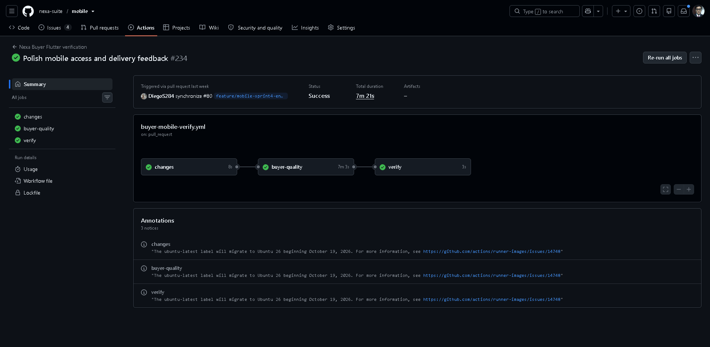
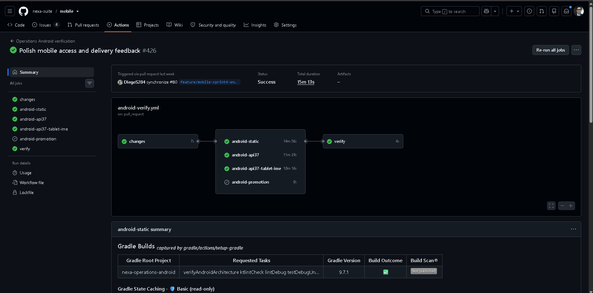
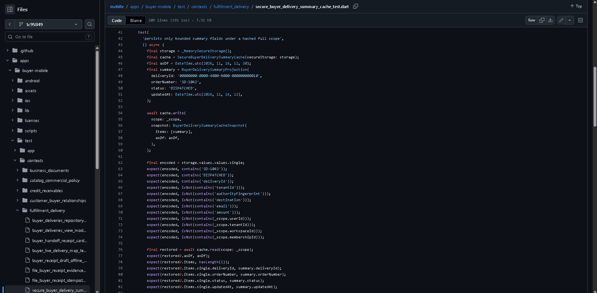
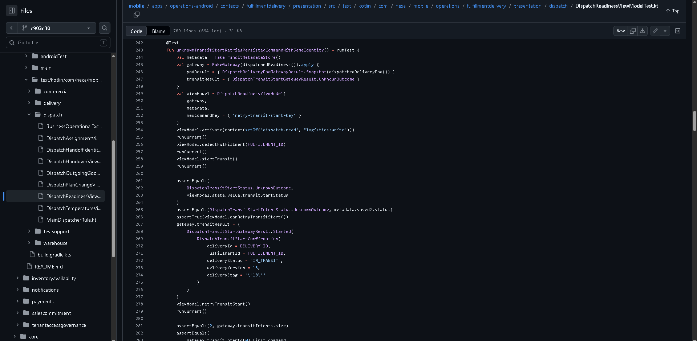

#### 4.2.4.5. Testing Suite Evidence for Sprint Review

Las actividades de verificación técnica relacionadas con Sprint 4 comprenden comprobaciones automatizadas de Buyer Mobile y Operations Android, desarrolladas mediante Flutter y Dart, y Kotlin y Jetpack Compose, respectivamente.

Ambas aplicaciones utilizan workflows de GitHub Actions para ejecutar verificaciones de calidad del código, comprobar sus configuraciones y registrar los resultados asociados con revisiones determinadas del repositorio.

El candidato de publicación de Nexa Mobile v3.0.0, identificado mediante el commit `6d1944cc56438a94438e832350c34add84cdd7bf`, cuenta con ejecuciones satisfactorias de los workflows correspondientes a las dos aplicaciones.

##### Verificaciones automatizadas de Nexa Mobile

*Resultados de integración continua de las aplicaciones móviles.*

<table>
  <thead>
    <tr>
      <th scope="col">Componente</th>
      <th scope="col">Evidencia</th>
      <th scope="col">Resultado registrado</th>
      <th scope="col">Alcance</th>
    </tr>
  </thead>
  <tbody>
    <tr>
      <td>Buyer Mobile</td>
      <td><a href="https://github.com/nexa-suite/mobile/actions/runs/44398489580">Nexa Buyer Flutter verification</a></td>
      <td>Success</td>
      <td>Comprobaciones de arquitectura, formato, análisis estático, pruebas Flutter y compilación de una APK de depuración.</td>
    </tr>
    <tr>
      <td>Operations Mobile</td>
      <td><a href="https://github.com/nexa-suite/mobile/actions/runs/44398489585">Operations Android verification</a></td>
      <td>Success</td>
      <td>Verificaciones de arquitectura, formato, Android Lint, contratos, compilación y pruebas instrumentadas de Android.</td>
    </tr>
  </tbody>
</table>

*Nota.* Los resultados corresponden a las ejecuciones automatizadas realizadas sobre el candidato de publicación de Nexa Mobile v3.0.0. Elaboración propia a partir de los registros de GitHub Actions.

*Evidencia visual de las verificaciones de Buyer Mobile.*

La ejecución de Buyer Mobile registra resultados satisfactorios en las etapas de resolución de dependencias, comprobación de formato, análisis estático, ejecución de pruebas y generación de la APK de depuración.

El workflow presenta los trabajos `changes`, `buyer-quality` y `verify`, con una duración total de 7 minutos y 21 segundos.

*Figura. Ejecución satisfactoria del workflow Nexa Buyer Flutter verification, mostrando los trabajos de detección de cambios, comprobación de calidad y verificación final en GitHub Actions.*

*Evidencia visual de las verificaciones de Operations Android.*

En Operations Android se registraron resultados satisfactorios para las verificaciones estáticas y las pruebas instrumentadas en Android API 37. El workflow también incluye un trabajo específico relacionado con la interacción mediante teclado en un entorno de tableta.

La ejecución tuvo una duración total de 15 minutos y 13 segundos. La etapa `android-promotion` aparece omitida, sin afectar el resultado satisfactorio de las verificaciones ejecutadas.

*Figura. Ejecución satisfactoria del workflow Operations Android verification, mostrando las comprobaciones estáticas, las pruebas instrumentadas y el resultado general registrado en GitHub Actions.*

##### Verificaciones de integración relacionadas con Sprint 4

Además de las comprobaciones automatizadas, las [notas de publicación de Nexa Mobile v3.0.0](https://github.com/nexa-suite/mobile/blob/main/RELEASE_NOTES_v3.0.0.md) registran verificaciones realizadas sobre un entorno ICISA conectado con Nexa API.

Estas actividades permiten examinar aspectos de autenticación, acceso a funcionalidades autorizadas y continuidad de determinados flujos entre las aplicaciones móviles y el servidor.

*Comprobaciones de integración registradas para Nexa Mobile v3.0.0.*

<table>
  <thead>
    <tr>
      <th scope="col">Entorno</th>
      <th scope="col">Verificación documentada</th>
      <th scope="col">Resultado registrado</th>
      <th scope="col">Alcance de la evidencia</th>
    </tr>
  </thead>
  <tbody>
    <tr>
      <td>Nexa API v3.0.0 en Render</td>
      <td>Consultas de disponibilidad, información OpenAPI, condiciones de uso móviles y acceso a un recurso protegido.</td>
      <td>Comprobaciones satisfactorias de disponibilidad y respuesta HTTP 401 ante una consulta protegida sin sesión.</td>
      <td>Disponibilidad de los servicios consultados y protección de recursos que requieren autenticación.</td>
    </tr>
    <tr>
      <td>Emulador Android con ICISA</td>
      <td>Instalación y acceso con las aplicaciones Android firmadas.</td>
      <td>Instalación de ambas aplicaciones, acceso con cuentas de prueba y navegación hacia funciones autorizadas.</td>
      <td>Instalación, autenticación, aceptación de términos de uso y navegación.</td>
    </tr>
    <tr>
      <td>Entorno local de integración ICISA</td>
      <td>Recorrido conectado que comprende Buyer, Sales, Warehouse, Driver y recepción del comprador.</td>
      <td>Ejecución del recorrido y comprobación de los resultados registrados en el servidor.</td>
      <td>Integración local de los procesos comerciales y logísticos con datos de validación.</td>
    </tr>
    <tr>
      <td>Consultas locales sin conexión</td>
      <td>Recuperación de información previamente obtenida sobre entregas y preparación de pedidos.</td>
      <td>Consulta de resúmenes protegidos en modo de solo lectura.</td>
      <td>Continuidad de consultas ante interrupciones de conectividad.</td>
    </tr>
  </tbody>
</table>

*Nota.* Las comprobaciones corresponden a los entornos descritos en las notas de publicación. La ejecución satisfactoria del recorrido local no implica su disponibilidad integral en el despliegue público. Las consultas sin conexión se limitan a información previamente obtenida y no confirman operaciones de negocio. Elaboración propia.

##### Comprobaciones técnicas del candidato integrado

El [Pull Request #78 de Nexa Mobile](https://github.com/nexa-suite/mobile/pull/78) documenta actividades de verificación efectuadas durante la integración de funcionalidades relacionadas con pagos, notificaciones, operaciones de almacén, despacho y recuperación de información.

Posteriormente, el [Pull Request #80 de Nexa Mobile](https://github.com/nexa-suite/mobile/pull/80) registra comprobaciones adicionales asociadas con las mejoras de acceso, localización y retroalimentación durante la recepción de entregas.

*Verificaciones registradas en el proceso de integración.*

<table>
  <thead>
    <tr>
      <th scope="col">Componente</th>
      <th scope="col">Registro de verificación</th>
      <th scope="col">Alcance</th>
    </tr>
  </thead>
  <tbody>
    <tr>
      <td>Buyer Mobile</td>
      <td>253 pruebas Flutter satisfactorias y cinco pruebas opcionales omitidas, registradas en el Pull Request #78.</td>
      <td>Pruebas automatizadas del candidato de integración Flutter.</td>
    </tr>
    <tr>
      <td>Operations Android</td>
      <td>710 pruebas distribuidas en 142 suites, con resultados satisfactorios registrados en el Pull Request #78.</td>
      <td>Verificaciones de arquitectura, formato, Android Lint, pruebas JVM y compilación de depuración.</td>
    </tr>
    <tr>
      <td>Buyer Mobile</td>
      <td>275 pruebas satisfactorias y análisis estático satisfactorio, registrados en el Pull Request #80.</td>
      <td>Comprobaciones posteriores a las mejoras de acceso, localización y recepción de entregas.</td>
    </tr>
  </tbody>
</table>

*Nota.* Las cantidades corresponden a los resultados registrados en los respectivos Pull Requests y representan revisiones diferentes del código. No deben sumarse ni interpretarse como porcentajes de cobertura de pruebas. Elaboración propia.

##### Relación de clases de prueba y comportamientos

Las pruebas incluidas en Nexa Mobile permiten examinar componentes relacionados con la continuidad de entregas, el control de operaciones de despacho, el almacenamiento protegido y el tratamiento de evidencias comerciales.

La suite de Buyer Mobile utiliza pruebas de componentes y repositorios mediante Flutter Test. En Operations Android se emplean pruebas unitarias de Kotlin y pruebas instrumentadas para comprobar el comportamiento de componentes ejecutados sobre Android, incluyendo elementos de interfaz desarrollados mediante Jetpack Compose.

*Clases de prueba relacionadas con el alcance de Sprint 4.*

<table>
  <thead>
    <tr>
      <th scope="col">Componente</th>
      <th scope="col">Clase o archivo de prueba</th>
      <th scope="col">Comportamiento examinado</th>
      <th scope="col">Relación con Sprint 4</th>
    </tr>
  </thead>
  <tbody>
    <tr>
      <td>Operations Android</td>
      <td><a href="https://github.com/nexa-suite/mobile/blob/c903c3059093d56afe7974b5ea2388b028d0c16d/apps/operations-android/contexts/fulfillmentdelivery/presentation/src/test/kotlin/com/nexa/mobile/operations/fulfillmentdelivery/presentation/dispatch/DispatchReadinessViewModelTest.kt">DispatchReadinessViewModelTest.kt</a></td>
      <td>Pruebas unitarias del tratamiento de resultados de tránsito, reintentos y cambios de autoridad durante operaciones de despacho.</td>
      <td>Continuidad y control de operaciones de despacho.</td>
    </tr>
    <tr>
      <td>Operations Android</td>
      <td><a href="https://github.com/nexa-suite/mobile/blob/bd6746f3bcbf02036583e79cabc3bb2df83ebd0b/apps/operations-android/contexts/fulfillmentdelivery/infrastructure/src/test/kotlin/com/nexa/mobile/operations/fulfillmentdelivery/infrastructure/adapters/AppPickingWorkListCacheTest.kt">AppPickingWorkListCacheTest.kt</a></td>
      <td>Conservación y recuperación de resúmenes de preparación bajo el contexto autorizado.</td>
      <td>Continuidad de consultas de almacén.</td>
    </tr>
    <tr>
      <td>Operations Android</td>
      <td>
        
<a href="https://github.com/nexa-suite/mobile/blob/1dd56340200dedd61b84df5d25b59459c261660c/apps/operations-android/contexts/fulfillmentdelivery/presentation/src/test/kotlin/com/nexa/mobile/operations/fulfillmentdelivery/presentation/warehouse/PickingWorkListViewModelTest.kt">PickingWorkListViewModelTest.kt</a>

        
<a href="https://github.com/nexa-suite/mobile/blob/1dd56340200dedd61b84df5d25b59459c261660c/apps/operations-android/contexts/fulfillmentdelivery/presentation/src/androidTest/kotlin/com/nexa/mobile/operations/fulfillmentdelivery/presentation/warehouse/PickingWorkListScreenTest.kt">PickingWorkListScreenTest.kt</a>

      </td>
      <td>Pruebas unitarias e instrumentadas sobre la presentación de tareas de preparación y las restricciones de interacción con información disponible sin conexión.</td>
      <td>Seguridad de la interacción con tareas de almacén.</td>
    </tr>
    <tr>
      <td>Buyer Mobile</td>
      <td><a href="https://github.com/nexa-suite/mobile/blob/1c958497aafecfa2b556c0b71c30dff4aad44d70/apps/buyer-mobile/test/contexts/fulfillment_delivery/secure_buyer_delivery_summary_cache_test.dart">secure_buyer_delivery_summary_cache_test.dart</a></td>
      <td>Aislamiento de resúmenes de entrega, exclusión de información sensible y control de datos recuperados según el ámbito autorizado.</td>
      <td>Seguimiento y continuidad de consultas de entrega.</td>
    </tr>
    <tr>
      <td>Buyer Mobile</td>
      <td><a href="https://github.com/nexa-suite/mobile/blob/58bb4bc234bc9ec0fbce9043df3bc2cc5a9c76fc/apps/buyer-mobile/test/contexts/fulfillment_delivery/buyer_deliveries_view_model_test.dart">buyer_deliveries_view_model_test.dart</a></td>
      <td>Tratamiento de la autoridad vigente y navegación sobre resúmenes de entrega disponibles sin conexión.</td>
      <td>Continuidad y recuperación de consultas del comprador.</td>
    </tr>
    <tr>
      <td>Buyer Mobile</td>
      <td><a href="https://github.com/nexa-suite/mobile/blob/e771272a41886cc652a20a2ad783c8d76a9f2942/apps/buyer-mobile/test/contexts/payments/buyer_payments_repository_test.dart">buyer_payments_repository_test.dart</a></td>
      <td>Envío de evidencia de transferencia, protección ante respuestas de otra cuenta y uso de claves de idempotencia.</td>
      <td>Reporte de evidencia comercial y de pago.</td>
    </tr>
  </tbody>
</table>

*Nota.* Las pruebas identificadas comprenden verificaciones de componentes, repositorios, ViewModels e interfaces móviles. Su relación con las historias del Sprint 4 corresponde al comportamiento específico examinado y no representa una cobertura integral de todos sus criterios de aceptación. Los archivos presentados no corresponden a escenarios BDD definidos mediante Gherkin. Elaboración propia.

*Evidencia visual de las pruebas de almacenamiento protegido en Buyer Mobile.*

El archivo `secure_buyer_delivery_summary_cache_test.dart` incluye una prueba que comprueba la conservación de los campos necesarios para consultar un resumen de entrega y la exclusión de información como direcciones, correos electrónicos, importes e identificadores del contexto de acceso.

Las aserciones también comprueban la recuperación de los datos permitidos, incluyendo el identificador de la entrega, el número de pedido, su estado y la fecha de actualización.

*Figura. Prueba automatizada registrada en el commit 1c958497, mostrando las comprobaciones de almacenamiento, exclusión de información sensible y recuperación de resúmenes de entrega en Buyer Mobile.*

*Evidencia visual de las pruebas de recuperación de despacho en Operations Android.*

En `DispatchReadinessViewModelTest.kt` se incluye el método `unknownTransitStartRetriesPersistedCommandWithSameIdentity()`, que simula una operación de inicio de tránsito cuyo resultado no pudo confirmarse inicialmente.

La prueba comprueba que se conserve la intención pendiente, que el estado de la operación se mantenga como incierto y que el reintento se encuentre habilitado. Posteriormente, simula una respuesta satisfactoria del servidor y ejecuta el reintento correspondiente.

*Figura. Prueba unitaria registrada en el commit c903c305, mostrando la simulación de un resultado incierto y las comprobaciones asociadas con el reintento de una operación de tránsito en Operations Android.*

##### Commits relacionados con pruebas de Sprint 4

El repositorio Nexa Mobile conserva commits dedicados a verificar el comportamiento de las aplicaciones frente a cambios de conectividad, condiciones de autorización y reintentos de operaciones. Estos registros permiten identificar la evolución de las pruebas asociadas con funcionalidades del Sprint 4.

*Commits relacionados con las pruebas de Sprint 4.*

| Repository | Branch | Commit Id | Commit Message | Commit Message Body | Committed on (Date) |
| --- | --- | --- | --- | --- | --- |
| `nexa-suite/mobile` | Historial integrado en `main` (v3.0.0) | [1c958497](https://github.com/nexa-suite/mobile/commit/1c958497aafecfa2b556c0b71c30dff4aad44d70) | `test(buyer): verify offline summary isolation and denial markers` | Sin cuerpo adicional. | 16 de noviembre de 2026 |
| `nexa-suite/mobile` | Historial integrado en `main` (v3.0.0) | [58bb4bc2](https://github.com/nexa-suite/mobile/commit/58bb4bc234bc9ec0fbce9043df3bc2cc5a9c76fc) | `test(buyer): verify offline delivery authority and navigation` | Sin cuerpo adicional. | 16 de noviembre de 2026 |
| `nexa-suite/mobile` | Historial integrado en `main` (v3.0.0) | [bd6746f3](https://github.com/nexa-suite/mobile/commit/bd6746f3bcbf02036583e79cabc3bb2df83ebd0b) | `test(warehouse): verify encrypted cache scope and reopen` | Sin cuerpo adicional. | 16 de noviembre de 2026 |
| `nexa-suite/mobile` | Historial integrado en `main` (v3.0.0) | [1dd56340](https://github.com/nexa-suite/mobile/commit/1dd56340200dedd61b84df5d25b59459c261660c) | `test(warehouse): prevent selection from offline work rows` | Sin cuerpo adicional. | 16 de noviembre de 2026 |
| `nexa-suite/mobile` | Historial integrado en `main` (v3.0.0) | [c903c305](https://github.com/nexa-suite/mobile/commit/c903c3059093d56afe7974b5ea2388b028d0c16d) | `test(dispatch): cover transit retry and authority races` | Sin cuerpo adicional. | 17 de noviembre de 2026 |

*Nota.* Los commits corresponden a modificaciones de las pruebas automatizadas incorporadas en el historial de Nexa Mobile v3.0.0. Las fechas se presentan según la hora local del Perú (UTC-5). Elaboración propia a partir del historial del repositorio Nexa Mobile.
