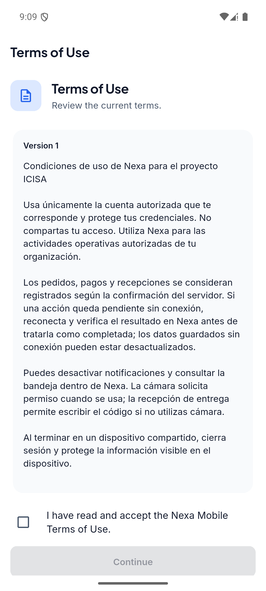

#### 4.2.4.6. Execution Evidence for Sprint Review

Las comprobaciones de ejecución relacionadas con Sprint 4 comprenden actividades de instalación, autenticación, navegación, consulta de información e integración con servicios REST realizadas con Buyer Mobile y Operations Android. Los registros de Nexa Mobile v3.0.0, v3.0.1 y v3.0.2 permiten identificar los avances funcionales y las condiciones de ejecución de ambas aplicaciones.

Durante el sprint se publicaron paquetes Android firmados destinados a actividades de validación en el entorno ICISA. Las comprobaciones incluyeron la navegación autenticada, la presentación de condiciones de uso, la consulta de información comercial y operativa, así como la ejecución de operaciones específicas mediante Nexa API.

*Comprobaciones de ejecución registradas para Nexa Mobile.*

| Aplicación | Entorno y versión | Resultado documentado | Alcance de la evidencia |
| --- | --- | --- | --- |
| Operations Mobile y Buyer Mobile | Emulador Android conectado con Nexa API v3.0.0 en Render; Mobile v3.0.0. | Instalación de las dos APK firmadas y autenticación con cuentas de prueba ICISA. | Instalación, acceso y navegación autorizada en emulador. |
| Operations Mobile | Contexto Logistics de ICISA; Mobile v3.0.0. | Acceso a las secciones Dispatch, Deliveries y Loads. | Disponibilidad de la navegación operativa para el rol utilizado. |
| Operations Mobile y Buyer Mobile | Emulador Android 15; Mobile v3.0.1. | Apertura de ambas aplicaciones y acceso a sus interfaces autenticadas. | Ejecución y navegación en el entorno documentado. |
| Operations Mobile | Entorno local de integración ICISA; candidato asociado con v3.0.0. | Ejecución de actividades conectadas de despacho, intento de entrega y recepción del comprador. | Verificación localizada de un recorrido integrado, sin equivalencia automática con el despliegue público. |
| Buyer Mobile | Emulador Android; Buyer 2.0.1 (build 6), correspondiente a Mobile v3.0.2. | Presentación de las condiciones de uso vigentes después de la autenticación. | Visualización del documento y del control de aceptación. |

Los registros de referencia se encuentran en las [notas de Nexa Mobile v3.0.0](https://github.com/nexa-suite/mobile/blob/main/RELEASE_NOTES_v3.0.0.md) y [v3.0.1](https://github.com/nexa-suite/mobile/blob/main/RELEASE_NOTES_v3.0.1.md).

##### Evidencias de ejecución de Operations Mobile

Operations Android proporciona acceso a funcionalidades operativas según las autorizaciones del usuario. En el entorno ICISA documentado para Mobile v3.0.0, la autenticación con una cuenta del contexto Logistics permitió visualizar las opciones Dispatch, Deliveries y Loads.

La interfaz de Loads utiliza tarjetas para presentar información sobre pedidos y ventanas de entrega. Esta organización facilita la consulta de las cargas disponibles y su relación con las actividades de despacho.

La ejecución también considera las restricciones de acceso determinadas por Nexa API. La presentación de una opción de navegación no implica que todas las operaciones asociadas estén disponibles ni que una acción de negocio pueda confirmarse sin intervención del servidor.

Por otra parte, la documentación de v3.0.0 registra comprobaciones locales de consultas protegidas relacionadas con entregas y preparación de pedidos. Los datos previamente obtenidos pueden presentarse en modo de solo lectura cuando se pierde la conectividad, conservando las restricciones del contexto autorizado.

Este mecanismo contribuye a la continuidad de consulta, pero no permite interpretar información almacenada localmente como una nueva confirmación de inventario, despacho o entrega.

##### Evidencias de ejecución de Buyer Mobile

Buyer Mobile incorpora mecanismos de acceso y navegación orientados a los compradores autorizados. Las notas de Mobile v3.0.0 documentan la presentación de las condiciones de uso vigentes y su aceptación mediante el servicio correspondiente de Nexa API.

En la comprobación realizada con el entorno ICISA, ambas aplicaciones pudieron cargar las condiciones de uso después de la autenticación. El servidor registró una aceptación de la versión correspondiente por cada una de las dos cuentas utilizadas durante esa validación.
El 25 de noviembre de 2026 se realizó una comprobación adicional con Buyer Mobile 2.0.1 (build 6) en un emulador Android. Después de la autenticación en el entorno ICISA, la aplicación presentó la versión 1 de las condiciones de uso, incluyendo el documento correspondiente y el control de aceptación requerido para continuar con la navegación.

**Figura**

*Presentación de las condiciones de uso en Buyer Mobile.*

*Nota.* Captura obtenida durante la ejecución de Buyer Mobile 2.0.1 en un emulador Android, el 25 de noviembre de 2026. Se muestra el estado previo a la aceptación de las condiciones de uso.

La aplicación también presenta funcionalidades relacionadas con el seguimiento de entregas y la recepción de mercadería. En la interfaz de entrega se ubican las acciones de confirmación y reintento próximas al código QR utilizado para el proceso de recepción.

La disponibilidad de estos controles permite identificar su incorporación a la experiencia del comprador. Sin embargo, la confirmación efectiva de una recepción depende de los resultados registrados por el servidor y no exclusivamente de la interacción visual.

##### Comprobaciones del catálogo y borradores de compra

Como parte de las comprobaciones realizadas para TB2, se efectuó una consulta autenticada al catálogo de Nexa API. La respuesta del servicio incluyó 53 fichas de producto, con 32 nombres y 50 direcciones de imágenes distintas. Esta información corresponde a los datos proporcionados por el servidor para el contexto comercial evaluado.

Asimismo, se realizó una prueba funcional de los servicios asociados con los borradores de solicitudes de compra. Mediante una cuenta Buyer de prueba se creó un borrador, obteniendo una respuesta HTTP 201. Posteriormente, se añadieron dos productos, se consultó el borrador, se modificó la cantidad de uno de los productos y se retiró el segundo.

Las operaciones de consulta y modificación registraron respuestas HTTP 200. Como resultado, Nexa API devolvió el borrador en su versión 3, conservando una línea de producto con dos unidades y permaneciendo pendiente de envío.

Estas comprobaciones evidencian el funcionamiento de las operaciones evaluadas mediante Nexa API. La persistencia del resultado en PostgreSQL se presenta en la sección [4.2.4.8. Software Deployment Evidence for Sprint Review](4.2.4.8-software-deployment-evidence-for-sprint-review.md).

##### Comprobaciones de integración y continuidad

Las notas de Mobile v3.0.0 describen una ejecución local conectada que comprendió actividades de Buyer, Sales, Warehouse, Driver y recepción del comprador.

En ese recorrido se documentaron resultados confirmados mediante consultas al servidor, incluyendo una recepción aceptada, evidencia de entrega sellada y la finalización del pedido comercial utilizado como dato de prueba.

Esta comprobación proporciona evidencia de integración entre componentes de Nexa Mobile y Nexa API para el escenario evaluado. Su alcance corresponde al entorno local y a los datos de validación utilizados; no debe interpretarse como una demostración completa de todas las historias del Sprint 4.

También se registraron comprobaciones de continuidad de lectura sobre resúmenes de entregas y preparación de pedidos en emuladores. Estas vistas conservaron información previamente consultada y protegida, sin habilitar confirmaciones de negocio mientras el dispositivo permanecía desconectado.

##### Alcance y limitaciones de las comprobaciones

Las verificaciones de Mobile v3.0.1 permiten identificar diferencias entre la navegación disponible y el funcionamiento de los servicios consultados en el entorno público.

En Render, las solicitudes autenticadas relacionadas con información del comprador, pedidos e historial de entregas devolvieron respuestas HTTP 200. En cambio, determinadas consultas de exposición crediticia y listas operativas de almacén y despacho devolvieron HTTP 503 durante la comprobación documentada.

Estos resultados muestran que las aplicaciones pueden presentar sus interfaces y gestionar determinados accesos, mientras otras funcionalidades dependen de servicios que no respondieron satisfactoriamente en el entorno evaluado.

Las comprobaciones realizadas en emuladores y entornos locales no constituyen evidencia de aceptación integral en dispositivos físicos ni de disponibilidad completa de las operaciones transaccionales en el despliegue público.

En consecuencia, los registros permiten identificar resultados concretos de instalación, navegación e integración, manteniendo separadas la ejecución observada, la validación técnica y la aceptación funcional del incremento.
