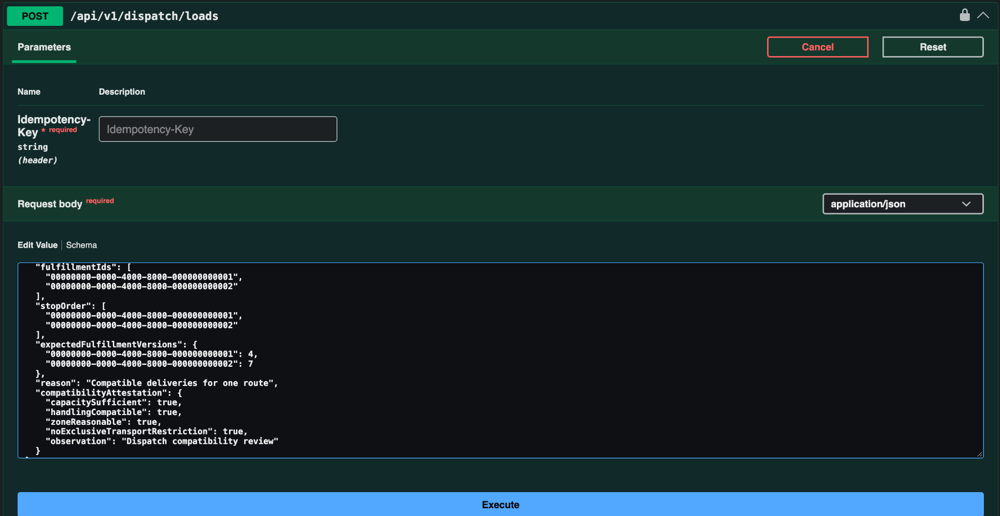
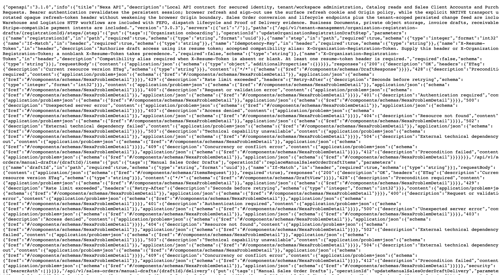
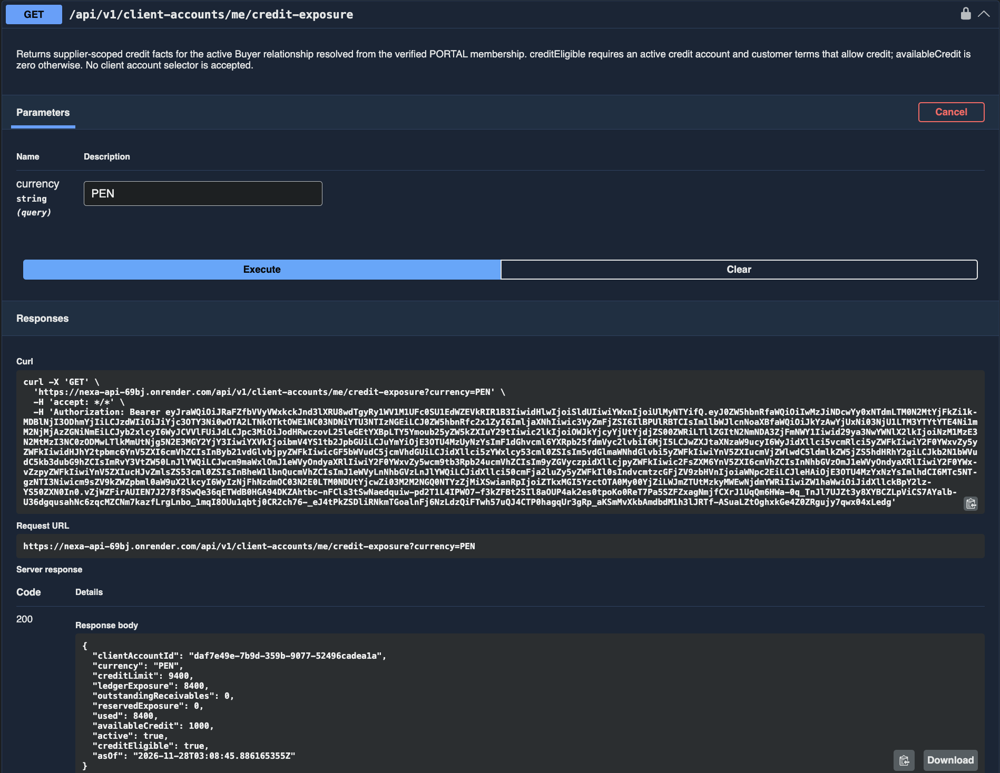

#### 4.2.4.7. Services Documentation Evidence for Sprint Review

Las funcionalidades relacionadas con Sprint 4 requieren servicios que permitan consultar información operativa, organizar cargas, controlar el traspaso de responsabilidad durante el despacho y registrar acciones comerciales autorizadas. Nexa API proporciona contratos REST que establecen las operaciones disponibles, sus condiciones de acceso y las reglas aplicables a cada solicitud.

La documentación técnica distingue las operaciones de consulta de aquellas que modifican información. Las aplicaciones móviles presentan los datos y permiten solicitar acciones, mientras que el servidor conserva la responsabilidad de comprobar permisos, versiones, estados y resultados de negocio.

##### Contratos de servicios relacionados con Sprint 4

La documentación de Nexa API incluye operaciones para organizar cargas de despacho, modificar el orden de las paradas y registrar las decisiones requeridas antes de transferir la responsabilidad de una carga al conductor.

*Operaciones REST documentadas para la planificación y entrega de cargas.*

<table>
  <thead>
    <tr>
      <th scope="col">Método y ruta</th>
      <th scope="col">Funcionalidad</th>
      <th scope="col">Condiciones principales</th>
      <th scope="col">Relación con Sprint 4</th>
    </tr>
  </thead>
  <tbody>
    <tr>
      <td><code>GET /api/v1/dispatch/loads</code></td>
      <td>Consultar cargas dentro del alcance de almacén autorizado.</td>
      <td>Permiso <code>dispatch.read</code> y contexto vigente.</td>
      <td><code>MOB-US-059</code></td>
    </tr>
    <tr>
      <td><code>POST /api/v1/dispatch/loads</code></td>
      <td>Crear una carga con entregas planificadas.</td>
      <td>Permisos <code>dispatch.read</code> y <code>dispatch.schedule</code>; requiere <code>Idempotency-Key</code>.</td>
      <td><code>MOB-US-059</code></td>
    </tr>
    <tr>
      <td><code>GET /api/v1/dispatch/loads/{loadId}</code></td>
      <td>Consultar el detalle de una carga.</td>
      <td>Permiso <code>dispatch.read</code> y acceso autorizado al almacén de origen.</td>
      <td><code>MOB-US-059</code></td>
    </tr>
    <tr>
      <td><code>PUT /api/v1/dispatch/loads/{loadId}/stops</code></td>
      <td>Reemplazar el orden completo de las paradas.</td>
      <td>Permiso <code>dispatch.schedule</code>; requiere <code>If-Match</code> e <code>Idempotency-Key</code>.</td>
      <td><code>MOB-US-059</code></td>
    </tr>
    <tr>
      <td><code>POST /api/v1/dispatch/loads/{loadId}/assignments</code></td>
      <td>Asignar un integrante autorizado de Logistics a todas las paradas de una carga.</td>
      <td>Permiso <code>dispatch.assign</code>; requiere <code>If-Match</code> e <code>Idempotency-Key</code>.</td>
      <td><code>MOB-US-059</code> y <code>MOB-US-060</code></td>
    </tr>
    <tr>
      <td><code>POST /api/v1/dispatch/loads/{loadId}/offers</code></td>
      <td>Ofrecer la carga al conductor asignado.</td>
      <td>Permiso <code>dispatch.schedule</code>; requiere <code>If-Match</code> e <code>Idempotency-Key</code>.</td>
      <td><code>MOB-US-060</code></td>
    </tr>
    <tr>
      <td><code>POST /api/v1/dispatch/loads/{loadId}/handoff-confirmations</code></td>
      <td>Confirmar las condiciones de despacho de una carga.</td>
      <td>Permiso <code>dispatch.schedule</code>; requiere versión vigente y clave de idempotencia.</td>
      <td><code>MOB-US-060</code></td>
    </tr>
    <tr>
      <td><code>GET /api/v1/driver/loads</code></td>
      <td>Consultar cargas asignadas al conductor actual.</td>
      <td>Asignación vigente y permiso <code>dispatch.read</code>.</td>
      <td><code>MOB-US-060</code></td>
    </tr>
    <tr>
      <td><code>POST /api/v1/driver/loads/{loadId}/acceptances</code></td>
      <td>Registrar la aceptación de una carga por el conductor asignado.</td>
      <td>Permiso <code>dispatch.start_route</code>; requiere <code>If-Match</code> e <code>Idempotency-Key</code>.</td>
      <td><code>MOB-US-060</code></td>
    </tr>
  </tbody>
</table>

Estas operaciones se describen en el contrato [Delivery Load API](https://github.com/nexa-suite/api/blob/main/docs/openapi/delivery-loads.md), disponible en el repositorio de servicios de Nexa.

Los servicios de Dispatch y Driver mantienen responsabilidades diferenciadas. La confirmación de despacho y la aceptación del conductor constituyen hechos distintos; ninguno representa por sí mismo la entrega de mercadería al comprador.

Las operaciones documentadas también establecen condiciones para evitar cargas incompatibles o modificaciones basadas en información desactualizada. La comprobación efectiva de estas condiciones depende del contexto autorizado y del estado vigente del servidor.

La presencia de un endpoint en la documentación no demuestra que se haya ejecutado satisfactoriamente en el entorno cloud. Por ello, esta sección describe los contratos identificados, mientras que sus resultados de ejecución requieren evidencias específicas.

##### Creación de una carga de despacho

La operación `POST /api/v1/dispatch/loads` permite crear una carga a partir de Fulfillments autorizados y preparados para despacho. El contrato especifica que la carga agrupa entre dos y veinte elementos compatibles pertenecientes a un mismo almacén.

La solicitud incorpora los identificadores de los Fulfillments, su orden inicial, las versiones esperadas y la declaración de compatibilidad realizada por Dispatch.

*Ejemplo de solicitud documentada para crear una carga.*

```json
{
  "fulfillmentIds": [
    "fulfillment-uuid-1",
    "fulfillment-uuid-2"
  ],
  "stopOrder": [
    "fulfillment-uuid-1",
    "fulfillment-uuid-2"
  ],
  "expectedFulfillmentVersions": {
    "fulfillment-uuid-1": 4,
    "fulfillment-uuid-2": 7
  },
  "reason": "Compatible deliveries for one route",
  "compatibilityAttestation": {
    "capacitySufficient": true,
    "handlingCompatible": true,
    "zoneReasonable": true,
    "noExclusiveTransportRestriction": true,
    "observation": "Dispatch review"
  }
}
```

Los identificadores corresponden a valores ilustrativos del contrato y no a una solicitud ejecutada. La operación requiere una clave de idempotencia, mientras que el servidor verifica la preparación, las restricciones de compatibilidad y el almacén correspondiente.

**Figura**

*Documentación de la creación de cargas de despacho en Swagger UI.*



*Nota.* La captura muestra el encabezado obligatorio `Idempotency-Key` y un ejemplo del cuerpo JSON con dos Fulfillments y sus versiones esperadas. La solicitud no se ejecutó. Elaboración propia.

La respuesta documentada representa una carga creada e incluye su identificador, versión, estado, almacén de origen, paradas y registro de compatibilidad. El ejemplo del contrato utiliza el estado `DRAFT` y la versión inicial `0`.

*Fragmento de la respuesta documentada de creación de una carga.*

```json
{
  "id": "uuid",
  "version": 0,
  "status": "DRAFT",
  "originWarehouseId": "uuid",
  "assignedDriverMembershipId": null,
  "vehicleReference": null
}
```

El fragmento muestra el estado inicial de la carga y la ausencia de un conductor asignado. El contrato completo incluye las paradas, el registro de compatibilidad y el historial de operaciones. La respuesta de detalle y las respuestas de modificación incluyen el encabezado `ETag`, que identifica la versión vigente de la carga.

Para las rutas que contienen `{loadId}`, este parámetro identifica la carga sobre la que se realiza la consulta o modificación. Al cambiar el orden de las paradas, la solicitud incluye `stopOrder` y `reason`. Para asignar un conductor, se utiliza `driverMembershipId` y, opcionalmente, `vehicleReference`.

El servidor también conserva la identidad de quien realizó la declaración de compatibilidad y la fecha de registro. Estos datos no son determinados libremente por el cliente móvil.

##### Control de versiones y resultados de error

Las operaciones que modifican cargas existentes requieren una versión vigente mediante `If-Match` y una clave `Idempotency-Key`. La versión se obtiene de la información devuelta por el servidor.

*Condiciones de respuesta documentadas para las operaciones de cargas.*

| Condición | Resultado documentado | Interpretación |
| --- | --- | --- |
| Versión desactualizada | HTTP 412 | La operación utiliza una revisión que ya no es vigente. |
| Falta de precondiciones requeridas | HTTP 428 | La solicitud no incluye los mecanismos exigidos para controlar la modificación. |
| Conflicto de estado o reutilización incompatible de una clave de idempotencia | HTTP 409 | El servidor rechaza la operación incompatible. |
| Recurso fuera del ámbito de autorización | HTTP 404 | El recurso no se expone fuera del contexto permitido. |

Los resultados anteriores corresponden al contrato de Nexa API. No deben interpretarse como respuestas observadas durante una ejecución de Sprint 4 sin el registro correspondiente.

##### Documentación y disponibilidad del servicio

La documentación de los servicios REST se encuentra en [Nexa API](https://github.com/nexa-suite/api). El entorno publicado dispone de una interfaz [Swagger UI](https://nexa-api-69bj.onrender.com/swagger-ui/index.html), utilizada para consultar las operaciones descritas mediante OpenAPI.

El 25 de noviembre de 2026 se consultó la definición OpenAPI publicada en el entorno cloud de Nexa API. El documento identificó la versión 3.0.3 del servicio y presentó 388 rutas documentadas, incluyendo las correspondientes a las consultas del catálogo y a la gestión de borradores de solicitudes de compra utilizadas en las comprobaciones de Buyer.

**Figura**

*Definición OpenAPI de Nexa API v3.0.3 publicada en Render.*



*Nota.* Consulta de la documentación pública de Nexa API realizada el 25 de noviembre de 2026.

La definición se encuentra disponible en el siguiente enlace: [OpenAPI de Nexa API](https://nexa-api-69bj.onrender.com/v3/api-docs/complete).

Las solicitudes operativas requieren el contexto autorizado de la cuenta que las realiza. El servidor conserva las verificaciones de permisos, estado y concurrencia, mientras que las aplicaciones móviles presentan la información necesaria para solicitar acciones y comprender sus resultados.

La consulta y ejecución de estos endpoints deberán contrastarse con la versión efectiva del contrato desplegado, especialmente cuando existan diferencias entre el código disponible y los servicios habilitados en el entorno público.

*Nota.* Los ejemplos de solicitud y respuesta de cargas se derivan del contrato Delivery Load API y no corresponden a una operación de creación ejecutada sobre la instancia publicada. Elaboración propia.

##### Consulta de exposición crediticia del comprador

Como parte del seguimiento comercial y financiero, Nexa API permite consultar la exposición crediticia de la cuenta asociada al comprador mediante `GET /api/v1/client-accounts/me/credit-exposure`. La operación requiere el permiso `payment.read` y una relación activa en el contexto PORTAL. El parámetro de consulta `currency` permite indicar la moneda; el servidor determina la cuenta autorizada a partir de la sesión, sin recibir un identificador de cliente como parámetro. El contrato se describe en la [documentación OpenAPI de Nexa API](https://github.com/nexa-suite/api/blob/main/docs/openapi/README.md).

El 27 de noviembre de 2026 se ejecutó esta consulta desde Swagger UI con una cuenta de prueba de Buyer en el Workspace ICISA y el parámetro `currency=PEN`. El servidor respondió con HTTP 200 y devolvió un límite de crédito de S/ 9,400, una exposición registrada de S/ 8,400 y un crédito disponible de S/ 1,000. La respuesta indicó también que la cuenta se encontraba activa y era elegible para crédito.

**Figura**

*Consulta de exposición crediticia del comprador en Swagger UI.*



*Nota.* Consulta realizada con datos de prueba en el entorno publicado de Nexa API. Se ocultó el token de acceso en la captura. Elaboración propia.

La consulta evidencia la recuperación de información financiera autorizada desde el servidor. No representa una aprobación de crédito ni la confirmación de un pago.

##### Commits relacionados con la documentación de servicios

Durante el Sprint 4 se actualizaron los archivos de documentación de Nexa API como parte de la preparación de sus publicaciones. Los siguientes commits incluyen modificaciones de la definición OpenAPI versionada en el repositorio.

*Actualizaciones de la documentación OpenAPI durante Sprint 4.*

| Repository | Commit Id | Commit Message | Committed on (Date) |
| --- | --- | --- | --- |
| `nexa-suite/api` | [192cbb8e](https://github.com/nexa-suite/api/commit/192cbb8e2f21e15d9ec1d0006fa0161cd8494c53) | `chore(release): prepare API v3.0.0` | 18 de noviembre de 2026 |
| `nexa-suite/api` | [09242da2](https://github.com/nexa-suite/api/commit/09242da27c72405a36693db43ce69636910d0443) | `chore(release): prepare API v3.0.3` | 19 de noviembre de 2026 |
| `nexa-suite/api` | [8b350dc5](https://github.com/nexa-suite/api/commit/8b350dc5c6a789ab43d5622cc11ca09e1e9ed28b) | `chore(release): prepare API v3.0.4` | 26 de noviembre de 2026 |

*Nota.* Los tres commits registran modificaciones en `docs/openapi/openapi.json`. Las actualizaciones corresponden a la preparación de las publicaciones indicadas y no implican necesariamente la incorporación de nuevos endpoints. Las fechas se presentan según la hora local del Perú (UTC-5). Elaboración propia.
