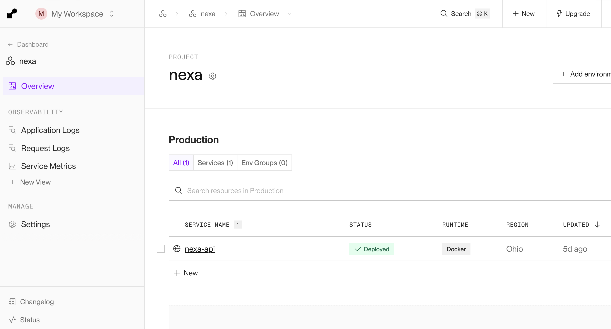
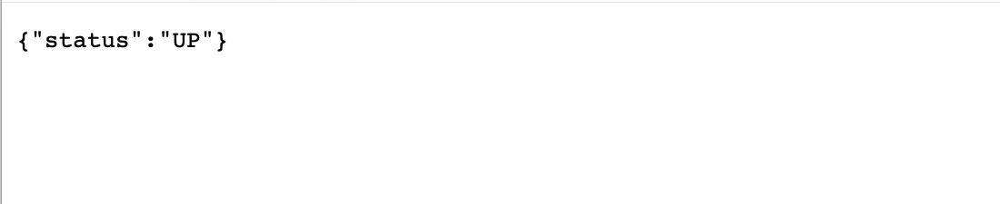
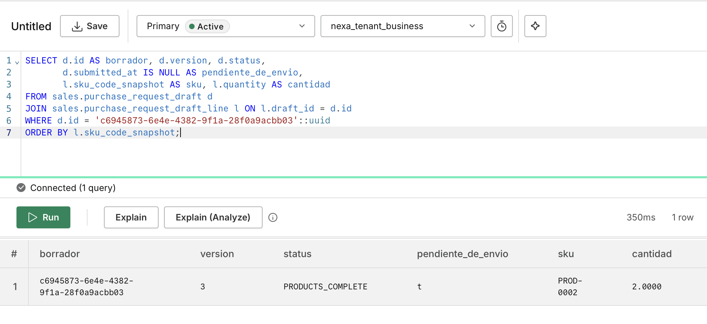
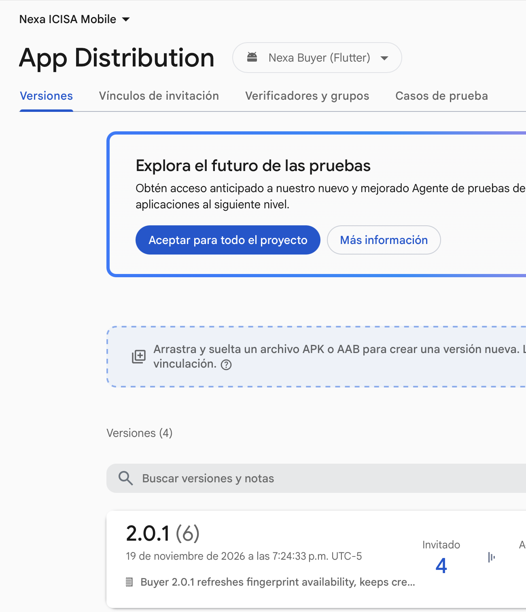
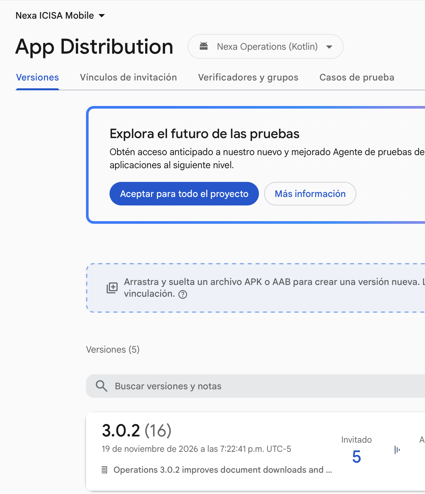

#### 4.2.4.8. Software Deployment Evidence for Sprint Review

Las actividades de despliegue relacionadas con Sprint 4 comprenden la preparación y publicación de versiones Android de Nexa Mobile, así como su integración con los servicios disponibles en Nexa API. Los registros de publicación permiten identificar los artefactos distribuidos, sus versiones, los mecanismos de verificación y los entornos utilizados durante las comprobaciones.

Nexa Mobile mantiene versiones independientes para Buyer Mobile y Operations Android. Por este motivo, la numeración de una publicación del repositorio no debe confundirse con la versión interna de cada aplicación.

##### Publicaciones de Nexa Mobile

Durante el período examinado se registraron publicaciones correspondientes a Nexa Mobile v3.0.0, v3.0.1 y v3.0.2. Cada una documenta paquetes Android destinados a actividades de instalación y validación.

*Publicaciones de Nexa Mobile relacionadas con Sprint 4.*

| Publicación | Buyer Mobile | Operations Android | Características documentadas |
| --- | --- | --- | --- |
| [Mobile v3.0.0](https://github.com/nexa-suite/mobile/releases/tag/v3.0.0) | 1.2.1, build 4 | 1.3.1, build 13 | APK firmadas, navegación localizada, condiciones de uso y comprobaciones de integración ICISA. |
| [Mobile v3.0.1](https://github.com/nexa-suite/mobile/blob/main/RELEASE_NOTES_v3.0.1.md) | 2.0.0, build 5 | 3.0.1, build 15 | Mejoras de presentación de las condiciones de uso y documentación adicional de instalación y funcionamiento. |
| [Mobile v3.0.2](https://github.com/nexa-suite/mobile/blob/main/RELEASE_NOTES_v3.0.2.md) | 2.0.1, build 6 | 3.0.2, build 16 | Ajustes de disponibilidad biométrica, consulta de crédito y tratamiento de documentos en Operations Android. |

Las publicaciones proporcionan trazabilidad de las versiones preparadas para validación. La versión del repositorio y las versiones internas de las aplicaciones representan identificadores diferentes y deben mantenerse diferenciados durante la instalación y las comprobaciones.

##### Artefactos Android y verificación de integridad

Las notas de publicación incluyen los nombres de las APK y sus valores SHA-256. Esta información permite comparar la integridad de los archivos obtenidos con los artefactos documentados.

Las aplicaciones utilizan un certificado de firma destinado a validación Android. La instalación de una actualización sobre una versión existente requiere compatibilidad con el certificado utilizado anteriormente; en caso contrario, se necesita una instalación separada que respete las condiciones del dispositivo.

Buyer Mobile establece Android 7.0 (API 24) como versión mínima documentada, mientras que Operations Android establece Android 10 (API 29).

Estas condiciones describen los paquetes publicados y sus requisitos de instalación. No representan una garantía de funcionamiento satisfactorio en todos los dispositivos compatibles ni equivalen a una distribución productiva mediante una tienda de aplicaciones.

*Artefactos Android y valores SHA-256 documentados en las publicaciones de Nexa Mobile.*

<table>
  <thead>
    <tr>
      <th scope="col">Publicación</th>
      <th scope="col">Aplicación</th>
      <th scope="col">Archivo APK</th>
      <th scope="col">SHA-256 documentado</th>
    </tr>
  </thead>
  <tbody>
    <tr>
      <td rowspan="2">v3.0.0</td>
      <td>Buyer Mobile</td>
      <td><code>nexa-buyer-v3.0.0.apk</code></td>
      <td><code>5f8df54e036627ad879d4d6efaeff30a40a3bdfa16a65293c781ca34b76505e7</code></td>
    </tr>
    <tr>
      <td>Operations Android</td>
      <td><code>nexa-operations-v3.0.0.apk</code></td>
      <td><code>4eca01dee832e27a503247a35aeda16bc5e31f46b730475de20bc378b0ba56f6</code></td>
    </tr>
    <tr>
      <td rowspan="2">v3.0.1</td>
      <td>Buyer Mobile</td>
      <td><code>nexa-buyer-v2.0.0.apk</code></td>
      <td><code>3f700980fab7c71c194049018c9b7ca3c6ee2a35f3da5b7dc73ece66a3cb6c25</code></td>
    </tr>
    <tr>
      <td>Operations Android</td>
      <td><code>nexa-operations-v3.0.1.apk</code></td>
      <td><code>cbc0a9f53c7e78c2418ad37e1afa19138199d2831ef14b9f17b325bf96e9beca</code></td>
    </tr>
    <tr>
      <td rowspan="2">v3.0.2</td>
      <td>Buyer Mobile</td>
      <td><code>nexa-buyer-v2.0.1.apk</code></td>
      <td><code>bf0ca0074620e9af1170b9fe2827605ce2c37233dcd615e977cdfe4659580371</code></td>
    </tr>
    <tr>
      <td>Operations Android</td>
      <td><code>nexa-operations-v3.0.2.apk</code></td>
      <td><code>788ae639871c22430579973bd8b8470b79329d391f0d8d2d315d5684ed94f3b7</code></td>
    </tr>
  </tbody>
</table>

Los valores anteriores corresponden a los SHA-256 publicados en las notas de Nexa Mobile [v3.0.0](https://github.com/nexa-suite/mobile/blob/main/RELEASE_NOTES_v3.0.0.md), [v3.0.1](https://github.com/nexa-suite/mobile/blob/main/RELEASE_NOTES_v3.0.1.md) y [v3.0.2](https://github.com/nexa-suite/mobile/blob/main/RELEASE_NOTES_v3.0.2.md).

La comparación de estos valores con los archivos descargados permite comprobar que los artefactos coincidan con las referencias publicadas. La tabla reproduce los valores documentados y no representa una nueva verificación criptográfica realizada durante la elaboración del informe.

Las diferencias entre el número de versión del repositorio y los nombres de las APK responden al versionamiento independiente de las dos aplicaciones.

##### Despliegue de servicios y conexión con Nexa API

Las aplicaciones móviles utilizan Nexa API como servicio responsable de autenticación, autorización y confirmación de operaciones de negocio. La documentación de Mobile v3.0.0 identifica un entorno de API publicado en Render y registra comprobaciones relacionadas con su disponibilidad y la interacción de los clientes.

Entre las actividades documentadas se encuentran las consultas de disponibilidad, la revisión de la versión OpenAPI y la recuperación de las condiciones de uso móviles. También se comprobó la respuesta de un recurso protegido cuando no se proporcionó una sesión autorizada.

*Comprobaciones de servicios relacionadas con el despliegue.*

| Servicio o entorno | Comprobación documentada | Resultado observado | Alcance |
| --- | --- | --- | --- |
| Nexa API v3.0.0 en Render | Disponibilidad, información OpenAPI y condiciones de uso. | Las notas de Mobile v3.0.0 registran resultados satisfactorios. | Acceso a los servicios específicos examinados. |
| Recurso protegido de Nexa API | Consulta sin sesión autenticada. | HTTP 401. | Rechazo de una consulta sin autorización. |
| Nexa API v3.0.1 en Render | Consultas autenticadas de solicitudes, pedidos e historial de entregas del comprador. | HTTP 200. | Disponibilidad de las consultas evaluadas. |
| Nexa API v3.0.1 en Render | Consultas de exposición crediticia y determinadas listas operativas. | HTTP 503. | Indisponibilidad registrada para los recursos consultados. |

Los resultados corresponden a las verificaciones descritas en las [notas de Mobile v3.0.0](https://github.com/nexa-suite/mobile/blob/main/RELEASE_NOTES_v3.0.0.md) y [v3.0.1](https://github.com/nexa-suite/mobile/blob/main/RELEASE_NOTES_v3.0.1.md). No representan una medición continua de disponibilidad ni acreditan que todas las operaciones de Nexa API funcionen satisfactoriamente en el entorno público.

Las notas de Mobile v3.0.2 identifican posteriormente a Nexa API v3.0.3 como versión relacionada con sus cambios de integración. Esta referencia establece la correspondencia documental entre publicaciones, sin extender los resultados anteriores a verificaciones no registradas.

##### Comprobación del entorno público para TB2

Durante la preparación de TB2 se realizaron comprobaciones sobre la infraestructura pública de Nexa, considerando la disponibilidad de Nexa API en Render y la persistencia de información en PostgreSQL mediante Neon.

El 25 de noviembre de 2026, el panel de Render mostró el servicio `nexa-api` desplegado. Adicionalmente, se consultó el endpoint de disponibilidad del servicio, obteniendo una respuesta HTTP 200 con estado `UP`.

**Figura**

*Servicio Nexa API desplegado en Render.*

**Figura**

*Respuesta de disponibilidad de Nexa API.*

*Nota.* Comprobaciones realizadas el 25 de noviembre de 2026 sobre el entorno público de Nexa API.

[Endpoint de disponibilidad de Nexa API](https://nexa-api-69bj.onrender.com/actuator/health/readiness).

Como parte de las comprobaciones de integración, se consultó directamente la información persistida en Neon correspondiente al borrador de compra generado mediante Nexa API. La consulta de solo lectura permitió identificar el borrador en su versión 3, con una línea correspondiente al SKU `PROD-0002` y una cantidad de dos unidades.

El borrador permaneció pendiente de envío, conservando las modificaciones realizadas durante la prueba.

**Figura**

*Persistencia del borrador de compra en PostgreSQL mediante Neon.*

*Nota.* Resultado de la consulta de solo lectura realizada sobre los datos de prueba empleados en las comprobaciones de Buyer.

La prueba de registro autónomo de la cuenta comercial del comprador devolvió HTTP 503. El perfil cloud de Nexa API v3.0.3 presenta restricciones para esta operación, según la [implementación correspondiente](https://github.com/nexa-suite/api/blob/v3.0.3/src/main/java/com/nexa/api/bootstrap/runtime/boundaries/CloudBuyerSelfAccountReadUseCase.java).

Las comprobaciones realizadas permiten identificar la disponibilidad del servicio y la persistencia de las operaciones evaluadas. El recorrido completo de compra, despacho y recepción mediante ambas aplicaciones conectadas al entorno público requiere una comprobación adicional.

##### Distribución y servicios de notificación

La distribución de las aplicaciones móviles se realizó mediante Firebase App Distribution, permitiendo compartir las compilaciones Android con participantes invitados para actividades de instalación, prueba y validación.

En la consola del proyecto Nexa ICISA Mobile se encuentran registradas las compilaciones Buyer Mobile 2.0.1 (build 6), desarrollada con Flutter, y Operations Android 3.0.2 (build 16), desarrollada con Kotlin y Jetpack Compose.

Ambos paquetes Android también se encuentran disponibles en la publicación [Nexa Mobile v3.0.2](https://github.com/nexa-suite/mobile/releases/tag/v3.0.2), lo que permite mantener la trazabilidad entre los artefactos distribuidos y sus correspondientes versiones.

**Figura**

*Distribución de Buyer Mobile mediante Firebase App Distribution.*

**Figura**

*Distribución de Operations Android mediante Firebase App Distribution.*

*Nota.* Compilaciones Android registradas en Firebase App Distribution al 25 de noviembre de 2026.

La documentación también registra una comprobación de Firebase Cloud Messaging con respuesta HTTP 200 en modo de validación. Sin embargo, esa respuesta no demuestra por sí misma la recepción efectiva de todas las notificaciones originadas por eventos del sistema.

La entrega completa de notificaciones a dispositivos dependía de ajustes adicionales en el servicio y de verificaciones específicas del contexto ICISA. Por ello, no corresponde interpretar la aceptación técnica de una solicitud FCM como confirmación general de entrega al destinatario.

##### Alcance de las evidencias de despliegue

Las publicaciones de Nexa Mobile permiten identificar versiones, artefactos firmados y mecanismos de distribución. Las comprobaciones del API documentan la disponibilidad de determinados servicios en un entorno cloud, mientras que las pruebas de instalación permiten examinar aspectos concretos del funcionamiento de las aplicaciones.

La publicación v3.0.0 también registra limitaciones respecto de las operaciones transaccionales del entorno público. Las verificaciones locales de compra, despacho y recepción no sustituyen la comprobación del recorrido completo sobre la infraestructura desplegada.

Asimismo, las notas de publicación mantienen diferenciada la validación realizada mediante emuladores de la aceptación en dispositivos físicos y de una eventual distribución iOS.

En consecuencia, la evidencia presentada sustenta la existencia de publicaciones móviles y comprobaciones de despliegue específicas, sin afirmar la disponibilidad integral del sistema ni su preparación para producción.
