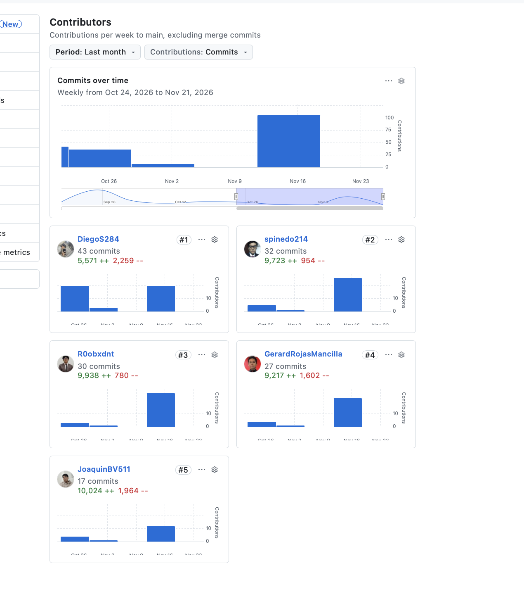
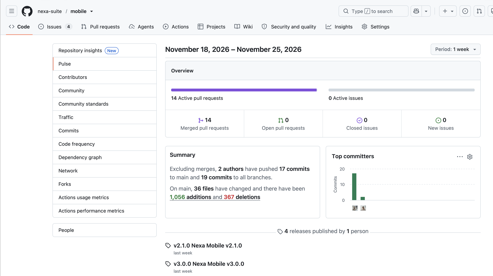
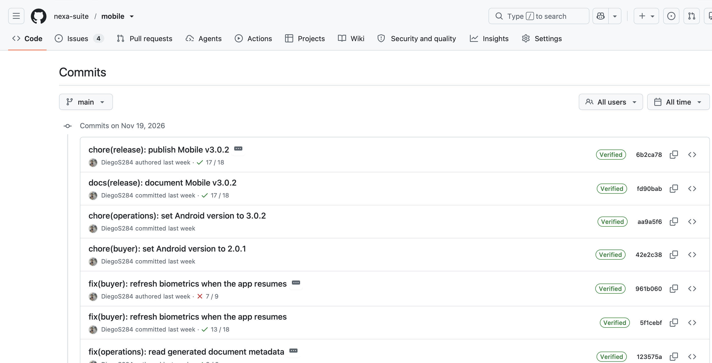

#### 4.2.4.9. Team Collaboration Insights during Sprint

La colaboración técnica relacionada con Sprint 4 se refleja en las actividades de integración, revisión y publicación registradas en los repositorios Nexa Mobile y Nexa API. GitHub permitió organizar modificaciones de Buyer Mobile y Operations Android, ejecutar comprobaciones automatizadas y conservar el historial de los cambios incorporados.

Los Pull Requests proporcionan referencias sobre el alcance de las propuestas, las comprobaciones registradas y la revisión del código. Estos elementos permiten examinar la coordinación técnica relacionada con la integración de funcionalidades y la preparación de versiones destinadas a validación.

##### Pull Requests relacionados con Sprint 4

Entre los registros examinados se encuentran propuestas de integración funcional y publicaciones posteriores de Nexa Mobile y Nexa API. La siguiente tabla presenta su propósito y las actividades documentadas.

*Pull Requests relacionados con el desarrollo y la publicación de Sprint 4.*

| Pull Request | Trabajo registrado | Información de integración y revisión |
| --- | --- | --- |
| [PR #78](https://github.com/nexa-suite/mobile/pull/78) | Integración de funcionalidades de Buyer Mobile y Operations Android, incluyendo notificaciones, operaciones de almacén, pagos y consultas offline protegidas. | Documenta verificaciones técnicas, comprobaciones locales y una revisión aprobada. |
| [PR #81](https://github.com/nexa-suite/mobile/pull/81) | Preparación de la publicación Nexa Mobile v3.0.0. | Relaciona los paquetes Android, instrucciones de instalación y comprobaciones del entorno ICISA. |
| [PR #85](https://github.com/nexa-suite/mobile/pull/85) | Preparación de la publicación Nexa Mobile v3.0.1. | Documenta ajustes de presentación y la preparación de paquetes Android para validación. |
| [PR #90](https://github.com/nexa-suite/mobile/pull/90) | Preparación de la publicación Nexa Mobile v3.0.2. | Incluye correcciones relacionadas con autenticación biométrica, información comercial y documentos. |
| [API PR #152](https://github.com/nexa-suite/api/pull/152) | Continuidad de las operaciones de preparación de almacén. | Mantiene visibles las tareas durante la preparación y registra 14 pruebas de integración satisfactorias. Fusionado el 18 de noviembre de 2026. |
| [API PR #153](https://github.com/nexa-suite/api/pull/153) | Registro de evidencias de transferencias bancarias del comprador. | Documenta comprobaciones de autorización y pruebas de integración del registro de evidencias. Fusionado el 18 de noviembre de 2026. |
| [API PR #173](https://github.com/nexa-suite/api/pull/173) | Publicación de Nexa API v3.0.4. | Incluye ajustes de las cabeceras de versión de solicitudes de compra y la habilitación de favoritos del catálogo mediante configuración. Fusionado el 26 de noviembre de 2026. |

La secuencia de estos registros permite reconocer actividades de integración funcional y preparación de versiones sucesivas. La publicación de una versión conserva una relación con el código fuente correspondiente, mientras que las revisiones y comprobaciones permiten evaluar aspectos técnicos del cambio.

No obstante, el registro de un Pull Request no demuestra automáticamente el cumplimiento de todos los criterios de aceptación de las historias vinculadas.

##### Evidencia de revisión del código

El historial de Pull Requests registra aprobaciones efectuadas durante la integración y preparación de las publicaciones móviles.

En los Pull Requests #78, #81, #85 y #90 se identificaron revisiones aprobadas por la cuenta `spinedo214`. Estas aprobaciones permiten reconocer una actividad concreta de revisión técnica dentro del proceso de integración.

*Revisiones registradas en Pull Requests de Nexa Mobile.*

| Pull Request | Revisor registrado | Resultado de revisión | Relación con el trabajo |
| --- | --- | --- | --- |
| [PR #78](https://github.com/nexa-suite/mobile/pull/78) | `spinedo214` | Approved | Integración de funcionalidades móviles y comprobaciones asociadas. |
| [PR #81](https://github.com/nexa-suite/mobile/pull/81) | `spinedo214` | Approved | Preparación de Nexa Mobile v3.0.0. |
| [PR #85](https://github.com/nexa-suite/mobile/pull/85) | `spinedo214` | Approved | Preparación de Nexa Mobile v3.0.1. |
| [PR #90](https://github.com/nexa-suite/mobile/pull/90) | `spinedo214` | Approved | Preparación de Nexa Mobile v3.0.2. |

Las aprobaciones documentan la revisión registrada en GitHub. No sustituyen las pruebas automatizadas, las comprobaciones funcionales ni la aceptación de producto.

##### Integración continua y coordinación técnica

El candidato utilizado para la publicación Mobile v3.0.0 cuenta con ejecuciones satisfactorias de los workflows de Buyer Flutter y Operations Android.

Los resultados se encuentran disponibles en [Nexa Buyer Flutter verification](https://github.com/nexa-suite/mobile/actions/runs/44398489580) y [Operations Android verification](https://github.com/nexa-suite/mobile/actions/runs/44398489585).

Estas comprobaciones permitieron evaluar las configuraciones y el código de ambas aplicaciones sobre una revisión determinada. Su integración con GitHub proporciona un mecanismo común para identificar fallos técnicos antes de preparar los artefactos de distribución.

La combinación de revisiones y verificaciones automatizadas favorece la trazabilidad del proceso de integración. Sin embargo, las comprobaciones satisfactorias únicamente sustentan el alcance ejecutado por cada workflow.

##### Actividad colaborativa registrada en GitHub

La participación del equipo durante el desarrollo de Nexa Mobile se complementa con los indicadores disponibles en GitHub Insights. Estos registros permiten identificar las contribuciones realizadas sobre el repositorio y las actividades de integración durante los intervalos consultados.

La vista Contributors, consultada el 25 de noviembre de 2026, presenta la actividad de los cinco integrantes del equipo durante el periodo comprendido entre el 24 de octubre y el 21 de noviembre de 2026.

**Tabla**

*Contribuciones registradas en Nexa Mobile.*

| Integrante (GitHub) | Commits registrados |
| --- | ---: |
| DiegoS284 | 43 |
| spinedo214 | 32 |
| R0obxdnt | 30 |
| GerardRojasMancilla | 27 |
| JoaquinBV511 | 17 |
| **Total** | **149** |

*Nota.* Información correspondiente al intervalo seleccionado en GitHub Contributors, considerando los commits de la rama principal y excluyendo los commits de merge. El intervalo incluye actividad anterior al Sprint 4 y no representa el total de contribuciones de dicho sprint.

**Figura**

*Participación de los integrantes en el repositorio Nexa Mobile.*

La actividad registrada permite identificar contribuciones de los cinco integrantes del equipo. Las diferencias en el número de commits deben interpretarse considerando las responsabilidades asignadas, el alcance de las modificaciones y las actividades de revisión e integración.

Por otra parte, GitHub Pulse registró 14 Pull Requests fusionados, 17 commits en la rama principal y 19 commits considerando todas las ramas durante el periodo del 18 al 25 de noviembre de 2026, excluyendo los commits de merge del conteo de commits.

**Figura**

*Actividad reciente de desarrollo e integración en Nexa Mobile.*

El historial de la rama principal complementa estos indicadores mediante el registro de los cambios incorporados y la publicación de Nexa Mobile v3.0.2.

**Figura**

*Historial de commits de la rama principal de Nexa Mobile.*

Los indicadores de Contributors y Pulse reflejan periodos distintos y corresponden únicamente a Nexa Mobile. Los registros de Nexa API complementan la evidencia de integración entre los clientes móviles y el servidor. La cantidad de commits no constituye una medida directa del esfuerzo ni de la calidad de las contribuciones.
