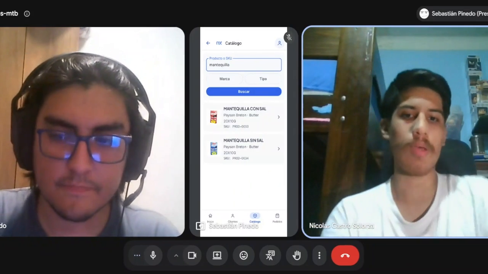

### 4.3.2. Registro de Entrevistas

Durante AV2 se registró una primera entrevista de validación mediante videollamada, con demostración de Nexa Operations Mobile y participación de un usuario con experiencia en atención comercial.

#### Entrevista de validación AV2-VAL-01

*Información de la primera entrevista registrada.*

| Campo | Registro |
| --- | --- |
| Participante | Nicolás Castro-Solorza |
| Edad | 23 años |
| Ocupación | Cajero y recepcionista en Tottus |
| Distrito de residencia | La Victoria |
| Entrevistador | Sebastián Pinedo |
| Aplicación | Nexa Operations Mobile |
| Cuenta utilizada | Sales |
| Modalidad | Demostración guiada mediante videollamada |
| Fecha de realización | 12/11/2026 |
| Inicio en la grabación | 00:00:00 |
| Duración | 00:11:14 |
| Archivo audiovisual | `Upc-Pre-202602-1Acc0238-4949-Nexa-Team-Validation-Av2.mp4` |
| Consentimiento | Aceptación verbal registrada al inicio para uso académico |
| Publicación en YouTube | [Ver entrevista de validación AV2](https://youtu.be/eLa5VMzP484) |

#### Evidencia audiovisual

*Entrevista de validación con demostración del catálogo de Nexa Operations Mobile.*

*Figura. Registro de la demostración guiada durante la búsqueda de mantequilla con sal y sin sal. Se observa la aplicación compartida por el entrevistador y la participación del entrevistado.*

#### Desarrollo de la sesión

La entrevista comenzó con la presentación de Nexa y la solicitud de consentimiento para utilizar el registro con fines académicos. Posteriormente, el participante explicó que en su trabajo utiliza un sistema de búsqueda mediante palabras clave para localizar productos solicitados por los clientes. Señaló que los productos con características muy específicas pueden requerir filtros adicionales y aumentar el tiempo de atención.

Durante la demostración de Nexa Operations Mobile, el entrevistador ingresó a la sección de clientes y buscó al Restaurante La Cava Fría SAC. Se mostró la relación comercial correspondiente y su estado activo.

Después se accedió al catálogo para realizar una búsqueda de queso. El participante observó los resultados y comentó la utilidad de identificar productos mediante el nombre y otros atributos.

El siguiente ejercicio consistió en buscar mantequilla y distinguir entre una opción con sal y otra sin sal. Ante la pregunta del entrevistador, el participante identificó verbalmente la alternativa sin sal y valoró que la denominación del producto fuera directa. También destacó la importancia de visualizar la marca, el gramaje y el SKU.

Al evaluar el recorrido completo, manifestó que la navegación le había parecido sencilla y que no encontró dificultades importantes para reconocer los botones mostrados. Como oportunidad de mejora, sugirió utilizar una diferenciación visual más marcada entre algunas secciones y controles.

Finalmente, señaló que la información de stock es fundamental antes de comprometer una venta. Explicó que ofrecer un producto sin comprobar su disponibilidad puede generar problemas durante la atención. También mencionó el valor de contar con información adicional, como datos de vencimiento y una descripción más detallada del producto.

#### Síntesis de apreciaciones

| Aspecto | Apreciación del participante | Alcance de la evidencia |
| --- | --- | --- |
| Búsqueda de productos | Valoró la localización mediante palabras clave. | Opinión durante la demostración. |
| Identificación de alternativas | Distinguió verbalmente mantequilla con sal y sin sal. | Respuesta a una pregunta basada en resultados visibles. |
| Información comercial | Consideró útiles la marca, el gramaje y el SKU. | Valoración de atributos mostrados en el catálogo. |
| Navegación | Describió el recorrido como sencillo. | Percepción del participante, sin ejecución autónoma. |
| Presentación visual | Sugirió diferenciar mejor algunos colores y secciones. | Recomendación cualitativa, sin medición de accesibilidad. |
| Disponibilidad | Consideró necesario confirmar el stock antes de vender. | Necesidad comercial expresada; no demuestra ausencia global de esta funcionalidad. |
| Detalle de producto | Propuso incorporar o facilitar una descripción adicional. | Sugerencia de mejora, sin comprobar otras pantallas de detalle. |

#### Alcance y limitaciones

La evidencia corresponde a una entrevista con un participante y una demostración guiada. El entrevistado no operó directamente la aplicación, por lo que la sesión no permite medir autonomía, tiempo de ejecución, tasa de éxito ni recuperación ante errores.

Las opiniones recopiladas permiten identificar aspectos valorados y oportunidades de revisión, pero no constituyen pruebas de aceptación funcional ni validación representativa de los segmentos objetivo.

La evaluación preliminar de las recomendaciones se desarrolla en la sección 4.3.3.
