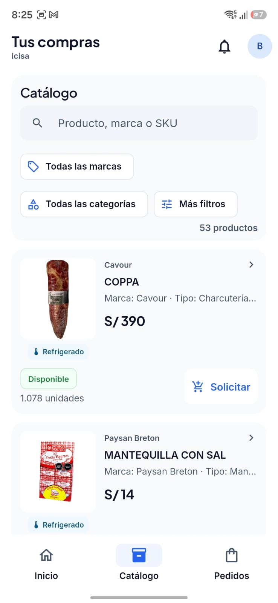

# Video About the Product

El video *About the Product* presenta la propuesta de Nexa mediante una demostración de las aplicaciones móviles que forman parte de la solución. Esta primera versión audiovisual corresponde al Avance 2 (AV2) del curso Aplicaciones para Dispositivos Móviles.

La presentación permite conocer las interfaces de Nexa Operations Mobile y Nexa Buyer Mobile, dos aplicaciones orientadas a necesidades diferentes dentro de los procesos comerciales y operativos de empresas B2B. Ambas mantienen una identidad visual compartida y ofrecen recorridos adaptados a sus respectivos usuarios.

El material audiovisual complementa la documentación de implementación del Capítulo IV y permite observar algunas de las funcionalidades disponibles en las versiones presentadas.

## Contenido del video

El video comienza con Nexa Operations Mobile, aplicación nativa Android desarrollada con Kotlin y Jetpack Compose. Inicialmente se presenta su pantalla de bienvenida y el formulario de inicio de sesión.

Posteriormente, se muestra la pantalla principal correspondiente al área de almacén, donde se encuentran opciones relacionadas con la consulta de inventario y la identificación de productos. La navegación permite visualizar cómo se organiza la información para apoyar las actividades del personal operativo.

En la segunda parte se presenta Nexa Buyer Mobile, aplicación multiplataforma desarrollada con Flutter y Dart, orientada a compradores empresariales. La demostración incluye las pantallas de bienvenida, inicio de sesión y navegación principal.

También se presenta el catálogo de productos, donde el comprador puede consultar información comercial, identificar productos y revisar los datos de disponibilidad mostrados por la aplicación. Finalmente, se observa el acceso a la sección de pedidos y otros elementos de navegación de la experiencia Buyer.

Las escenas corresponden a funcionalidades e interfaces mostradas durante la grabación. La presencia de una pantalla no implica que todos los procesos comerciales u operativos estén completamente disponibles o hayan superado una validación integral.

*Secuencias principales del video About the Product.*

| Secuencia | Aplicación | Contenido presentado |
| --- | --- | --- |
| Presentación inicial | Operations Mobile | Pantalla de bienvenida e inicio de sesión. |
| Navegación operativa | Operations Mobile | Vista principal de almacén, inventario e identificación de productos. |
| Presentación del comprador | Buyer Mobile | Pantalla de bienvenida, inicio de sesión y navegación principal. |
| Consulta comercial | Buyer Mobile | Catálogo, información de productos y disponibilidad mostrada en pantalla. |
| Navegación de pedidos | Buyer Mobile | Acceso a la sección de pedidos. |

## Evidencia audiovisual y publicación

La primera versión del video está publicada en YouTube y permite consultar los recorridos presentados durante el AV2.

Como referencia visual se incluye una captura existente de Nexa Buyer Mobile correspondiente a las evidencias de Sprint 3. La imagen muestra una de las interfaces incluidas en la presentación audiovisual y complementa el enlace al video.

*Vista del catálogo de productos de Nexa Buyer Mobile.*

*Figura. Captura de la interfaz del catálogo de Nexa Buyer Mobile, utilizada como referencia visual de una de las funcionalidades presentadas en el video About the Product.*

**Información del video:**

- **Entrega:** AV2 — Primera versión de About the Product.
- **Duración:** 02:12.
- **Enlace:** [Ver video en YouTube](https://www.youtube.com/shorts/G2eSdN8vkjY).

El video presenta una aproximación visual a las aplicaciones Nexa Operations Mobile y Nexa Buyer Mobile, mostrando sus interfaces y algunos recorridos representativos.

Esta evidencia complementa las capturas, pruebas y registros de implementación del informe. Su propósito es comunicar las características del producto mediante una presentación audiovisual, sin sustituir las pruebas funcionales ni las sesiones de validación con participantes de los segmentos objetivo.
