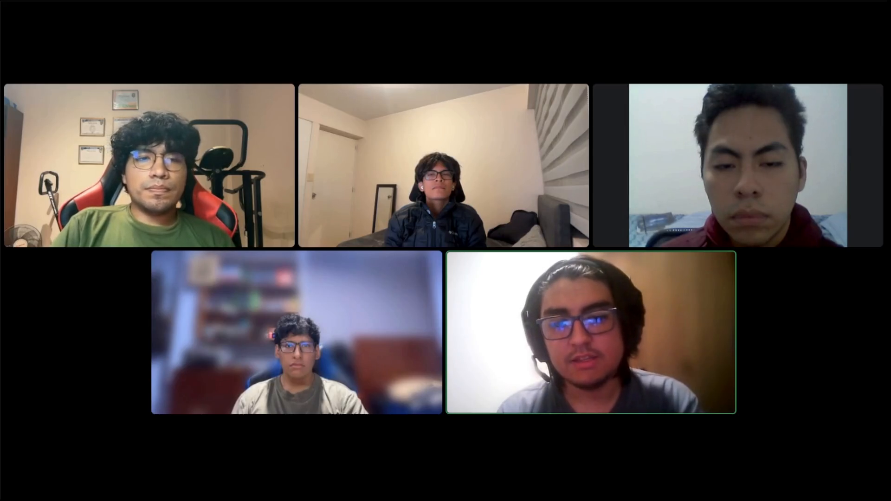

# Video About the Team

El video *About the Team* presenta a los cinco integrantes de nexa-team mediante una grabación grupal realizada en modalidad virtual. Esta primera versión audiovisual forma parte de las evidencias preparadas para el Avance 2 (AV2) del proyecto Nexa.

El registro permite visualizar la participación conjunta del equipo y complementa la documentación del trabajo colaborativo presentada en el Front Matter del Project Report.

## Participación del equipo

La grabación muestra una videollamada con la participación de los cinco integrantes del proyecto:

- Pinedo Sanchez, Sebastián Martín.
- Rojas Mancilla, Gerard Gianpier.
- Torrejón De Los Santos, Gino Rodrigo.
- Verde Bueno, Joaquín Francisco.
- Yucra Sandoval, Diego Sebastián.

Las responsabilidades, contribuciones y aprendizajes correspondientes a AV2 se encuentran documentados en las secciones *Student Outcome* y *Project Report Collaboration Insights*.

Esta primera versión constituye evidencia audiovisual de la participación grupal. Las responsabilidades individuales y los resultados técnicos del proyecto se sustentan en los registros documentales de sus respectivas secciones.

## Evidencia audiovisual y publicación

*Participación de los integrantes de nexa-team en la grabación de About the Team.*

*Figura. Captura de la videollamada correspondiente a la primera versión del video About the Team.*

**Información del video:**

- **Entrega:** AV2 — Primera versión de About the Team.
- **Duración:** 04:40.
- **Formato:** MP4, orientación horizontal.
- **Participantes:** 5 integrantes de nexa-team.
- **Publicación:** [Ver About the Team en YouTube](https://youtu.be/ixMt-g-OH6Q).

El video complementa las evidencias de colaboración del equipo presentadas en el informe y constituye el registro audiovisual de About the Team correspondiente a AV2.
