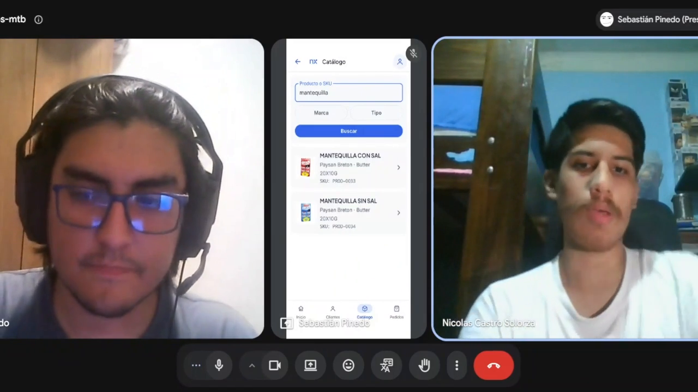

# Video App Validation

El video *App Validation* presenta la primera entrevista de validación realizada durante AV2, orientada a recoger opiniones sobre la experiencia de consulta de clientes y búsqueda de productos en Nexa Operations Mobile.

La sesión contó con la participación de Nicolás Castro-Solorza, de 23 años, quien trabaja como cajero y recepcionista en Tottus. La aplicación se presentó mediante una cuenta Sales y una demostración guiada por el entrevistador.

## Desarrollo de la validación

Durante la entrevista se mostró la consulta de un cliente comercial, la revisión de su relación activa y la búsqueda de productos mediante palabras clave.

Posteriormente, el participante respondió preguntas relacionadas con la identificación de productos similares, la claridad de la navegación y la información necesaria para atender una consulta comercial.

La sesión permitió recoger una valoración positiva de la búsqueda de productos y tres oportunidades de revisión: la diferenciación visual de algunos elementos de la interfaz, la importancia de confirmar la disponibilidad de stock y el acceso a información complementaria de los productos.

Debido a que el entrevistador manejó la aplicación, esta actividad corresponde a una evaluación guiada. No se considera una prueba de ejecución autónoma ni una validación completa de los segmentos objetivo de Nexa Mobile.

## Evidencia audiovisual

*Primera entrevista de validación de Nexa Operations Mobile durante AV2.*

*Figura. Demostración guiada del catálogo de Operations Mobile durante la entrevista de validación.*

**Información del video:**

- **Entrega:** AV2 — Primera entrevista de validación.
- **Fecha de la sesión:** 12 de noviembre de 2026.
- **Duración:** 11 minutos y 14 segundos.
- **Aplicación:** Nexa Operations Mobile.
- **Cuenta utilizada:** Sales.
- **Participantes entrevistados:** 1.
- **Publicación:** [Ver entrevista de validación en YouTube](https://youtu.be/eLa5VMzP484).

## Resultados de la validación

El participante valoró la facilidad para localizar productos y distinguir alternativas por sus características. Asimismo, propuso revisar algunos aspectos visuales y ampliar la información comercial disponible durante la consulta.

Estos resultados constituyen evidencia cualitativa preliminar. Las observaciones y recomendaciones se desarrollan en las secciones 4.3.2, *Registro de Entrevistas*, y 4.3.3, *Evaluaciones según heurísticas*, del Capítulo IV.

La cobertura de validación permanece parcial, dado que durante AV2 se realizó una sola entrevista.
